

# Saycode Desktop

### 話せば、ソフトウェアになる。

**社内のAIサブスクリプションとAPIを一箇所で管理する運用レイヤー** —
チームがすでに使い慣れた最新モデル(Claude · Codex · Grok · opencode)はそのままに、
アカウント・権限・モデル選択・コスト・デプロイを会社が一つの画面で管理します。
**管理は一画面で、コストは半分に。**

[English](README.md) | [한국어](README.ko.md) | [中文](README.zh.md) | **日本語**

 

### [⬇️ macOS 版をダウンロード (Apple Silicon)](https://github.com/buzzni/saycode-desktop-releases/releases/download/v0.1.105/Saycode-0.1.105-arm64.dmg)

*署名・公証済み DMG · 自動アップデート内蔵 · アカウント不要ですぐ開始*

### 📘 ガイドブック — [Web で読む](https://buzzni.github.io/saycode-desktop-releases/guidebook/en/) · [PDF をダウンロード](docs/guidebook/saycode-guidebook-en.pdf) · [Markdown](docs/GUIDE.md)

*ガイドブックは英語版と[韓国語版](docs/GUIDE.ko.md)があります。*

 

https://github.com/user-attachments/assets/a323660d-93d9-45a6-ac1b-85dc2f664523

*🔊 音声をオンにしてご覧ください — 実際の v0.1.81 の画面で作った 92 秒の紹介動画（英語字幕・BGM）です。その後 v0.1.89 で画面のスタイルが新しくなったため、動画内の見た目とは少し異なる場合があります · [MP4 をダウンロード](docs/assets/saycode-intro-en.mp4) · [字幕 SRT](docs/assets/saycode-intro-en.srt)*

<!-- release-notes:start -->
## 新機能と変更点

- [最新リリースノート](docs/releases/v0.1.41.ko.md)（韓国語）
- [リリース履歴](docs/releases/README.ko.md)（韓国語）
<!-- release-notes:end -->

---

## 30 秒でわかる Saycode

| 🗣️ **一文でアプリになる** | 🗂️ **エージェント艦隊を一つのボードで** | ✅ **レビュー → コミット → 完了まで** |
|:---|:---|:---|
| 欲しいものを伝えるだけで、エージェントが**あなたの Mac 上で**本物のコードを書いてコマンドを実行し、回答の下に**変更されたファイルのカードと結果のプレビュー**をすぐに表示します。 | Claude · Codex · Grok · opencode の複数の会話を**カンバン形式の作業ボード**で指揮します。カードをドラッグ&ドロップすれば、次の指示やレビュー依頼が送られます。 | **作業を完了**メニューひとつで、レビューから Commit & PR まで進み、終わった会話は**アーカイブ&完了**で整理されます。 |

> **v0.1.91 — 一段と落ち着いた画面、計画から始める会話。** v0.1.81 以降の 10 リリースでの主な変化:
>
> - **新しいスタイルの落ち着いた画面** — v0.1.89 ですべての画面のスタイルを新しく統一しました。作業ボードはウィンドウ幅 1440px でも6列が一画面に収まり、プロフィールメニューの**言語**から 한국어 · English · 日本語 · 简体中文 をすぐに切り替えられます。
> - **🧭 計画モード · コンテキスト圧縮** — 入力欄の **⋯ → 計画モード**をオンにすると、AI がファイルを編集する前に**計画カード**を先に見せ、**作業を開始**を押して初めて作業します。入力欄の下のコンテキストゲージ(`N%`)を押すと内訳が見られ、**会話を圧縮**で長い会話を縮められます。
> - **下部ターミナル · ファイルの直接編集 · 会話に貼り付け** — **⌘J** でどの画面でも下にターミナルを開き、ファイルをタブで開いてそのまま編集して **⌘S** で保存し、コードやターミナルの出力は **⌘L**、ファイルは `@` で会話に貼り付けます。
> - **応答中も思いのまま** — AI が回答している間に送ったメッセージを**キューに入れる · 今すぐ反映 · 中断して送信**から選べ、**メッセージ送信キー**(Enter / ⌘Enter)も決められます。アカウントメニューの**開発者モード**で、会話を複数のタブで開き、最大 4×4 のウィンドウに分けて見られます。
> - **💸 有料アカウントなしで無料スタート** — 有料の AI アカウントがなくても **無料モデル(opencode)** ですぐに始められます。無料モデルは OpenCode が期間限定で提供しており、モデルごとにデータの扱いが異なります([ガイドブック](https://buzzni.github.io/saycode-desktop-releases/guidebook/en/#205-how-much-can-i-use-free-models)、英語)。
> - **組織・ログイン専用** — モデルメニューの**使用する接続**で、組織が割り当てた **saycode プラン**(定額プラン)と**内部AI**(社内 LLM)を選び、所有するクラウドプロジェクトは**デプロイ**ボタンでテスト・本番に公開します。

---

## なぜ Saycode なのか？

社員はすでに ChatGPT や Claude で素早く働いています。しかし、サブスクリプションと API 契約は部署・個人ごとに
散らばり、誰がどのモデルをどれだけ使っているか会社にはわかりません。**制限すれば生産性が止まり、
野放しにすれば統制を失います。** 成果物は個人の PC に残ったまま、退職とともに消えていきます。

Saycode は**モデルと競合する製品ではありません。** チームがすでに知っている最新モデルをそのまま使いながら、
組織に必要な管理・セキュリティ・デプロイをその上に加える**運用レイヤー**です。

| | 個人で直接契約する場合 | **Saycode で一緒に使う場合** |
|---|---|---|
| アカウント・コスト | 個人ごとの支払い・アカウントが分散し、管理者は利用状況を把握できない | **同じモデルを中央管理・監査・コスト統制のもとで利用** |
| プロンプト・成果物 | 個人アカウントに紐づき、退職すると消える | **組織の資産として蓄積 — 担当者が変わっても引き継がれる** |
| モデル選択 | 一つのモデルに縛られ、より良いモデルが出ても切り替えにくい | **リクエストごとに最適なモデルを自動選択、ベンダーロックインなしで新モデルをすぐ利用** |
| コード・データ | 外部クラウドへ流出 | **会社が指定した作業PCに常駐 + エンドツーエンド暗号化(E2EE)** |
| 複数エージェントの運用 | チャットウィンドウをひとつずつ Alt-Tab | **カンバン型の作業ボードで艦隊全体を一画面で指揮** |
| 成果物 | レビュー待ちのブランチ | **作業を完了 → レビュー → Commit & PR → 社内 URL へデプロイ** |

一人で使うなら、個人契約が正解です。**組織で一緒に使う瞬間、必要なものが変わります。**

### 会社の管理者が実際にコントロールする4つのこと

| | 何を | どうやって |
|---|---|---|
| **誰が使えるか** | アカウント・シート | 従業員ごとにアカウントを発行・回収します。会社が持つ AI サブスクリプションや API を誰に割り当てるかも会社が決めます。異動・退職時は即座に回収。 |
| **どの AI を使えるか** | モデル・作業PCポリシー | チーム・作業PCごとに使える AI を選んで開放し、個人ごとに例外を設定できます。会社アカウントでシングルサインオン(SSO)。 |
| **どれだけ使っているか** | 利用量・コスト | 誰がどれだけ使い、コストがいくらかかったかを一画面で確認。予算上限に近づくと通知し、超えると自動停止。 |
| **何が起きたか** | 監査ログ | 誰がいつ何をしたかの記録が残ります。検索してファイルへ書き出せます。 |

### 私たちが先に導入し、測定しました

Buzzni の開発組織が Saycode 上で開発・運用しながら実測した結果です。

| **49%** | 単純なリクエスト **~90%** | 日常的な作業 **~80%** |
|:---:|:---:|:---:|
| 月間 AI 実行コスト削減 — 作業量はそのままに、コストだけを削減 | 誤字・文言修正は軽量モデルが処理 | 機能実装・リファクタリングは中位モデルが処理 |

> 測定条件: Buzzni 開発組織 35名 · 2026年6〜7月 · サブスクリプション・API 実行コスト基準 · 同一作業量を維持。
> ターンあたりの削減率は全体の削減率とは異なる指標です。お客様の環境での削減率を保証するものではなく、
> 導入初月に一緒にベースラインを測定します。

---

## Agent IDE(Orca など)とは何が違うのか？

[Orca](https://www.onorca.dev) のようなツールは **Agent IDE** であり、開発者のコーディングループに
集中しています — worktree 単位での並列エージェント実行、diff、レビュー、エディタとの深い統合。その領域を
非常によくこなしており、一部は組織単位の導入とガバナンスまで提供します。そのループが皆さんの課題であれば、
良い選択です。

Saycode が向き合う問いは異なります。エージェントがコードを作り終えた*その後*に始まる問いです:

> **Agent IDE は開発者がより多くのエージェントを動かせるようにします。
> Saycode はそのエージェントが作った成果物を会社の資産にします。**

| | Agent IDE(Orca など) | **Saycode** |
|---|---|---|
| 主な焦点 | 開発者のコーディングループ | **会社のデリバリーループ** — 制作 → レビュー → デプロイ → 共有 → 引き継ぎ |
| 管理の単位 | Repo · worktree · エージェントセッション | **組織 · チーム · プロジェクト · 作業PC · シート · デプロイ済み成果物** |
| 「デプロイ」の意味 | エージェントツールを組織に安全に導入・展開すること | **作った成果物をチームが開く社内 URL でサービスすること** |
| 一般的なゴール | レビューを経て Git にマージされた変更 | **共有・引き継ぎ可能な、実際に稼働中の社内サービス** |
| AI モデルコスト | 利用量の追跡、アカウント切り替え | **難易度ベースの自動ルーティング + サブエージェント委任 — 組織全体で49%削減を実測** |
| 届く相手 | 主に開発者 | **会社の全構成員** — 開発者、企画者、運用担当者 |

両者は並列エージェント、worktree、リモート実行、ローカルファーストのセキュリティという点で重なっています。
したがって、それらは選択の決め手にはなりません。Saycode がその上に加えるのは**運用レイヤー**です:

- **会社の所有権** — プロジェクト、セッション、企画ドキュメント、作業PCは個人のノート PC ではなく組織に
  帰属します。担当者が退職したりチームを異動しても、成果物は検索でき、引き継がれます。
- **社内デプロイ** — ワンクリックで固定の社内 URL(SSL 自動)にデプロイされます。成果物は
  レビュー待ちのブランチではなく、チームが今日すぐ開ける実際のツールになります。
- **共有・引き継ぎ** — 同僚が閲覧し、複製し、磨き上げ、変更を反映し直します。他のチームが完成させた
  プロジェクトは作り直す対象ではなく、出発点になります。
- **コスト運用** — リクエストの難易度に応じて最も安価で適切なモデルへ自動ルーティングし(セッションが
  行き詰まったときだけ上位モデルへ昇格)、機械的なサブタスクはより軽量なモデルのサブエージェントに
  委任し、これらすべてが中央管理された組織共用PCの上で動きます。メッセージごとにどのモデルが
  なぜ選ばれたかがバッジで表示されます。会社全体の AI コストを「確認する」のではなく「運用する」のです。

**いつ何を使えばいいか:** 自分のリポジトリで最も深い並列エージェントコーディング体験を求めるなら、
Agent IDE も良い選択です — 両方を併用しない理由もありません。AI が作ったソフトウェアが
**会社のインフラ**になること — 社内にデプロイされ、チーム間で共有され、引き継ぎを経ても生き残り、
コストまで管理される — それが目標なら、それが Saycode が解決する課題です。

---

## 主な機能

<table>
<tr>
<td width="42%" valign="middle">

### 🧭 インストールしたらすぐ — アカウントなしで始められる

最初の画面はログインフォームで、その下に**個人で使う**と**セルフホストサーバーに接続**があり、一番下で言語を
選べます。**個人で使う → 確認**を一度押すだけで、Saycode がこの PC に作業環境を用意し、この PC が**作業PC**になって、
**初期設定**ウィンドウが自動で開きます — Saycode CLI、Saycode の指示、AI ツールの接続確認、通知音の4ステップで、
**後で行う**でスキップできます。この PC ですでにログインしている Claude や ChatGPT はそのまま接続され、有料の AI
アカウントがなくても**無料モデルで始める**(opencode)ですぐに会話できます(この PC がオンラインであること、組織が
AI を制限している場合は使えません)。個人利用の会話とプロジェクトはこの PC にだけ保存され、終了するときは
プロフィールメニュー最下部の**個人利用を終了**を押します。

</td>
<td>
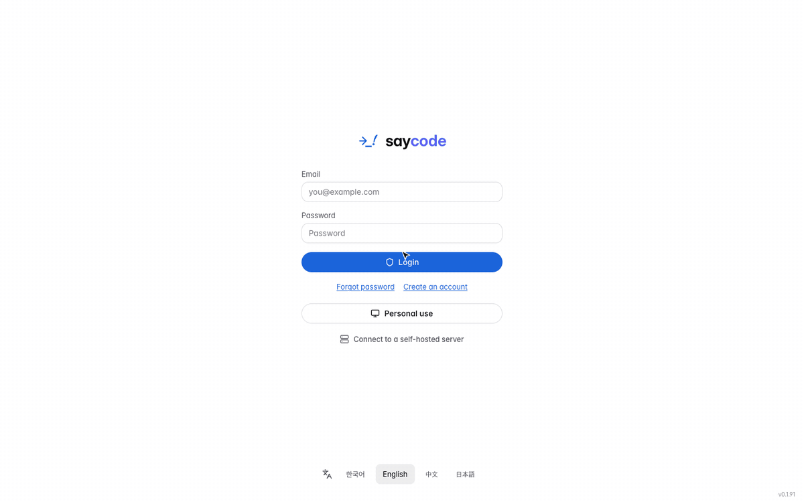 
<em>スクリーンショットは英語 UI です。アプリ本体はプロフィールメニュー → 言語 から日本語に切り替えられます。</em> 
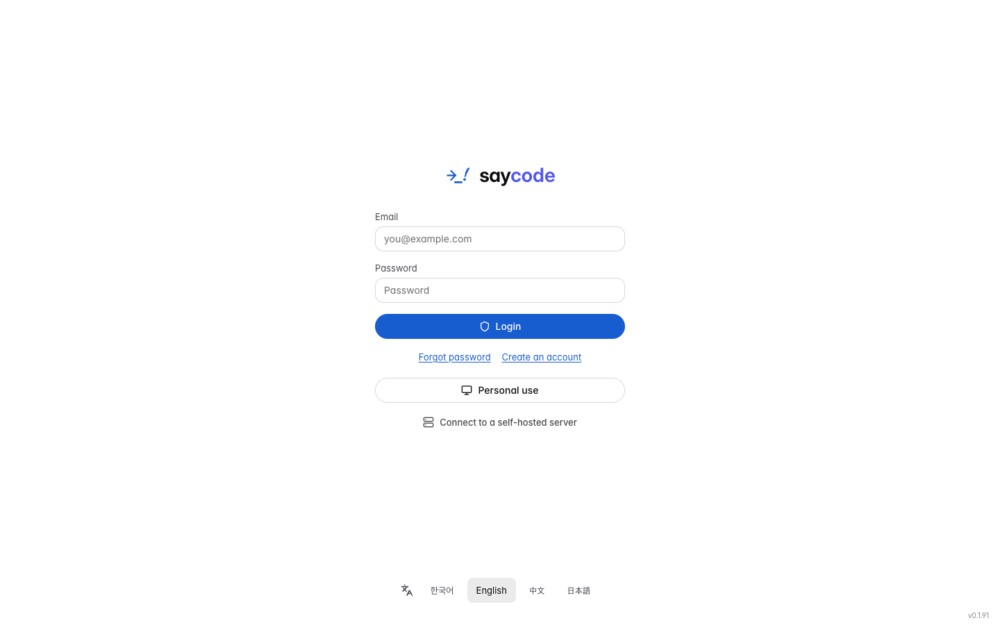
</td>
</tr>
<tr>
<td width="42%" valign="middle">

### 🏠 サイドバーから目的どおりに開始 — Chat · Project

すべては左のサイドバーから分かれます。**Chat** はプロジェクトなしでそのまま質問したりドキュメントを
作ったりする場所、**Project** は **Build**(作りたいものを言葉で説明して企画から始める)と **Develop**
(プロジェクトを作成 · コードリポジトリ · ZIP/ファイル · 作業PCのフォルダー)で開発を始める場所です。
**プロジェクトを作成**では**新しいプロジェクト / Git リポジトリ / ZIP・ファイル / 既存フォルダー**を
ひとつの画面で選び(Git リポジトリはログインと GitHub・GitLab との連携が必要)、このコンピューターで最近
Claude Code・Codex で作業したフォルダーは**最近作業したフォルダー**からまとめてプロジェクトにできます。
作業PC、**自分の設定**、**ダークモード**、**言語**はサイドバー最下部のプロフィールメニューにまとまっています。

</td>
<td>
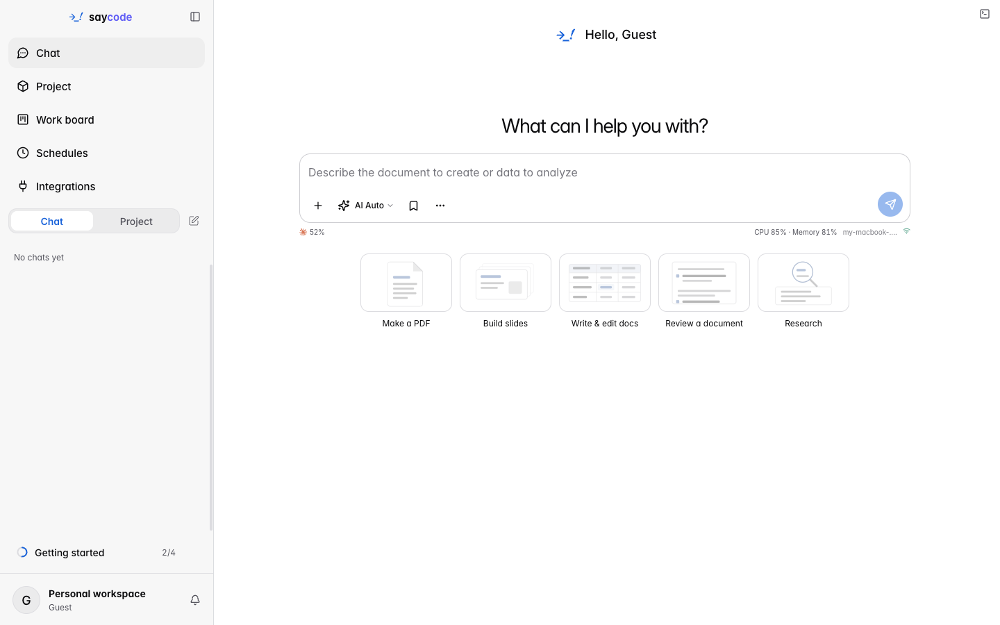 
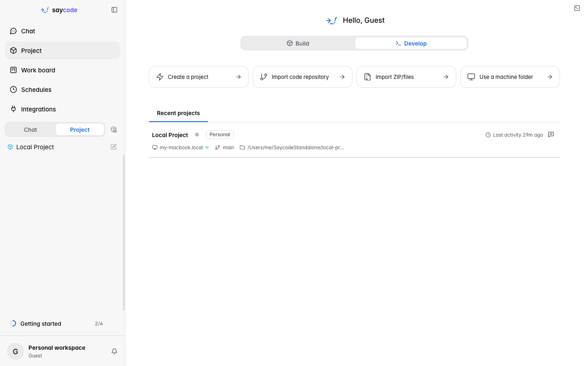
</td>
</tr>
<tr>
<td width="42%" valign="middle">

### 🗣️ 一文で動くアプリになる

*「コーヒーのサブスクサービスのランディングページを作ってください」* — この一行で、エージェントが
**あなたの PC 上で**実際のファイルを作り、編集します。作業中は進行の行が見え、終わると一行に折りたたまれ、
回答の中に**結果のプレビュー**と**変更されたファイル N 個**のカード(ファイルごとの +/− 行数、**このターンの変更を見る**)が
付きます。もっと見たいときは**ツールを表示 → ファイル**で `index.html` を開いて結果を確認・編集し、**変更**で
変わった行を左右比較します(作業エリアは自動では開かないので、自分で開いてください)。
(動画はエージェントの待ち時間を短縮して編集しています。)

</td>
<td>
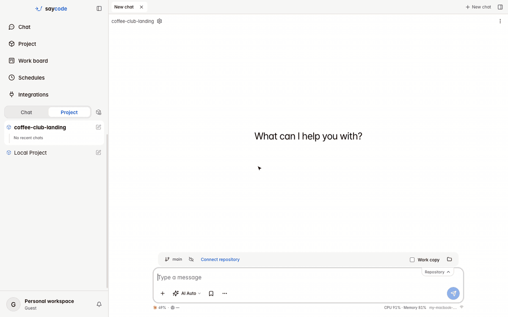 
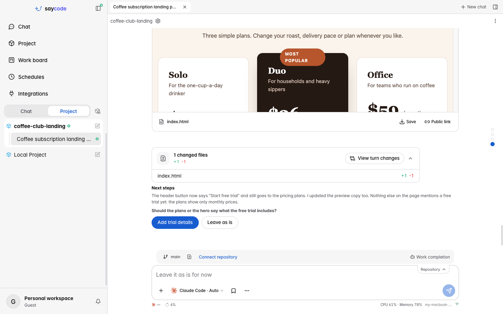 
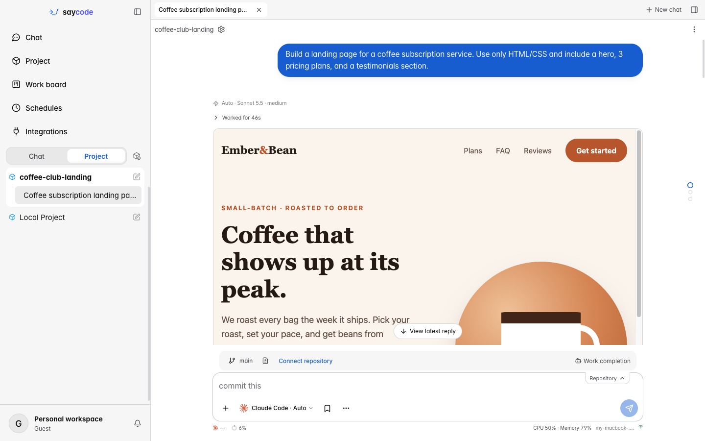
</td>
</tr>
<tr>
<td width="42%" valign="middle">

### 📄 プロジェクトなしですぐ仕事 — Chat とドキュメントテンプレート

コードがなくても大丈夫。**Chat** で *「第3四半期の機材レンタル状況レポートを作って」* と頼めば、結果
ファイルが回答の下に**ファイルカード**として現れ、ファイル名を押すと右のパネルで**アプリ内でそのまま開きます**
(HTML は会話内のプレビューが先に表示されます)。入力欄の **+** でファイル・写真・フォルダーを添付したり、
**既存のパスから開始**したりでき、文書 · スプレッドシート · プレゼンテーション · PDF の形式と
テンプレート(*Design Report*、*Minimal Letterhead*、**マイテンプレートを作成**)を選べば、同じ書式で
書き続けられます。ファイルカードでは**保存**でき、ログインすれば**公開リンク**で HTML の結果を共有できます
(公開範囲と有効期限を選択)。

</td>
<td>
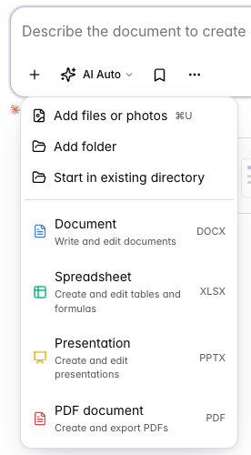 
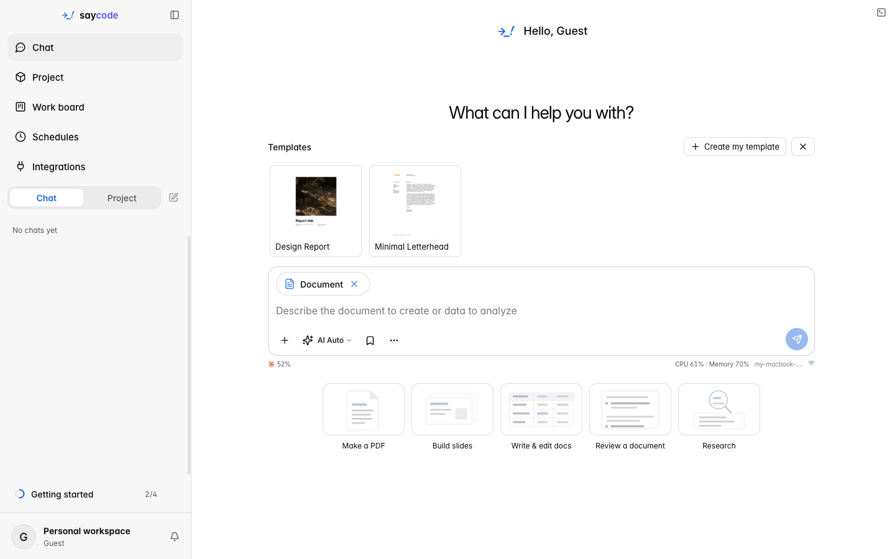 
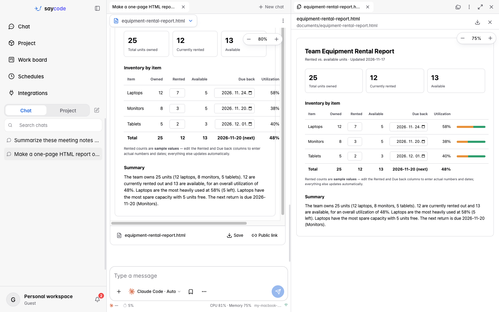
</td>
</tr>
<tr>
<td width="42%" valign="middle">

### 🧩 作業エリア — 会話は中央、ツールは右側

**ツールを表示**(⌘⇧B)で**ファイル · ターミナル · 変更**パネルを会話の隣に並べます(作業エリアは自動では
開きません)。**変更**パネルは**未コミットの変更 / ターン別**(このターン · 直前のターン以降 · 会話開始時との比較、
ワークツリーの会話は**ブランチ全体**も)で左右比較 diff を表示し、ファイル名や変更内容で検索できます。
**ファイル**パネルにはプロジェクト全体のファイル名検索と**内容検索**、CSV/TSV の**表で表示**、作ったものを
ひとまとめにする**成果物一覧**があり、ファイルをタブで開いて**そのまま編集し ⌘S で保存**できます(AI が変えた
内容は開いているタブにすぐ反映)。プロジェクトがなくても **⌘J** を押すと下に**下部ターミナル**が開き、隠しても
実行中の作業は続きます。開いたツールは会話ごとに記憶されます。

</td>
<td>
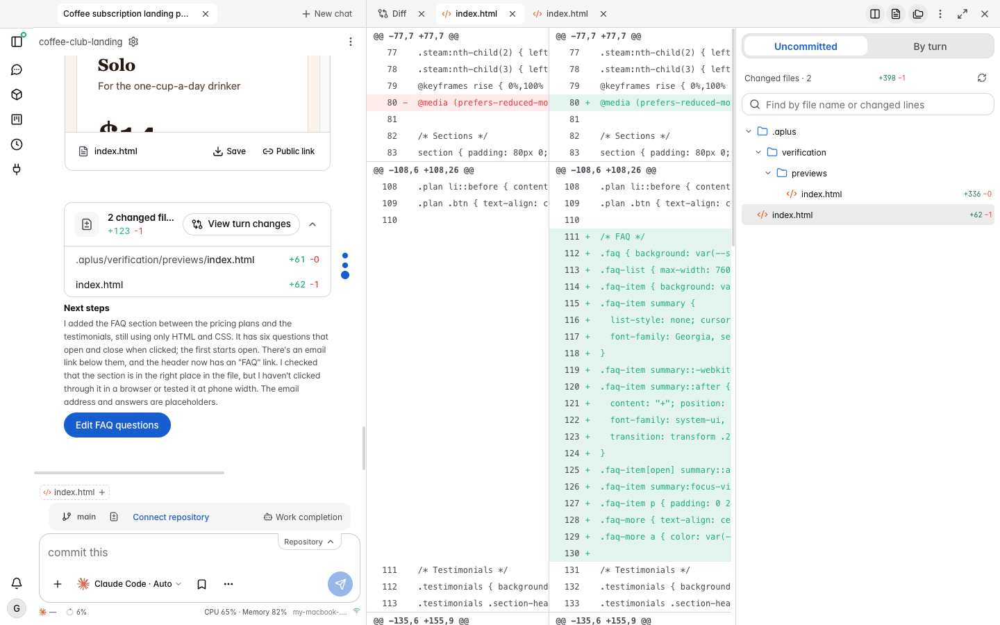 
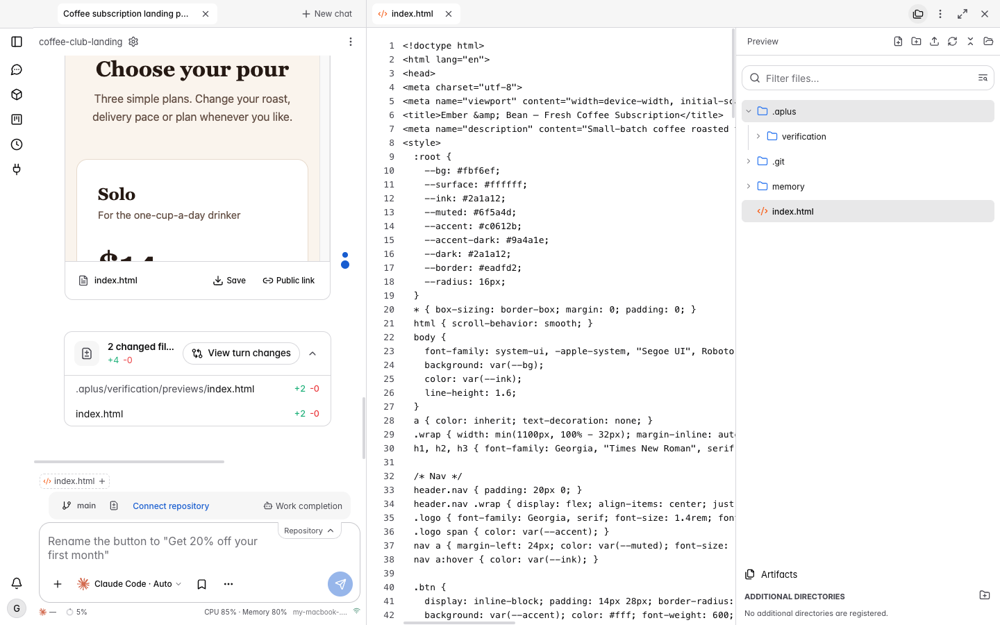 
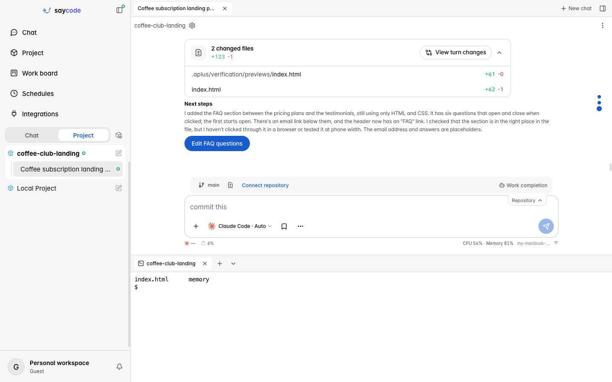
</td>
</tr>
<tr>
<td width="42%" valign="middle">

### 🧭 計画から立てて、コードを指して指示 — 計画モード · 会話に貼り付け

AI がすぐにファイルを編集する前に**計画から**受け取りたいときは、入力欄の **⋯ → 計画モード**をオンにして
送ってください(最初のメッセージを送ったあと、Claude の会話で表示されます)。**計画カード**が出たら
**承認後の実行方法**を選んで**作業を開始**を押します — すると AI が作業を始め、計画モードは自動でオフになり、
気に入らなければ**修正を依頼**します。どこを指すかは**会話に貼り付けて**伝えてください: ファイルツリーの右クリック
**チャットに追加**や `@` でファイルを、エディターで選んだコード(パス・行番号付きで渡されます)と作業パネルの
ターミナルで選んだ出力は **⌘L** で入力欄に貼り付けます。入力欄の下の円形ゲージ(**コンテキスト N%**)を押すと、
何がどれだけ占めているかが見え、**会話を圧縮**で長い会話を縮められます。

</td>
<td>
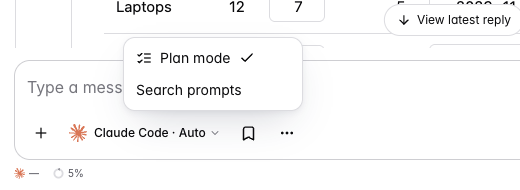 
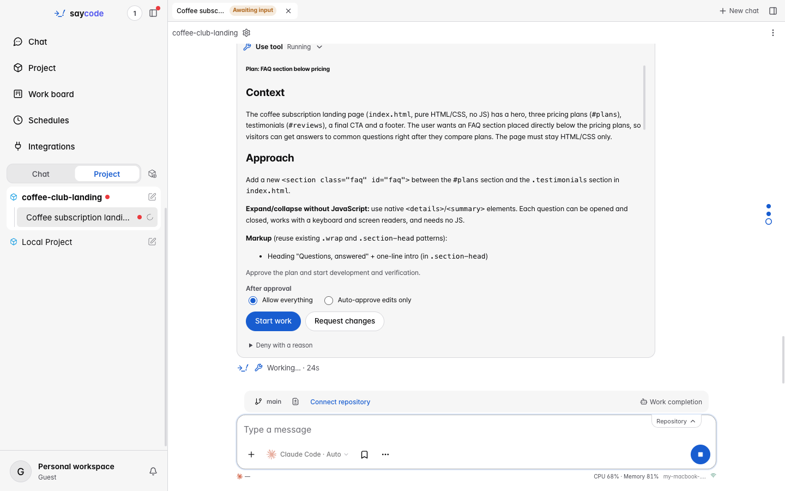 
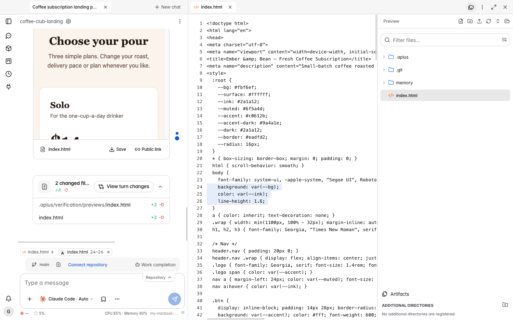 
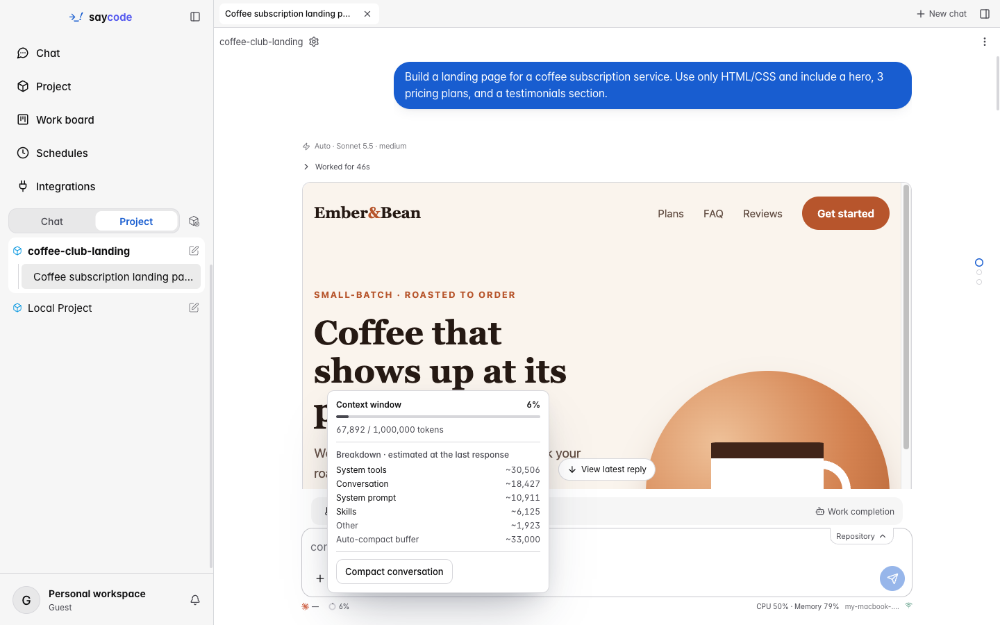
</td>
</tr>
<tr>
<td width="42%" valign="middle">

### 🤖 AI は自分で選び、モデルはおまかせ — AI 自動

入力欄の下の**ひとつのボタン**で、AI(**Claude Code · Codex · Opencode**、インストールされていれば Grok)、
モデル、**作業強度**を選べます。既定の **AI 自動**はリクエストの難しさに合うモデルと強度をその都度選び、
メッセージごとに *「自動 · Sonnet 5.5 · medium」* というバッジで何が選ばれたかを残します。自分で固定したいときは
モデル(例: Fable 5.2 · Opus 5.5 · Sonnet 5.5 · Haiku 5.5 — 一覧はアップデートで変わります)を選んでください。
作業強度はモデルを自分で選んだ後に表示され、**⌘⇧M**(次のモデル)・**⌘⇧L**(次の作業強度)で切り替えます。
よく使う組み合わせは **AI プロファイル**に保存でき、メニュー最下部の**使用する接続**で **AI アカウント**(既定)と、
組織が割り当てた **saycode プラン**・**内部AI**を選びます。入力欄の下の左にある **AI 残量**(`55%`)を押すと、
アカウント別の **7日間の使用率**とリセットまでの残り時間が開き、アカウントが複数あれば**アカウント自動切替**で
上限に達しても作業が止まりません。

</td>
<td>
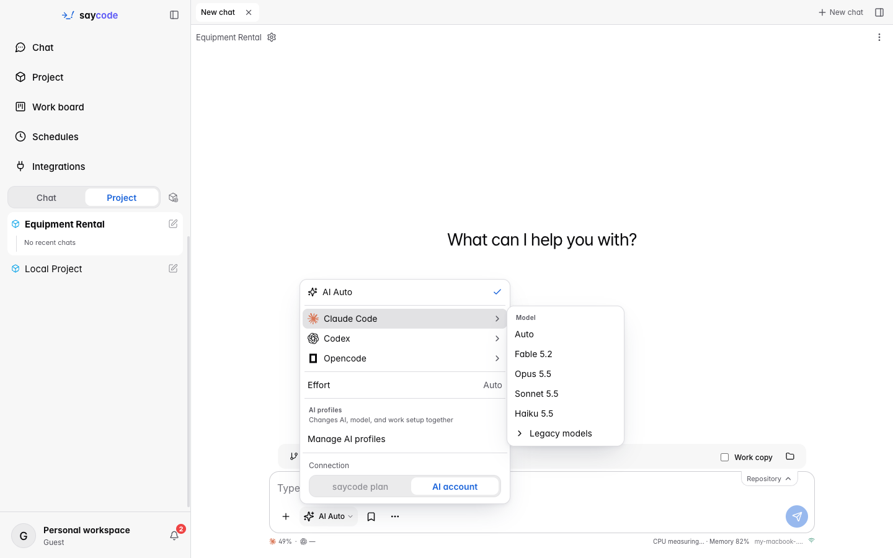 
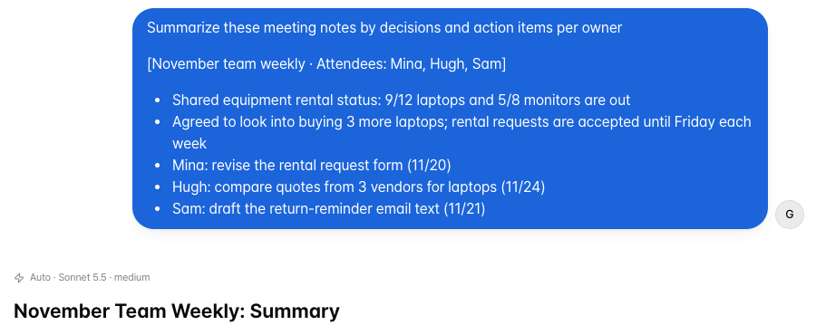 
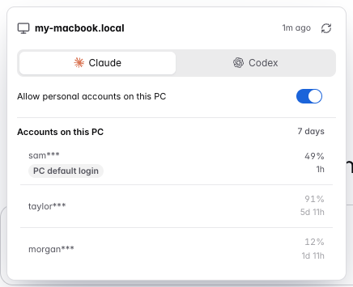
</td>
</tr>
<tr>
<td width="42%" valign="middle">

### 💸 有料アカウントなしで無料スタート — 無料モデル(opencode)

Claude や ChatGPT の有料アカウントがなくても、**初期設定 → 無料モデルで始める**を一度押すだけで opencode をこの PC に
インストールして、すぐに会話できます。インストール前にインストール先と無料モデルの条件を表示し、確認してからインストールします。
入力欄の下の AI メニューで **Opencode** を選ぶと無料モデルに「無料」「おすすめ無料」の表示が付き、モデルを選ばない場合は
メッセージごとにおすすめの無料モデルが使われます。無料モデルは OpenCode が**期間限定で提供**しており、**モデルごとに入力の保持・学習
ポリシーが異なります。** 社内・機密コードには、有料または組織の AI をつなぐか、提供元が保持・学習をしないと明記したモデルだけを使ってください。
→ [ガイドブック FAQ: How much can I use free models?(英語)](https://buzzni.github.io/saycode-desktop-releases/guidebook/en/#205-how-much-can-i-use-free-models)

</td>
<td>
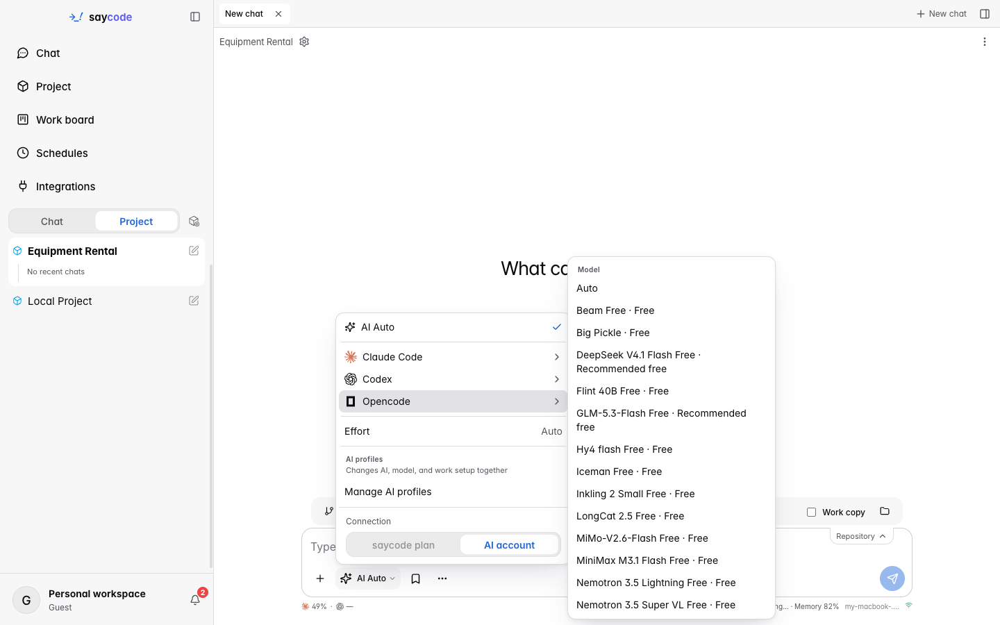
</td>
</tr>
<tr>
<td width="42%" valign="middle">

### 💬 途切れない会話 — キュー、要約、整理

AI が回答している間も次の依頼を入力して送れば**キュー**に並び(最大3件、編集・削除、**今すぐ反映**で応答を止めずに
すぐ届ける)、**自分の設定 → ショートカット**で**応答中の新しいメッセージ**を**キューに入れる · 今すぐ反映 ·
中断して送信**から選び、**メッセージ送信キー**(Enter / ⌘Enter)も変えられます。AI からの質問は入力欄が
**質問フォーム**に変わります。長い会話は右側の**メッセージ移動レール**でざっと見渡し、開発者向け機能の設定で
**会話の要約メニューを表示**をオンにすると、⋮ → **会話の要約を表示**で**会話の要約**(計画・成果物・変更ファイル)を
横に固定できます。終わった会話は**アーカイブ**(取り消し通知あり、**会話の保管箱**から**アーカイブ解除**)や
**一時的に非表示**(1時間〜来週月曜)で整理します。アカウントメニューの**開発者モード**(既定でオン)では、
会話を複数のタブで開き、**Chat を右に分割**(⌘⌥C)・**Chat を下に分割**(⌘⌥⇧C)で縦横最大 4×4 のウィンドウに
分けて見られます。

</td>
<td>
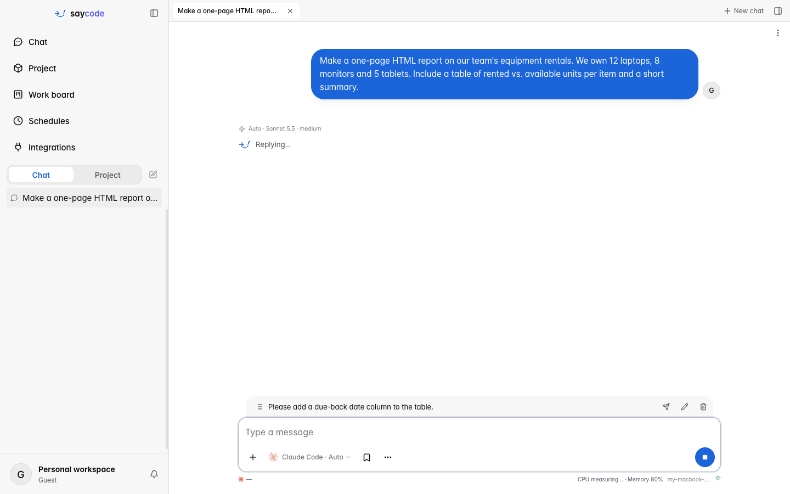 
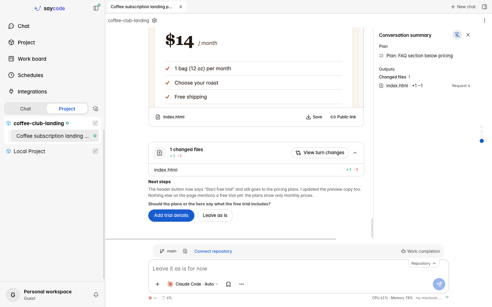 
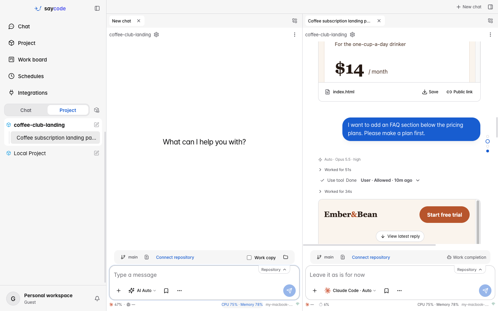
</td>
</tr>
<tr>
<td width="42%" valign="middle">

### 🗂️ 作業ボード — 会話の艦隊をカンバンで指揮

すべてのプロジェクトのすべての会話が一つのボードに: **入力待ち → 応答中 → アイドル → レビュー中 → 完了 →
PR マージ済み**(ウィンドウ幅 1440px 程度なら、サイドバーを開いたままでも6列が一画面に収まります)。カードには
プロジェクト・タイトル・AI・経過時間(ワークツリーの会話はブランチ名)が表示され、カードを**レビュー中**へ
ドラッグするとレビュー依頼を送るダイアログが、**完了**へドラッグすると完了の確認ダイアログが続きます。
**フィルター**(作業PC · 自動化 · PR の状態)と**先行作業**(`先行 0/1` バッジ)で順序を組み、**オートパイロット** ·
**変更を検証** · **PRウォッチ**(GitHub が必要)をカードからそのまま実行でき、完了列のカードは**アーカイブ解除**で
戻せます。同じ権限を待つ会話は**すべて許可 (N)** を一度押すだけで処理できます。
作業ボードは既定では非表示です — **プロフィールメニュー → 開発者向け機能の設定 → 作業ボードメニューを表示**を
オンにしてください(**⌘⇧A** はオンにしなくても動作します)。

</td>
<td>
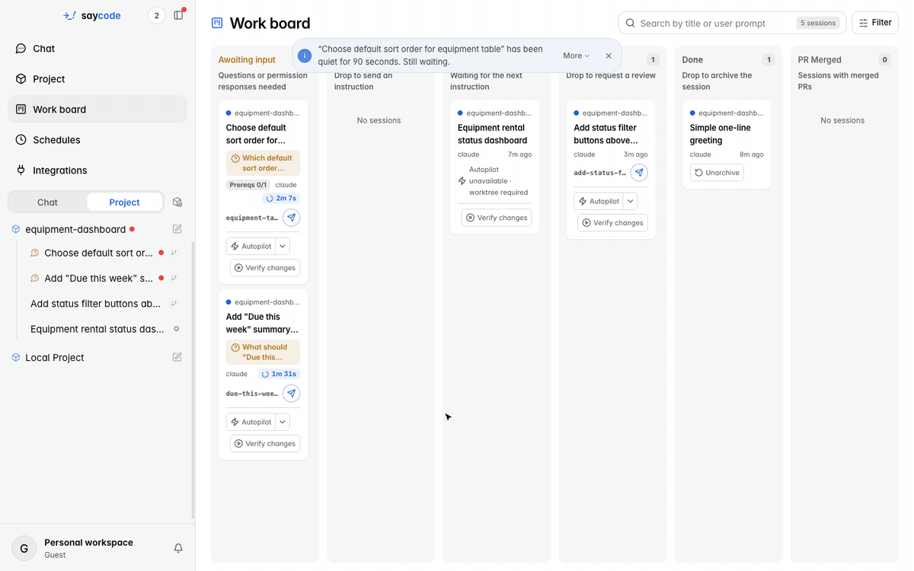 
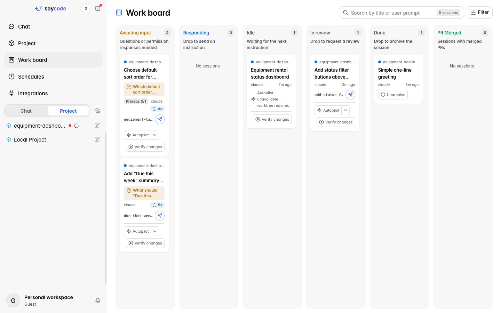
</td>
</tr>
<tr>
<td width="42%" valign="middle">

### ✅ 作業を完了 — レビューして、PR を出して、片づける

入力欄の上の行の右端にある**作業を完了**ボタンでメニューが開きます。**セルフレビュー**(AI が自分で点検、
回数は**詳細設定…**で調整)、**独立レビューを依頼…**(別の AI ツールが、選んだ AI・モデル・作業強度・レビューの
焦点で確認。**レビュー履歴**タブもあり)、**Commit & PR**(CI・レビューボット・コンフリクトの処理を経て
base へのマージまで — 条件が残る場合はマージせずに報告)、**アーカイブ&完了**。Commit & PR はワークツリーの
会話とリモートリポジトリがあるときに表示され、リモートがなければ**コミット**(ローカルコミット)が使えます。
応答中に**セルフレビュー · Commit & PR** を押してもキューに入り、応答が終わったあとに実行されるので、
タイミングを気にする必要はありません。

</td>
<td>
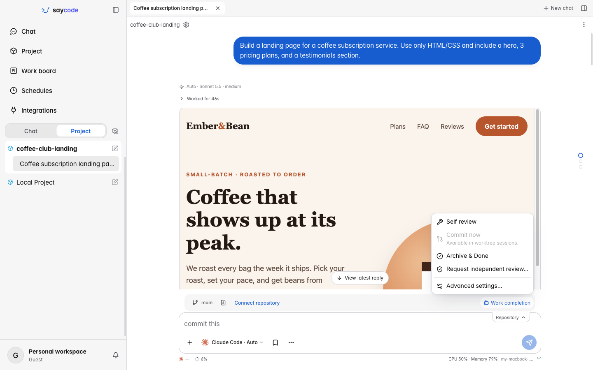 
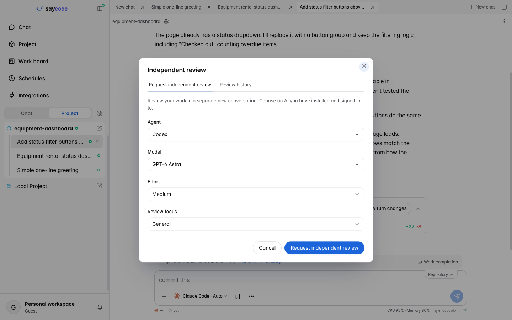
</td>
</tr>
<tr>
<td width="42%" valign="middle">

### 🌿 ワークツリー — 会話ごとに分離、消しても安心

新しい会話の入力欄の上の行の**ワークツリー**をオンにすると、会話専用のコピー作業フォルダー(ブランチ)で作業するので、
作業ボードで複数の会話を同時に動かしても互いにぶつかりません。新しいワークツリーはリモートの最新の
デフォルトブランチから始まり、**現在の変更を持っていく**で作業中の変更を引き継げます。**プロジェクトツール (⋮) →
Git 操作 → ワークツリー…** の管理画面で古いワークツリーをまとめて整理でき、削除前には `.env` のような
ローカル専用ファイルを知らせ、消したワークツリーは**スナップショット保管庫**から復元できます(Git プロジェクト。
Windows の作業PCを除く)。

</td>
<td>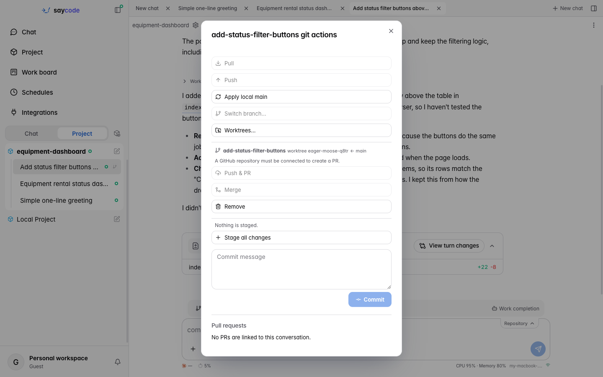</td>
</tr>
<tr>
<td width="42%" valign="middle">

### 🔐 承認とセキュリティ — AI にさせることは自分で決める

AI が危険な操作をしようとすると、まず**注意が必要な操作**の承認カードで確認し、**いいえ、代わりにこうして**で
別のやり方を指示して拒否することもできます。メインウィンドウを見ていなくても**フローティング承認パネル**
(自分の設定 → 一般 → 通知、既定はオフ)で承認や質問に答えられ、**AI ツールの利用ルール**でアプリごとに確認・ブロック・許可
(MCP ツールの読み取り/書き込みを含む)を決めます。**グローバル一時停止**ひとつで予約・オートパイロットのような
自動実行をまとめて止め、開発自動化の **AI 審査で権限リクエストを処理**で、繰り返しの承認を AI に任せることもできます。

</td>
<td>
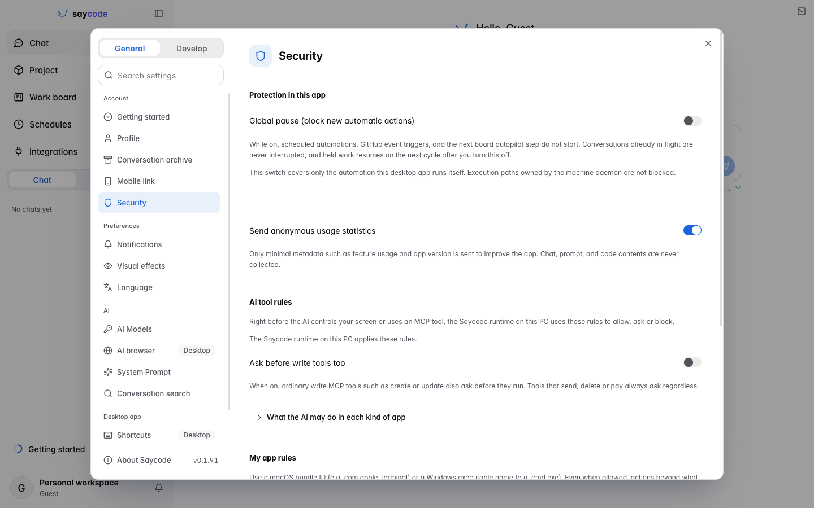 
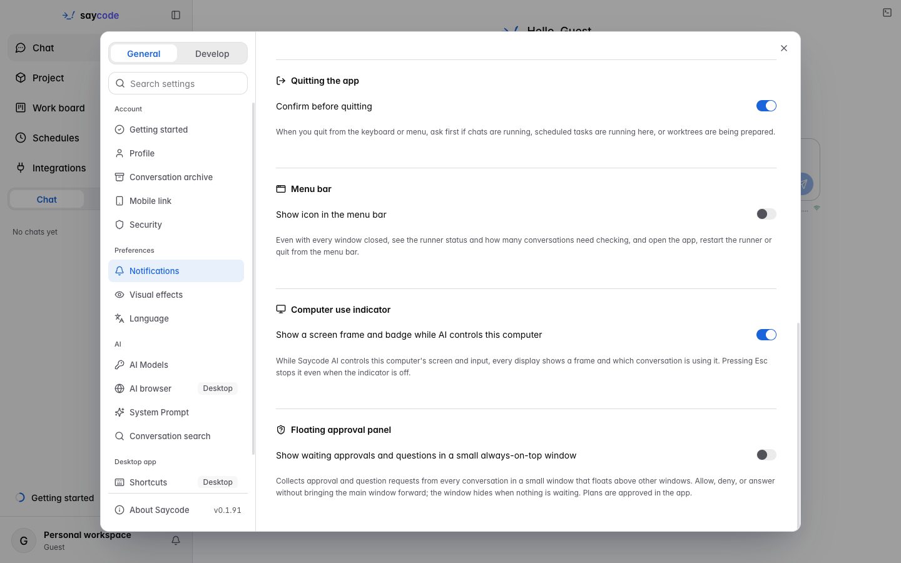
</td>
</tr>
<tr>
<td width="42%" valign="middle">

### 🧠 覚えて、学ぶエージェント

エージェントが作業中に確かめたやり方を**教訓の候補**として提案したら、回答の下のカードで**承認 / 却下**を
押すだけです。承認した教訓は同じプロジェクトの以降の会話で使われます。**自分の設定 → 開発 → Memory** では記憶を管理し、
新しい会話で似た過去の会話を提案してもらえます。**自分の設定 → 一般 → システムプロンプト**では、
Saycode の既定の指示(**Saycode 使い方ガイド**を含む)を項目ごとにオン・オフできます。

</td>
<td>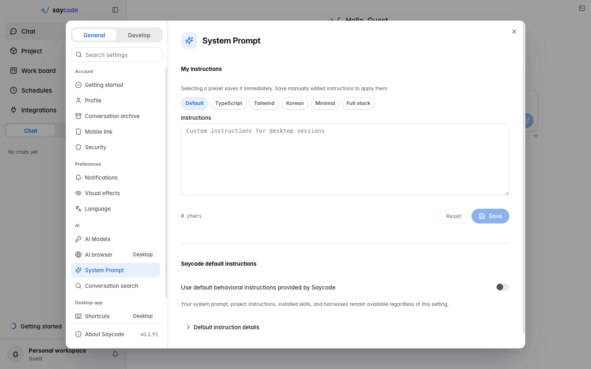</td>
</tr>
<tr>
<td width="42%" valign="middle">

### 🖥️ 自分の作業PC、自分のスマホ

この PC は初回起動で自動的に作業PCになり、GPU サーバー・ビルドサーバーのような他のコンピューターも
**自分の設定 → 開発 → 作業PC → マシン登録**で追加できます(ホームフォルダー外のパスやドライブは**このPCで許可したパス**で許可)。
新しい作業をどの PC で動かすかはプロフィールメニューや入力欄で選び、開発者向け機能の設定で **CPU・メモリを表示**を
オンにすれば、入力欄の下で負荷を確認できます。**自分の設定 → 一般 → モバイル接続**の QR を Saycode モバイルアプリで
読み取ると、同じ作業環境がスマホで開き、通知設定の**モバイル完了プッシュ**で長い作業が終わった瞬間をお知らせします。

</td>
<td>
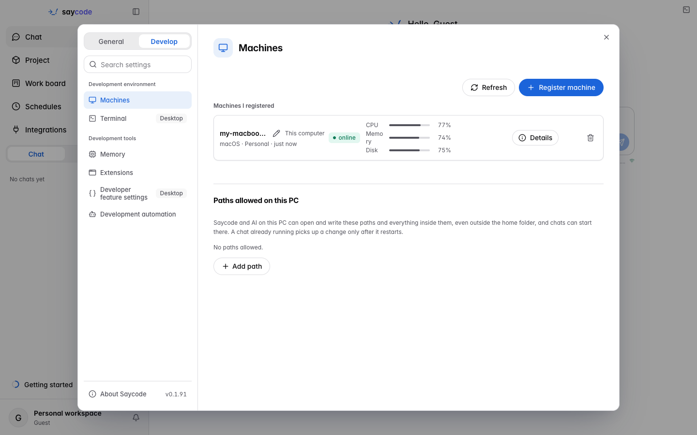 
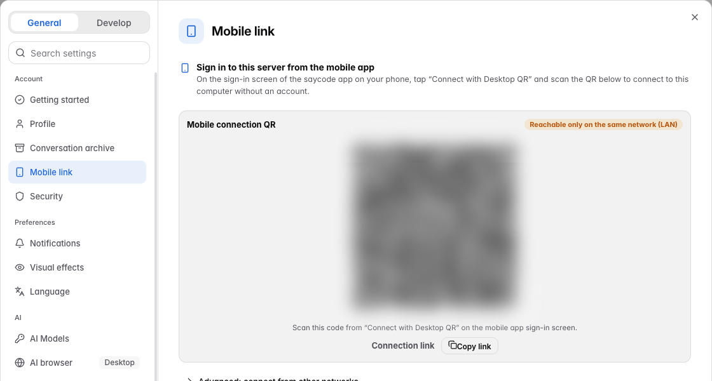
</td>
</tr>
<tr>
<td width="42%" valign="middle">

### 🔌 外部連携 — サービス、拡張機能、メッセンジャー

ログインすると、サイドバーの**外部連携**で Notion · Slack · Google Drive · Gmail · KNOI · Figma · DirectCloud を
接続でき、**カスタムコネクタ**(MCP アドレス)も追加できます。ログインしない個人利用では、公式の**拡張機能**
(チャネルアダプター、プラグインマネージャーなど)のインストール・管理画面が開き、**自分の設定 → 開発 →
拡張機能**でも同じことができます。**メッセンジャーチャネル**(自分の設定 → 一般、ログイン中のアカウント限定)を
接続すると、Slack · Telegram · Discord から Saycode の会話を始めて進捗を受け取れます。

</td>
<td>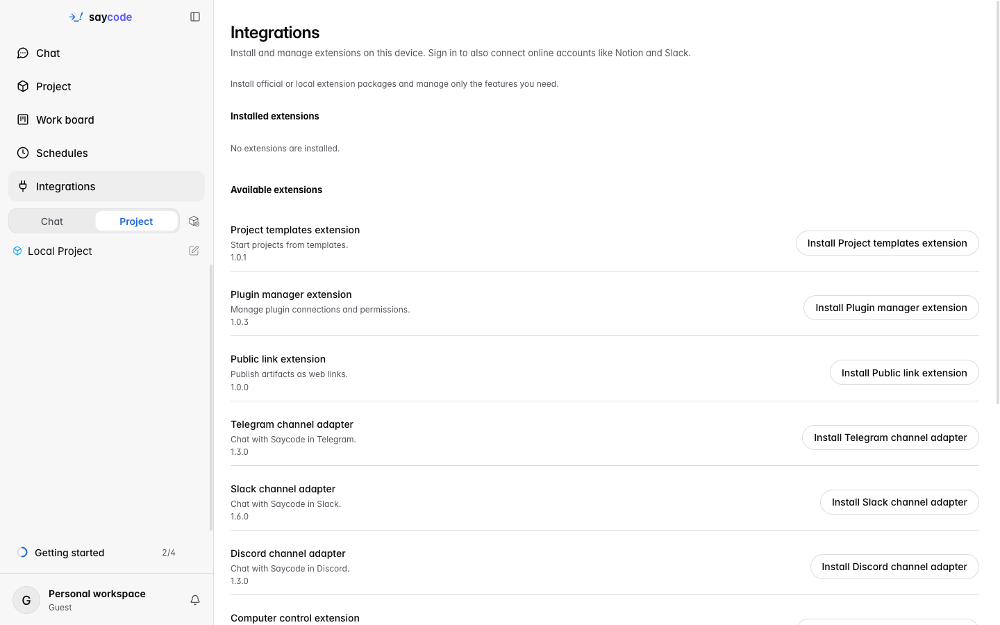</td>
</tr>
<tr>
<td width="42%" valign="middle">

### 🏢 チームワークスペース — デプロイ、共有、組織の統制 *(ログイン)*

saycode.ai アカウントでログインすると、所有するクラウドプロジェクトをヘッダーの**デプロイ**ボタンから**テストデプロイ**し、
そのあと**本番デプロイ**(組織の許可・サーバー設定・合格したテストデプロイが必要)まで進められ、同じアドレスを
更新する**デプロイ更新**か、別アドレスの**新規デプロイ**を選べます。プロジェクトを**共同作業**に招待したり
チーム単位で共有したりでき、**どの組織で作業しますか？**で組織を選び、プロフィールメニューの**組織管理**で
メンバー・チーム・権限・監査ログ・AI モデルポリシー・LLM の使用量とコストを管理します。モデルメニューの
**使用する接続**では、組織の管理者が割り当てた **saycode プラン**(定額プラン — 入力欄の下の **saycode プラン**ボタンで
今月・今週・5時間の使用量を確認)と**内部AI**(組織が運用する社内 LLM)で会話を実行します。個人利用では使えない
**公開リンク · 予約 · メッセンジャーチャネル · 外部サービス連携**もログインすれば開きます。デプロイされたアプリや
レポートを開く**エンドユーザーにシートは不要です。**

</td>
<td>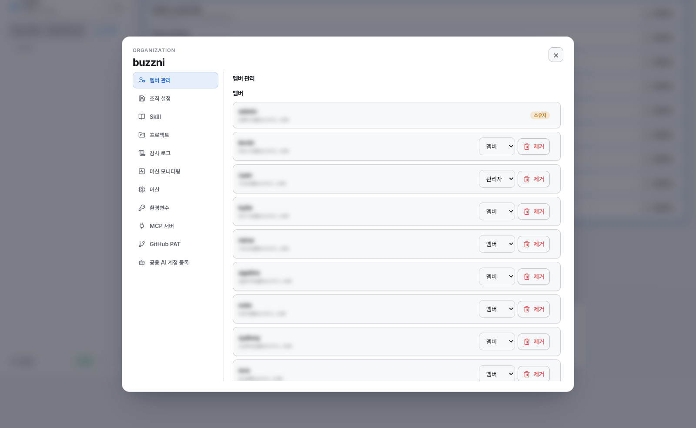</td>
</tr>
<tr>
<td width="42%" valign="middle">

### 🌙 いつまでも居たくなるワークスペース

プロフィールメニューの**ダークモード**スイッチでそのまま暗くでき、**言語**で 한국어 · English · 日本語 · 简体中文 を
切り替えられます。情報は密に、画面は落ち着いて。**クイックオープン**(⌘P — `>` を打つとコマンドだけ)、
会話検索 ⌘⇧F、作業ボード ⌘⇧A、作業パネル ⌘⇧B、下部ターミナル ⌘J、固定した会話 ⌘1〜9、閉じたタブの復元 ⌘⇧T まで、
**自分の設定 → 一般 → ショートカット**で検索し、割り当てを変更できます。ベルの中の最近の通知、Dock バッジ、
入力リクエストと作業完了の音 — 細部の積み重ねが体験になります。

</td>
<td>
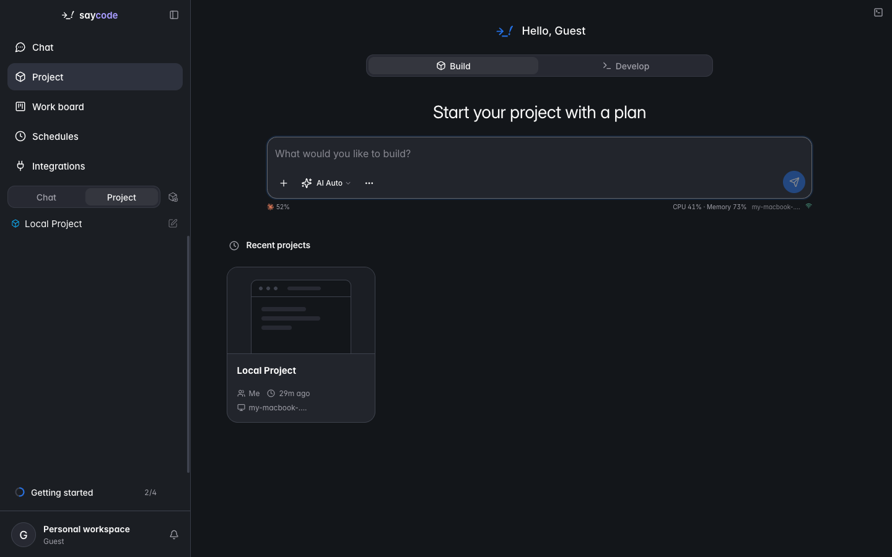 
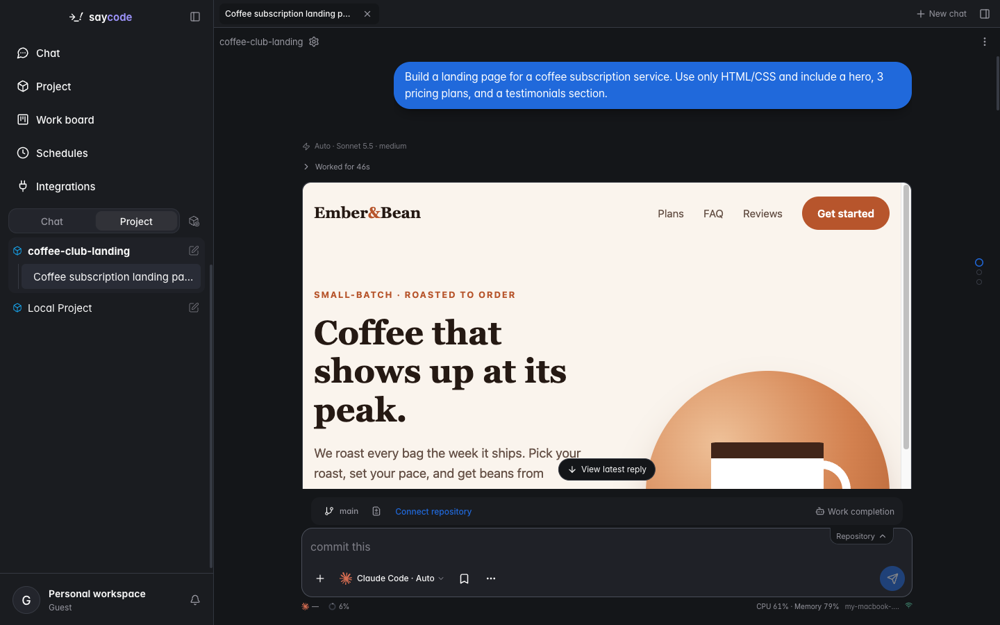 
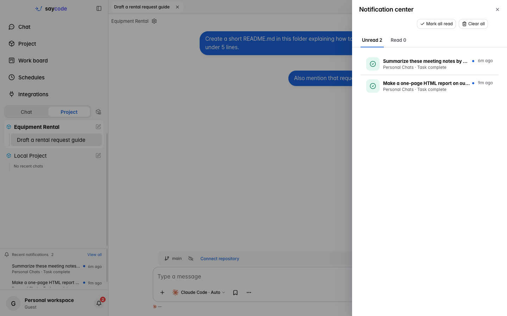
</td>
</tr>
</table>

### ほかにも

- ⌨️ **入力欄の生産性** — 空の入力欄で **↑** を押すとこの会話の過去の依頼を呼び出し、ブックマーク型の**マイプロンプト**でよく使う依頼を保存(ログインするとアカウントに保存されるので別の PC でも使えます)、`@` でファイル・Git の変更(`@diff`)・別の会話を参照、`/recap`・`/btw`・`/usage`、長文貼り付けはカードに折りたたみ
- 🛟 **ファイルチェックポイント** — 新しい会話の `⋯` でオンにすると(macOS・Linux の作業PC)、エージェントがファイルを変更する前の状態を残し、ファイルごとのプレビューを経て安全に復元でき、自分のメッセージから**この時点にファイルを戻す**こともできます *(v0.1.91 の個人利用では、オンにすると会話が始まりません)*
- 🧭 **プロジェクトハブ** — 新しい会話の `⋯` → **プロジェクトハブに設定**すると、同じプロジェクトの別の会話が終わった知らせや質問をまとめて受け取れます(プロジェクトごとに一つ)
- 🔁 **会話を続ける** — **プロジェクトツール (⋮) → 会話を続ける**で、**別の AI ツールで続ける**(Claude ↔ Codex)か、**同じ AI で分岐**
- 🔎 **会話検索とクイックオープン** — ⌘⇧F でこの PC のインデックスから過去の会話を検索し、⌘P でファイルやコマンドをすばやく開く
- 🤖 **オートパイロットと自動品質検証** — 作業ボードのカードのオートパイロットがレビューし、要件ごとの根拠を確認してから初めて PR へ進み、PR ウォッチが CI の失敗・レビュー指摘・コンフリクトをエージェントに指示 *(PR ウォッチは GitHub が必要)*
- 🗓️ **予約** *(ログイン)* — 決まった時刻に AI に仕事をさせる: *「毎日午前9時に昨日の PR を要約して」*。タイムゾーンを確認でき、結果は通常の会話として蓄積され、Telegram・Slack にも届きます
- 🧪 **アプリ内ブラウザー · プレビュー · 要素への注釈 · AI ブラウザー** — 画面の要素を指して直す機能は v0.1.91 ではまだ調整中のため、一部の組織にだけ先行提供されています(個人利用・一般アカウントには表示されません。今は言葉で説明するか、画面キャプチャ・`@`・⌘L で指して依頼してください)
- 🔔 **通知と Webhook** — 完了・入力リクエストの通知は再起動後も残り、開発自動化でセッションイベントを署名付き Webhook として自分のエンドポイントに送信
- 📄 **リッチなファイルビューア** — Markdown・HTML・PDF・DOCX をアプリ内でレンダリングし、CSV/TSV は表で、大きなメディアはストリーミングで開く
- 🔐 **セキュリティの既定値** — チャットとターミナルのエンドツーエンド暗号化、パスキー/TOTP MFA *(チーム)*、コードとデータは自分の作業PCに

---

## こう動きます

| | | |
|---|---|---|
| **01 · インストールして開始** | **02 · 目的どおりに開始** | **03 · 言葉で依頼** |
| DMG を開いて**個人で使う**を選ぶと作業環境が用意され、**初期設定**ウィンドウが自動で開きます。 | サイドバーで Chat(ドキュメント・質問)か、Project の Build(新規企画)· Develop(リポジトリ・ZIP・フォルダー)を選びます。 | 自然な一文で十分です: *「状態別のフィルターボタンとサマリーカードを追加して」* (計画から受け取りたいときは**計画モード**) |

| | |
|---|---|
| **04 · 自分の作業PCで AI が制作** — エージェントが実際にファイルを読み書きし、コマンドを実行します。回答の中の変更されたファイルのカードと結果のプレビュー、右側の作業エリアのファイル・変更・ターミナルで確認し、複数の会話は作業ボードで指揮します。 | **05 · 仕上げて共有** — 作業を完了で、レビュー → Commit & PR → アーカイブ&完了。チームワークスペースなら社内 URL にデプロイし、共同作業で引き継ぎます。 |

---

## インストールと初回起動

### macOS

1. **[Releases](https://github.com/buzzni/saycode-desktop-releases/releases/latest)** から最新の DMG をダウンロード(Apple Silicon — Intel Mac 用の x64 DMG も同じページにあります)
2. DMG を開き、**Saycode** を Applications にドラッグ
3. 起動すると最初の画面はログインフォームです。画面下部で**言語**を選べます(한국어 · English · 中文 · 日本語)
4. 開始方法を選びます
   - **個人で使う → 確認** — ログインなしでこの PC ですぐに開始(会話とプロジェクトはこの PC にだけ保存され、終了するときはプロフィールメニュー最下部の**個人利用を終了**)
   - **ログイン** — saycode.ai アカウントで開始。アカウントがなければアプリ内で**アカウントを作成**でき、組織はログイン後の**どの組織で作業しますか？**で選びます
   - **セルフホストサーバーに接続** — 自分のサーバーで `saycode server connect` により受け取った接続コードを貼り付けて**接続**

<table>
<tr>
<td width="33%"></td>
<td width="33%">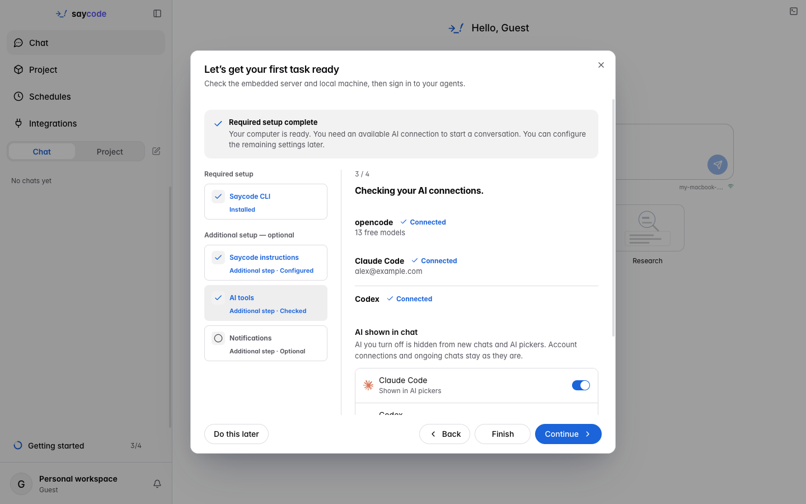</td>
<td width="33%">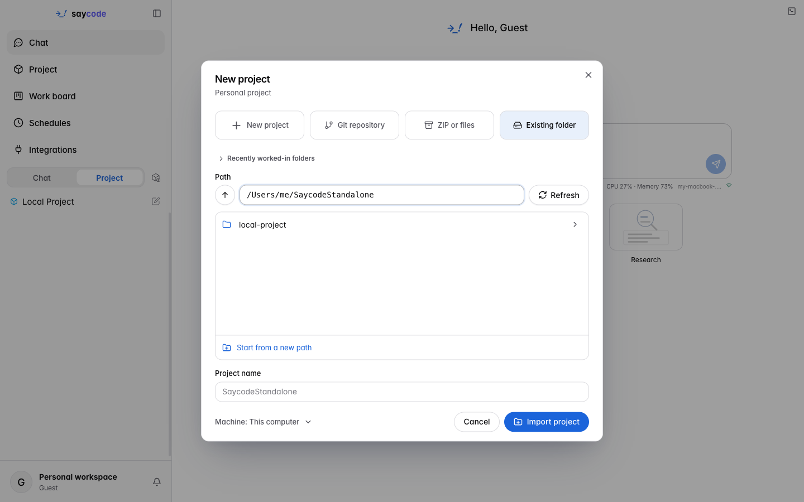</td>
</tr>
<tr>
<td valign="top"><b>① 開始画面</b> — ログインフォームの下に<b>個人で使う</b>と<b>セルフホストサーバーに接続</b>があり、言語ボタンは一番下です。言語は後からプロフィールメニューの<b>言語</b>や 自分の設定 → 一般 → 言語 で変更できます。</td>
<td valign="top"><b>② 初期設定</b> — Saycode CLI → Saycode の指示 → AI ツール → 通知の順に<b>続ける</b>を押して進みます。AI ツールの手順では AI ごとの<b>接続済み</b>・<b>未接続</b>の状態を確認し、接続済みの AI がなければ<b>自分のAIアカウントを接続</b>(ChatGPT · Claude)か<b>無料モデルで始める</b>を選びます。</td>
<td valign="top"><b>③ 最初のプロジェクト</b> — Project → Develop → <b>プロジェクトを作成</b>で、新しいプロジェクト · Git リポジトリ · ZIP・ファイル · 既存フォルダーから選び、作業PC(このコンピューター)を確認します。</td>
</tr>
</table>

初期設定は**後で行う**でスキップでき、サイドバー最下部の**初期設定 N/4** の行や**プロフィールメニュー → 自分の設定 →
一般 → 初期設定**からいつでも続きから再開できます(インストールするツールが残っていれば**このステップから自動実行**)。
**Saycode の指示**は既定で*オフ*です。オンにすると、子エージェントへの委任や結果のインラインプレビューといった
Saycode のワークフローに従います。

アプリは Developer ID で署名・公証済みで、自動的にアップデートされます。
スクリーンショット付きで全ステップを見るには、上の**[ガイドブック](docs/GUIDE.md)** をご覧ください。

### ローカルワークスペースとチームワークスペース

| | 個人利用 · Guest ローカルワークスペース | ログイン · チームワークスペース (saycode.ai ログイン) |
|---|---|---|
| 必要なもの | なし — インストールするだけ | 組織アカウント (SSO · パスキー/TOTP MFA) |
| データの場所 | すべてこの Mac | コード・データは指定の作業PC、メタデータ・監査ログは組織コンソール |
| エージェント · AI 自動選択 · 計画モード · Chat とドキュメントテンプレート · 作業ボード · ワークツリー · 作業を完了 · ファイル編集 · 下部ターミナル · 開発者モード(画面分割) · 検索 · 教訓/メモリ · 拡張機能 | ✅ | ✅ |
| アプリ内ブラウザー · プレビュー · 要素への注釈 · AI ブラウザー | — | 一部の組織に先行提供 |
| 作業PCの登録 · モバイル接続 | ✅ (モバイルは同一ネットワークまたはトンネル) | ✅ |
| 公開リンク · 予約 · メッセンジャーチャネル · 外部サービス連携(Notion、Slack など) | — | ✅ |
| デプロイ(テスト・本番) · 共同作業 · チーム共有 · プロジェクトタグ | — | ✅ |
| 使用する接続の saycode プラン · 内部AI | — | ✅ (組織が割り当てたとき) |
| 組織コンソール (シート・チーム・権限・AI モデルポリシー・コスト・監査ログ) | — | ✅ |

ローカルで始めて、必要になったらログインすれば大丈夫です。ローカルのプロジェクトはそのまま残ります。

> **Windows / Linux** — Windows(x64)は [Releases](https://github.com/buzzni/saycode-desktop-releases/releases) からインストーラーを入手できます(一部の機能は macOS のみ)。Linux は準備中です。

---

## 導入シナリオ — どこから始めるかはお客様が決めます

三つのシナリオは順番ではなく選択肢です。一つから始めても、組み合わせても構いません。

| 💬 チャットとドキュメント | ⚙️ 個人業務の自動化 | 🚀 アプリ構築とデプロイ |
|---|---|---|
| 議事録の要約、企画書・報告書のドラフト、検索・要約。承認されたユーザー・モデルのみ使用し、グループごとにモデルを制限し、利用量・コストを集計します。 | 社内のコラボレーションツール・ドキュメントストレージと連携し、定型レポートの生成、申請・承認フローの補助といった反復業務を自動化します。 | 現場の担当者が自ら社内ツールを作り、社内 URL でデプロイします。成果物のレビュー・承認フローまで。 |

**開発者でなくても最初の週から使えます** — 経営支援(議事録・月次報告書のドラフト・規定 Q&A)、
営業・マーケティング(提案書ドラフト・VOC 分類)、コマース運用(商品・価格・在庫の確認レポート)、
人事・総務(規定案内・申請/承認フロー・オンボーディング資料)のように、今まさに手作業・Excel・
メッセンジャーで処理している反復業務から始めます。成果物はリンクで共有するので、メッセンジャーへの
添付なしにレビューが完結します。

---

## チームのための Saycode

### 1ヶ月無料の PoC で、まず数字を確認します

お客様が選んだシナリオを対象に、利用量・コスト・ポリシー・監査を実測し、導入判断に必要な結果報告書
まで一緒に作成します。**プレミアムシートの全機能を PoC でそのまま利用できます。**

| 第1週 · ベースライン | 第2〜3週 · 実利用 | 第4週 · 結果報告 |
|---|---|---|
| 現在の AI 利用・コストのベースライン測定、対象部署と PoC シナリオの選定 | 実際の業務に適用し、利用量・コストを実測、ポリシー・権限設定を検証 | 有効化率・コスト・ポリシーの動作結果を整理し、本導入の見積もりを算出 |

PoC 期間は1ヶ月無料。期間中に発生するモデル利用料はお客様の契約に従います。

### 価格 — シートが必要なのは自分で作る人だけ

AI モデルを転売するツールではありません。すでにお使いの AI 契約をそのまま接続し、管理と実行環境に
対するシート料金のみをいただきます。

| プラン | 価格 | 対象 | 含まれるもの |
|---|---|---|---|
| **オフィス** | $10 / 人・月 | チャット・ドキュメント中心の全社員向け | チャット・ドキュメント作業 · 成果物の閲覧・レビュー・承認 · 利用量ダッシュボード |
| **プレミアム** ⭐ | $40 / 人・月 | 自ら作りデプロイする実務担当者向け | オフィスの全機能 + アプリ制作・エージェント実行 · 社内 URL デプロイ · SSO 連携 |
| **大量導入** | 規模に応じて協議 | 全社導入・特殊要件 | 全社規模の単価 · オンプレミス設置型・閉域網構成 · 専任サポート・SLA |

- **AI モデルへのマークアップ 0%** — お使いの Anthropic・OpenAI・Azure・Bedrock・Vertex の契約をそのまま接続します。月額総コスト = シート料金 + 外部 AI サブスクリプション料金 + API 利用料。
- デプロイされたアプリ・レポートの URL を利用するだけの**エンドユーザーにはシートが不要です。** 記名制のシートで、アカウントの共有は行いません。
- 予算上限としきい値アラートを設定でき、上限を超えると自動的に停止します。
- 現在の導入キャンペーン期間中は初期セットアップ費用なし。

- 🌐 ウェブサイト: **[saycode.ai](https://saycode.ai)** · 紹介資料: **[saycodepoc.apps.saycode.ai](https://saycodepoc.apps.saycode.ai/)**
- 💼 導入のお問い合わせ: [soo@buzzni.com](mailto:soo@buzzni.com)
- 🛠 技術に関するお問い合わせ: [ryan@buzzni.com](mailto:ryan@buzzni.com)
- 🤝 カスタマーサポート: [ernie@buzzni.com](mailto:ernie@buzzni.com)

---

## オープンソースについて

Saycode Desktop はオープンソースの上に構築されています。以下のプロジェクトをバンドルまたは使用して
おり(ライセンスを併記)、ライセンス全文はパッケージ版アプリに同梱されています:

| プロジェクト | 用途 | ライセンス |
|---|---|---|
| [Happy](https://github.com/slopus/happy) ([buzzni フォーク](https://github.com/buzzni/happy) 経由) | スタンドアロンモードにバンドルされる暗号化エージェントセッション・リレーエンジン (`happy-cli` / `happy-server`) | MIT |
| [Electron](https://www.electronjs.org/) | デスクトップアプリシェル | MIT |
| [React](https://react.dev/) | UI フレームワーク | MIT |
| [xterm.js](https://xtermjs.org/) (+ fit / web-links / WebGL アドオン) | リモートターミナルのレンダリング | MIT |
| [socket.io-client](https://socket.io/) | リアルタイム通信 | MIT |
| [react-markdown](https://github.com/remarkjs/react-markdown) + [remark-gfm](https://github.com/remarkjs/remark-gfm) | チャットの Markdown レンダリング | MIT |
| [electron-updater](https://www.electron.build/) | アプリ内自動アップデート | MIT |
| [buffer](https://github.com/feross/buffer) | バイナリユーティリティ | MIT |
| [lucide-react](https://lucide.dev/) | アイコンセット | ISC |
| [TweetNaCl.js](https://tweetnacl.js.org/) | エンドツーエンド暗号化プリミティブ | Unlicense (パブリックドメイン) |

Saycode の暗号化セッション同期アーキテクチャの土台となった Kirill Dubovitskiy と
コントリビューターの **[slopus/happy](https://github.com/slopus/happy)** (MIT) に、
特別な感謝を捧げます。

---

**© 2026 [Buzzni](https://buzzni.com) · [saycode.ai](https://saycode.ai)**

*会社の誰もが、話すだけで作れるように。*

