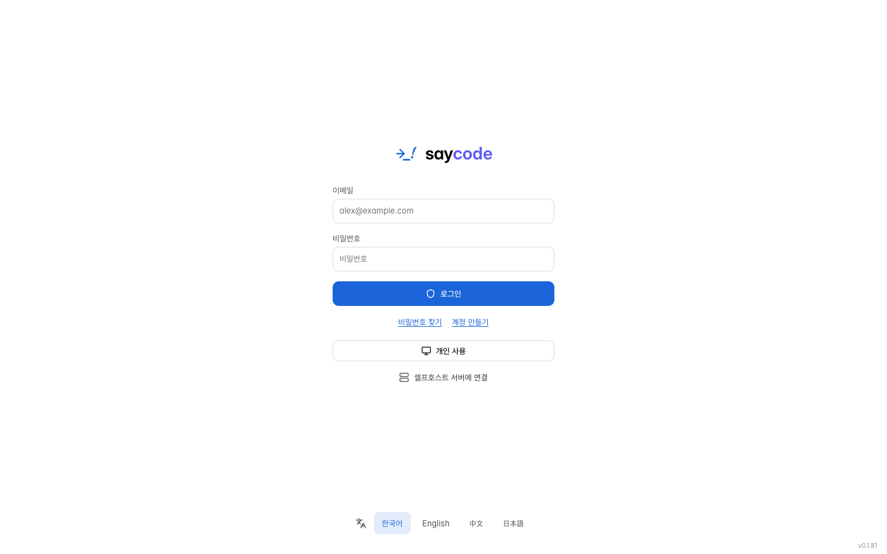
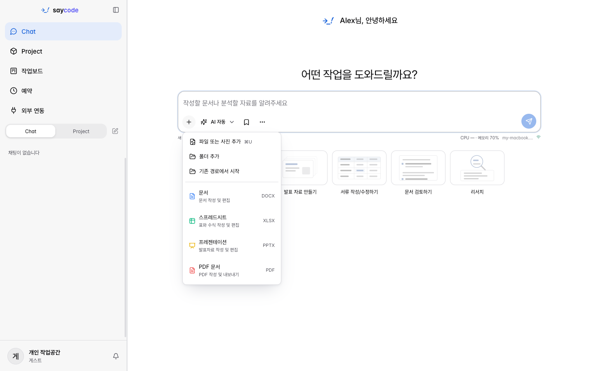
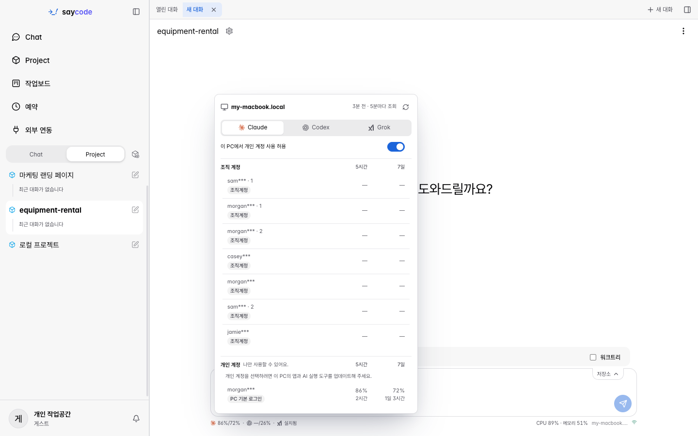
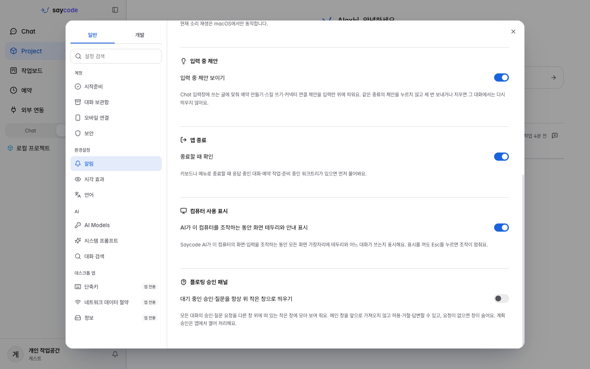
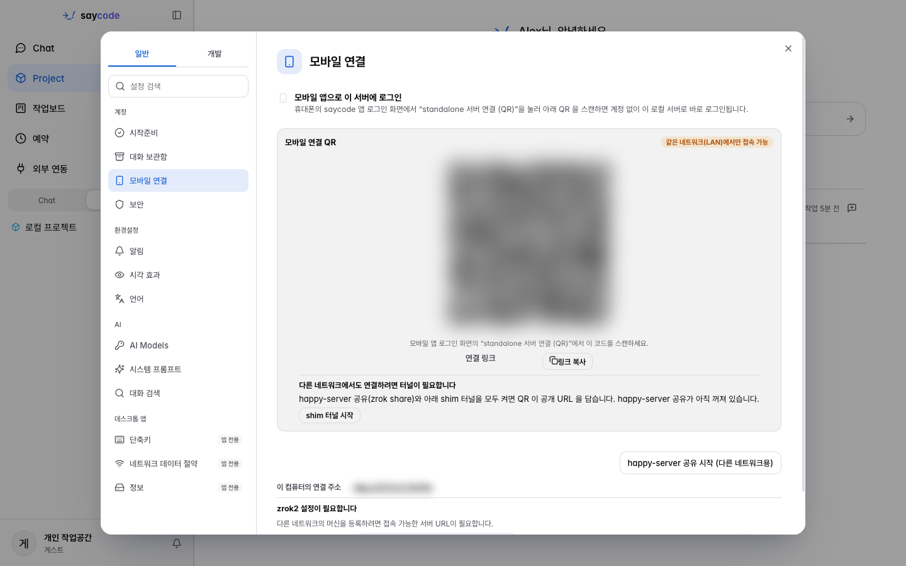
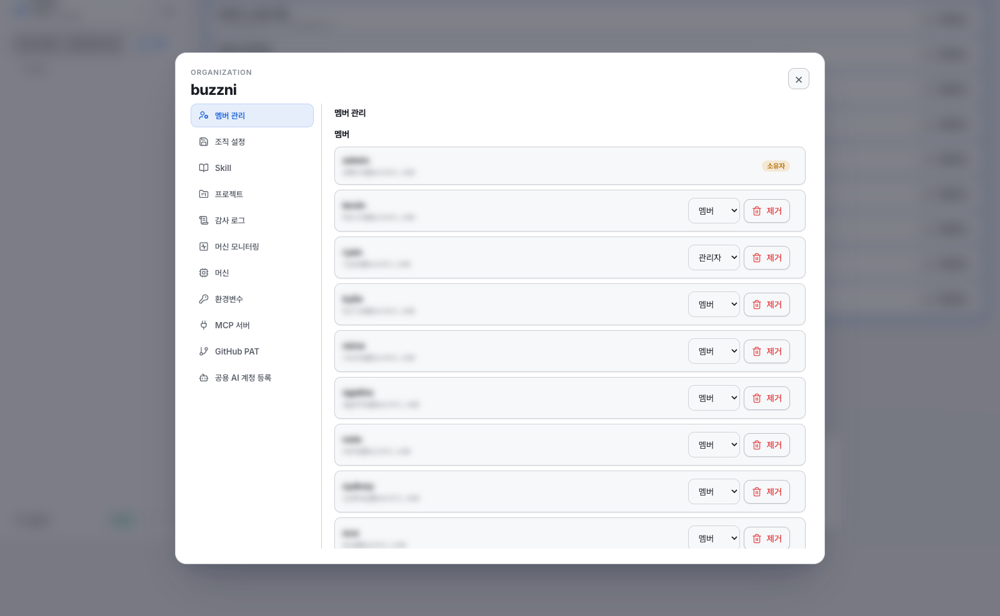
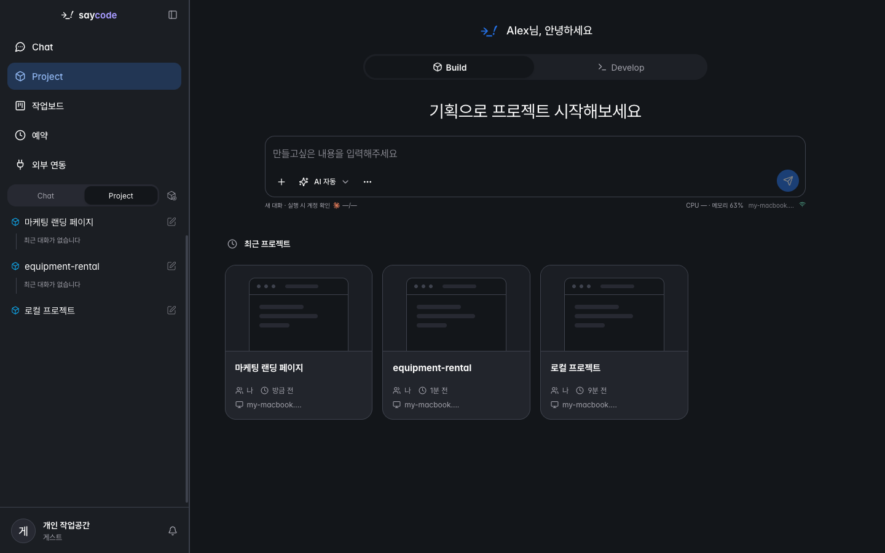
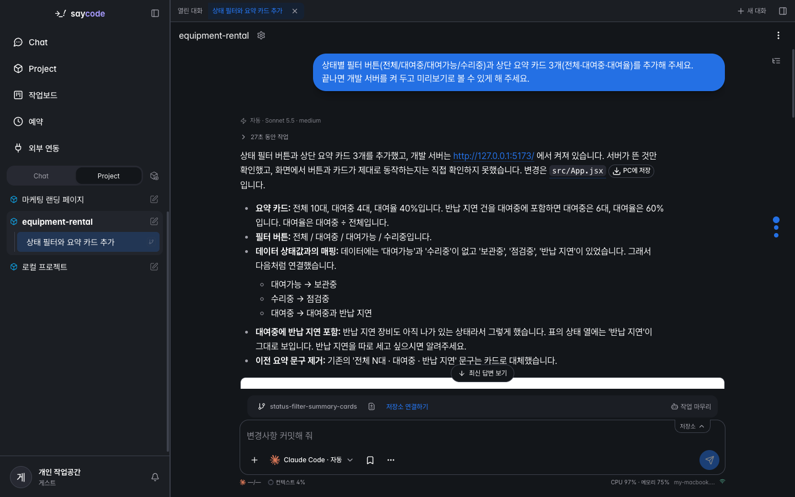
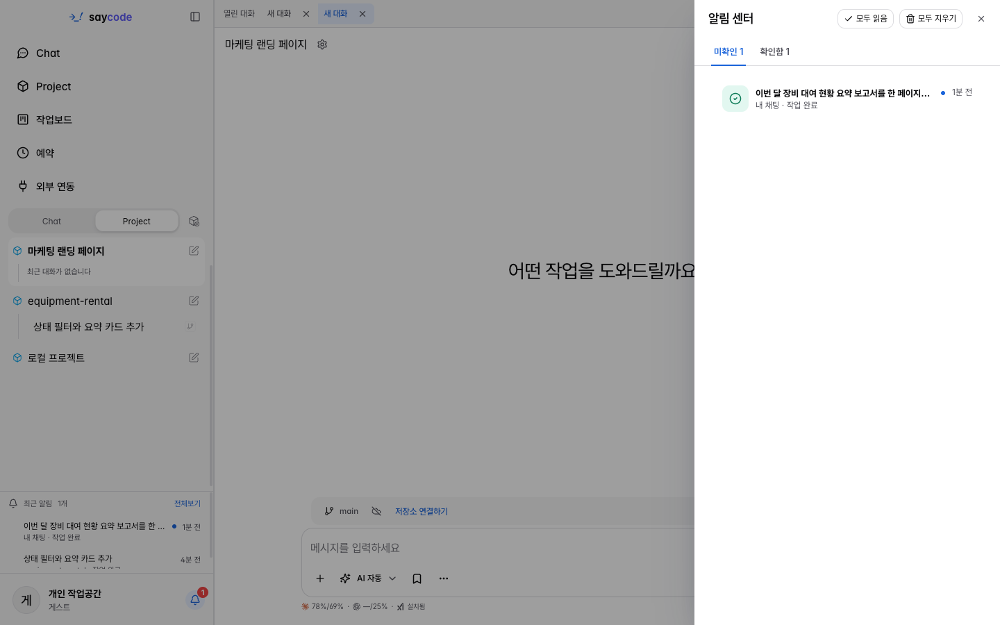

# Saycode Desktop

### 話せば、ソフトウェアになる。

**社内のAIサブスクリプションとAPIを一箇所で管理する運用レイヤー** —
チームがすでに使い慣れた最新モデル(Claude · Codex · Grok · opencode)はそのままに、
アカウント・権限・モデル選択・コスト・デプロイを会社が一つの画面で管理します。
**管理は一画面で、コストは半分に。**

[English](README.md) | [한국어](README.ko.md) | [中文](README.zh.md) | **日本語**

 

### [⬇️ macOS 版をダウンロード (Apple Silicon)](https://github.com/buzzni/saycode-desktop-releases/releases/download/v0.1.81/Saycode-0.1.81-arm64.dmg)

*署名・公証済み DMG · 自動アップデート内蔵 · アカウント不要ですぐ開始*

### 📘 ガイドブック — [Web で読む](https://buzzni.github.io/saycode-desktop-releases/guidebook/en/) · [PDF をダウンロード](docs/guidebook/saycode-guidebook-en.pdf) · [Markdown](docs/GUIDE.md)

*ガイドブックは英語版と[韓国語版](docs/GUIDE.ko.md)があります。*

 

https://github.com/user-attachments/assets/9eea6cbb-bf4d-4d10-a86d-dc4011a8d9dc

*🔊 音声をオンにしてご覧ください — 実際の v0.1.81 の画面で作った 92 秒の紹介動画（英語字幕・BGM） · [MP4 をダウンロード](docs/assets/saycode-intro-en.mp4) · [字幕 SRT](docs/assets/saycode-intro-en.srt)*

<!-- release-notes:start -->
## 新機能と変更点

- [最新リリースノート](docs/releases/v0.1.41.ko.md)（韓国語）
- [リリース履歴](docs/releases/README.ko.md)（韓国語）
<!-- release-notes:end -->

---

## 30 秒でわかる Saycode

| 🗣️ **一文でアプリになる** | 🗂️ **エージェント艦隊を一つのボードで** | ✅ **レビュー → コミット → 完了まで** |
|:---|:---|:---|
| 欲しいものを伝えるだけで、エージェントが**あなたの Mac 上で**本物のコードを書き、開発サーバーを起動し、**プレビューを自動で開いて**くれます。 | Claude · Codex · Grok · opencode の複数の会話を**カンバン形式の作業ボード**で指揮します。カードをドラッグ&ドロップすれば、次の指示やレビュー依頼が送られます。 | **作業を完了**メニューひとつで、レビューから Commit & PR まで進み、終わった会話は**アーカイブ&完了**で整理されます。 |

> **v0.1.81 — 始めやすく、画面の構造は Web と同じに。** v0.1.50 以降の 31 リリースでの主な変化:
>
> - **アカウントなしですぐ開始** — 最初の画面で**個人で使う**を一度押すだけで**初期設定**が自動で進み、有料の AI アカウントがなくても**無料モデル**で会話を始められます。
> - **新しいサイドバーと自分の設定** — ホームのタブの代わりに **Chat · Project**、プロフィールメニュー、**自分の設定(一般 · 開発)**、ひとつにまとまった**プロジェクトを作成**画面、**作業PC**・**作業ボード**といった整理された用語。
> - **より賢い入力欄** — **AI · モデル · 作業強度をひとつのボタン(AI 自動)**に、入力欄の下に **AI 残量**、応答中の**キュー**、**会話の要約**、アーカイブと一時的に非表示。
> - **直してから仕上げるまで** — 要素を**注釈トレイ**にためて送れるブラウザ、**ブランチ全体 / ターン別**の変更・ファイルパネル、入力欄の上の**作業を完了**メニュー、フィルターと先行作業が加わった**作業ボード**、ログインすれば**予約**。

---

## なぜ Saycode なのか？

社員はすでに ChatGPT や Claude で素早く働いています。しかし、サブスクリプションと API 契約は部署・個人ごとに
散らばり、誰がどのモデルをどれだけ使っているか会社にはわかりません。**制限すれば生産性が止まり、
野放しにすれば統制を失います。** 成果物は個人の PC に残ったまま、退職とともに消えていきます。

Saycode は**モデルと競合する製品ではありません。** チームがすでに知っている最新モデルをそのまま使いながら、
組織に必要な管理・セキュリティ・デプロイをその上に加える**運用レイヤー**です。

| | 個人で直接契約する場合 | **Saycode で一緒に使う場合** |
|---|---|---|
| アカウント・コスト | 個人ごとの支払い・アカウントが分散し、管理者は利用状況を把握できない | **同じモデルを中央管理・監査・コスト統制のもとで利用** |
| プロンプト・成果物 | 個人アカウントに紐づき、退職すると消える | **組織の資産として蓄積 — 担当者が変わっても引き継がれる** |
| モデル選択 | 一つのモデルに縛られ、より良いモデルが出ても切り替えにくい | **リクエストごとに最適なモデルを自動選択、ベンダーロックインなしで新モデルをすぐ利用** |
| コード・データ | 外部クラウドへ流出 | **会社が指定した作業PCに常駐 + エンドツーエンド暗号化(E2EE)** |
| 複数エージェントの運用 | チャットウィンドウをひとつずつ Alt-Tab | **カンバン型の作業ボードで艦隊全体を一画面で指揮** |
| 成果物 | レビュー待ちのブランチ | **作業を完了 → レビュー → Commit & PR → 社内 URL へデプロイ** |

一人で使うなら、個人契約が正解です。**組織で一緒に使う瞬間、必要なものが変わります。**

### 会社の管理者が実際にコントロールする4つのこと

| | 何を | どうやって |
|---|---|---|
| **誰が使えるか** | アカウント・シート | 従業員ごとにアカウントを発行・回収します。会社が持つ AI サブスクリプションや API を誰に割り当てるかも会社が決めます。異動・退職時は即座に回収。 |
| **どの AI を使えるか** | モデル・作業PCポリシー | チーム・作業PCごとに使える AI を選んで開放し、個人ごとに例外を設定できます。会社アカウントでシングルサインオン(SSO)。 |
| **どれだけ使っているか** | 利用量・コスト | 誰がどれだけ使い、コストがいくらかかったかを一画面で確認。予算上限に近づくと通知し、超えると自動停止。 |
| **何が起きたか** | 監査ログ | 誰がいつ何をしたかの記録が残ります。検索してファイルへ書き出せます。 |

### 私たちが先に導入し、測定しました

Buzzni の開発組織が Saycode 上で開発・運用しながら実測した結果です。

| **49%** | 単純なリクエスト **~90%** | 日常的な作業 **~80%** |
|:---:|:---:|:---:|
| 月間 AI 実行コスト削減 — 作業量はそのままに、コストだけを削減 | 誤字・文言修正は軽量モデルが処理 | 機能実装・リファクタリングは中位モデルが処理 |

> 測定条件: Buzzni 開発組織 35名 · 2026年6〜7月 · サブスクリプション・API 実行コスト基準 · 同一作業量を維持。
> ターンあたりの削減率は全体の削減率とは異なる指標です。お客様の環境での削減率を保証するものではなく、
> 導入初月に一緒にベースラインを測定します。

---

## Agent IDE(Orca など)とは何が違うのか？

[Orca](https://www.onorca.dev) のようなツールは **Agent IDE** であり、開発者のコーディングループに
集中しています — worktree 単位での並列エージェント実行、diff、レビュー、エディタとの深い統合。その領域を
非常によくこなしており、一部は組織単位の導入とガバナンスまで提供します。そのループが皆さんの課題であれば、
良い選択です。

Saycode が向き合う問いは異なります。エージェントがコードを作り終えた*その後*に始まる問いです:

> **Agent IDE は開発者がより多くのエージェントを動かせるようにします。
> Saycode はそのエージェントが作った成果物を会社の資産にします。**

| | Agent IDE(Orca など) | **Saycode** |
|---|---|---|
| 主な焦点 | 開発者のコーディングループ | **会社のデリバリーループ** — 制作 → レビュー → デプロイ → 共有 → 引き継ぎ |
| 管理の単位 | Repo · worktree · エージェントセッション | **組織 · チーム · プロジェクト · 作業PC · シート · デプロイ済み成果物** |
| 「デプロイ」の意味 | エージェントツールを組織に安全に導入・展開すること | **作った成果物をチームが開く社内 URL でサービスすること** |
| 一般的なゴール | レビューを経て Git にマージされた変更 | **共有・引き継ぎ可能な、実際に稼働中の社内サービス** |
| AI モデルコスト | 利用量の追跡、アカウント切り替え | **難易度ベースの自動ルーティング + サブエージェント委任 — 組織全体で49%削減を実測** |
| 届く相手 | 主に開発者 | **会社の全構成員** — 開発者、企画者、運用担当者 |

両者は並列エージェント、worktree、リモート実行、ローカルファーストのセキュリティという点で重なっています。
したがって、それらは選択の決め手にはなりません。Saycode がその上に加えるのは**運用レイヤー**です:

- **会社の所有権** — プロジェクト、セッション、企画ドキュメント、作業PCは個人のノート PC ではなく組織に
  帰属します。担当者が退職したりチームを異動しても、成果物は検索でき、引き継がれます。
- **社内デプロイ** — ワンクリックで固定の社内 URL(SSL 自動)にデプロイされます。成果物は
  レビュー待ちのブランチではなく、チームが今日すぐ開ける実際のツールになります。
- **共有・引き継ぎ** — 同僚が閲覧し、複製し、磨き上げ、変更を反映し直します。他のチームが完成させた
  プロジェクトは作り直す対象ではなく、出発点になります。
- **コスト運用** — リクエストの難易度に応じて最も安価で適切なモデルへ自動ルーティングし(セッションが
  行き詰まったときだけ上位モデルへ昇格)、機械的なサブタスクはより軽量なモデルのサブエージェントに
  委任し、これらすべてが中央管理された組織共用PCの上で動きます。メッセージごとにどのモデルが
  なぜ選ばれたかがバッジで表示されます。会社全体の AI コストを「確認する」のではなく「運用する」のです。

**いつ何を使えばいいか:** 自分のリポジトリで最も深い並列エージェントコーディング体験を求めるなら、
Agent IDE も良い選択です — 両方を併用しない理由もありません。AI が作ったソフトウェアが
**会社のインフラ**になること — 社内にデプロイされ、チーム間で共有され、引き継ぎを経ても生き残り、
コストまで管理される — それが目標なら、それが Saycode が解決する課題です。

---

## 主な機能

<table>
<tr>
<td width="42%" valign="middle">

### 🧭 インストールしたらすぐ — アカウントなしで始められる

最初の画面はログインフォームで、その下に**個人で使う**と**セルフホストサーバーに接続**があります。
**個人で使う → 確認**を一度押すだけで、Saycode が内蔵サーバーを起動し、この PC を**作業PC**として登録して、
**初期設定**を**自動で進めます** — Saycode CLI、AI ツールの接続確認、通知音まで。この PC ですでに
ログインしている Claude や ChatGPT はそのまま接続され、有料の AI アカウントがなくても**無料モデルで始める**
(opencode)ですぐに会話できます(この PC がオンラインであること、組織が AI を制限している場合は使えません)。
個人利用の会話とプロジェクトは、この PC にだけ保存されます。

</td>
<td>
 

</td>
</tr>
<tr>
<td width="42%" valign="middle">

### 🏠 サイドバーから目的どおりに開始 — Chat · Project

すべては左のサイドバーから分かれます。**Chat** はプロジェクトなしでそのまま質問したりドキュメントを
作ったりする場所、**Project** は **Build**(話しかけて企画・新規プロジェクトを始める)と **Develop**
(新規プロジェクト · コードリポジトリ · ZIP/ファイル · 自分のフォルダー)で開発を始める場所です。
**プロジェクトを作成**では**新しいプロジェクト / Git リポジトリ / ZIP・ファイル / 既存フォルダー**を
ひとつの画面で選びます(Git リポジトリは GitHub・GitLab との連携が必要)。作業PC、**自分の設定**、
**ダークモード**はサイドバー最下部のプロフィールメニューにまとまっています。

</td>
<td>
 
 

</td>
</tr>
<tr>
<td width="42%" valign="middle">

### 🗣️ 一文で動くアプリになる

*「コーヒーのサブスクサービスのランディングページを作ってください」* — この一行で、エージェントが
**あなたの PC 上で**実際のファイルを作り、編集します。ツールの実行は一行ずつ折りたたまれて流れが
見やすく、回答は書かれるそばから表示されます。終わったら、右側の作業エリアの**ブラウザ・プレビュー**で
結果を開いて確認します。(動画はエージェントの待ち時間を短縮して編集しています。)

</td>
<td>
 

</td>
</tr>
<tr>
<td width="42%" valign="middle">

### 📄 プロジェクトなしですぐ仕事 — Chat とドキュメントテンプレート

コードがなくても大丈夫。**Chat** で *「第3四半期の機材レンタル状況レポートを作って」* と頼めば、
結果ファイルが**アプリ内でそのまま開きます**。入力欄の **+** でファイル・写真・フォルダーを添付したり、
**既存のフォルダで開始**したりでき、文書 · スプレッドシート · プレゼンテーション · PDF の形式と
テンプレート(*Design Report*、*Minimal Letterhead*、**マイテンプレートを作成**)を選べば、同じ書式で
書き続けられます。結果ファイルのカードでは**このPCに保存**でき、ログインすれば**公開リンク**で HTML の
結果を共有できます(公開範囲と有効期限を選択)。

</td>
<td>
 
 

</td>
</tr>
<tr>
<td width="42%" valign="middle">

### 🧩 作業エリア — 会話は中央、ツールは右側

**ツールを表示 → パネルを追加**で、ファイル · ターミナル · ブラウザ · 変更 · プレビューを会話の隣に並べます。
**変更**パネルは**ブランチ全体**(コミットを押すとそのコミットだけ)か**ターン別**(このターン · 直前のターン以降 ·
会話開始時との比較)で左右比較 diff を表示し、ファイル名や変更内容で検索できます。**ファイル**パネルには
プロジェクト全体のファイル名検索と**内容検索**、CSV/TSV の**表で表示**、作ったものをひとまとめにする
**成果物一覧**があります。開いたツールは会話ごとに復元され、⌘⇧B で折りたたみ・展開できます。

</td>
<td>
 
 

</td>
</tr>
<tr>
<td width="42%" valign="middle">

### 👀 見ながら直す — 要素をつまんでトレイにためて、まとめて送る

作業エリアの**ブラウザ**で自分のアプリ(`http://localhost:…`)を開き、要素選択で画面上の要素を
いくつもクリックすると、下の**注釈トレイ**にたまっていきます。項目ごとに依頼を書き、意図(**修正して /
質問 / 参考**)を決めて**すべて送信** — セレクター・スタイル・スクリーンショットが入力欄に入るので、
確認して送るだけです。値を自分で変えたいときは**デザイン調整**で余白・配置・文字を調整し、**変更リクエストを
送信**で渡します。返信が終わったらリロードすれば、変更後の画面をすぐ確認できます。

</td>
<td>
 

</td>
</tr>
<tr>
<td width="42%" valign="middle">

### 🤖 AI は自分で選び、モデルはおまかせ — AI 自動

入力欄の下の**ひとつのボタン**で、AI(**Claude Code · Codex · Opencode · Grok**)、モデル、**作業強度**を
選べます。既定の **AI 自動**はリクエストの難しさに合うモデルと強度をその都度選び、メッセージごとに
*「自動 · Sonnet 5.5 · medium」* というバッジで何が選ばれたかを残します。固定したいときはモデルを
選びます(作業強度のメニューは、自分でモデルを選んだ後に表示されます)。よく使う組み合わせは **AI プロファイル**に
保存できます。すぐ隣の **AI 残量**ボタンで Claude · Codex · Grok の使用量とアカウント別の残りを開け、
アカウントが複数あれば**アカウント自動切替**で上限に達しても作業が止まりません。

</td>
<td>
 
 

</td>
</tr>
<tr>
<td width="42%" valign="middle">

### 💬 途切れない会話 — キュー、要約、整理

AI が回答している間も次の依頼を入力して送れば**キュー**に並び(編集・削除・並べ替え可能)、AI からの質問は
入力欄が**質問フォーム**に変わります。長い会話は右側の**メッセージ移動レール**でざっと見渡し、
**会話の要約**(依頼ごとの成果物・変更ファイル・プレビュー)を横に固定できます。終わった会話は
**アーカイブ**(取り消し通知あり、**会話の保管箱**から復元)や**一時的に非表示**(1時間〜来週月曜)で整理し、
開いている会話タブはプロジェクトごとに復元されます。

</td>
<td>
 

</td>
</tr>
<tr>
<td width="42%" valign="middle">

### 🗂️ 作業ボード — 会話の艦隊をカンバンで指揮

すべてのプロジェクトのすべての会話が一つのボードに: **入力待ち → 応答中 → アイドル → レビュー中 → 完了 →
PR マージ済み**。カードにはプロジェクト・AI・モデル・経過時間・ワークツリーが表示され、カードを**レビュー中**へ
ドラッグするとレビュー依頼のダイアログが、**完了**へドラッグすると完了処理が続きます。**フィルター**(作業PC ·
自動化 · PR の状態)と**先行作業**(カードの `1/2` バッジ)で順序を組み、**オートパイロット** · **変更を検証** ·
**PRウォッチ**(GitHub が必要)をカードからそのまま実行できます。同じ権限を待つ会話は**すべて許可 (N)** を
一度押すだけで処理できます。
作業ボードは既定では非表示です — **プロフィールメニュー → 開発者向け機能の設定 → 作業ボードメニューを表示**を
オンにしてください(**⌘⇧A** はオンにしなくても動作します)。

</td>
<td>
 

</td>
</tr>
<tr>
<td width="42%" valign="middle">

### ✅ 作業を完了 — レビューして、PR を出して、片づける

入力欄の上の行の右端にある**作業を完了**ボタンでメニューが開きます。**セルフレビュー**(AI が自分で点検、
回数は**詳細設定…**で調整)、**独立レビューを依頼…**(別の AI ツールが、選んだ AI・モデル・強度・レビューの
焦点で確認。**レビュー履歴**タブもあり)、**Commit & PR**(CI・レビューボット・コンフリクトの処理を経て
base へのマージまで — 条件が残る場合はマージせずに報告)、**アーカイブ&完了**。PR 作成はワークツリーの
会話とリモートリポジトリがあるときに表示され、リモートがなければ**コミット**が出ます。応答中に押しても
大丈夫で、今の作業が終わったあとに続けて実行されるよう順番待ちになります。

</td>
<td>
 

</td>
</tr>
<tr>
<td width="42%" valign="middle">

### 🌿 ワークツリー — 会話ごとに分離、消しても安心

入力欄の上の行の**ワークツリー**をオンにすると、会話専用のブランチで作業するので、作業ボードで複数の会話を
同時に動かしても互いにぶつかりません。新しいワークツリーはリモートの最新のデフォルトブランチから始まり、
**現在の変更を持っていく**で作業中の変更を引き継げます。**プロジェクトツール (⋮) → Git 操作 → ワークツリー…**
の管理画面で古いワークツリーをまとめて整理でき、削除前には `.env` のようなローカル専用ファイルを
知らせ、消したワークツリーは**スナップショット保管庫**から復元できます(Git プロジェクト。Windows の
作業PCを除く)。

</td>
<td></td>
</tr>
<tr>
<td width="42%" valign="middle">

### 🔐 承認とセキュリティ — AI にさせることは自分で決める

AI が危険な操作をしようとすると、まず**注意が必要な操作**の承認カードで確認し、**理由を書いて拒否**する
こともできます。メインウィンドウを見ていなくても**フローティング承認パネル**(自分の設定 → 一般 → 通知、
既定はオフ)で承認や質問に答えられ、**AI ツールの利用ルール**でアプリごとに確認・ブロック・許可
(MCP ツールの読み取り/書き込みを含む)を決めます。**グローバル一時停止**ひとつで自動実行をまとめて止め、
開発自動化の **AI 審査で権限リクエストを処理**で、繰り返しの承認を AI に任せることもできます。

</td>
<td>
 

</td>
</tr>
<tr>
<td width="42%" valign="middle">

### 🧠 覚えて、学ぶエージェント

エージェントが作業中に確かめたやり方を**教訓の候補**として提案したら、回答の下のカードで**承認 / 却下**を
押すだけです。承認した教訓は次の会話から自動で使われます。**自分の設定 → 開発 → Memory** では記憶を管理し、
新しい会話で似た過去の会話を提案してもらえます。**自分の設定 → 一般 → システムプロンプト**では、
Saycode の既定の指示(**Saycode 使い方ガイド**を含む)を項目ごとにオン・オフできます。

</td>
<td></td>
</tr>
<tr>
<td width="42%" valign="middle">

### 🖥️ 自分の作業PC、自分のスマホ

この PC は初回起動で自動登録され、GPU サーバー・ビルドサーバー・クラウド VM も
**自分の設定 → 開発 → 作業PC → マシン登録**で追加できます。新しい作業をどの PC で動かすかはプロフィールメニューや
入力欄で選び、開発者向け機能の設定で **CPU・メモリを表示**をオンにすれば、入力欄の下で負荷を確認できます。
**自分の設定 → 一般 → モバイル接続**の QR を Saycode モバイルアプリで読み取ると、同じ作業環境がスマホで
開き、通知設定の**モバイル完了プッシュ**で長い作業が終わった瞬間をお知らせします。

</td>
<td>
 

</td>
</tr>
<tr>
<td width="42%" valign="middle">

### 🔌 外部連携 — サービス、拡張機能、メッセンジャー

ログインすると、サイドバーの**外部連携**で Notion · Slack · Google Drive · Gmail · KNOI · Figma · DirectCloud を
接続でき、**カスタムコネクタ**(MCP アドレス)も追加できます。ログインしない個人利用では、公式の**拡張機能**
(チャネルアダプター、プラグインマネージャーなど)のインストール・管理画面が開き、**自分の設定 → 開発 →
拡張機能**でも同じことができます。**メッセンジャーチャネル**(自分の設定 → 一般、ログイン中のアカウント限定)を
接続すると、Slack · Telegram · Discord から Saycode の会話を始めて進捗を受け取れます。

</td>
<td></td>
</tr>
<tr>
<td width="42%" valign="middle">

### 🏢 チームワークスペース — デプロイ、共有、組織の統制 *(ログイン)*

saycode.ai アカウントでログインすると、チームが開く**社内 URL にデプロイ**でき(SSL 自動、デプロイのたびに
同じリンクを更新)、プロジェクトを**共同作業**に招待したりチーム単位で共有したりできます。
**どの組織で作業しますか？**で組織を選び、プロフィールメニューの**組織管理**でメンバー・チーム・権限・監査ログ・
AI モデルポリシー・LLM の使用量とコストを管理します。個人利用では表示されない**公開リンク · 予約 ·
メッセンジャーチャネル · 外部サービス連携**も、ログインすれば使えます。デプロイされたアプリやレポートを開く
**エンドユーザーにシートは不要です。**

</td>
<td></td>
</tr>
<tr>
<td width="42%" valign="middle">

### 🌙 いつまでも居たくなるワークスペース

プロフィールメニューの**ダークモード**でそのまま暗くできます。情報は密に、画面は落ち着いて。**クイックオープン**
(⌘P — `>` を打つとコマンドだけ)、会話検索 ⌘⇧F、作業ボード ⌘⇧A、作業パネル ⌘⇧B、固定した会話 ⌘1〜9、
閉じたタブの復元 ⌘⇧T まで、**自分の設定 → 一般 → ショートカット**で検索し、割り当てを変更できます。
ベルの中の最近の通知、Dock バッジ、入力リクエストと作業完了の音 — 細部の積み重ねが体験になります。

</td>
<td>
 
 

</td>
</tr>
</table>

### ほかにも

- ⌨️ **入力欄の生産性** — 空の入力欄で **↑** を押すとこの会話の過去の依頼を呼び出し、ブックマーク型の**マイプロンプト**でよく使う依頼を保存(アカウントに保存されるので別の PC でも使えます)、`@` で別の会話を参照、`/recap`・`/btw`、長文貼り付けはカードに折りたたみ
- 🛟 **ファイルチェックポイント** — 新しい会話の `⋯` でオンにすると(macOS)、エージェントがファイルを変更する前の状態を残し、ファイルごとのプレビューを経て安全に復元
- 🧭 **プロジェクトハブ** — **プロジェクトツール (⋮) → プロジェクトハブに設定**すると、ほかの会話の完了・質問がメッセージとして届き、エージェントが同じプロジェクトの別の会話を参照・指示
- 🔁 **会話を続ける** — **プロジェクトツール (⋮) → 会話を続ける**で、別の AI ツールで続ける(Claude ↔ Codex)か、同じ AI で分岐
- 🔎 **会話検索とクイックオープン** — ⌘⇧F でこの PC のインデックスから過去の会話を検索し、⌘P でファイルやコマンドをすばやく開く
- 🤖 **オートパイロットと自動品質検証** — 作業ボードのカードのオートパイロットがレビューし、要件ごとの根拠を確認してから初めて PR へ進み、PR ウォッチが CI の失敗・レビュー指摘・コンフリクトをエージェントに指示 *(PR ウォッチは GitHub が必要)*
- 🗓️ **予約** *(ログイン)* — 決まった時刻に AI に仕事をさせる: *「毎日午前9時に昨日の PR を要約して」*。タイムゾーンを確認でき、結果は通常の会話として蓄積され、Telegram・Slack にも届きます
- 🔔 **通知と Webhook** — 完了・入力リクエストの通知は再起動後も残り、開発自動化でセッションイベントを署名付き Webhook として自分のエンドポイントに送信
- 📄 **リッチなファイルビューア** — Markdown・HTML・PDF・DOCX をアプリ内でレンダリングし、CSV/TSV は表で、大きなメディアはストリーミングで開く
- 🔐 **セキュリティの既定値** — チャットとターミナルのエンドツーエンド暗号化、パスキー/TOTP MFA *(チーム)*、コードとデータは自分の作業PCに

---

## こう動きます

| | | |
|---|---|---|
| **01 · インストールして開始** | **02 · 目的どおりに開始** | **03 · 言葉で依頼** |
| DMG を開いて**個人で使う**を選ぶと、内蔵サーバーが起動し、初期設定が自動で進みます。 | サイドバーで Chat(ドキュメント・質問)か、Project の Build(新規企画)· Develop(リポジトリ・ZIP・フォルダー)を選びます。 | 自然な一文で十分です: *「状態別のフィルターボタンとサマリーカードを追加して」* |

| | |
|---|---|
| **04 · 自分の作業PCで AI が制作** — エージェントが実際にファイルを読み書きし、コマンドを実行します。右側の作業エリアで変更・ターミナル・ブラウザからすぐ確認し、複数の会話は作業ボードで指揮します。 | **05 · 仕上げて共有** — 作業を完了で、レビュー → PR 作成 → アーカイブ&完了。チームワークスペースなら社内 URL にデプロイし、共同作業で引き継ぎます。 |

---

## インストールと初回起動

### macOS

1. **[Releases](https://github.com/buzzni/saycode-desktop-releases/releases/latest)** から最新の DMG をダウンロード(Apple Silicon — Intel Mac 用の x64 DMG も同じページにあります)
2. DMG を開き、**Saycode** を Applications にドラッグ
3. 起動すると最初の画面はログインフォームです。画面下部で**言語**を選べます(한국어 · English · 中文 · 日本語)
4. 開始方法を選びます
   - **個人で使う → 確認** — ログインなしでこの PC ですぐに開始(会話とプロジェクトはこの PC にだけ保存)
   - **ログイン** — saycode.ai アカウントで開始。アカウントがなければアプリ内で**アカウントを作成**でき、組織はログイン後の**どの組織で作業しますか？**で選びます
   - **セルフホストサーバーに接続** — 自分のサーバーで `saycode server connect` により受け取った接続コードを貼り付けて**接続**

<table>
<tr>
<td width="33%"></td>
<td width="33%"></td>
<td width="33%"></td>
</tr>
<tr>
<td valign="top"><b>① 開始画面</b> — ログインフォームの下に<b>個人で使う</b>と<b>セルフホストサーバーに接続</b>があり、言語ボタンは一番下です。言語は後から 自分の設定 → 一般 → 言語 で変更できます。</td>
<td valign="top"><b>② 初期設定</b> — Saycode CLI → Saycode の指示 → AI ツール → 通知の順に自動で進みます。AI ツールの手順にはこの PC に接続済みの AI だけが表示され、なければ<b>自分のAIアカウントを接続</b>(ChatGPT · Claude)か<b>無料モデルで始める</b>を選びます。</td>
<td valign="top"><b>③ 最初のプロジェクト</b> — Project → Develop → <b>プロジェクトを作成</b>で、新しいプロジェクト · Git リポジトリ · ZIP・ファイル · 既存フォルダーから選び、作業PC(このコンピューター)を確認します。</td>
</tr>
</table>

初期設定は**後で行う**でスキップでき、**プロフィールメニュー → 自分の設定 → 一般 → 初期設定 → このステップから自動実行**で
いつでも続きから再開できます。**Saycode の指示**は既定で*オフ*です。オンにすると、子エージェントへの委任や
結果のインラインプレビューといった Saycode のワークフローに従います。

アプリは Developer ID で署名・公証済みで、自動的にアップデートされます。
スクリーンショット付きで全ステップを見るには、上の**[ガイドブック](docs/GUIDE.md)** をご覧ください。

### ローカルワークスペースとチームワークスペース

| | 個人利用 · Guest ローカルワークスペース | ログイン · チームワークスペース (saycode.ai ログイン) |
|---|---|---|
| 必要なもの | なし — インストールするだけ | 組織アカウント (SSO · パスキー/TOTP MFA) |
| データの場所 | すべてこの Mac | コード・データは指定の作業PC、メタデータ・監査ログは組織コンソール |
| エージェント · AI 自動選択 · Chat とドキュメントテンプレート · 作業ボード · ワークツリー · 作業を完了 · ブラウザ · ターミナル · 検索 · 教訓/メモリ · 拡張機能 | ✅ | ✅ |
| 作業PCの登録 · モバイル接続 | ✅ (モバイルは同一ネットワークまたはトンネル) | ✅ |
| 公開リンク · 予約 · メッセンジャーチャネル · 外部サービス連携(Notion、Slack など) | — | ✅ |
| 社内 URL へのデプロイ · 共同作業 · チーム共有 · プロジェクトタグ | — | ✅ |
| 組織コンソール (シート・チーム・権限・AI モデルポリシー・コスト・監査ログ) | — | ✅ |

ローカルで始めて、必要になったらログインすれば大丈夫です。ローカルのプロジェクトはそのまま残ります。

> **Windows / Linux** — 準備中です。[Releases](https://github.com/buzzni/saycode-desktop-releases/releases) で最新情報をご確認ください。

---

## 導入シナリオ — どこから始めるかはお客様が決めます

三つのシナリオは順番ではなく選択肢です。一つから始めても、組み合わせても構いません。

| 💬 チャットとドキュメント | ⚙️ 個人業務の自動化 | 🚀 アプリ構築とデプロイ |
|---|---|---|
| 議事録の要約、企画書・報告書のドラフト、検索・要約。承認されたユーザー・モデルのみ使用し、グループごとにモデルを制限し、利用量・コストを集計します。 | 社内のコラボレーションツール・ドキュメントストレージと連携し、定型レポートの生成、申請・承認フローの補助といった反復業務を自動化します。 | 現場の担当者が自ら社内ツールを作り、社内 URL でデプロイします。成果物のレビュー・承認フローまで。 |

**開発者でなくても最初の週から使えます** — 経営支援(議事録・月次報告書のドラフト・規定 Q&A)、
営業・マーケティング(提案書ドラフト・VOC 分類)、コマース運用(商品・価格・在庫の確認レポート)、
人事・総務(規定案内・申請/承認フロー・オンボーディング資料)のように、今まさに手作業・Excel・
メッセンジャーで処理している反復業務から始めます。成果物はリンクで共有するので、メッセンジャーへの
添付なしにレビューが完結します。

---

## チームのための Saycode

### 1ヶ月無料の PoC で、まず数字を確認します

お客様が選んだシナリオを対象に、利用量・コスト・ポリシー・監査を実測し、導入判断に必要な結果報告書
まで一緒に作成します。**プレミアムシートの全機能を PoC でそのまま利用できます。**

| 第1週 · ベースライン | 第2〜3週 · 実利用 | 第4週 · 結果報告 |
|---|---|---|
| 現在の AI 利用・コストのベースライン測定、対象部署と PoC シナリオの選定 | 実際の業務に適用し、利用量・コストを実測、ポリシー・権限設定を検証 | 有効化率・コスト・ポリシーの動作結果を整理し、本導入の見積もりを算出 |

PoC 期間は1ヶ月無料。期間中に発生するモデル利用料はお客様の契約に従います。

### 価格 — シートが必要なのは自分で作る人だけ

AI モデルを転売するツールではありません。すでにお使いの AI 契約をそのまま接続し、管理と実行環境に
対するシート料金のみをいただきます。

| プラン | 価格 | 対象 | 含まれるもの |
|---|---|---|---|
| **オフィス** | $10 / 人・月 | チャット・ドキュメント中心の全社員向け | チャット・ドキュメント作業 · 成果物の閲覧・レビュー・承認 · 利用量ダッシュボード |
| **プレミアム** ⭐ | $40 / 人・月 | 自ら作りデプロイする実務担当者向け | オフィスの全機能 + アプリ制作・エージェント実行 · 社内 URL デプロイ · SSO 連携 |
| **大量導入** | 規模に応じて協議 | 全社導入・特殊要件 | 全社規模の単価 · オンプレミス設置型・閉域網構成 · 専任サポート・SLA |

- **AI モデルへのマークアップ 0%** — お使いの Anthropic・OpenAI・Azure・Bedrock・Vertex の契約をそのまま接続します。月額総コスト = シート料金 + 外部 AI サブスクリプション料金 + API 利用料。
- デプロイされたアプリ・レポートの URL を利用するだけの**エンドユーザーにはシートが不要です。** 記名制のシートで、アカウントの共有は行いません。
- 予算上限としきい値アラートを設定でき、上限を超えると自動的に停止します。
- 現在の導入キャンペーン期間中は初期セットアップ費用なし。

- 🌐 ウェブサイト: **[saycode.ai](https://saycode.ai)** · 紹介資料: **[saycodepoc.apps.saycode.ai](https://saycodepoc.apps.saycode.ai/)**
- 💼 導入のお問い合わせ: [soo@buzzni.com](mailto:soo@buzzni.com)
- 🛠 技術に関するお問い合わせ: [ryan@buzzni.com](mailto:ryan@buzzni.com)
- 🤝 カスタマーサポート: [ernie@buzzni.com](mailto:ernie@buzzni.com)

---

## オープンソースについて

Saycode Desktop はオープンソースの上に構築されています。以下のプロジェクトをバンドルまたは使用して
おり(ライセンスを併記)、ライセンス全文はパッケージ版アプリに同梱されています:

| プロジェクト | 用途 | ライセンス |
|---|---|---|
| [Happy](https://github.com/slopus/happy) ([buzzni フォーク](https://github.com/buzzni/happy) 経由) | スタンドアロンモードにバンドルされる暗号化エージェントセッション・リレーエンジン (`happy-cli` / `happy-server`) | MIT |
| [Electron](https://www.electronjs.org/) | デスクトップアプリシェル | MIT |
| [React](https://react.dev/) | UI フレームワーク | MIT |
| [xterm.js](https://xtermjs.org/) (+ fit / web-links / WebGL アドオン) | リモートターミナルのレンダリング | MIT |
| [socket.io-client](https://socket.io/) | リアルタイム通信 | MIT |
| [react-markdown](https://github.com/remarkjs/react-markdown) + [remark-gfm](https://github.com/remarkjs/remark-gfm) | チャットの Markdown レンダリング | MIT |
| [electron-updater](https://www.electron.build/) | アプリ内自動アップデート | MIT |
| [buffer](https://github.com/feross/buffer) | バイナリユーティリティ | MIT |
| [lucide-react](https://lucide.dev/) | アイコンセット | ISC |
| [TweetNaCl.js](https://tweetnacl.js.org/) | エンドツーエンド暗号化プリミティブ | Unlicense (パブリックドメイン) |

Saycode の暗号化セッション同期アーキテクチャの土台となった Kirill Dubovitskiy と
コントリビューターの **[slopus/happy](https://github.com/slopus/happy)** (MIT) に、
特別な感謝を捧げます。

---

**© 2026 [Buzzni](https://buzzni.com) · [saycode.ai](https://saycode.ai)**

*会社の誰もが、話すだけで作れるように。*

