

# Saycode Desktop

### 말하면, 소프트웨어가 됩니다.

**회사 내 AI 구독과 API를 한 곳에서 관리하는 운영 레이어** —
팀이 이미 아는 최신 모델(Claude · Codex · Grok · opencode)을 그대로 쓰되,
계정·권한·모델 선택·비용·배포를 회사가 한 화면에서 관리합니다.
**관리는 한 화면에서, 비용은 절반으로.**

[English](README.md) | **한국어** | [中文](README.zh.md) | [日本語](README.ja.md)

 

### [⬇️ macOS용 다운로드 (Apple Silicon)](https://github.com/buzzni/saycode-desktop-releases/releases/download/v0.1.83/Saycode-0.1.83-arm64.dmg)

*서명·공증된 DMG · 자동 업데이트 내장 · 계정 없이 바로 시작*

### 📘 가이드북 — [웹에서 보기](https://buzzni.github.io/saycode-desktop-releases/guidebook/ko/) · [PDF 내려받기](docs/guidebook/saycode-guidebook-ko.pdf) · [Markdown](docs/GUIDE.ko.md)

*처음이신가요? 첫 실행부터 작업 마무리까지 순서대로 따라오세요.*

 

https://github.com/user-attachments/assets/aa3e4f8b-3f24-48dc-ab8c-b8a4c19fee4b

*🔊 소리를 켜고 보세요 — 실제 v0.1.81 화면으로 만든 92초 소개 영상(자막·배경음악)입니다 · [MP4 다운로드](docs/assets/saycode-intro-ko.mp4) · [자막 SRT](docs/assets/saycode-intro-ko.srt)*

<!-- release-notes:start -->
## 새로운 기능과 변경사항

- [최신 릴리스 노트](docs/releases/v0.1.83.ko.md)
- [전체 릴리스 기록](docs/releases/README.ko.md)
<!-- release-notes:end -->

---

## 30초 요약

| 🗣️ **한 문장이면 앱이 됩니다** | 🗂️ **에이전트 함대를 한 보드에서** | ✅ **리뷰 → 커밋 → 완료까지** |
|:---|:---|:---|
| 원하는 것을 말하면 에이전트가 **내 Mac에서** 진짜 코드를 쓰고, 개발 서버를 띄우고, **미리보기를 자동으로 열어** 줍니다. | Claude · Codex · Grok · opencode 대화 여러 개를 **칸반 작업보드**로 지휘합니다. 카드를 끌어 놓으면 다음 지시·리뷰 요청이 나갑니다. | **작업 마무리** 메뉴 하나로 작업 리뷰·독립 리뷰·PR 올리기까지 이어지고, 끝난 대화는 **보관&완료**로 정리됩니다. |

> **v0.1.81 — 시작은 더 쉽게, 화면은 웹과 같은 구조로.** v0.1.50 이후 31개 릴리스에서 달라진 점:
>
> - **계정 없이 바로 시작** — 첫 화면에서 **개인 사용**을 한 번 누르면 **시작준비**가 자동으로 진행되고, 유료 AI 계정이 없어도 **무료 모델**로 대화를 시작합니다.
> - **💸 유료 계정 없이 무료로 시작** — 유료 AI 계정 없이 **무료 모델(opencode)**로 바로 시작합니다. 무료 모델은 OpenCode가 기간을 정해 제공하며 모델마다 데이터 정책이 다릅니다([가이드북](https://buzzni.github.io/saycode-desktop-releases/guidebook/ko/#205-%EB%AC%B4%EB%A3%8C-%EB%AA%A8%EB%8D%B8%EB%A1%9C-%EC%96%BC%EB%A7%88%EB%82%98-%EC%93%B8-%EC%88%98-%EC%9E%88%EB%82%98%EC%9A%94)).
> - **새 사이드바와 내 설정** — 홈 탭 대신 **Chat · Project**, 프로필 메뉴, **내 설정(일반·개발)**, 하나로 합쳐진 **프로젝트 만들기** 창, **작업PC**·**작업보드** 같은 정돈된 용어.
> - **더 똑똑해진 입력창** — **AI·모델·작업 강도 한 버튼(AI 자동)**, 입력창 아래 **AI 잔여량**, 응답 중 **대기열**, **대화 요약**과 보관·잠시 숨기기.
> - **고치고 마무리하기까지** — 요소를 **주석 트레이**에 모아 보내는 브라우저, **브랜치 전체/턴별** 변경·파일 패널, 입력창 위 **작업 마무리** 메뉴, 필터·선행 작업이 생긴 **작업보드**, 로그인하면 **예약**.

---

## 왜 Saycode인가요?

직원들은 이미 ChatGPT와 Claude로 빠르게 일합니다. 하지만 구독과 API 계약은 부서·개인별로
흩어지고, 누가 어떤 모델을 얼마나 쓰는지 회사는 알 수 없습니다. **막으면 생산성이 멈추고,
열어두면 통제를 잃습니다.** 결과물은 개인 PC에 남았다가 퇴사와 함께 사라집니다.

Saycode는 **모델과 경쟁하는 제품이 아닙니다.** 팀이 이미 아는 최신 모델을 그대로 쓰되,
조직에 필요한 관리·보안·배포를 그 위에 더하는 **운영 레이어**입니다.

| | 개인이 직접 구독할 때 | **Saycode로 함께 쓸 때** |
|---|---|---|
| 계정·비용 | 개인별 결제·계정 파편화, 관리자는 사용량 확인 불가 | **같은 모델을 중앙 관리·감사·비용 통제 아래에서 사용** |
| 프롬프트·산출물 | 개인 계정에 귀속, 퇴사하면 소멸 | **조직 자산으로 축적 — 담당자가 바뀌어도 유지** |
| 모델 선택 | 하나의 모델에 종속, 더 나은 모델이 나와도 전환 곤란 | **요청별 최적 모델 자동 선택, 벤더 종속 없이 신모델 즉시 사용** |
| 코드·데이터 | 외부 클라우드로 나감 | **회사가 지정한 작업PC에 상주 + 종단간 암호화(E2EE)** |
| 다중 에이전트 운영 | 채팅 창 하나씩 알트탭 | **칸반 작업보드로 함대 전체를 한 화면에서 지휘** |
| 결과물 | 리뷰를 기다리는 브랜치 | **작업 마무리 → 리뷰 → PR 올리기 → 사내 URL 배포** |

혼자 쓸 때는 직접 구독이 맞습니다. **조직이 함께 쓰는 순간, 필요한 것이 달라집니다.**

### 회사 관리자가 실제로 통제하는 네 가지

| | 무엇을 | 어떻게 |
|---|---|---|
| **누가 쓸 수 있나** | 계정·좌석 | 직원마다 계정을 주고 거둡니다. 회사가 가진 AI 구독이나 API를 누구에게 붙일지도 회사가 정합니다. 부서 이동·퇴사 시 즉시 회수. |
| **어떤 AI를 쓸 수 있나** | 모델·작업PC 정책 | 팀·작업PC별로 쓸 수 있는 AI를 골라 열어주고, 사람마다 예외를 둡니다. 회사 계정으로 한 번에 로그인(SSO). |
| **얼마나 쓰고 있나** | 사용량·비용 | 누가 얼마나 썼고 비용이 얼마 나갔는지 한 화면에서 봅니다. 예산 상한을 넘기 전에 알려주고, 넘으면 자동 중지. |
| **무슨 일이 있었나** | 감사 로그 | 누가 언제 무엇을 했는지 기록이 남습니다. 검색해서 파일로 내보낼 수 있습니다. |

### 우리가 먼저 도입해 측정했습니다

버즈니 개발 조직이 Saycode 위에서 개발·운영하며 실측한 결과입니다.

| **49%** | 단순 요청 **~90%** | 일상 작업 **~80%** |
|:---:|:---:|:---:|
| 월 AI 실행비 절감 — 작업량은 그대로 두고 비용만 줄였습니다 | 오타·문구 수정은 가벼운 모델이 처리 | 기능 구현·리팩터링은 중간 모델이 처리 |

> 측정 조건: 버즈니 개발 조직 35명 · 2026년 6~7월 · 구독·API 실행비 기준 · 동일 작업량 유지.
> 1턴당 절감률은 전체 절감률과 다른 지표입니다. 고객 환경의 절감률을 보장하지 않으며,
> 도입 첫 달에 기준선을 함께 측정합니다.

---

## Agent IDE(Orca 등)와는 뭐가 다른가요?

[Orca](https://www.onorca.dev) 같은 도구는 **Agent IDE**로, 개발자의 코딩 루프에
집중합니다 — worktree 단위 병렬 에이전트 실행, diff, 리뷰, 깊은 에디터 통합. 그 영역을
아주 잘 해내고, 일부는 조직 단위 도입과 거버넌스까지 제공합니다. 그 루프가 여러분의
문제라면 좋은 선택입니다.

Saycode가 겨냥하는 질문은 다릅니다. 에이전트가 코드를 다 만든 *그 다음*에 시작되는
질문입니다:

> **Agent IDE는 개발자가 더 많은 에이전트를 돌리게 합니다.
> Saycode는 그 에이전트가 만든 결과물을 회사의 자산으로 만듭니다.**

| | Agent IDE (Orca 등) | **Saycode** |
|---|---|---|
| 주된 초점 | 개발자의 코딩 루프 | **회사의 딜리버리 루프** — 제작 → 검토 → 배포 → 공유 → 인수인계 |
| 관리 단위 | Repo · worktree · 에이전트 세션 | **조직 · 팀 · 프로젝트 · 작업PC · 좌석 · 배포 결과물** |
| "배포"의 의미 | 에이전트 도구를 조직에 안전하게 도입·확산 | **만든 결과물을 팀이 여는 사내 URL로 서비스** |
| 일반적인 결승선 | 리뷰를 거쳐 Git에 병합된 변경 | **공유·인수인계 가능한, 실제 운영 중인 사내 서비스** |
| AI 모델 비용 | 사용량 추적, 계정 전환 | **난이도 기반 자동 라우팅 + 서브 에이전트 위임 — 조직 전체 49% 절감 실측** |
| 닿는 사람 | 주로 개발자 | **회사 구성원 전체** — 개발자, 기획자, 운영자 |

두 제품은 병렬 에이전트, worktree, 원격 실행, 로컬 우선 보안에서 겹칩니다. 그러니
그것들은 선택의 기준이 되지 못합니다. Saycode가 그 위에 더하는 것은 **운영 레이어**입니다:

- **회사 소유권** — 프로젝트, 세션, 기획 문서, 작업PC가 개인 노트북이 아니라 조직에
  귀속됩니다. 담당자가 퇴사하거나 팀을 옮겨도 결과물은 검색되고 인수인계됩니다.
- **사내 배포** — 원클릭으로 고정된 사내 URL(SSL 자동)에 배포됩니다. 결과물이
  리뷰를 기다리는 브랜치가 아니라, 팀이 오늘 바로 여는 실제 도구가 됩니다.
- **공유·인수인계** — 동료가 열람하고, 복제하고, 다듬고, 변경 사항을 다시 반영합니다.
  다른 팀이 완성한 프로젝트는 다시 만들 대상이 아니라 출발점이 됩니다.
- **비용 운영** — 요청 난이도에 따라 가장 저렴한 적정 모델로 자동 라우팅하고(세션이
  막힐 때만 상위 모델로 승격), 기계적인 하위 작업은 더 가벼운 모델의 서브 에이전트에게
  위임하며, 이 모든 것이 중앙에서 관리되는 조직 공용 PC 위에서 돌아갑니다.
  메시지마다 어떤 모델이 왜 선택됐는지 배지로 표시됩니다. 회사 전체의 AI 비용을
  "확인"이 아니라 "운영"합니다.

**언제 무엇을 쓰면 되나요:** 내 저장소에서 가장 깊은 병렬 에이전트 코딩 경험이
목표라면 Agent IDE도 좋은 선택입니다 — 둘을 함께 쓰지 못할 이유도 없습니다. AI로 만든
소프트웨어가 **회사의 인프라**가 되는 것이 목표라면 — 사내에 배포되고, 팀 간에
공유되고, 인수인계에도 살아남고, 비용까지 통제되는 — 그게 Saycode가 푸는 문제입니다.

---

## 주요 기능

<table>
<tr>
<td width="42%" valign="middle">

### 🧭 설치하면 바로 — 계정 없이도 시작

첫 화면에는 로그인 폼 아래에 **개인 사용**과 **셀프호스트 서버에 연결**이 있습니다. **개인 사용 → 확인**
한 번이면 Saycode가 내장 서버를 띄우고, 이 PC를 **작업PC**로 등록한 뒤 **시작준비**를
**자동으로 진행**합니다 — Saycode CLI, AI 도구 연결 확인, 알림 소리까지. 이 PC에 이미 로그인된
Claude·ChatGPT는 그대로 연결되고, 유료 AI 계정이 없어도 **무료 모델로 시작하기**(opencode)로 바로
대화할 수 있습니다(이 PC가 온라인이어야 하고, 조직이 AI를 제한하면 쓸 수 없습니다). 개인 사용의
대화와 프로젝트는 이 PC에만 저장됩니다.

</td>
<td>
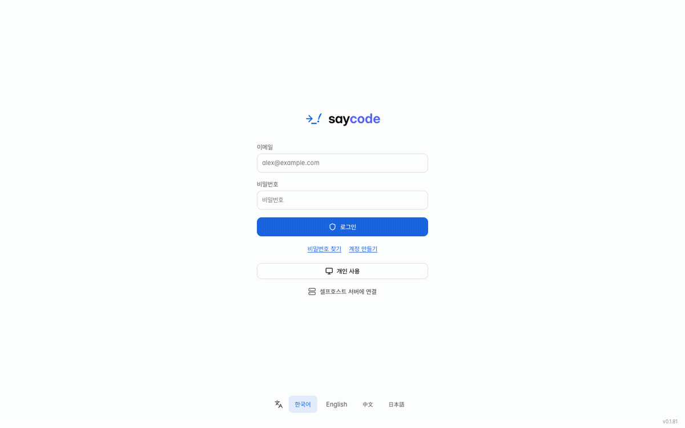 
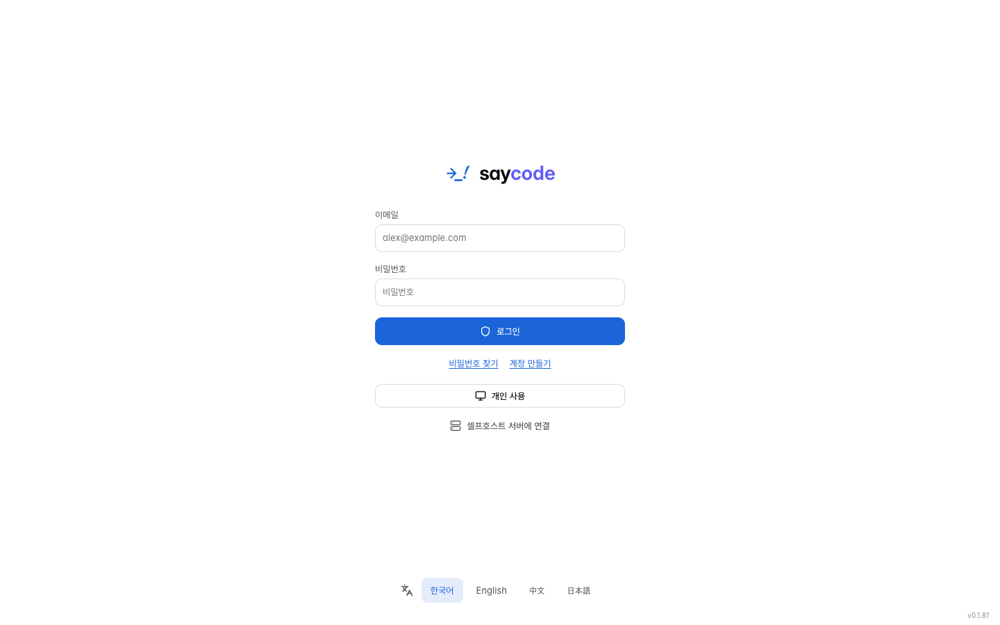
</td>
</tr>
<tr>
<td width="42%" valign="middle">

### 🏠 사이드바에서 목적대로 시작 — Chat · Project

왼쪽 사이드바에서 갈립니다. **Chat**은 프로젝트 없이 바로 묻고 문서를 만드는 곳, **Project**는
**Build**(말로 기획·새 프로젝트)와 **Develop**(새 프로젝트 · 코드 저장소 · ZIP/파일 · 내 폴더)으로
개발을 시작하는 곳입니다. **프로젝트 만들기**는 **새 프로젝트 / Git 저장소 / ZIP·파일 / 기존 폴더**를
한 창에서 고릅니다(Git 저장소는 GitHub·GitLab 연결 필요). 작업PC, **내 설정**, **다크 모드**는
사이드바 맨 아래 프로필 메뉴에 모여 있습니다.

</td>
<td>
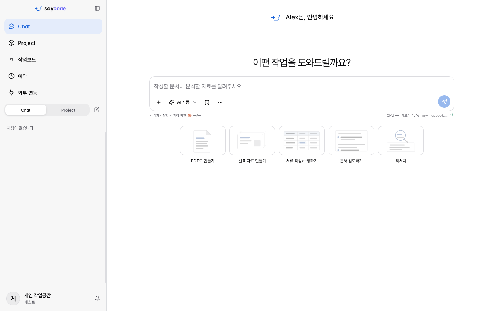 
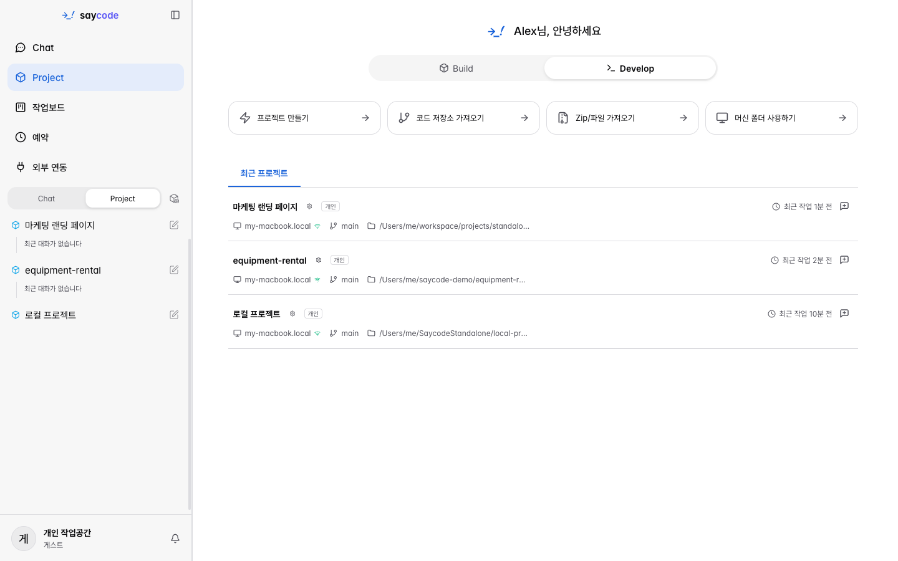 
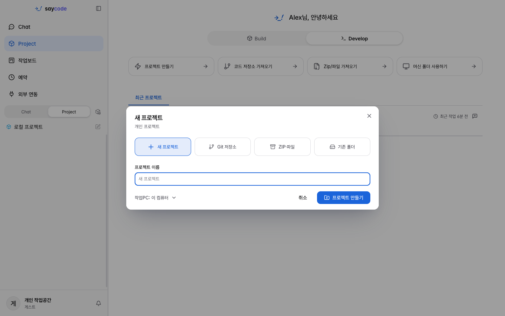
</td>
</tr>
<tr>
<td width="42%" valign="middle">

### 🗣️ 한 문장이면 동작하는 앱이 됩니다

*"커피 구독 서비스 랜딩 페이지를 만들어 주세요"* — 이 한 줄에 에이전트가 **내 PC에서** 실제 파일을
만들고 고칩니다. 도구 실행은 한 줄씩 접혀 흐름이 깔끔하게 보이고, 답변은 쓰이는 대로 바로
보입니다. 끝나면 오른쪽 작업 영역의 **브라우저·미리보기**에서 결과를 열어 봅니다.
(영상은 에이전트 대기 구간을 줄여 편집했습니다.)

</td>
<td>
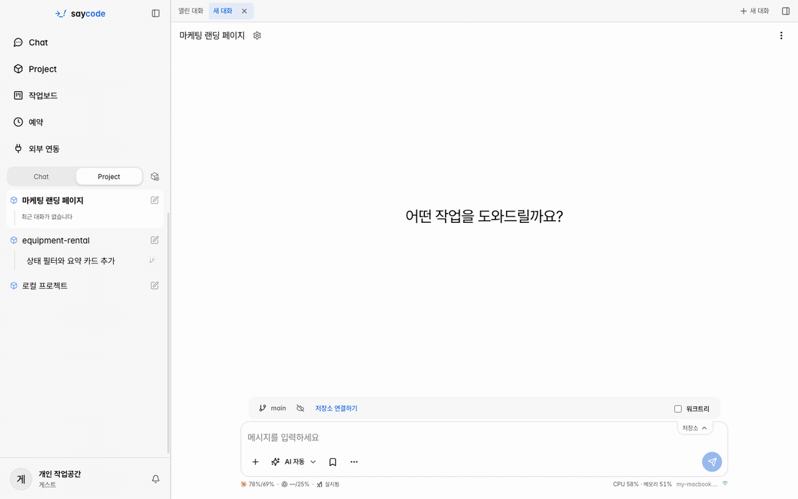 
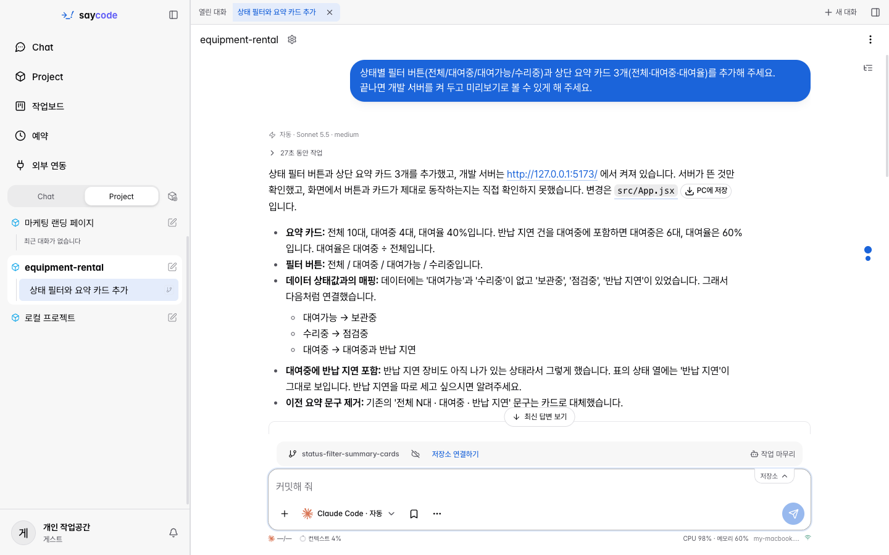
</td>
</tr>
<tr>
<td width="42%" valign="middle">

### 📄 프로젝트 없이 바로 일하기 — Chat과 문서 템플릿

코드가 없어도 됩니다. **Chat**에서 *"3분기 장비 대여 현황 보고서를 만들어줘"* 라고 하면 결과
파일이 **앱 안에서 바로 열립니다**. 입력창 **+** 에서 파일·사진·폴더를 붙이거나 **기존 경로에서
시작**하고, 문서 · 스프레드시트 · 프레젠테이션 · PDF 형식과 템플릿(*Design Report*, *Minimal
Letterhead*, **내 템플릿 만들기**)을 고르면 같은 서식으로 계속 작성합니다. 결과 파일 카드에서는
**PC에 저장**하고, 로그인하면 **공개 링크**로 HTML 결과를 공유할 수 있습니다(공개 범위·만료 선택).

</td>
<td>
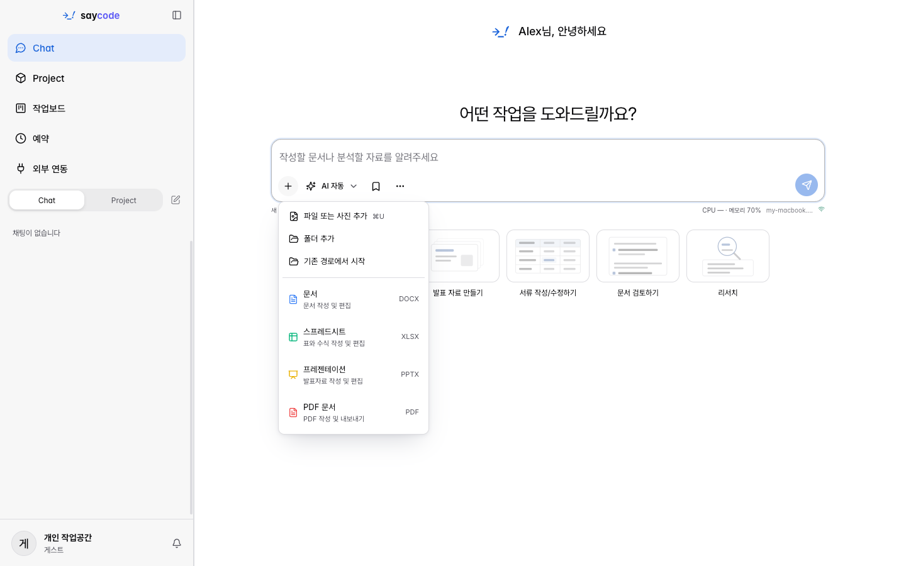 
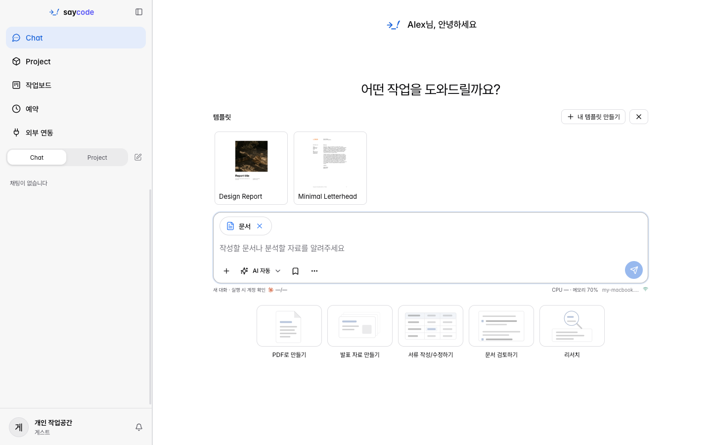 
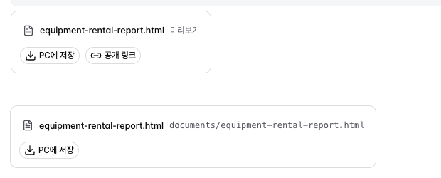
</td>
</tr>
<tr>
<td width="42%" valign="middle">

### 🧩 작업 영역 — 대화는 가운데, 도구는 오른쪽

**도구 펼치기 → 작업 패널 추가**로 파일 · 터미널 · 브라우저 · 변경 · 미리보기를 대화 옆에 붙입니다.
**변경** 패널은 **브랜치 전체**(커밋을 누르면 그 커밋만)와 **턴별**(이 턴 · 직전 턴 이후 · 대화
시작 대비)로 좌우 비교 diff를 보여 주고, 파일명·바뀐 내용으로 찾을 수 있습니다. **파일** 패널은
프로젝트 전체 파일 이름 검색과 **내용 검색**, CSV·TSV **표로 보기**, 만든 결과를 한곳에 모은
**작업물 모아보기**를 갖췄습니다. 열어 둔 도구는 대화별로 복원되고, ⌘⇧B로 접고 펼칩니다.

</td>
<td>
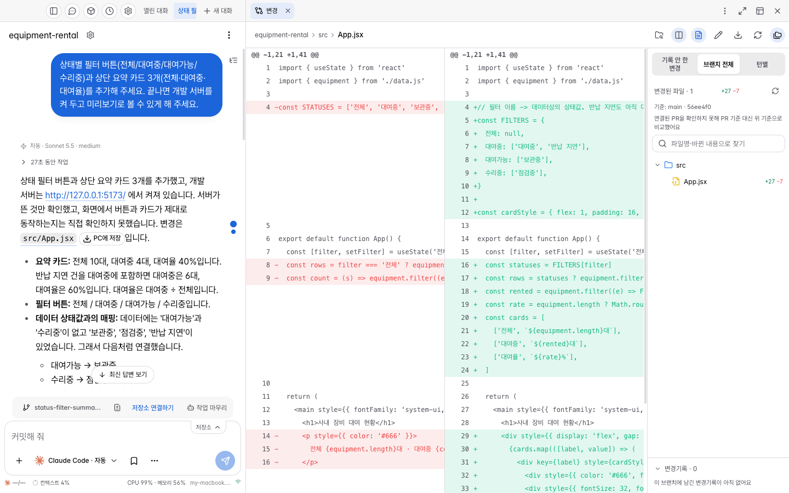 
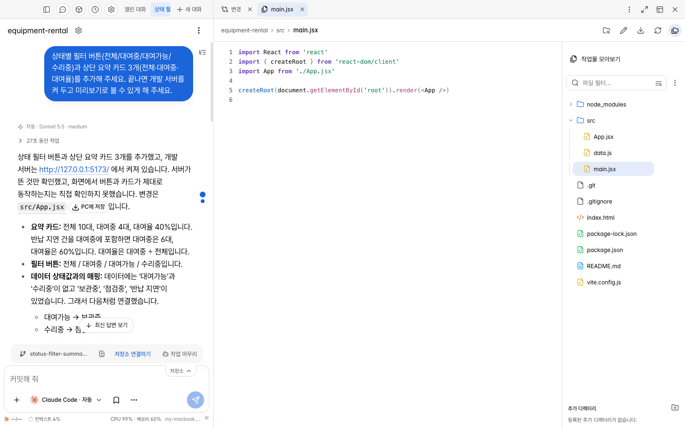 
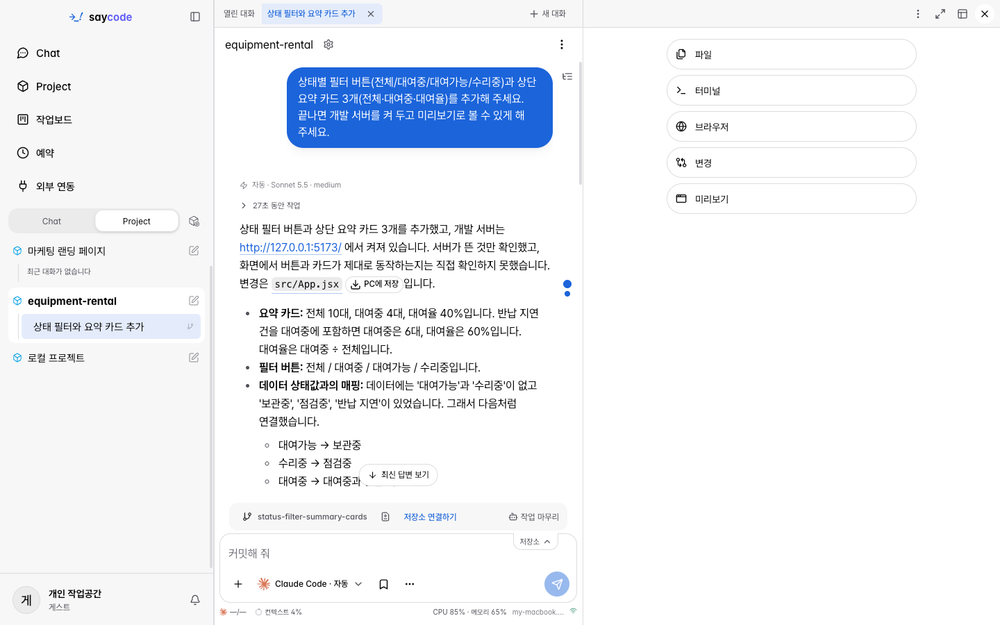
</td>
</tr>
<tr>
<td width="42%" valign="middle">

### 👀 보면서 고치기 — 화면의 요소를 집어 트레이에 담아 한 번에

작업 영역의 **브라우저**에 내 앱(`http://localhost:…`)을 열고 **요소 선택**으로 화면의 요소를 여러 개
클릭하면 아래 **주석 트레이**에 쌓입니다. 항목마다 요청을 적고 의도(**수정해 줘 / 질문 / 참고**)를
정한 뒤 **모두 보내기** — 셀렉터·스타일·스크린샷이 입력창에 채워지니 확인하고 전송하면 됩니다.
말 대신 값을 직접 바꾸고 싶다면 **디자인 조정**(여백·간격·글자)에서 조절해 **변경 요청 보내기**로
넘깁니다. 응답이 끝난 뒤 새로고침하면 바뀐 화면을 바로 확인합니다.

</td>
<td>
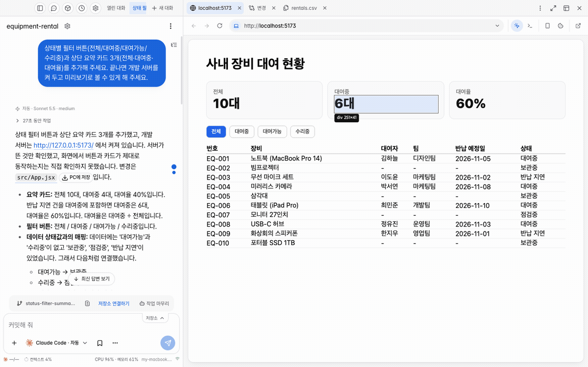 
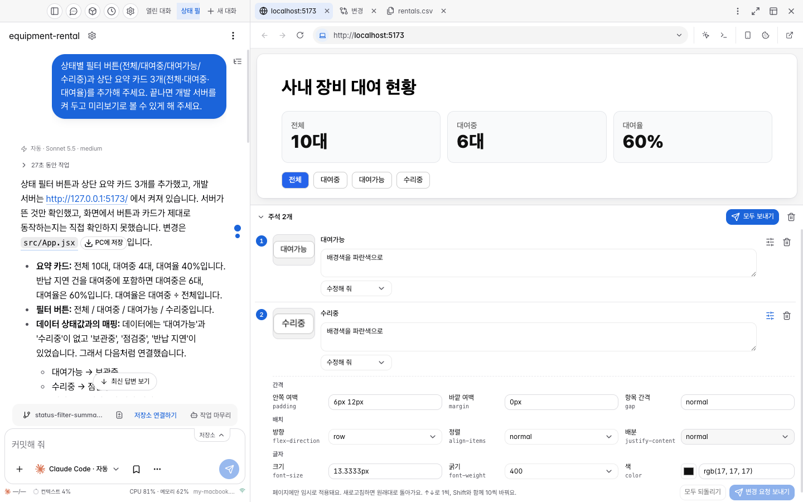
</td>
</tr>
<tr>
<td width="42%" valign="middle">

### 🤖 AI는 고르고, 모델은 알아서 — AI 자동

입력창 아래 **한 버튼**에서 AI(**Claude Code · Codex · Opencode · Grok**), 모델, **작업 강도**를
고릅니다. 기본값 **AI 자동**은 요청 난이도에 맞는 모델과 강도를 매번 알아서 고르고, 메시지마다
*"자동 · Sonnet 5.5 · medium"* 배지로 무엇이 선택됐는지 남깁니다. 직접 고정하고 싶다면 모델을
고르세요(작업 강도는 모델을 직접 고른 뒤에 나타납니다). 자주 쓰는 조합은 **AI 프로필**로 저장합니다.
바로 옆 **AI 잔여량** 버튼은 Claude · Codex · Grok 사용량과 계정별 잔량을 열고, 계정이 여러 개면
**자동순환계정**으로 한도에 막혀도 작업을 이어 갑니다.

</td>
<td>
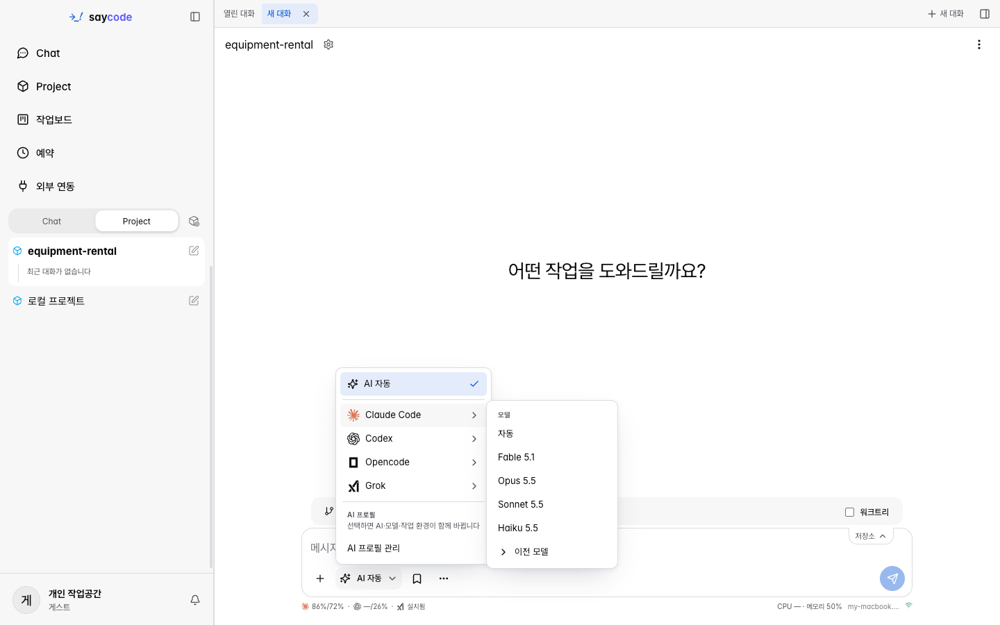 
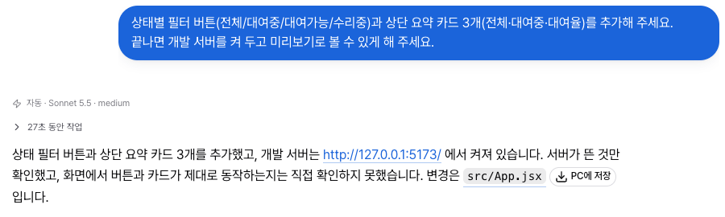 
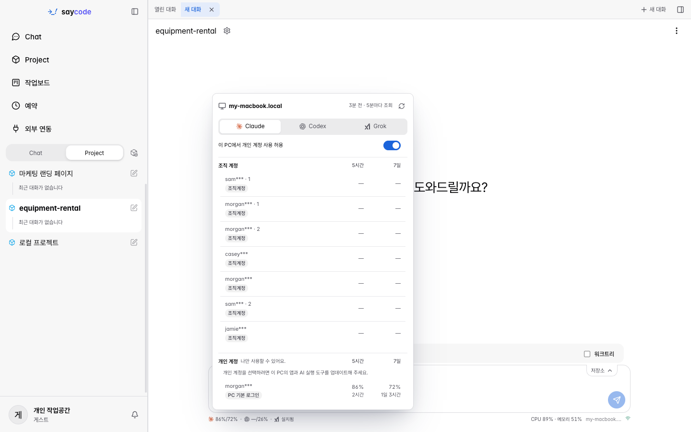
</td>
</tr>
<tr>
<td width="42%" valign="middle">

### 💸 유료 계정 없이 무료로 시작 — 무료 모델(opencode)

Claude·ChatGPT 유료 계정이 없어도 **시작준비 → 무료 모델로 시작하기** 한 번이면 opencode를 이 PC에 설치하고
바로 대화할 수 있습니다. 설치 전에 설치 위치와 무료 모델의 조건을 보여 주고, 확인한 뒤에만 설치합니다.
입력창 아래 AI 메뉴에서 **Opencode**를 고르면 무료 모델에 `무료`·`추천 무료` 표시가 붙고, 모델을 고르지
않으면 메시지마다 추천 무료 모델이 쓰입니다. 무료 모델은 OpenCode가 **기간을 정해 제공**하며 **모델마다
데이터 보관·학습 정책이 다릅니다.** 회사·기밀 코드는 유료·조직 AI를 연결하거나 보관·학습을 하지 않는다고
밝힌 모델만 쓰세요. → [가이드북 FAQ: 무료 모델로 얼마나 쓸 수 있나요?](https://buzzni.github.io/saycode-desktop-releases/guidebook/ko/#205-%EB%AC%B4%EB%A3%8C-%EB%AA%A8%EB%8D%B8%EB%A1%9C-%EC%96%BC%EB%A7%88%EB%82%98-%EC%93%B8-%EC%88%98-%EC%9E%88%EB%82%98%EC%9A%94)

</td>
<td>
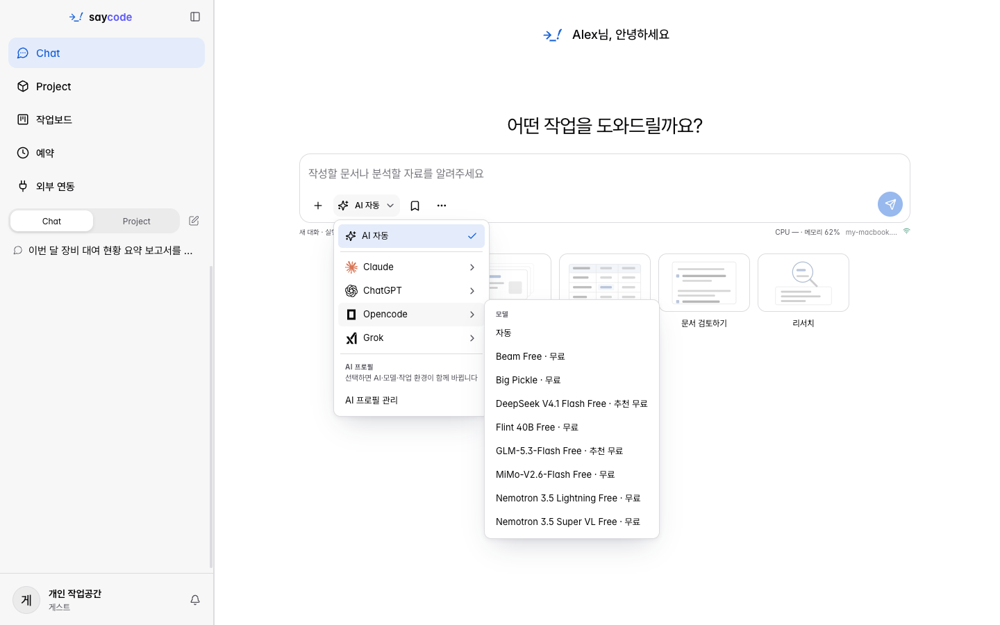
</td>
</tr>
<tr>
<td width="42%" valign="middle">

### 💬 끊김 없는 대화 — 대기열, 요약, 정리

AI가 답하는 동안에도 다음 요청을 입력해 보내면 **대기열**에 쌓이고(편집·삭제·순서 변경), AI가
되묻는 질문은 입력창이 **질문 폼**으로 바뀝니다. 긴 대화는 오른쪽 **메시지 이동 레일**로 훑고
**대화 요약**(요청별 작업물·변경 파일·미리보기)을 옆에 고정해 둘 수 있습니다. 끝난 대화는
**보관하기**(되돌리기 알림, **대화 보관함**에서 복원)나 **잠시 숨기기**(1시간 ~ 다음 주 월요일)로
정리하고, 열린 대화 탭은 프로젝트별로 복원됩니다.

</td>
<td>
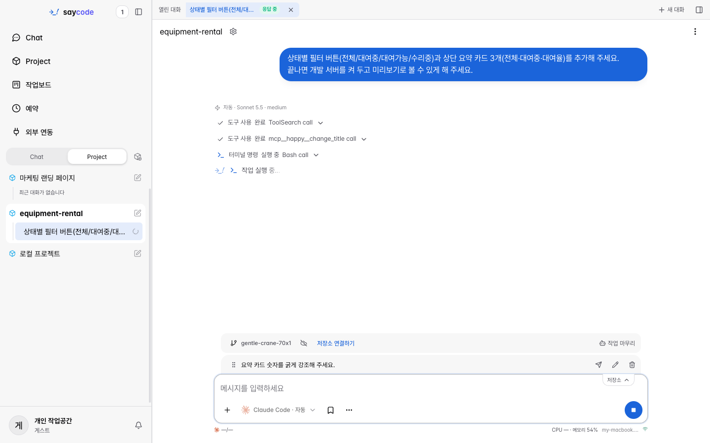 
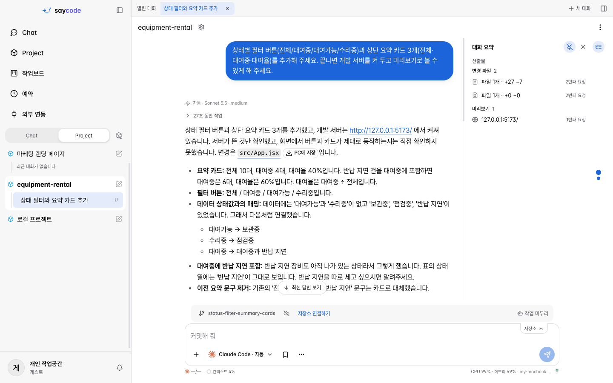
</td>
</tr>
<tr>
<td width="42%" valign="middle">

### 🗂️ 작업보드 — 대화 함대를 칸반으로 지휘

모든 프로젝트의 모든 대화가 한 보드에: **입력 대기 → 응답 중 → 대기 → 리뷰 중 → 완료 →
PR 병합됨**. 카드마다 프로젝트·AI·모델·경과 시간·작업트리가 보이고, 카드를 **리뷰 중**으로
끌어 놓으면 리뷰 요청 대화상자가, **완료**로 끌어 놓으면 완료 처리가 이어집니다. **필터**(작업PC ·
자동화 · PR 상태)와 **선행 작업**(`선행 1/2` 배지)으로 순서를 짜고, **오토파일럿** · **변경 검증** ·
**PR 지킴이**(GitHub 필요)를 카드에서 바로 실행합니다. 같은 권한을 기다리는 대화는
**전부 허용 (N)** 한 번으로 처리합니다.
작업보드는 기본으로 숨겨져 있습니다 — **프로필 메뉴 → 개발자 기능 설정 → 작업보드 메뉴 보이기**를
켜세요(**⌘⇧A**는 켜지 않아도 동작합니다).

</td>
<td>
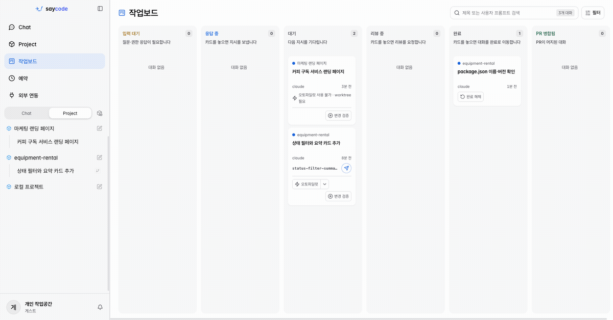 
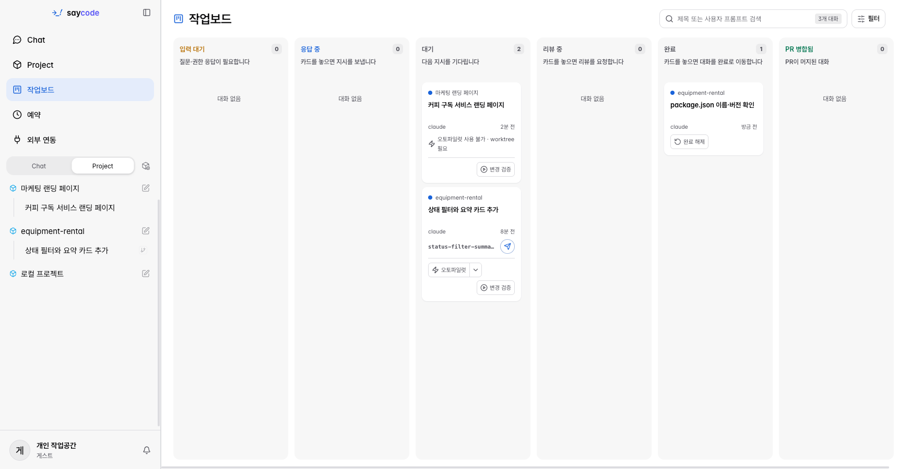
</td>
</tr>
<tr>
<td width="42%" valign="middle">

### ✅ 작업 마무리 — 리뷰하고, 올리고, 정리하기

입력창 위 줄 오른쪽의 **작업 마무리** 버튼이 메뉴를 엽니다. **작업 리뷰하기**(AI가 스스로 점검,
반복 횟수는 **고급 설정…**), **독립 리뷰 요청…**(다른 AI도구가 AI·모델·작업 강도·리뷰 초점을 정해
검토, **리뷰 기록** 탭), **PR 올리기**(CI·리뷰 봇·충돌 처리를 거쳐 base 머지까지 — 조건이 남으면
머지하지 않고 보고), **보관&완료**. PR 올리기는 작업트리 대화와 원격 저장소가 있을 때 나타나고,
원격이 없으면 **변경기록 남기기**가 보입니다. 응답 중에 눌러도 "지금 작업이 끝나면 이어서 실행"으로
줄을 서니 타이밍을 걱정하지 않아도 됩니다.

</td>
<td>
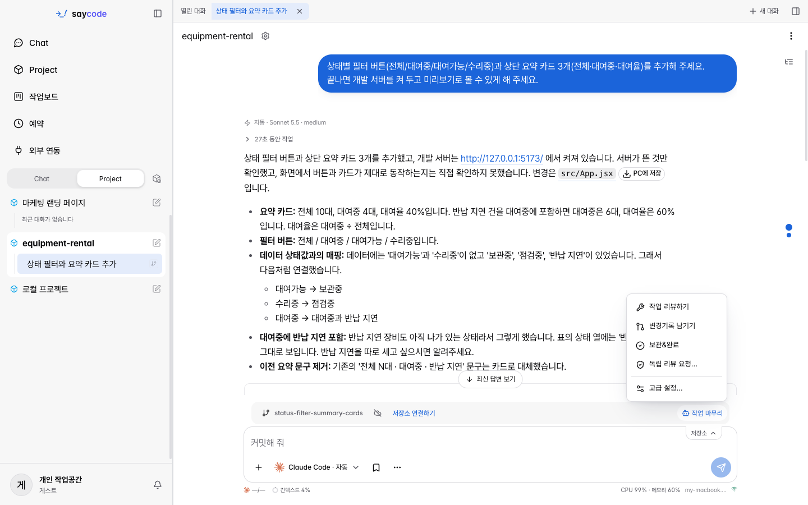 
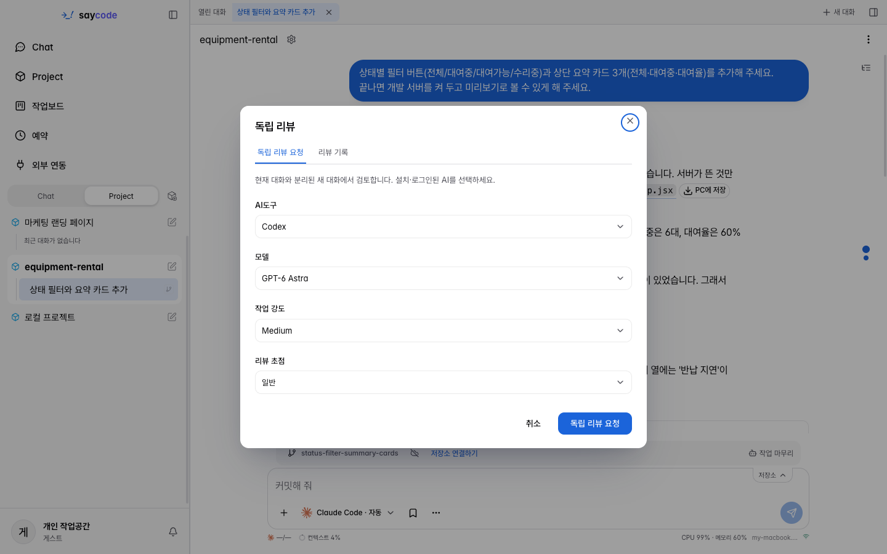
</td>
</tr>
<tr>
<td width="42%" valign="middle">

### 🌿 작업트리 — 대화마다 격리, 지워도 안전

입력창 위 줄의 **워크트리**를 켜면 대화 전용 브랜치(작업트리)에서 일해, 작업보드에서 여러 대화를
동시에 돌려도 서로 부딪히지 않습니다. 새 작업트리는 원격의 최신 기본 브랜치에서 시작하고,
**지금 변경사항 가져가기**로 진행 중인 변경을 옮길 수 있습니다. **프로젝트 도구(⋮) → Git 작업 →
작업트리…** 관리 창에서 오래된 작업트리를 한꺼번에 정리하고, 삭제 전에 `.env` 같은 로컬 전용 파일을
알려 주며, 지운 작업트리는 **스냅샷 보관함**에서 되살릴 수 있습니다(Git 프로젝트, Windows 작업PC 제외).

</td>
<td>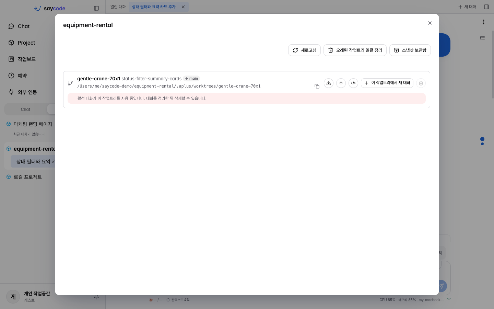</td>
</tr>
<tr>
<td width="42%" valign="middle">

### 🔐 승인과 보안 — AI가 할 수 있는 일을 내가 정합니다

AI가 위험한 작업을 하려 하면 **주의가 필요한 작업** 승인 카드로 먼저 묻고, **이유를 적고 거절**할 수
있습니다. 메인 창을 보고 있지 않아도 **플로팅 승인 패널**(내 설정 → 일반 → 알림, 기본 꺼짐)에서
승인·질문에 답하고, **AI 도구 사용 규칙**에서 앱별로 묻기·차단·허용(MCP 도구 읽기/쓰기 포함)을
정합니다. **자동 작업 일시정지** 한 번으로 예약·오토파일럿 같은 자동 실행을 멈추고, 개발 자동화의
**AI 심사로 권한 요청 처리**로 반복되는 승인을 AI에게 맡길 수도 있습니다.

</td>
<td>
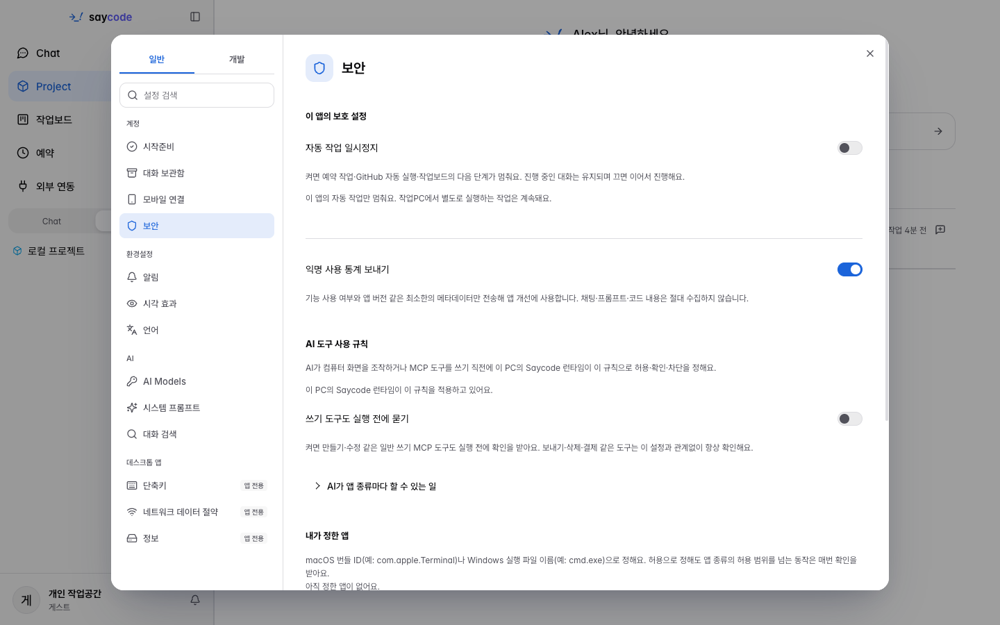 
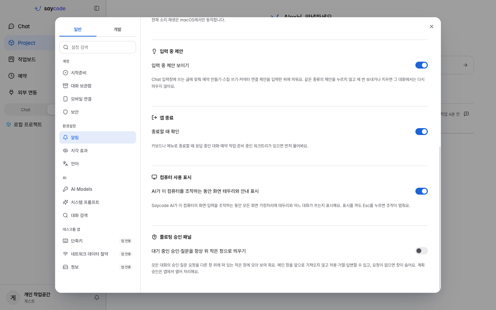
</td>
</tr>
<tr>
<td width="42%" valign="middle">

### 🧠 기억하고 배우는 에이전트

에이전트가 작업 중 확인한 방법을 **교훈 후보**로 제안하면 답변 아래 카드에서 **승인 / 거절**만
누르세요. 승인한 교훈은 다음 대화부터 자동으로 쓰입니다. **내 설정 → 개발 → 메모리**에서는
기억을 관리하고 새 대화에서 비슷한 과거 대화를 제안받으며, **내 설정 → 일반 → 시스템 프롬프트**에서는
Saycode 기본 지시(**Saycode 사용 안내** 포함)를 항목별로 켜고 끕니다.

</td>
<td>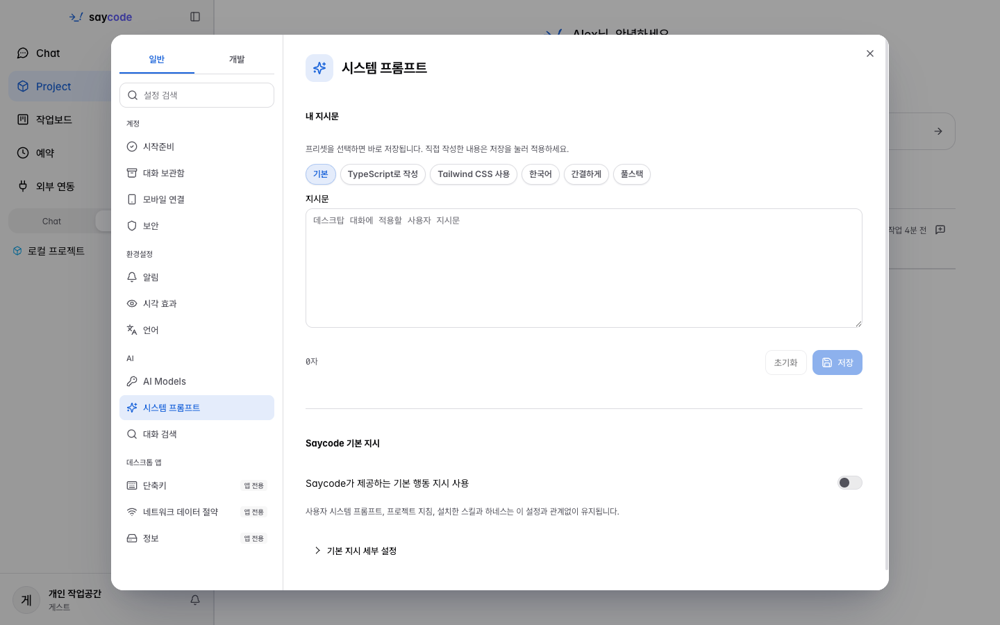</td>
</tr>
<tr>
<td width="42%" valign="middle">

### 🖥️ 내 작업PC, 내 휴대폰

이 PC는 첫 실행에 자동 등록되고, GPU 서버·빌드 서버·클라우드 VM도 **내 설정 → 개발 → 작업PC →
작업PC 등록**으로 더할 수 있습니다. 새 작업을 돌릴 PC는 프로필 메뉴나 입력창에서 고르고,
개발자 기능 설정에서 **CPU·메모리 보이기**를 켜면 입력창 아래에서 부하를 볼 수 있습니다.
**내 설정 → 일반 → 모바일 연결**의 QR을 Saycode 모바일 앱으로 찍으면 같은 작업공간이 폰에 열리고,
알림 설정의 **모바일 완료 푸시**로 긴 작업이 끝나는 순간을 알려 줍니다.

</td>
<td>
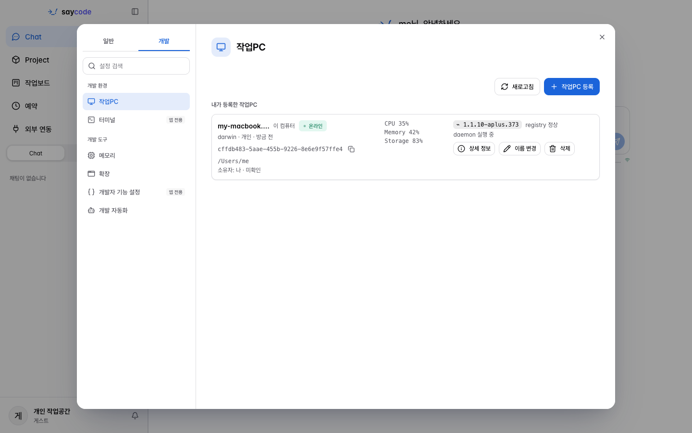 
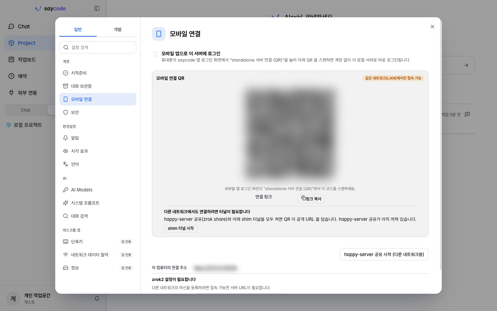
</td>
</tr>
<tr>
<td width="42%" valign="middle">

### 🔌 외부 연동 — 서비스, 확장, 메신저

로그인하면 사이드바 **외부 연동**에서 Notion · Slack · Google Drive · Gmail · KNOI · Figma ·
DirectCloud를 연결하고 **커스텀 커넥터**(MCP 주소)도 추가합니다. 로그인하지 않은 개인 사용에서는
공식 **확장**(채널 어댑터 · 플러그인 관리자 등) 설치·관리 화면이 열리고, **내 설정 → 개발 → 확장**에서도
같은 일을 합니다. **메신저 채널**(내 설정 → 일반, 로그인 계정 전용)을 연결하면 Slack · Telegram ·
Discord에서 Saycode 대화를 시작하고 진행 상황을 받아볼 수 있습니다.

</td>
<td>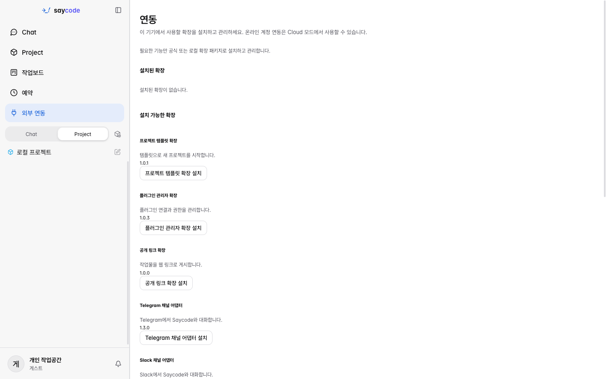</td>
</tr>
<tr>
<td width="42%" valign="middle">

### 🏢 팀 워크스페이스 — 배포, 공유, 조직 통제 *(로그인)*

saycode.ai 계정으로 로그인하면 팀이 여는 **사내 URL로 배포**하고(SSL 자동, 배포마다 같은
링크 갱신), 프로젝트를 **함께 작업**으로 초대하거나 팀 단위로 공유합니다. **어느 조직에서
작업할까요?** 에서 조직을 고르고, 프로필 메뉴의 **조직 관리**에서 멤버·팀·권한·감사 로그·AI 모델
정책·LLM 사용량과 비용을 관리합니다. 개인 사용에서는 보이지 않는 **공개 링크 · 예약 · 메신저 채널 ·
외부 서비스 연동**도 로그인하면 열립니다. 배포된 앱·리포트를 여는 **최종 이용자에게는 좌석이
필요 없습니다.**

</td>
<td>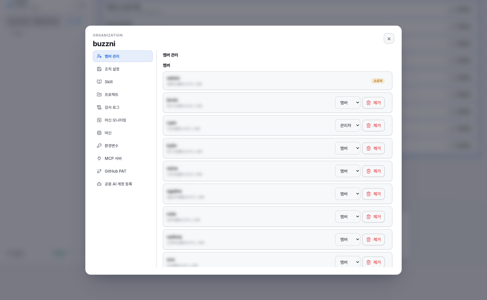</td>
</tr>
<tr>
<td width="42%" valign="middle">

### 🌙 오래 머물고 싶은 작업공간

프로필 메뉴의 **다크 모드** 스위치로 바로 어둡게. 정보는 촘촘하게, 화면은 차분하게. **빠른 열기**
(⌘P — `>`를 치면 명령만), 대화 검색 ⌘⇧F, 작업보드 ⌘⇧A, 작업 패널 ⌘⇧B, 고정 대화 ⌘1~9,
닫은 탭 복원 ⌘⇧T까지 **내 설정 → 일반 → 단축키**에서 찾고 바꿀 수 있습니다. 종 아이콘의 최근
알림, Dock 배지와 입력 요청·작업 완료 소리까지 — 디테일이 쌓여 경험이 됩니다.

</td>
<td>
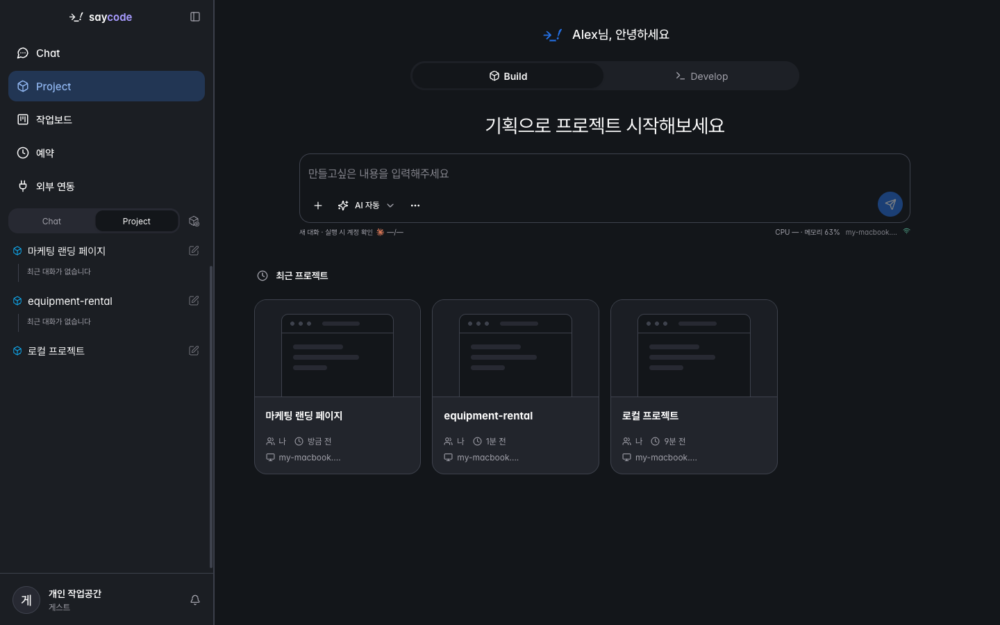 
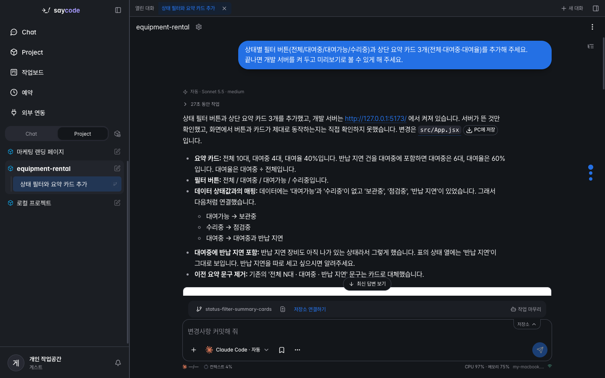 
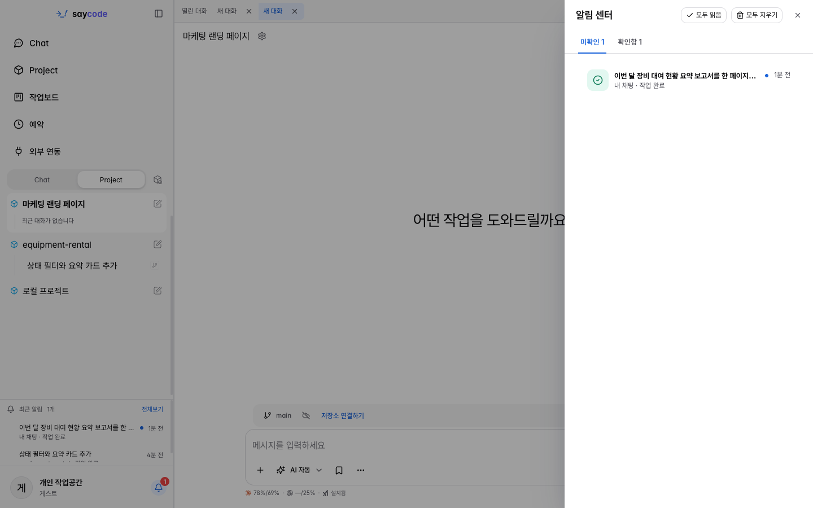
</td>
</tr>
</table>

### 이것도 있습니다

- ⌨️ **입력창 생산성** — 빈 입력창에서 **↑**로 이 대화의 이전 요청 불러오기, 책갈피 **내 프롬프트**로 자주 쓰는 요청 저장(계정에 저장되어 다른 PC에서도 사용), `@`로 다른 대화 참조, `/recap`·`/btw`, 긴 텍스트 붙여넣기 카드
- 🛟 **파일 복원지점** — 새 대화 `⋯`에서 켜면(macOS) 에이전트가 파일을 바꾸기 전 상태를 남기고, 파일별 미리보기를 거쳐 안전하게 복원
- 🧭 **프로젝트 허브** — 프로젝트 도구(⋮) → **프로젝트 허브로 설정**하면 다른 대화의 완료·질문이 메시지로 도착하고, 에이전트가 같은 프로젝트의 다른 대화를 조회·지시
- 🔁 **대화 이어가기** — 프로젝트 도구(⋮) → **대화 이어가기**에서 **다른 AI도구로 이어가기**(Claude ↔ Codex) 또는 **같은 AI로 갈래 만들기**
- 🔎 **대화 검색 & 빠른 열기** — ⌘⇧F로 지난 대화를 이 PC의 인덱스로 검색하고, ⌘P로 파일·명령을 빠르게 엽니다
- 🤖 **오토파일럿 & 자동 품질 검증** — 작업보드 카드의 오토파일럿이 리뷰하고 요구사항별 증거를 확인한 뒤에만 PR까지 진행, PR 지킴이가 CI 실패·리뷰 지적·충돌을 대신 지시 *(PR 지킴이는 GitHub 필요)*
- 🗓️ **예약** *(로그인)* — 정해진 시각에 AI에게 일 시키기: *"매일 오전 9시에 어제 PR을 요약해 줘"*. 시간대를 확인하고, 결과는 일반 대화로 쌓이며 Telegram·Slack으로도 받습니다
- 🔔 **알림 & 웹훅** — 완료·입력 요청 알림이 재시작 후에도 유지되고, 개발 자동화에서 세션 이벤트를 서명된 웹훅으로 내 엔드포인트에 전송
- 📄 **리치 파일 뷰어** — 마크다운·HTML·PDF·DOCX를 앱 안에서 렌더링하고, CSV·TSV는 표로, 큰 미디어는 스트리밍으로 열기
- 🔐 **보안 기본값** — 채팅·터미널 종단간 암호화, 패스키/TOTP MFA *(팀)*, 코드와 데이터는 내 작업PC에

---

## 이렇게 동작합니다

| | | |
|---|---|---|
| **01 · 설치하고 시작** | **02 · 목적대로 시작** | **03 · 말로 요청** |
| DMG를 열고 **개인 사용**을 고르면 내장 서버가 뜨고 시작준비가 자동으로 진행됩니다. | 사이드바에서 Chat(문서·질문) 또는 Project의 Build(새 기획)·Develop(저장소·ZIP·폴더)을 고릅니다. | 자연어 한 문장이면 됩니다: *"상태별 필터 버튼과 요약 카드를 추가해 주세요"* |

| | |
|---|---|
| **04 · 내 작업PC에서 AI가 제작** — 에이전트가 실제 파일을 읽고 쓰고 명령을 실행합니다. 오른쪽 작업 영역에서 변경·터미널·브라우저로 바로 확인하고, 여러 대화는 작업보드로 지휘합니다. | **05 · 마무리하고 공유** — 작업 마무리로 리뷰 → PR 올리기 → 보관&완료. 팀 워크스페이스라면 사내 URL로 배포하고 함께 작업으로 인수인계합니다. |

---

## 설치와 첫 실행

### macOS

1. **[Releases](https://github.com/buzzni/saycode-desktop-releases/releases/latest)**에서 최신 DMG 다운로드 (Apple Silicon — Intel Mac용 x64 DMG도 같은 페이지에 있습니다)
2. DMG를 열고 **Saycode**를 Applications로 드래그
3. 실행하면 로그인 폼이 첫 화면입니다. 화면 하단에서 **언어**를 고를 수 있습니다 (한국어 · English · 中文 · 日本語)
4. 시작 방법을 고르세요
   - **개인 사용 → 확인** — 로그인 없이 이 PC에서 바로 시작 (대화·프로젝트는 이 PC에만 저장)
   - **로그인** — saycode.ai 계정으로 시작. 계정이 없으면 **계정 만들기**로 앱 안에서 가입하고, 조직은 로그인 후 **어느 조직에서 작업할까요?** 에서 고릅니다
   - **셀프호스트 서버에 연결** — 직접 운영하는 서버에서 `saycode server connect`로 받은 연결 코드를 붙여넣고 **연결**

<table>
<tr>
<td width="33%"></td>
<td width="33%">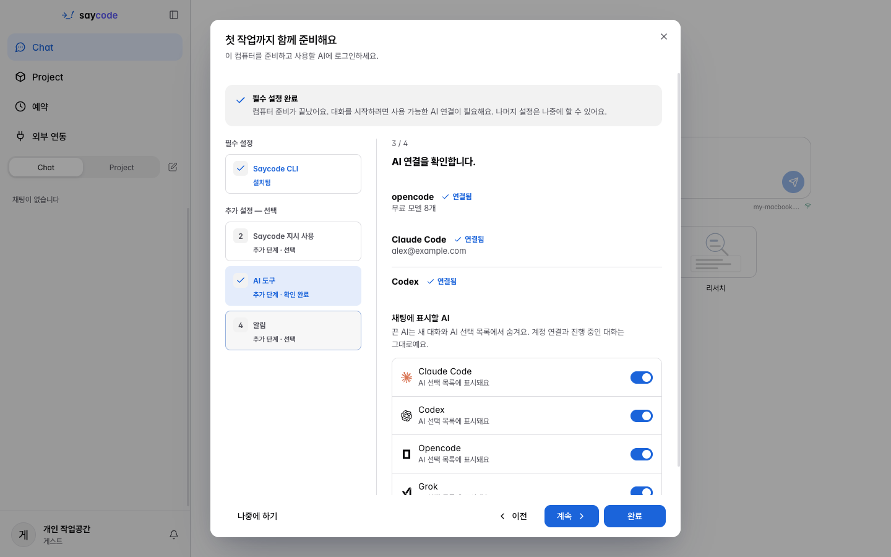</td>
<td width="33%">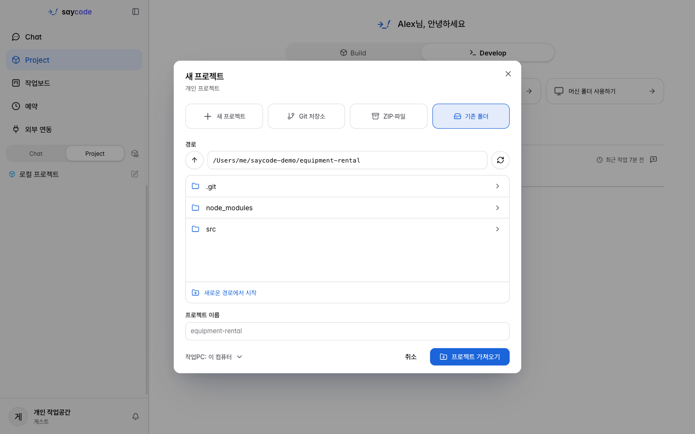</td>
</tr>
<tr>
<td valign="top"><b>① 시작 화면</b> — 로그인 폼 아래에 <b>개인 사용</b>과 <b>셀프호스트 서버에 연결</b>이 있고, 언어 버튼은 맨 아래입니다. 언어는 나중에 내 설정 → 일반 → 언어에서 바꿀 수 있습니다.</td>
<td valign="top"><b>② 시작준비</b> — Saycode CLI → Saycode 지시 사용 → AI 도구 → 알림 순서로 스스로 진행합니다. AI 도구 단계에는 이 PC에 연결된 AI만 보이고, 없으면 <b>내 AI 계정 연결하기</b>(ChatGPT·Claude) 또는 <b>무료 모델로 시작하기</b>를 고릅니다.</td>
<td valign="top"><b>③ 첫 프로젝트</b> — Project → Develop → <b>프로젝트 만들기</b>에서 새 프로젝트 · Git 저장소 · ZIP·파일 · 기존 폴더 중 고르고, 작업PC(이 컴퓨터)를 확인합니다.</td>
</tr>
</table>

시작준비는 **나중에 하기**로 건너뛸 수 있고, **프로필 메뉴 → 내 설정 → 일반 → 시작준비 → 이 단계부터
자동 진행**으로 언제든 이어갈 수 있습니다. **Saycode 지시 사용**은 기본적으로 *사용 안 하기*이며,
켜두면 자식 에이전트 위임, 결과물 인라인 미리보기 같은 Saycode 워크플로우를 따릅니다.

앱은 Developer ID 서명·공증되어 있으며, 자동으로 업데이트됩니다.
모든 단계를 스크린샷과 함께 보려면 위의 **[가이드북](docs/GUIDE.ko.md)** 을 참고하세요.

### 로컬 작업공간과 팀 워크스페이스

| | 개인 사용 · Guest 로컬 작업공간 | 로그인 · 팀 워크스페이스 (saycode.ai 로그인) |
|---|---|---|
| 필요한 것 | 없음 — 설치만 하면 됨 | 조직 계정 (SSO · 패스키/TOTP MFA) |
| 데이터 위치 | 전부 이 Mac | 코드·데이터는 지정 작업PC, 메타데이터·감사 로그는 조직 콘솔 |
| 에이전트 · AI 자동 선택 · Chat과 문서 템플릿 · 작업보드 · 작업트리 · 작업 마무리 · 브라우저 · 터미널 · 검색 · 교훈/메모리 · 확장 | ✅ | ✅ |
| 작업PC 등록 · 모바일 연결 | ✅ (모바일은 같은 네트워크 또는 터널) | ✅ |
| 공개 링크 · 예약 · 메신저 채널 · 외부 서비스 연동(Notion·Slack 등) | — | ✅ |
| 사내 URL 배포 · 함께 작업 · 팀 공유 · 프로젝트 태그 | — | ✅ |
| 조직 콘솔 (좌석·팀·권한·AI 모델 정책·비용·감사 로그) | — | ✅ |

로컬로 시작해서 필요할 때 로그인하면 됩니다. 로컬 프로젝트는 그대로 유지됩니다.

> **Windows / Linux** — 준비 중입니다. [Releases](https://github.com/buzzni/saycode-desktop-releases/releases)에서 소식을 확인하세요.

---

## 도입 시나리오 — 어디부터 시작할지 고객이 정합니다

세 시나리오는 순서가 아니라 선택지입니다. 하나로 시작해도, 조합해도 됩니다.

| 💬 채팅과 문서 | ⚙️ 개인 업무 자동화 | 🚀 앱 빌딩과 배포 |
|---|---|---|
| 회의록 요약, 기획서·보고서 초안, 검색·요약. 승인된 사용자·모델만 사용하고, 그룹별로 모델을 제한하고, 사용량·비용을 집계합니다. | 사내 협업 도구·문서 저장소와 연결해 반복 리포트 생성, 요청·승인 흐름 보조 같은 반복 업무를 자동화합니다. | 현업이 직접 사내 도구를 만들고 사내 URL로 배포합니다. 결과물 검토·승인 흐름까지. |

**개발자가 아니어도 첫 주부터 씁니다** — 경영 지원(회의록·월간 보고서 초안·정책 Q&A),
영업·마케팅(제안서 초안·VOC 분류), 커머스 운영(상품·가격·재고 점검 리포트),
HR·총무(규정 안내·요청·승인 흐름·온보딩 자료)처럼 지금 수작업·엑셀·메신저로 처리되는
반복 업무부터 시작합니다. 결과물은 링크로 공유하니 메신저 첨부 없이 검토가 끝납니다.

---

## 팀을 위한 Saycode

### 1개월 무료 PoC로 숫자부터 확인합니다

고객이 선택한 시나리오를 대상으로 사용량·비용·정책·감사를 실측하고, 도입 판단에 필요한
결과 보고서까지 함께 만듭니다. **프리미엄 좌석의 모든 기능을 PoC에서 그대로 씁니다.**

| 1주차 · 기준선 | 2~3주차 · 실사용 | 4주차 · 결과 보고 |
|---|---|---|
| 현재 AI 사용·비용 기준선 측정, 대상 부서와 PoC 시나리오 선정 | 실제 업무에 적용, 사용량·비용 실측, 정책·권한 설정 검증 | 활성화율·비용·정책 작동 결과 정리, 본 도입 견적 산출 |

PoC 기간 1개월 무료. 기간 중 발생하는 모델 사용료는 고객 계약에 따릅니다.

### 가격 — 직접 만드는 사람만 좌석을 둡니다

AI 모델을 되파는 도구가 아닙니다. 쓰던 AI 계약을 그대로 연결하고, 관리와 실행 환경에
대한 좌석 요금만 받습니다.

| 플랜 | 가격 | 대상 | 포함 |
|---|---|---|---|
| **오피스** | $10 / 인·월 | 채팅·문서 중심의 전 직원용 | 채팅·문서 작업 · 결과물 열람·검토·승인 · 사용량 대시보드 |
| **프리미엄** ⭐ | $40 / 인·월 | 직접 만들고 배포하는 실무자용 | 오피스의 모든 기능 + 앱 제작·에이전트 실행 · 사내 URL 배포 · SSO 연동 |
| **대량 도입** | 규모에 따라 협의 | 전사 도입·특수 요건 | 전사 규모 단가 · 사내 서버 설치형·폐쇄망 구성 · 전담 지원·SLA |

- **AI 모델 마크업 0%** — 쓰던 Anthropic·OpenAI·Azure·Bedrock·Vertex 계약을 그대로 연결합니다. 월 총비용 = 좌석료 + 외부 AI 구독료 + API 사용료.
- 배포된 앱·리포트 URL을 이용하는 **최종 이용자에게는 좌석이 필요 없습니다.** 기명 좌석이며 계정을 공유하지 않습니다.
- 예산 상한과 임계치 알림을 설정할 수 있고, 상한을 넘으면 자동으로 멈춥니다.
- 현재 도입 이벤트 기간 중 초기 세팅비 없음.

- 🌐 웹사이트: **[saycode.ai](https://saycode.ai)** · 소개서: **[saycodepoc.apps.saycode.ai](https://saycodepoc.apps.saycode.ai/)**
- 💼 도입 문의: [soo@buzzni.com](mailto:soo@buzzni.com)
- 🛠 기술 문의: [ryan@buzzni.com](mailto:ryan@buzzni.com)
- 🤝 고객 지원: [ernie@buzzni.com](mailto:ernie@buzzni.com)

---

## 오픈소스 고지

Saycode Desktop은 오픈소스 위에 만들어졌습니다. 아래 프로젝트를 번들하거나 사용하고
있으며(라이선스 병기), 전체 라이선스 전문은 패키징된 앱에 포함되어 있습니다:

| 프로젝트 | 용도 | 라이선스 |
|---|---|---|
| [Happy](https://github.com/slopus/happy) ([buzzni 포크](https://github.com/buzzni/happy) 경유) | 스탠드얼론 모드에 번들되는 암호화 에이전트 세션 릴레이 엔진 (`happy-cli` / `happy-server`) | MIT |
| [Electron](https://www.electronjs.org/) | 데스크톱 앱 셸 | MIT |
| [React](https://react.dev/) | UI 프레임워크 | MIT |
| [xterm.js](https://xtermjs.org/) (+ fit / web-links / WebGL 애드온) | 원격 터미널 렌더링 | MIT |
| [socket.io-client](https://socket.io/) | 실시간 전송 | MIT |
| [react-markdown](https://github.com/remarkjs/react-markdown) + [remark-gfm](https://github.com/remarkjs/remark-gfm) | 채팅 마크다운 렌더링 | MIT |
| [electron-updater](https://www.electron.build/) | 앱 내 자동 업데이트 | MIT |
| [buffer](https://github.com/feross/buffer) | 바이너리 유틸리티 | MIT |
| [lucide-react](https://lucide.dev/) | 아이콘 세트 | ISC |
| [TweetNaCl.js](https://tweetnacl.js.org/) | 종단간 암호화 프리미티브 | Unlicense (퍼블릭 도메인) |

Saycode의 암호화 세션 동기화 아키텍처의 근간이 되어준 Kirill Dubovitskiy와 기여자들의
**[slopus/happy](https://github.com/slopus/happy)** (MIT)에 특별한 감사를 전합니다.

---

**© 2026 [Buzzni](https://buzzni.com) · [saycode.ai](https://saycode.ai)**

*회사의 누구든, 말하면 만들 수 있도록.*

