

# Saycode Desktop

### Say it. Ship it.

**The operations layer for every AI subscription and API your company uses.**
Keep the frontier models your team already knows (Claude · Codex · Grok · opencode) —
and let the company manage accounts, permissions, model routing, cost and deployment from one screen.
**One place to manage. Half the cost.**

**English** | [한국어](README.ko.md) | [中文](README.zh.md) | [日本語](README.ja.md)

 

### [⬇️ Download for macOS (Apple Silicon)](https://github.com/buzzni/saycode-desktop-releases/releases/download/v0.1.93/Saycode-0.1.93-arm64.dmg)

*Signed & notarized DMG · auto-updates built in · no account needed to start*

### 📘 Guidebook — [Read on the web](https://buzzni.github.io/saycode-desktop-releases/guidebook/en/) · [Download PDF](docs/guidebook/saycode-guidebook-en.pdf) · [Markdown](docs/GUIDE.md)

*New here? Follow it from first launch to finishing your work.* ([한국어](docs/GUIDE.ko.md))

 

https://github.com/user-attachments/assets/a323660d-93d9-45a6-ac1b-85dc2f664523

*🔊 Sound on — a 92-second intro made from real v0.1.81 screens, with subtitles and music. The screen style was refreshed in v0.1.89, so the app may look slightly different from the video · [Download MP4](docs/assets/saycode-intro-en.mp4) · [Subtitles SRT](docs/assets/saycode-intro-en.srt)*

<!-- release-notes:start -->
## What's new

- [Latest release notes](docs/releases/v0.1.41.ko.md) (Korean)
- [Full release history](docs/releases/README.ko.md) (Korean)
<!-- release-notes:end -->

---

## In 30 seconds

| 🗣️ **One sentence becomes an app** | 🗂️ **Your agent fleet on one board** | ✅ **Review → commit → done** |
|:---|:---|:---|
| Say what you want and the agent writes real code **on your Mac**, runs commands, and shows **changed-file cards and a result preview** right under its answer. | Command many Claude · Codex · Grok · opencode conversations from a **kanban Work board**. Drop a card in a column and the next instruction or review request goes out. | One **Work completion** menu takes you through review and Commit & PR, and the finished conversation is tidied away with **Archive & Done**. |

> **v0.1.91 — a calmer screen, and conversations that start with a plan.** What changed in the 10 releases since v0.1.81:
>
> - **A new, calmer look** — v0.1.89 unified the style of every screen. The Work board fits all six columns on one screen even at a window width of 1440px, and **Language** in the profile menu switches between 한국어 · English · 日本語 · 简体中文 on the spot.
> - **🧭 Plan mode · context compaction** — turn on **⋯ → Plan mode** in the composer and the AI shows a **plan card** before it edits any file, and only works after you click **Start work**. Click the context gauge (`N%`) below the composer to see what fills it and shrink a long chat with **Compact conversation**.
> - **Bottom terminal · direct file editing · Add to chat** — **⌘J** opens a terminal at the bottom of any screen, you open files as tabs, edit them directly and save with **⌘S**, and attach code or terminal output with **⌘L** and files with `@`.
> - **Your way while the AI answers** — choose what a message sent during a response does: **Add to queue · Steer now · Stop and send**, and pick the key that sends a message (Enter / ⌘Enter). With the **Developer mode** switch in the account menu you can keep conversations in several tabs and view them in up to 4×4 split panes.
> - **💸 Start free, no paid account** — begin right away with **free models (opencode)** and no paid AI account. Free models are offered by OpenCode for a limited time, and data policies vary by model ([guidebook](https://buzzni.github.io/saycode-desktop-releases/guidebook/en/#205-how-much-can-i-use-free-models)).
> - **For organizations and sign-in** — under **Connection** in the model menu, choose the **saycode plan** (a flat-rate plan) or **Internal AI** (an in-house LLM) your organization assigns, and put the cloud projects you own online as test or production with the **Deploy** button.

---

## Why Saycode?

Your people already move fast with ChatGPT and Claude. But subscriptions and API contracts
are scattered across teams and individuals, and nobody at the company can tell who is using
which model, or how much it costs. **Block it and productivity stops; leave it open and you
lose control.** The work lives on personal laptops and walks out the door with the employee.

Saycode **does not compete with the models.** It keeps the frontier models your team already
knows and adds the management, security and deployment an organisation needs on top — an
**operations layer**.

| | Individual subscriptions | **Saycode** |
|---|---|---|
| Accounts & cost | Per-person billing, fragmented accounts, admins can't see usage | **Same models under central management, audit and cost control** |
| Prompts & output | Tied to personal accounts, gone when people leave | **Accumulated as company assets — survives hand-overs** |
| Model choice | Locked to one vendor; hard to switch when a better model ships | **Best model auto-selected per request; new models usable on day one** |
| Code & data | Leaves for someone else's cloud | **Stays on the Work PCs the company designates, end-to-end encrypted** |
| Running many agents | Alt-tabbing between chat windows | **A kanban Work board to command the whole fleet from one screen** |
| The finish line | A branch waiting for review | **Work completion → review → Commit & PR → deploy to an internal URL** |

Solo, a personal subscription is the right call. **The moment an organisation works together, the requirements change.**

### Four things a company admin actually controls

| | What | How |
|---|---|---|
| **Who can use it** | Accounts & seats | Hand out and revoke accounts per employee. The company decides which of its AI subscriptions or APIs are attached to whom. Instant revocation on transfer or departure. |
| **Which AI they can use** | Model & Work PC policy | Open up specific models per team or Work PC, with per-person exceptions. Single sign-on with the company account. |
| **How much they use** | Usage & cost | See who used what and what it cost on one screen. Alerts before a budget cap, automatic stop when it is exceeded. |
| **What happened** | Audit log | Who did what, when. Searchable and exportable. |

### We adopted it first — and measured

Results measured while Buzzni's own engineering organisation built and operated on Saycode.

| **49%** | Simple requests **~90%** | Everyday work **~80%** |
|:---:|:---:|:---:|
| lower monthly AI execution cost — same workload, lower bill | Typos and copy fixes go to a light model | Features and refactors go to a mid-tier model |

> Measurement: Buzzni engineering, 35 people · June–July 2026 · subscription + API execution
> cost · workload held constant. Per-turn savings are a different metric from the overall
> figure. No guarantee for your environment — we measure your baseline together during the
> first month.

---

## How is this different from an Agent IDE (Orca etc.)?

Tools like [Orca](https://www.onorca.dev) are **Agent IDEs**: they focus on the developer's
coding loop — parallel agents in worktrees, diffs, review, deep editor integration. They do
that very well, and some add org-level rollout and governance. If that loop is your problem,
they are a fine choice.

Saycode targets a different question — the one that begins *after* the agent has written the code:

> **An Agent IDE lets a developer run more agents.
> Saycode turns what those agents build into company assets.**

| | Agent IDE (Orca etc.) | **Saycode** |
|---|---|---|
| Primary focus | The developer's coding loop | **The company's delivery loop** — build → review → deploy → share → hand over |
| Unit of management | Repo · worktree · agent session | **Org · team · project · Work PC · seat · deployed artifact** |
| What "deploy" means | Rolling the agent tool out safely across an org | **Serving the result at an internal URL the team opens** |
| Typical finish line | A reviewed change merged in Git | **A live internal service that can be shared and handed over** |
| AI model cost | Usage tracking, account switching | **Difficulty-based auto-routing + sub-agent delegation — 49% measured org-wide** |
| Who it reaches | Mostly developers | **Everyone in the company** — developers, planners, operators |

The two overlap on parallel agents, worktrees, remote execution and local-first security, so
those aren't the deciding factors. What Saycode adds on top is the **operations layer**:

- **Company ownership** — projects, sessions, planning docs and Work PCs belong to the
  organisation, not a laptop. When someone leaves or changes teams, the work stays
  searchable and hand-over-able.
- **Internal deployment** — one click to a fixed internal URL with automatic SSL. The result
  is a tool the team opens today, not a branch waiting for review.
- **Sharing & hand-over** — colleagues browse, clone, refine and merge changes back.
  A project another team finished is a starting point, not something to rebuild.
- **Cost operations** — route every request to the cheapest adequate model (escalating only
  when a session is genuinely stuck), delegate mechanical sub-tasks to lighter sub-agents,
  and run it all on centrally managed shared PCs. Every message shows which model was
  chosen and why. Company-wide AI cost is *operated*, not just *observed*.

**When to use which:** if the goal is the deepest parallel-agent coding experience in your
own repo, an Agent IDE is a great pick — and nothing stops you using both. If the goal is
AI-built software becoming **company infrastructure** — deployed internally, shared across
teams, surviving hand-overs, with cost under control — that's the problem Saycode solves.

---

## Highlights

<table>
<tr>
<td width="42%" valign="middle">

### 🧭 Install and go — no account needed

The first screen has the sign-in form, with **Personal use** and **Connect to a self-hosted server**
right below it and the language picker at the very bottom. Click **Personal use → Confirm** once and
Saycode prepares a workspace on this PC, this PC becomes your **machine** (Work PC), and the
**Getting started** window opens by itself — four steps (Saycode CLI, Saycode instructions, AI tools,
notification sounds) that you can skip with **Do this later**. Claude or ChatGPT already signed in on
this PC connect as-is, and with no paid AI account you can still chat right away via **Start with free
models** (opencode — needs this PC to be online, and isn't available if your organization restricts AI).
In personal use, your conversations and projects stay on this PC, and you leave by choosing
**End personal use** at the very bottom of the profile menu.

</td>
<td>
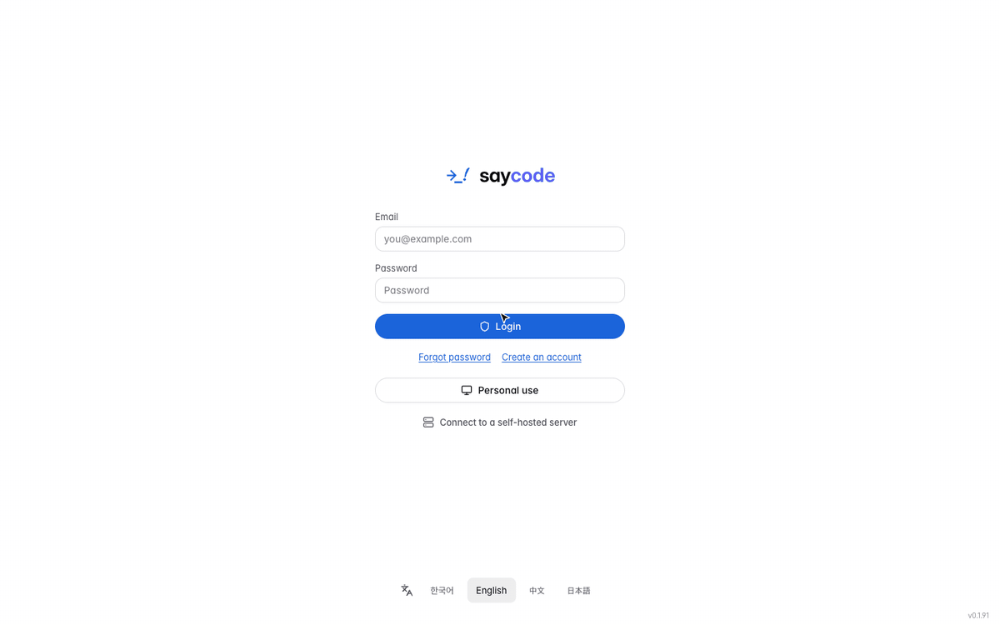 
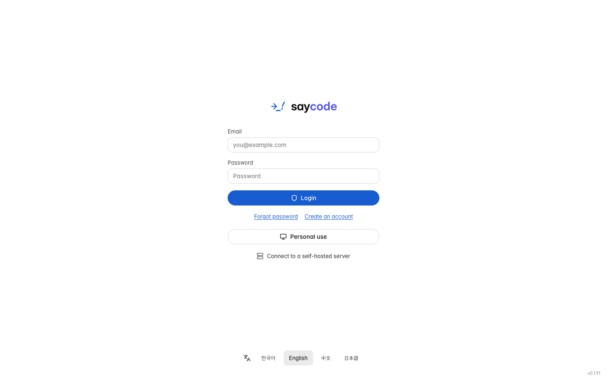
</td>
</tr>
<tr>
<td width="42%" valign="middle">

### 🏠 Start by purpose from the sidebar — Chat · Project

Everything branches from the left sidebar. **Chat** is where you ask questions and create documents
without a project; **Project** starts development through **Build** (describe what you want to build in
your own words and start from a plan) or **Develop** (create a project · import a code repository ·
import ZIP/files · use a machine folder). **Create project** offers **New project / Git repository /
ZIP or files / Existing folder** in one window (a Git repository needs sign-in and a GitHub or GitLab
connection), and folders you recently worked in with Claude Code or Codex on this computer become
projects in one go from **Recently worked-in folders**. Your Work PC, **My settings**, **Dark mode**
and **Language** live in the profile menu at the bottom of the sidebar.

</td>
<td>
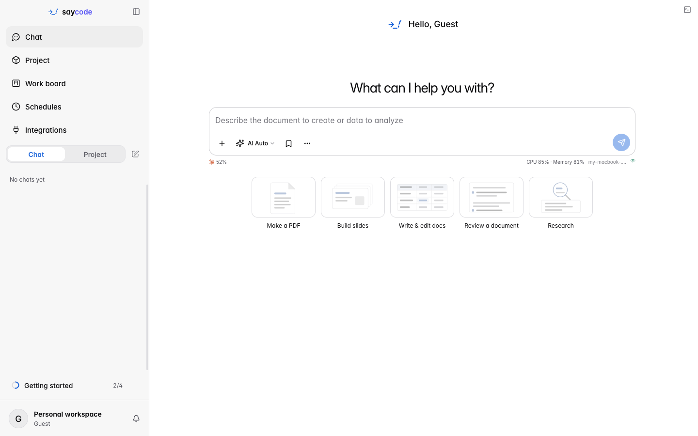 
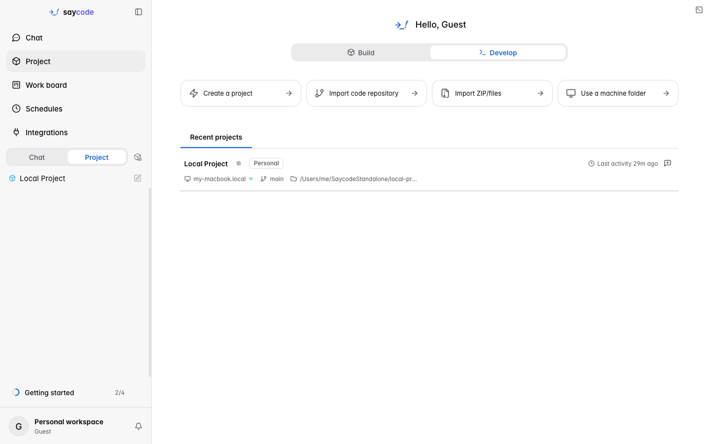
</td>
</tr>
<tr>
<td width="42%" valign="middle">

### 🗣️ One sentence becomes a working app

*"Build me a landing page for a coffee subscription service"* — from that one line the agent creates and
edits real files **on your PC**. While it works you see a progress line that folds into a single line when
it finishes, and the answer carries a **result preview** and a **changed files** card (+/− line counts per
file, **View turn changes**). To see more, open `index.html` under **Show tools → Files** to check and edit
the result, and compare the changed lines side by side under **Diff** (the workspace doesn't open by
itself, so open it yourself). (The video is edited to cut the agent's waiting time.)

</td>
<td>
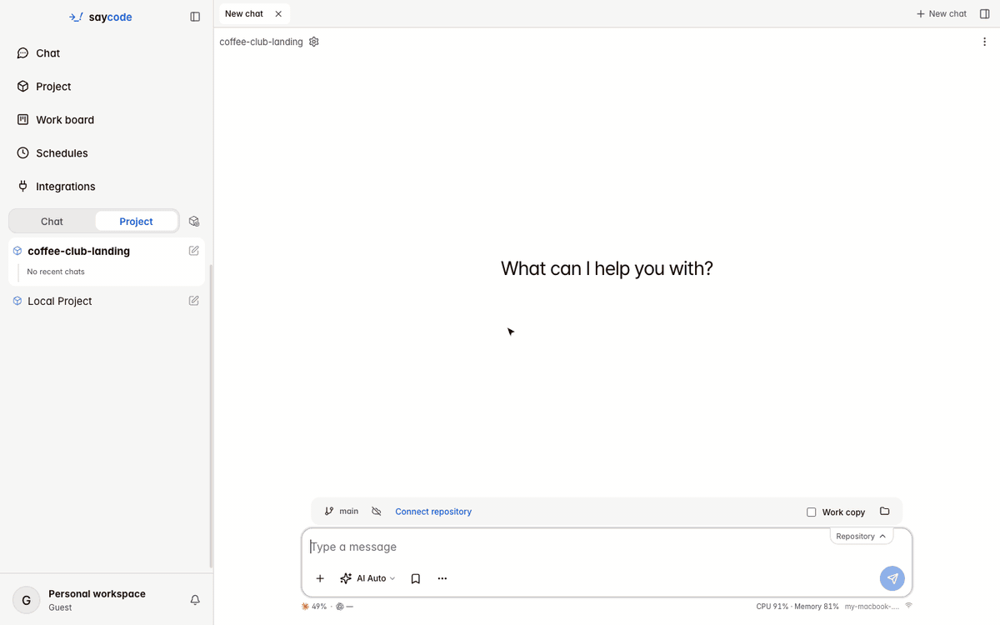 
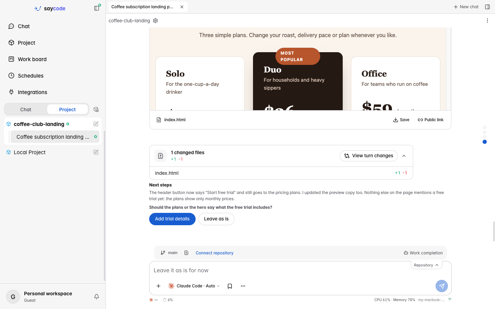 
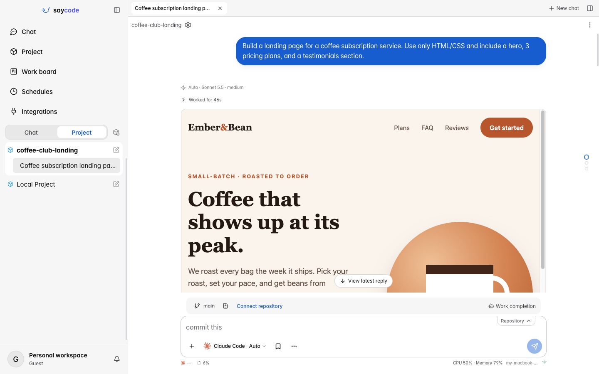
</td>
</tr>
<tr>
<td width="42%" valign="middle">

### 📄 Work without a project — Chat and document templates

No code required. Ask in **Chat**, *"Make a Q3 equipment-rental report"*, and the result file appears as a
**file card** below the answer; click the file name and it **opens right inside the app** in the panel on
the right (HTML also shows a preview in the conversation first). Use **+** in the composer to attach files,
photos or folders, or to **start in an existing directory**, and pick a document · spreadsheet ·
presentation · PDF format and a template (*Design Report*, *Minimal Letterhead*, **Create my template**) to
keep writing in the same style. On the file card you can **Save**, and once signed in, share HTML results
with a **Public link** (choose who can open it and when it expires).

</td>
<td>
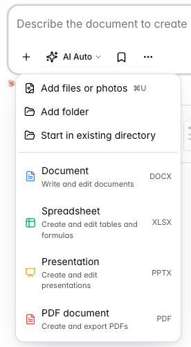 
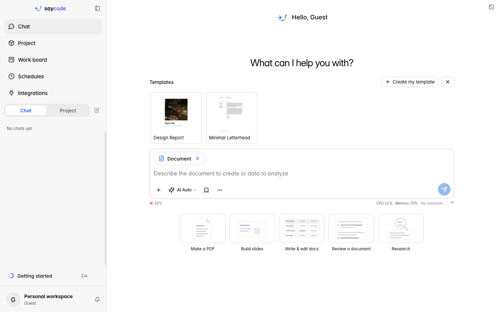 
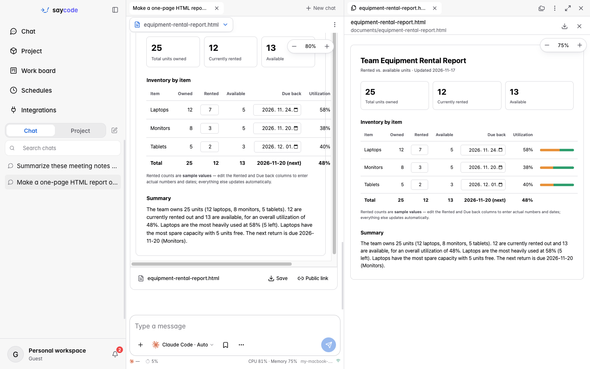
</td>
</tr>
<tr>
<td width="42%" valign="middle">

### 🧩 Workspace — conversation in the center, tools on the right

**Show tools** (⌘⇧B) puts the **Files · Terminal · Diff** panels next to the conversation (the workspace
doesn't open by itself). The **Diff** panel shows side-by-side diffs as **Uncommitted / By turn** (this
turn · since the last turn · since chat start; worktree conversations also get **Whole branch**),
searchable by file name or changed content. The **Files** panel offers project-wide file-name search and
**content search**, CSV/TSV **View as table**, and **Artifacts** to gather everything you've produced in
one place, and you open files as tabs to **edit them directly and save with ⌘S** (what the AI changes
shows up in the open tab right away). Even without a project, **⌘J** opens the **bottom terminal**
below, and anything running keeps going when you hide it. Open tools are remembered per conversation.

</td>
<td>
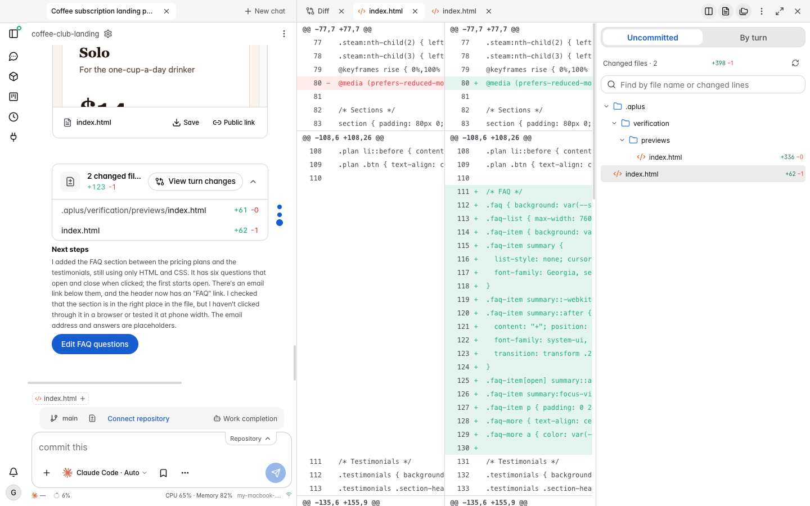 
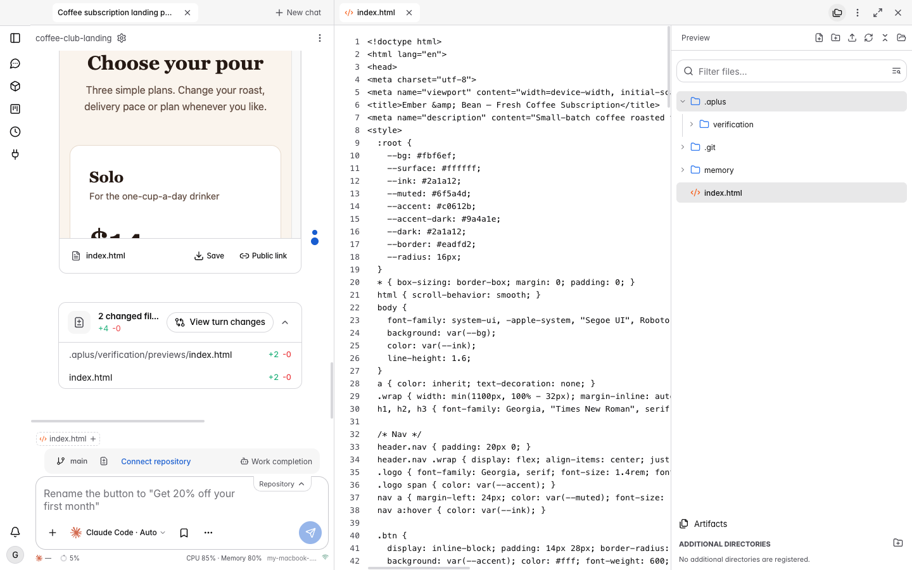 
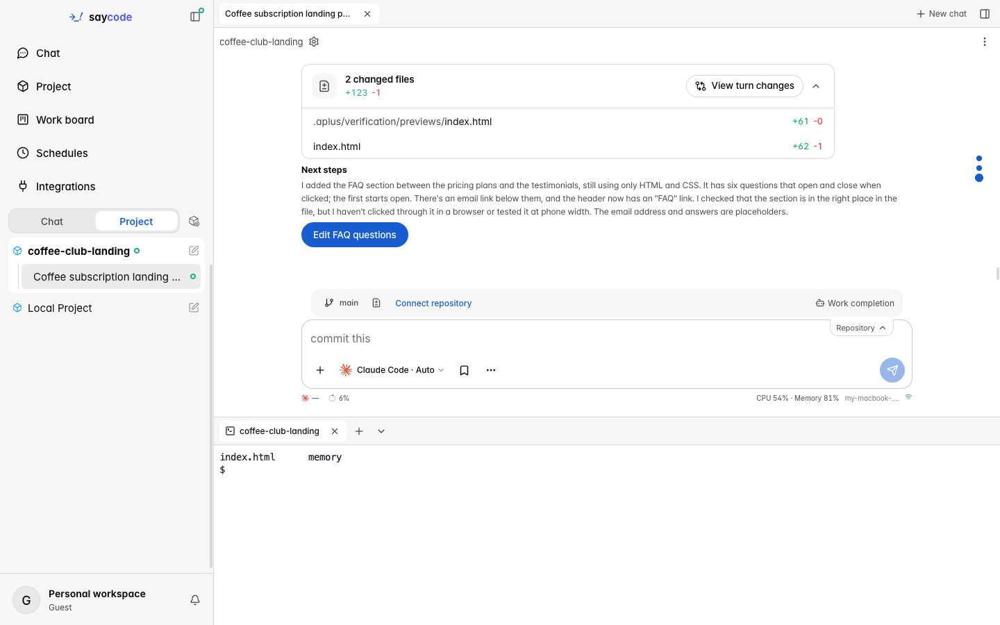
</td>
</tr>
<tr>
<td width="42%" valign="middle">

### 🧭 Plan first, then point at the code — Plan mode · Add to chat

To get a **plan first** before the AI touches any files, turn on **Plan mode** in the composer's **⋯** menu
and send (it shows up in Claude conversations once you've sent the first message). When the **plan card**
appears, choose **After approval** and click **Start work** — the AI gets to work and Plan mode turns itself
off; if you don't like the plan, click **Request changes**. To show *what* you mean, **add it to the chat**:
right-click a file in the tree → **Add to chat**, or type `@` to pick files; code you select in the editor
(sent with its path and line numbers) and output you select in a workspace terminal go into the composer
with **⌘L**. The round gauge below the composer (**Context N%**) shows what takes up how much, and
**Compact conversation** shrinks a long chat.

</td>
<td>
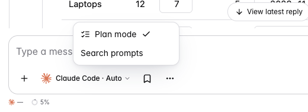 
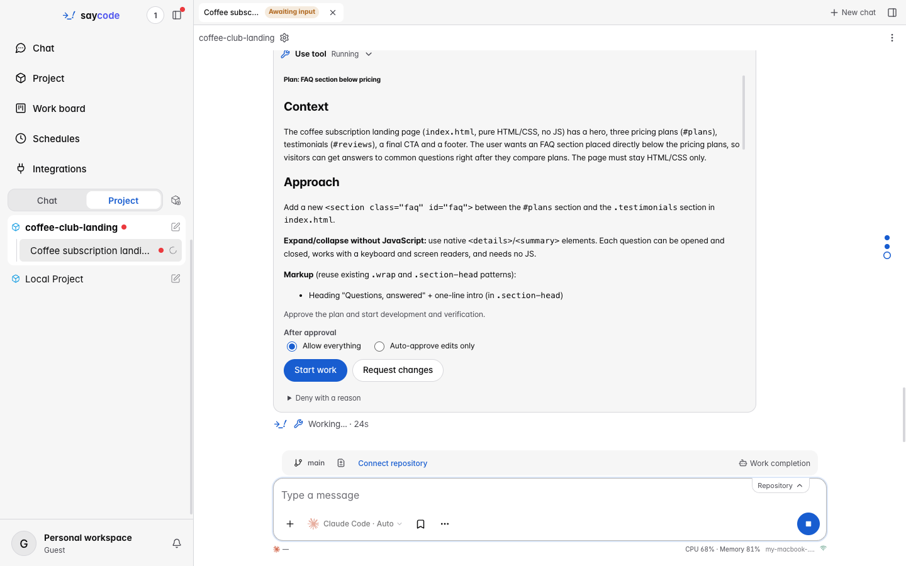 
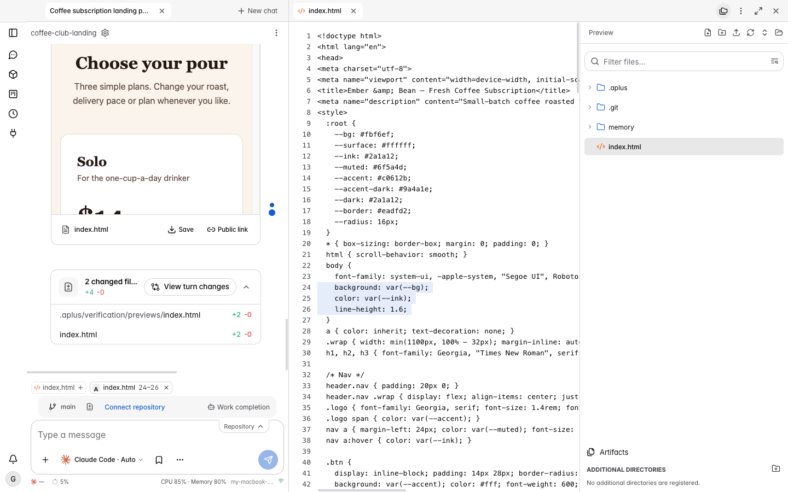 
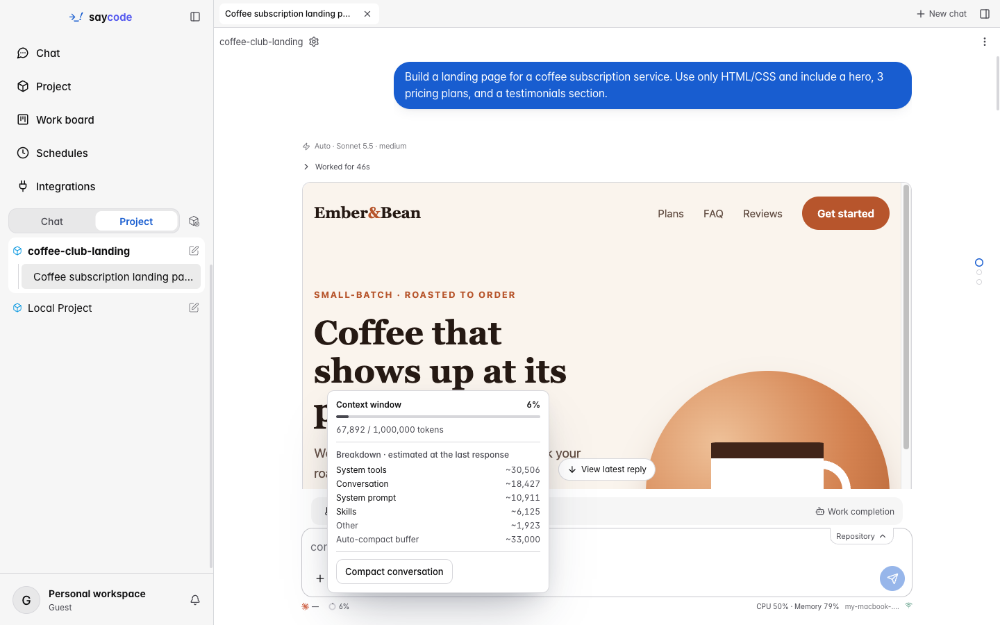
</td>
</tr>
<tr>
<td width="42%" valign="middle">

### 🤖 You pick the AI, the model picks itself — AI Auto

One **button below the composer** sets the AI (**Claude Code · Codex · Opencode**, plus Grok if installed),
the model and the **effort**. The default **AI Auto** chooses a model and effort that fit each request, and
leaves a badge on every message — *"Auto · Sonnet 5.5 · medium"* — showing what was picked. To pin one,
choose a model (for example Fable 5.2 · Opus 5.5 · Sonnet 5.5 · Haiku 5.5 — the list changes with
updates). The effort menu appears once you've picked a model yourself, and **⌘⇧M** (next model) and
**⌘⇧L** (next effort) switch them. Save favourite combinations as **AI profiles**, and under **Connection**
at the bottom of the menu choose **AI account** (the default) or the **saycode plan** and **Internal AI**
your organization assigns. **AI remaining usage** (`55%`), at the left below the composer, opens the
per-account **7-day usage** and the time left until reset; with several accounts, **auto account
rotation** keeps work going when one hits its limit.

</td>
<td>
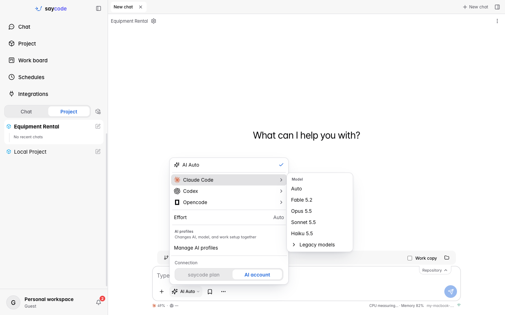 
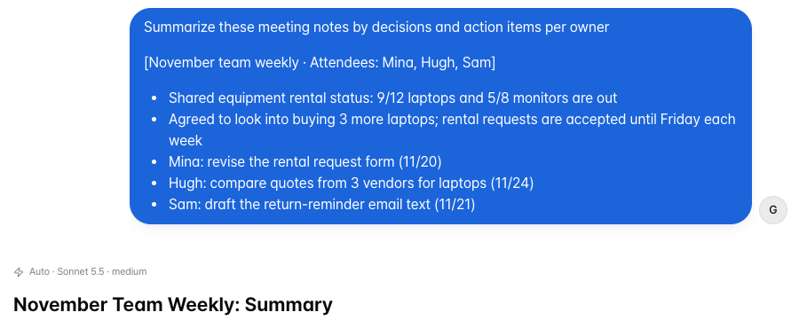 
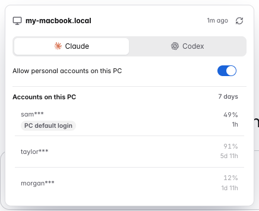
</td>
</tr>
<tr>
<td width="42%" valign="middle">

### 💸 Start free, no paid account — free models (opencode)

No paid Claude or ChatGPT account? One click on **Getting started → Start with free models** installs opencode
on this PC and you can chat right away. Before installing, Saycode shows the install location and the
conditions of free models, and installs only after you confirm. Pick **Opencode** in the AI menu below the
composer and free models are marked `Free` / `Recommended free`; if you choose no model, a recommended free
model is used for each message. Free models are offered by OpenCode **for a limited time**, and **each model
has its own data retention and training policy.** For company or confidential code, connect a paid or
organization AI, or use only models whose provider states they do not retain or train on input.
→ [Guidebook FAQ: How much can I use free models?](https://buzzni.github.io/saycode-desktop-releases/guidebook/en/#205-how-much-can-i-use-free-models)

</td>
<td>
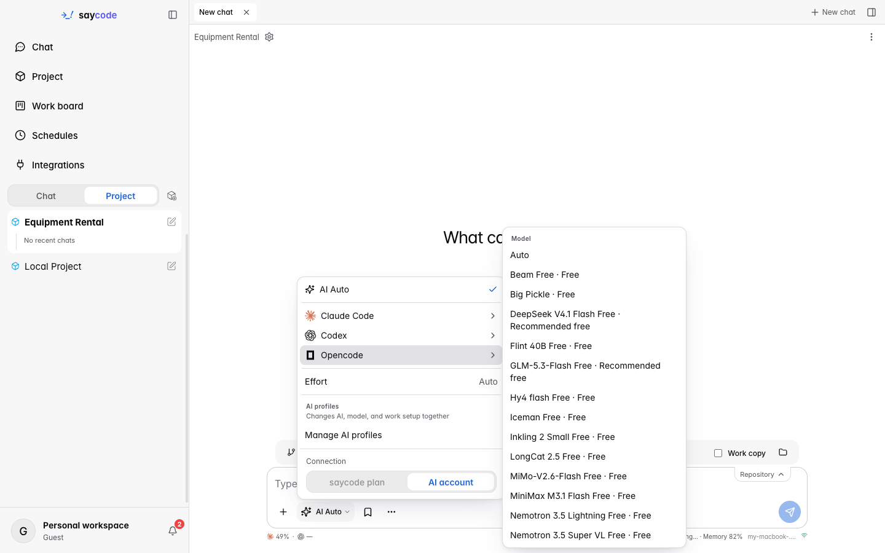
</td>
</tr>
<tr>
<td width="42%" valign="middle">

### 💬 Conversations that never stall — queue, recap, tidy-up

Type your next request while the AI is still answering and it joins the **queue** (up to 3; edit or delete
them, and **Steer now** hands one over without stopping the response). Under **My settings → Shortcuts**
choose what a **message sent during a response** does — **Add to queue**, **Steer now** or **Stop and
send** — and change the key that sends a message (Enter / ⌘Enter). When the AI asks you something, the
composer turns into a **question form**. Skim a long conversation with the **message rail** on the right;
once you turn on **Show conversation summary menu item** in Developer feature settings, **⋮ → Show
conversation summary** pins the **Conversation summary** (plan, artifacts, changed files) beside it. Tidy up
finished conversations with **Archive** (an undo notice; **Unarchive** from **Conversation archive**) or
**Snooze** (from one hour to next Monday). With the **Developer mode** switch in the account menu (on by
default) you can open conversations in several tabs and view them side by side with **Split Chat right**
(⌘⌥C) and **Split Chat down** (⌘⌥⇧C), up to 4×4 panes.

</td>
<td>
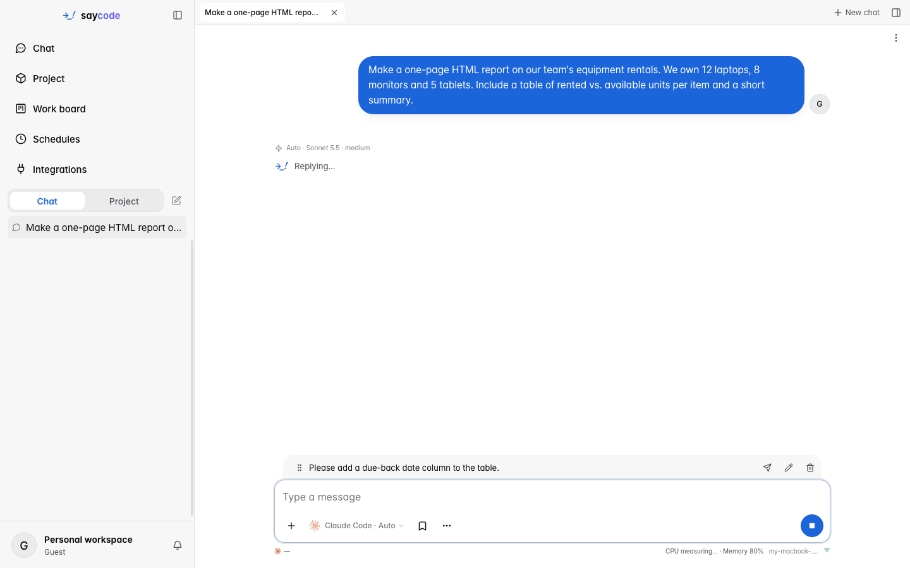 
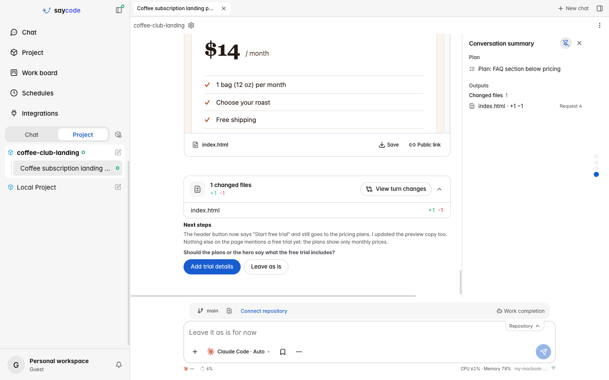 
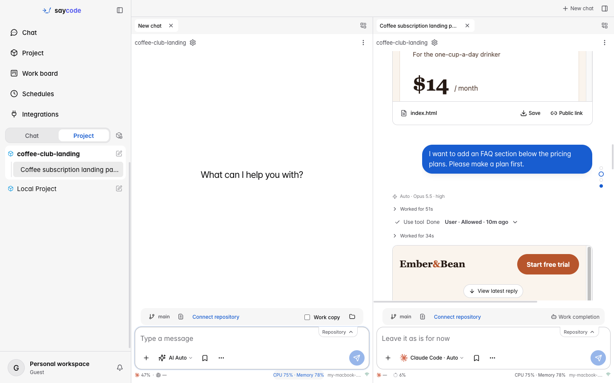
</td>
</tr>
<tr>
<td width="42%" valign="middle">

### 🗂️ Work board — command your conversations as a kanban

Every conversation in every project on one board: **Awaiting input → Responding → Idle → In review →
Done → PR Merged** (at a window width of about 1440px all six columns fit on screen even with the sidebar
open). Each card shows project, title, AI and elapsed time (the branch name for worktree conversations).
Drop a card on **In review** and a **Request a review** window opens; drop it on **Done** and a
confirmation window follows. Plan the order with **Filter** (Work PC · automation · PR state) and
**Prerequisites** (a `0/1` badge on the card), run **Autopilot**, **Verify changes** and **PR watch**
(needs GitHub) straight from the card, and bring a card in the Done column back with **Unarchive**.
Conversations waiting on the same permission clear with a single **Allow all (N)**.
The Work board is hidden by default — turn on **Profile menu → Developer feature settings → Show Work board
menu** (**⌘⇧A** works even when it's off).

</td>
<td>
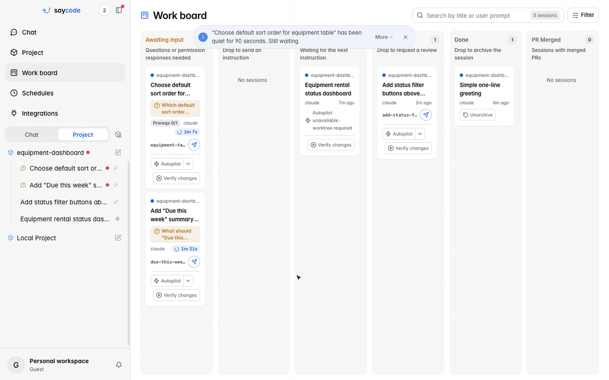 
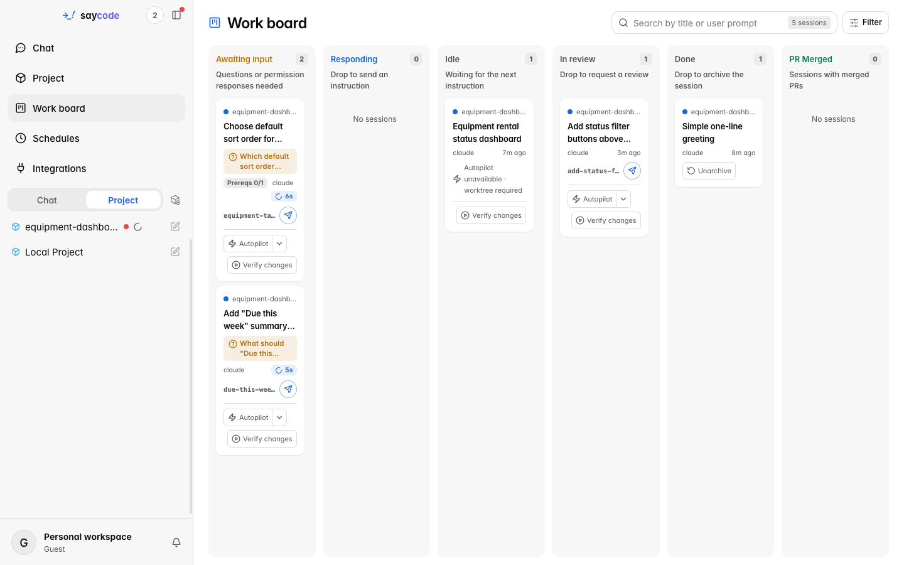
</td>
</tr>
<tr>
<td width="42%" valign="middle">

### ✅ Work completion — review, open the PR, wrap up

The **Work completion** button on the right of the line above the composer opens a menu: **Self review**
(the AI checks its own work; set the number of rounds under **Advanced settings…**), **Request independent
review…** (another agent reviews with the AI, model, effort and focus you choose; see the **Review
history** tab), **Commit & PR** (handles CI, review bots and conflicts, up to the base merge — and if
a condition remains it reports instead of merging), and **Archive & Done**. Commit & PR appears when you have a
worktree conversation and a remote repository; with no remote, **Commit now** (a local commit) is available
instead. Press **Self review** or **Commit & PR** mid-response and it simply joins the queue and runs when
the response ends, so you don't have to worry about timing.

</td>
<td>
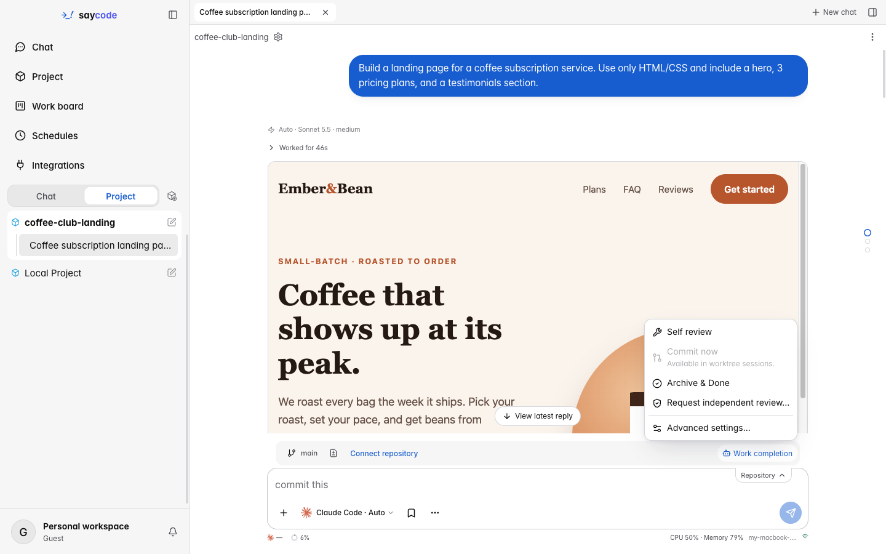 
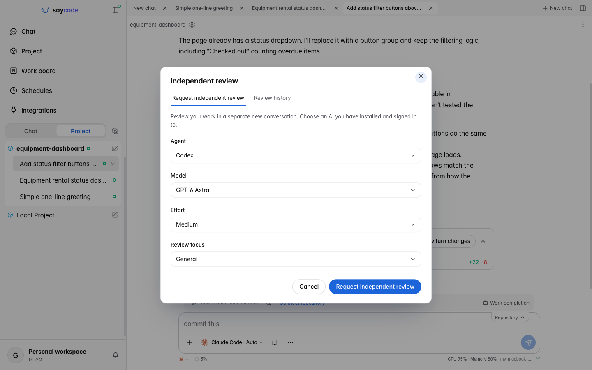
</td>
</tr>
<tr>
<td width="42%" valign="middle">

### 🌿 Worktrees — one per conversation, safe to delete

Turn on the **Work copy** checkbox above the composer of a new conversation and it works in its own copy of
the working folder (a branch, or worktree), so many conversations can run on the Work board without
stepping on each other. A new worktree starts from the latest default branch on the remote, **Bring
current changes** carries over what you have in progress, and the **Project tools (⋮) → Git actions →
Worktrees…** manager clears out old ones in bulk. Before deleting it warns you about local-only files such
as `.env`, and a deleted worktree can be restored from the **Snapshot archive** (Git projects; not on
Windows Work PCs).

</td>
<td>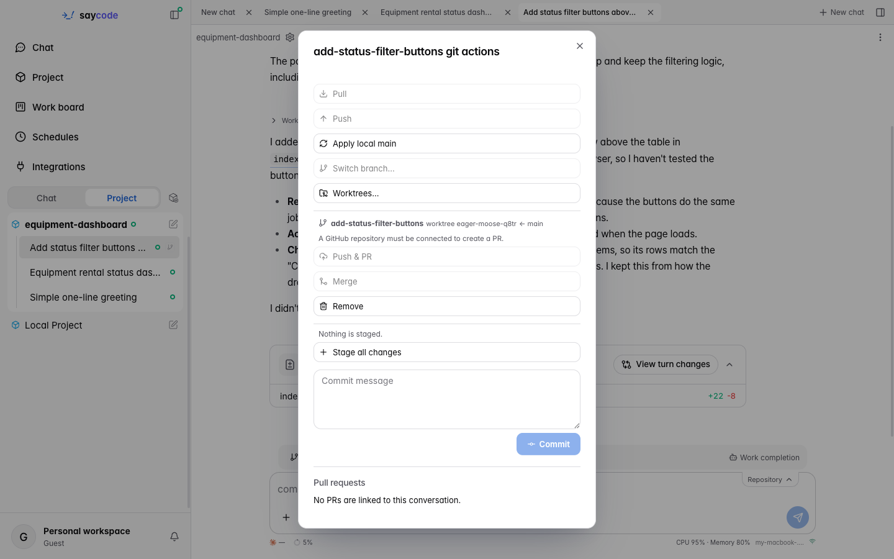</td>
</tr>
<tr>
<td width="42%" valign="middle">

### 🔐 Approvals and security — you decide what the AI may do

When the AI is about to do something risky, a **Needs a careful look** approval card asks first, and you can
refuse with **No, do this instead** to point it to another approach. Even when the main window isn't in
front, answer approvals and questions in the **Floating approval panel** (My settings → General →
Notifications, off by default), set ask / block / allow per app under **AI tool rules** (including MCP tool
read/write), stop every automatic run at once with **Global pause**, or hand repetitive approvals to the
AI with **Handle permission requests with AI review** in Development automation.

</td>
<td>
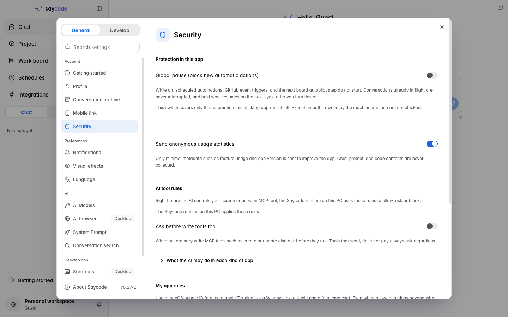 
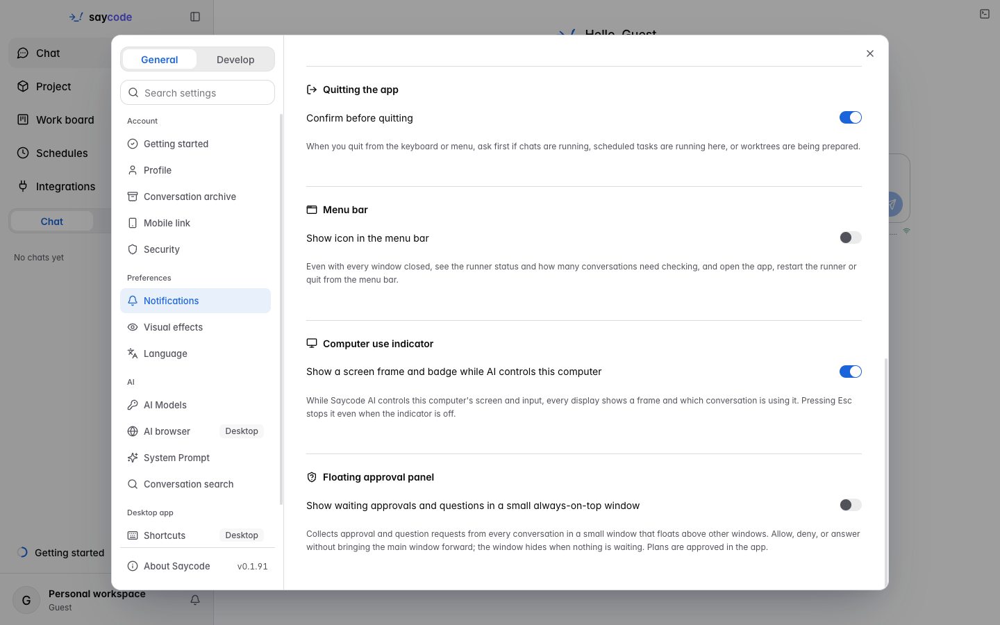
</td>
</tr>
<tr>
<td width="42%" valign="middle">

### 🧠 Agents that remember and learn

When the agent proposes a method it verified as a **lesson candidate**, just tap **Approve / Reject** on the
card under the answer. Approved lessons are used in later conversations of the same project. Under
**My settings → Develop → Memory** you manage what's remembered and get similar past conversations
suggested in new ones, and **My settings → General → System prompt** switches the Saycode default
instructions (including **Saycode usage guide**) on and off one by one.

</td>
<td>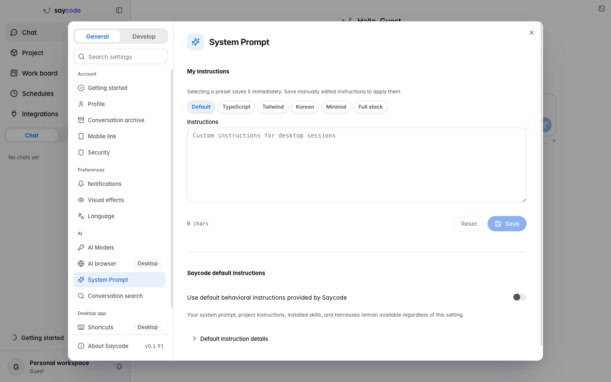</td>
</tr>
<tr>
<td width="42%" valign="middle">

### 🖥️ Your Work PCs, your phone

This PC becomes your Work PC automatically on first run, and other computers such as GPU or build servers
can be added under **My settings → Develop → Machines → Register machine** (paths outside your home
folder or whole drives are allowed under **Paths allowed on this PC**). Choose which PC runs a new task
from the profile menu or the composer, and turn on **Show CPU & memory** in Developer feature settings to
see its load below the composer. Scan the QR under **My settings → General → Mobile link** with the Saycode
mobile app and the same workspace opens on your phone; the **Mobile completion push** in notification
settings tells you the moment a long job finishes.

</td>
<td>
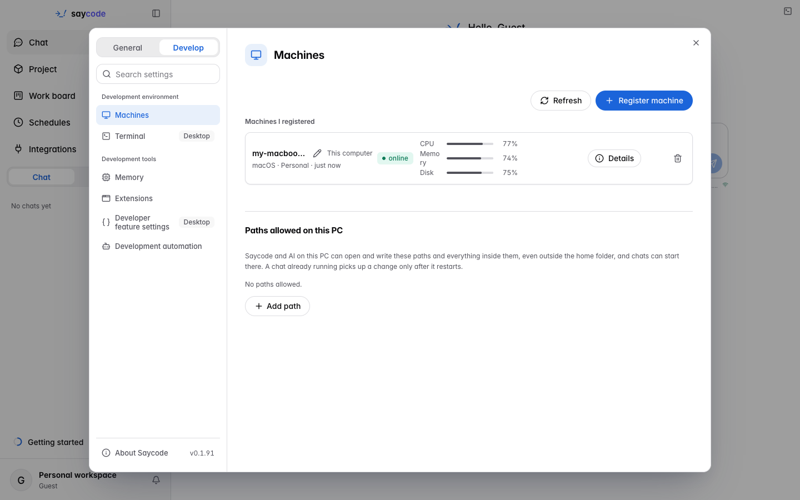 
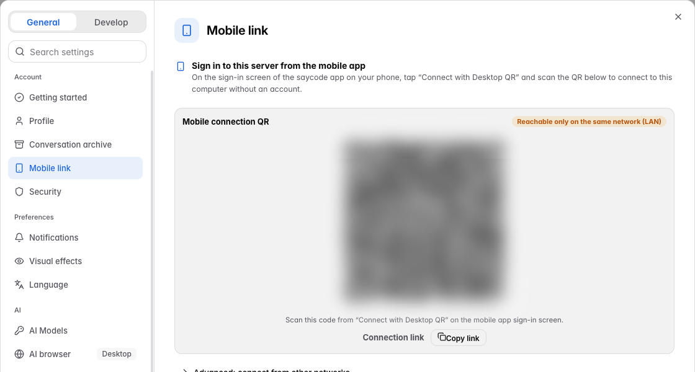
</td>
</tr>
<tr>
<td width="42%" valign="middle">

### 🔌 Integrations — services, extensions, messengers

Signed in, the sidebar's **Integrations** connects Notion · Slack · Google Drive · Gmail · KNOI · Figma ·
DirectCloud and lets you add a **custom connector** (an MCP address). In personal use, without signing in,
it opens the install-and-manage screen for official **extensions** (channel adapters, plugin manager and
more) — the same place as **My settings → Develop → Extensions**. Connect **Messenger channels**
(My settings → General, signed-in accounts only) to start Saycode conversations from Slack · Telegram ·
Discord and follow their progress there.

</td>
<td>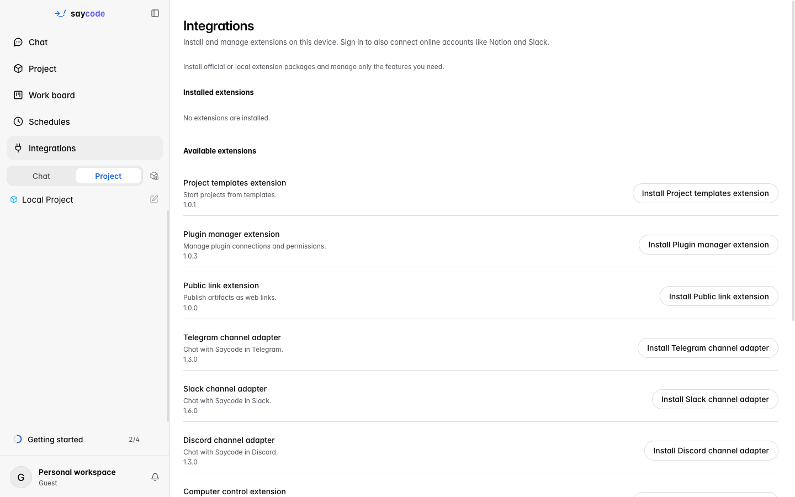</td>
</tr>
<tr>
<td width="42%" valign="middle">

### 🏢 Team workspace — deploy, share, organisation control *(sign-in)*

Sign in with a saycode.ai account and put a cloud project you own online from the **Deploy** button in its
header — first a **Test deployment**, then a **Production deployment** (needs your organization's
permission, server setup and a passing test deployment) — choosing **Update existing deployment** to
refresh the same address or **Create new deployment** for a separate one. Invite people to a project as
**Work together** or share it by team, pick your organization under **Which organization will you work
in?**, and manage members, teams, permissions, audit log, AI model policy and LLM usage and cost from
**Organization admin** in the profile menu. Under **Connection** in the model menu, run conversations on
the **saycode plan** your org admin assigns (a flat-rate plan — check this month's, this week's and
5-hour usage from the **saycode plan** button below the composer) or on **Internal AI** (an in-house LLM
your organization operates). The **Public link · Schedules · Messenger channels · connected outside
services** you can't use in personal use open up once you sign in. **End users who open a deployed app or
report need no seat.**

</td>
<td>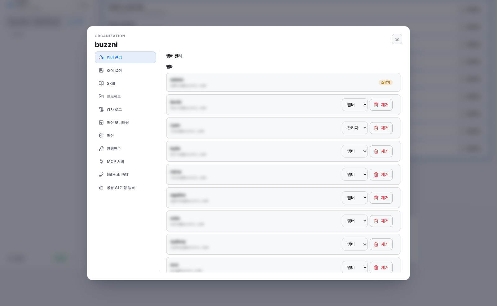</td>
</tr>
<tr>
<td width="42%" valign="middle">

### 🌙 A workspace you'll want to stay in

Flip **Dark mode** right from the profile menu, and switch the **Language** between 한국어 · English ·
日本語 · 简体中文. Dense where it counts, calm everywhere else. **Quick open** (⌘P — type `>` for commands
only), conversation search ⌘⇧F, Work board ⌘⇧A, workspace panel ⌘⇧B, bottom terminal ⌘J, pinned
conversations ⌘1–9 and reopening a closed tab ⌘⇧T are all searchable and rebindable under
**My settings → General → Shortcuts**. Recent notifications behind the bell, a Dock badge and sounds for input
requests and finished work — details that add up to an experience.

</td>
<td>
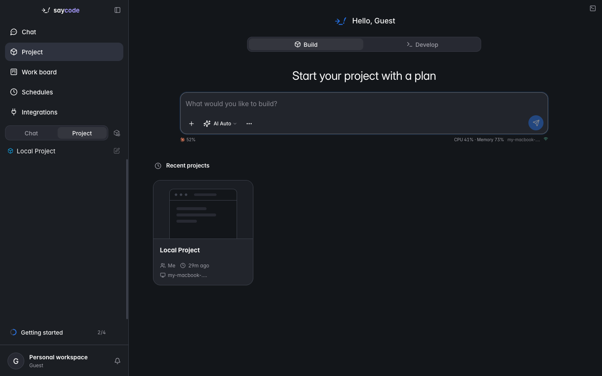 
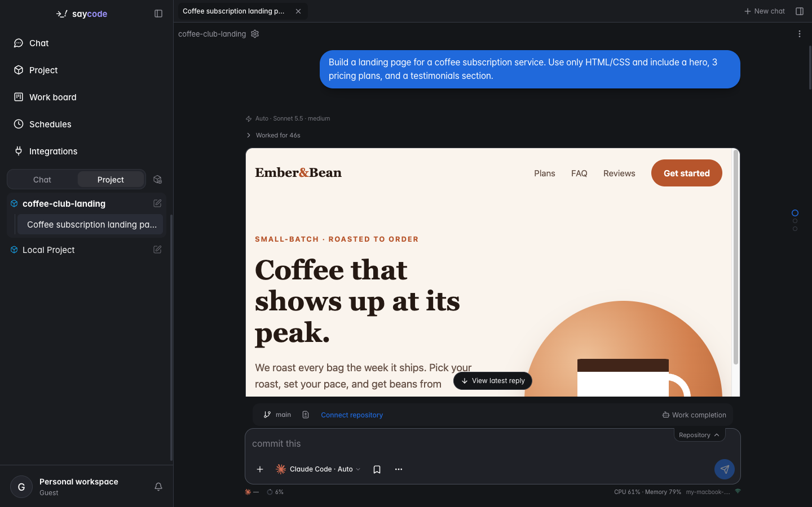 
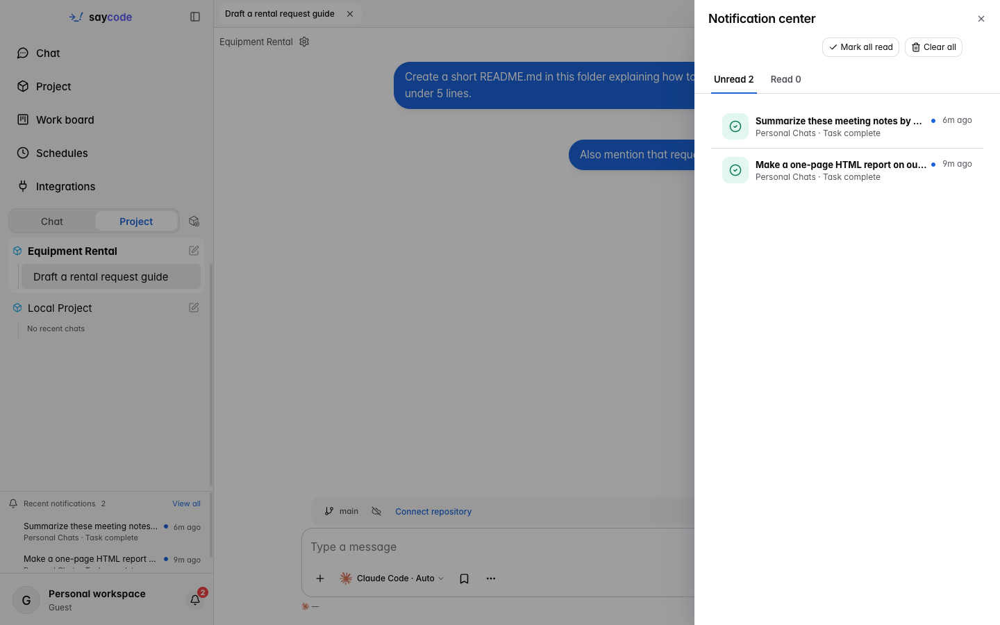
</td>
</tr>
</table>

### Also included

- ⌨️ **Composer productivity** — **↑** in an empty composer brings back this conversation's earlier requests; the bookmark **My prompts** saves requests you reuse (once signed in they're kept on your account, so other PCs have them too); `@` references files, Git changes (`@diff`) and other conversations; `/recap`, `/btw`, `/usage`; a card for long pasted text
- 🛟 **File checkpoints** — turn it on from `⋯` in a new conversation (macOS and Linux Work PCs) and the agent records the state before changing files, then you restore safely after a per-file preview, and **Restore files to this point** also works from your own message *(in v0.1.91, a conversation does not start in Personal use when this is on)*
- 🧭 **Project hub** — **Set as project hub** from `⋯` in a new conversation and you receive the completions and questions of the project's other conversations in one place (one hub per project)
- 🔁 **Continue conversation** — **Project tools (⋮) → Continue conversation** to **Continue with another agent** (Claude ↔ Codex) or **Branch with the same AI**
- 🔎 **Conversation search & Quick open** — ⌘⇧F searches past conversations through a local index on this PC; ⌘P opens files and commands fast
- 🤖 **Autopilot & automatic quality checks** — a Work board card's Autopilot reviews, confirms evidence for every requirement, and only then goes on to the PR; PR watch hands CI failures, review comments and conflicts back to the agent *(PR watch needs GitHub)*
- 🗓️ **Schedules** *(sign-in)* — have the AI do a job at set times: *"Every day at 9am, summarize yesterday's PRs"*. Check the time zone; results pile up as ordinary conversations and can also go to Telegram or Slack
- 🧪 **In-app browser · Preview · element annotation · AI browser** — picking elements on screen to fix them is still being polished in v0.1.91, so it is offered to some organizations first (not shown in personal use or regular accounts; for now describe the change in words, or point with a screen capture, `@` or ⌘L)
- 🔔 **Notifications & webhooks** — completion and input-request notifications survive a restart, and Development automation sends session events to your endpoint as signed webhooks
- 📄 **Rich file viewer** — Markdown, HTML, PDF and DOCX render inside the app; CSV/TSV open as tables and large media streams
- 🔐 **Secure by default** — end-to-end encrypted chat and terminal, passkey/TOTP MFA *(team)*, code and data stay on your Work PC

---

## How it works

| | | |
|---|---|---|
| **01 · Install and start** | **02 · Start by purpose** | **03 · Ask in plain words** |
| Open the DMG and choose **Personal use**: a workspace is prepared and the **Getting started** window opens on its own. | In the sidebar choose Chat (documents, questions) or Project's Build (new plan) · Develop (repository, ZIP, folder). | One natural sentence is enough: *"Add status filter buttons and summary cards"* (use **Plan mode** to get a plan first) |

| | |
|---|---|
| **04 · The AI builds on your Work PC** — the agent really reads and writes files and runs commands. Check it with the changed-file cards and result preview in the answer and with Files, Diff and Terminal in the workspace on the right, and command many conversations from the Work board. | **05 · Wrap up and share** — Work completion takes you through review → open PR → Archive & Done. On a team workspace, deploy to an internal URL and hand off with Work together. |

---

## Install & first run

### macOS

1. Download the latest DMG from **[Releases](https://github.com/buzzni/saycode-desktop-releases/releases/latest)** (Apple Silicon — an x64 DMG for Intel Macs is on the same page)
2. Open the DMG and drag **Saycode** to Applications
3. On launch the sign-in form is the first screen. Pick your **language** with the buttons at the bottom (한국어 · English · 中文 · 日本語)
4. Choose how to start
   - **Personal use → Confirm** — start on this PC right away, no sign-in (conversations and projects stay on this PC; to leave, choose **End personal use** at the very bottom of the profile menu)
   - **Sign in** — start with a saycode.ai account. No account yet? **Create an account** inside the app; organizations are chosen after sign-in under **Which organization will you work in?**
   - **Connect to a self-hosted server** — paste the connection code you got from `saycode server connect` on your own server and click **Connect**

<table>
<tr>
<td width="33%"></td>
<td width="33%">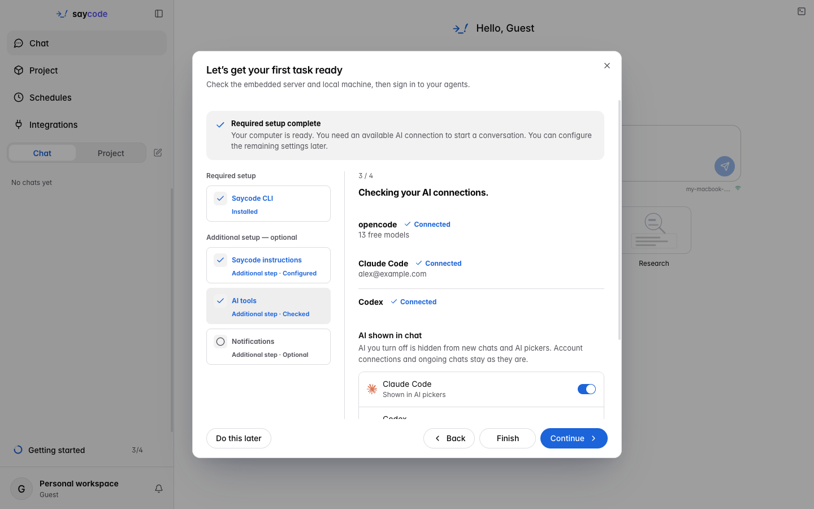</td>
<td width="33%">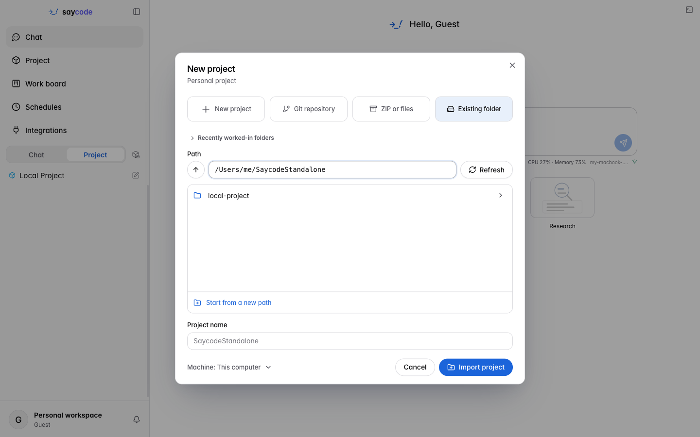</td>
</tr>
<tr>
<td valign="top"><b>① Start screen</b> — below the sign-in form are <b>Personal use</b> and <b>Connect to a self-hosted server</b>; the language buttons are at the very bottom. You can change the language later from **Language** in the profile menu or in My settings → General → Language.</td>
<td valign="top"><b>② Getting started</b> — press <b>Continue</b> through Saycode CLI → Saycode instructions → AI tools → Notifications. On the AI tools step you can see each AI as <b>Connected</b> or <b>Not connected</b>; if none is connected, choose <b>Connect my AI account</b> (ChatGPT · Claude) or <b>Start with free models</b>.</td>
<td valign="top"><b>③ First project</b> — in Project → Develop → <b>Create project</b> pick New project · Git repository · ZIP or files · Existing folder, and check the Work PC (this computer).</td>
</tr>
</table>

You can skip Getting started with **Do this later**, and resume any time from the **Getting started N/4** row at the very
bottom of the sidebar or from **profile menu → My settings → General → Getting started** (**Run automatically from this
step** if tools are still left to install). **Saycode instructions** default to *off*; switch them on and
Saycode workflows such as delegating to child agents and inline previews of results are followed.

The app is Developer ID signed and notarized, and updates itself automatically.
For every step with screenshots, see the **[guidebook](docs/GUIDE.md)** above.

### Local workspace vs. team workspace

| | Personal use · Guest local workspace | Signed in · Team workspace (saycode.ai sign-in) |
|---|---|---|
| What you need | Nothing — just install | An organization account (SSO · passkey/TOTP MFA) |
| Where data lives | All on this Mac | Code and data on the designated Work PC; metadata and audit log in the org console |
| Agents · AI Auto · Plan mode · Chat & document templates · Work board · worktrees · Work completion · file editing · bottom terminal · Developer mode (split view) · search · lessons/memory · extensions | ✅ | ✅ |
| In-app browser · Preview · element annotation · AI browser | — | Offered to some organizations first |
| Register Work PCs · mobile link | ✅ (mobile over the same network or a tunnel) | ✅ |
| Public link · Schedules · Messenger channels · connected outside services (Notion, Slack, …) | — | ✅ |
| Deploy (test · production) · Work together · team sharing · project tags | — | ✅ |
| saycode plan · Internal AI under Connection | — | ✅ (when your organization assigns them) |
| Org console (seats · teams · permissions · AI model policy · cost · audit log) | — | ✅ |

Start local, sign in when you need to. Your local projects stay as they are.

> **Windows / Linux** — a Windows (x64) installer is available on [Releases](https://github.com/buzzni/saycode-desktop-releases/releases), though some features are macOS-only. Linux is coming soon.

---

## Adoption scenarios — you choose where to start

Three scenarios, not a sequence. Start with one or combine them.

| 💬 Chat & documents | ⚙️ Personal workflow automation | 🚀 App building & deployment |
|---|---|---|
| Meeting summaries, drafts of plans and reports, search and summarise. Only approved users and models, model limits per group, usage and cost rolled up. | Connect internal collaboration tools and document stores to automate recurring reports, request/approval flows and other repetitive work. | Business teams build their own internal tools and deploy them to an internal URL, with review and approval built in. |

**Non-developers use it from week one** — business support (minutes, monthly report drafts,
policy Q&A), sales & marketing (proposal drafts, VOC classification), commerce operations
(product / price / inventory check reports), HR & general affairs (policy guidance,
request/approval flows, onboarding material). Start with whatever is done by hand, in
spreadsheets or over chat today. Results are shared as links, so review ends without
attachments flying around.

---

## Saycode for teams

### A free one-month PoC — see the numbers first

We measure usage, cost, policy and audit for the scenario you choose and write the results
report with you. **The PoC includes every Premium feature.**

| Week 1 · Baseline | Weeks 2–3 · Real use | Week 4 · Report |
|---|---|---|
| Measure current AI usage and cost baseline, pick the target team and PoC scenario | Apply to real work, measure usage and cost, validate policy and permission settings | Summarise activation, cost and policy results; produce a rollout quote |

The PoC month is free. Model usage during the PoC follows your own contracts.

### Pricing — seats only for the people who build

Saycode does not resell AI models. Connect the AI contracts you already have and pay a seat
fee only for management and the execution environment.

| Plan | Price | For | Includes |
|---|---|---|---|
| **Office** | $10 / user · month | Everyone — chat & documents | Chat and document work · viewing, reviewing and approving results · usage dashboard |
| **Premium** ⭐ | $40 / user · month | People who build and deploy | Everything in Office + app building & agent execution · internal URL deployment · SSO |
| **Volume** | Negotiated | Company-wide rollout, special requirements | Volume pricing · on-premise / air-gapped installation · dedicated support & SLA |

- **0% markup on AI models** — connect your existing Anthropic, OpenAI, Azure, Bedrock or Vertex contracts. Monthly total = seats + external AI subscriptions + API usage.
- **End users who only open deployed apps and reports don't need a seat.** Seats are named; no account sharing.
- Budget caps and threshold alerts, with automatic stop when a cap is exceeded.
- No setup fee during the current launch period.

- 🌐 Website: **[saycode.ai](https://saycode.ai)** · Deck: **[saycodepoc.apps.saycode.ai](https://saycodepoc.apps.saycode.ai/)**
- 💼 Sales: [soo@buzzni.com](mailto:soo@buzzni.com)
- 🛠 Technical: [ryan@buzzni.com](mailto:ryan@buzzni.com)
- 🤝 Support: [ernie@buzzni.com](mailto:ernie@buzzni.com)

---

## Open-source notice

Saycode Desktop is built on open source. It bundles or uses the following projects (licences
noted); full licence texts ship inside the packaged app:

| Project | Used for | Licence |
|---|---|---|
| [Happy](https://github.com/slopus/happy) (via the [buzzni fork](https://github.com/buzzni/happy)) | Encrypted agent-session relay engine bundled in standalone mode (`happy-cli` / `happy-server`) | MIT |
| [Electron](https://www.electronjs.org/) | Desktop app shell | MIT |
| [React](https://react.dev/) | UI framework | MIT |
| [xterm.js](https://xtermjs.org/) (+ fit / web-links / WebGL addons) | Remote terminal rendering | MIT |
| [socket.io-client](https://socket.io/) | Real-time transport | MIT |
| [react-markdown](https://github.com/remarkjs/react-markdown) + [remark-gfm](https://github.com/remarkjs/remark-gfm) | Chat Markdown rendering | MIT |
| [electron-updater](https://www.electron.build/) | In-app auto-updates | MIT |
| [buffer](https://github.com/feross/buffer) | Binary utilities | MIT |
| [lucide-react](https://lucide.dev/) | Icon set | ISC |
| [TweetNaCl.js](https://tweetnacl.js.org/) | End-to-end encryption primitives | Unlicense (public domain) |

Special thanks to Kirill Dubovitskiy and the contributors of
**[slopus/happy](https://github.com/slopus/happy)** (MIT), the foundation of Saycode's
encrypted session-sync architecture.

---

**© 2026 [Buzzni](https://buzzni.com) · [saycode.ai](https://saycode.ai)**

*So that anyone in the company can build, just by saying it.*

