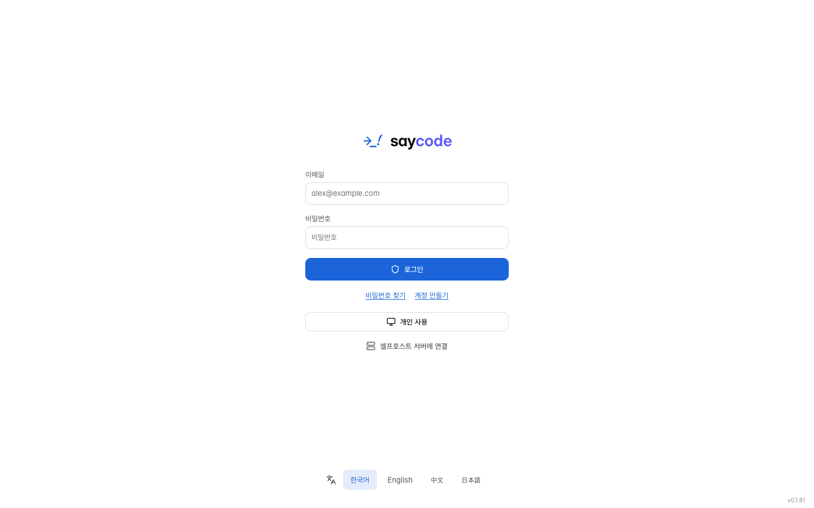
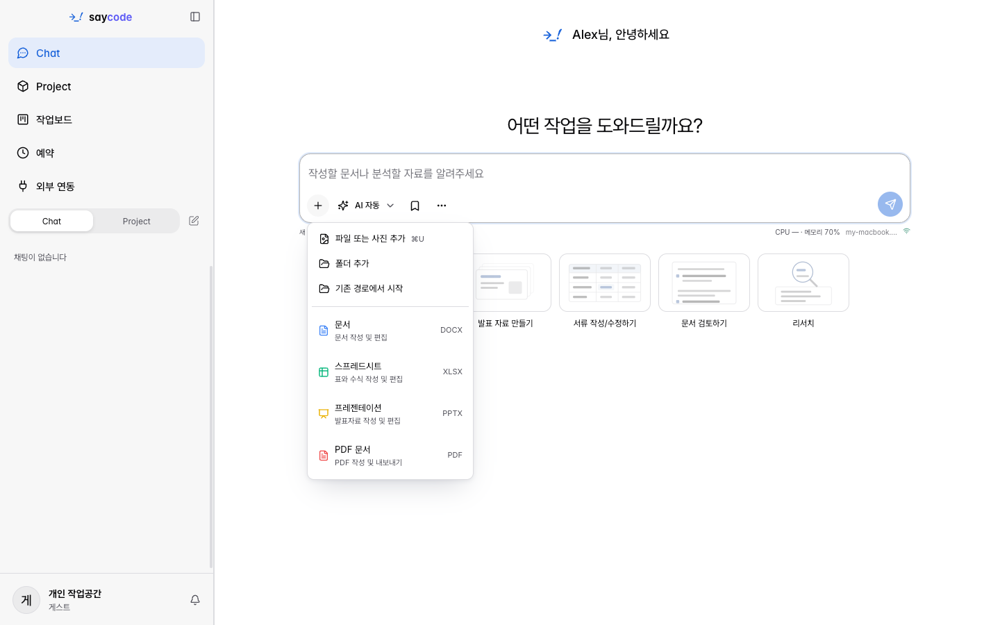
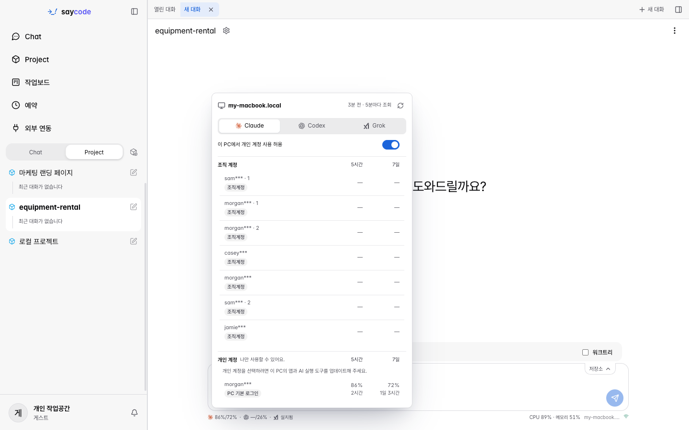
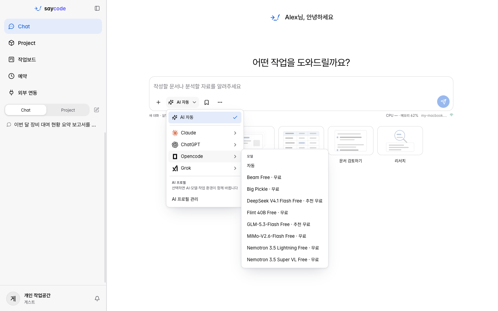
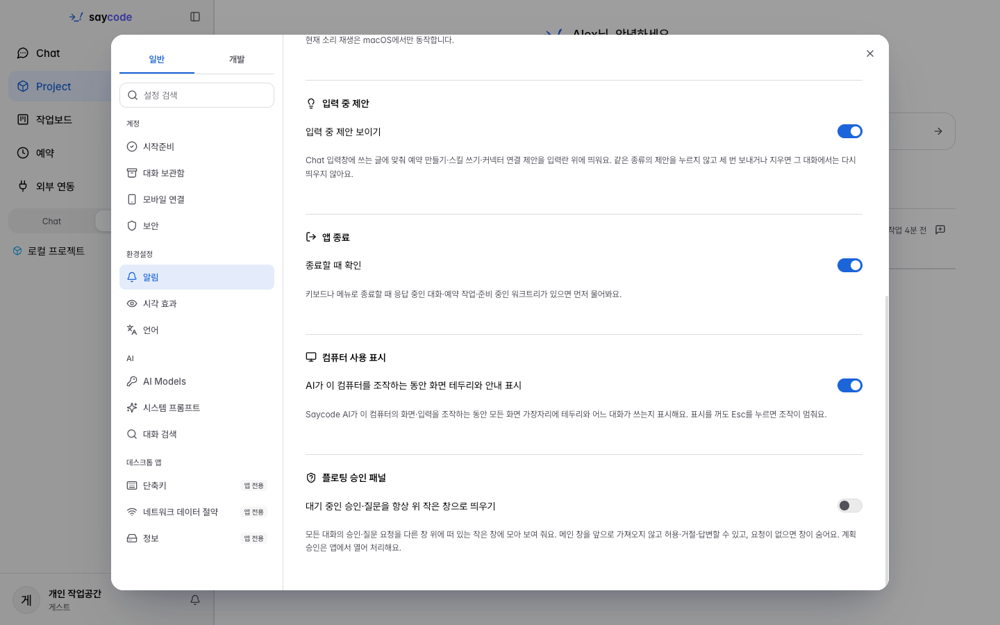
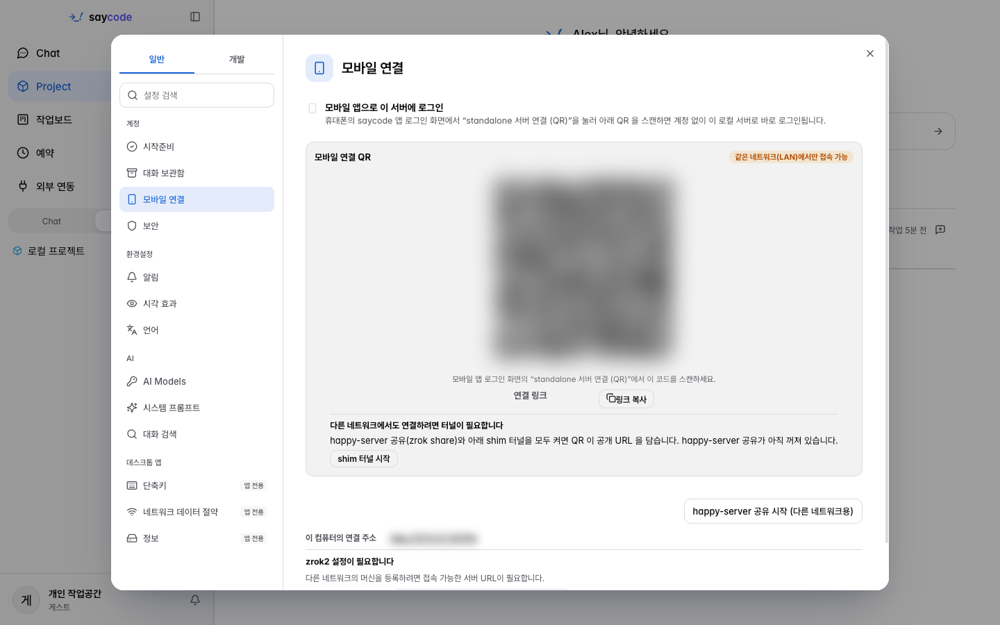
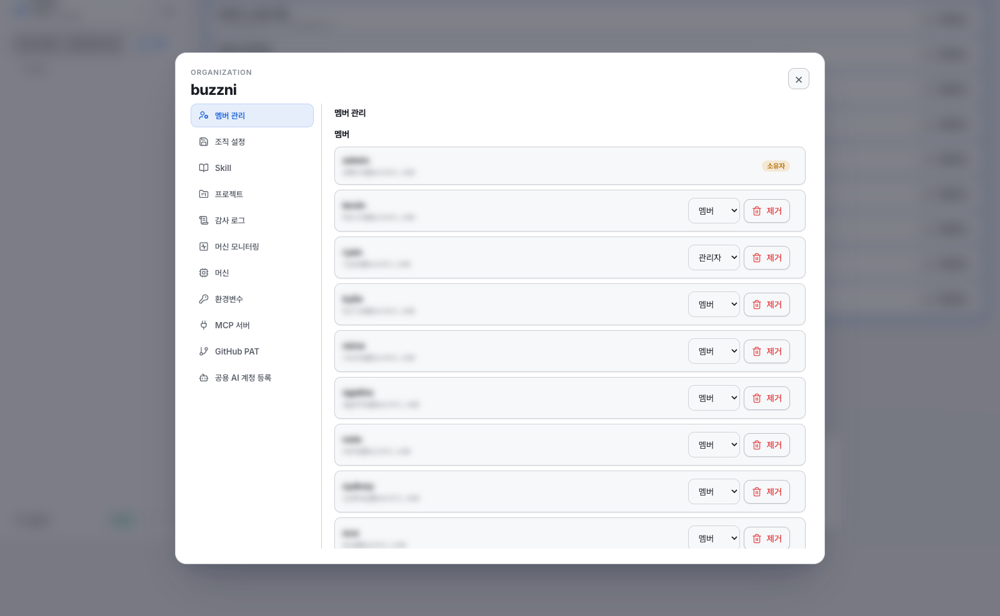
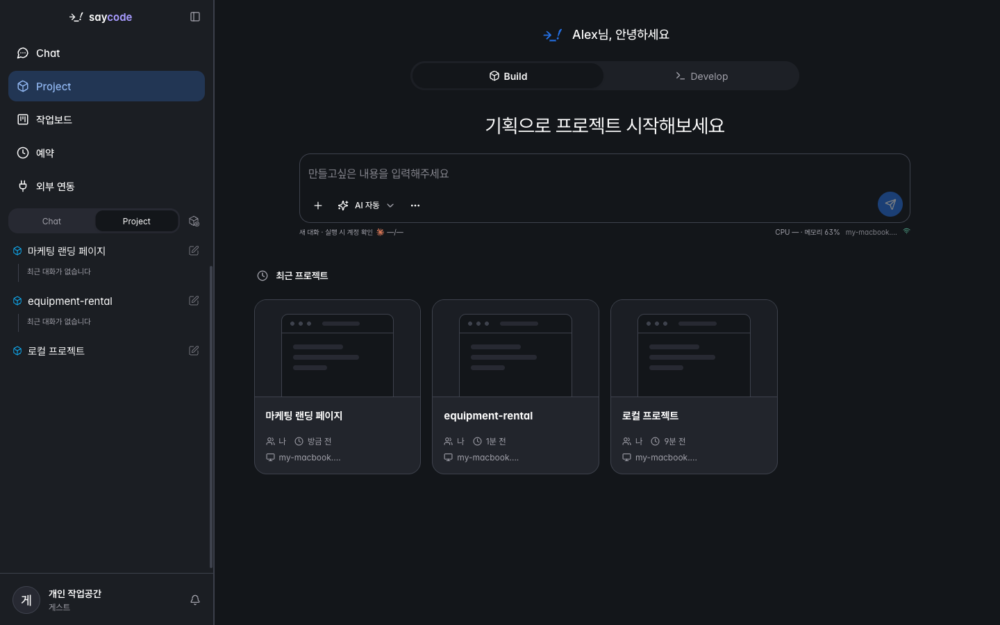
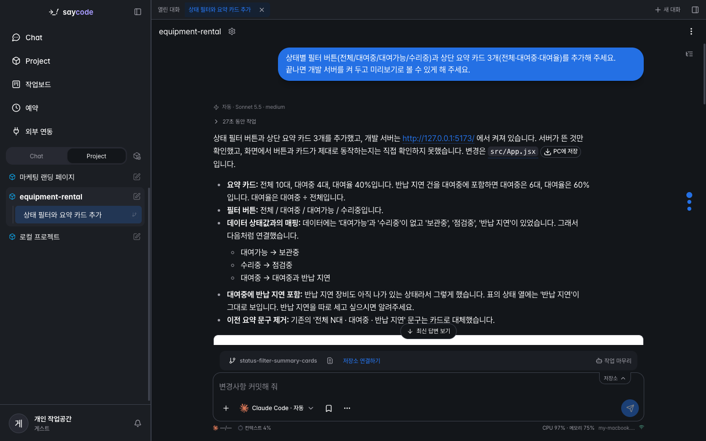
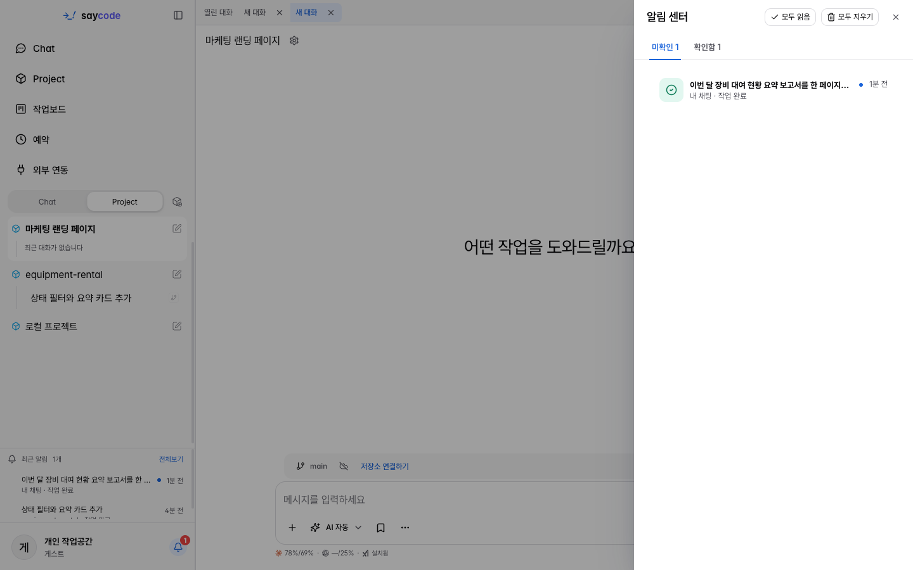

# Saycode Desktop

### Say it. Ship it.

**The operations layer for every AI subscription and API your company uses.**
Keep the frontier models your team already knows (Claude · Codex · Grok · opencode) —
and let the company manage accounts, permissions, model routing, cost and deployment from one screen.
**One place to manage. Half the cost.**

**English** | [한국어](README.ko.md) | [中文](README.zh.md) | [日本語](README.ja.md)

 

### [⬇️ Download for macOS (Apple Silicon)](https://github.com/buzzni/saycode-desktop-releases/releases/download/v0.1.81/Saycode-0.1.81-arm64.dmg)

*Signed & notarized DMG · auto-updates built in · no account needed to start*

### 📘 Guidebook — [Read on the web](https://buzzni.github.io/saycode-desktop-releases/guidebook/en/) · [Download PDF](docs/guidebook/saycode-guidebook-en.pdf) · [Markdown](docs/GUIDE.md)

*New here? Follow it from first launch to finishing your work.* ([한국어](docs/GUIDE.ko.md))

 

https://github.com/user-attachments/assets/a323660d-93d9-45a6-ac1b-85dc2f664523

*🔊 Sound on — a 92-second intro made from real v0.1.81 screens, with subtitles and music · [Download MP4](docs/assets/saycode-intro-en.mp4) · [Subtitles SRT](docs/assets/saycode-intro-en.srt)*

<!-- release-notes:start -->
## What's new

- [Latest release notes](docs/releases/v0.1.41.ko.md) (Korean)
- [Full release history](docs/releases/README.ko.md) (Korean)
<!-- release-notes:end -->

---

## In 30 seconds

| 🗣️ **One sentence becomes an app** | 🗂️ **Your agent fleet on one board** | ✅ **Review → commit → done** |
|:---|:---|:---|
| Say what you want and the agent writes real code **on your Mac**, starts the dev server and **opens the preview for you**. | Command many Claude · Codex · Grok · opencode conversations from a **kanban Work board**. Drop a card in a column and the next instruction or review request goes out. | One **Work completion** menu takes you through review and Commit & PR, and the finished conversation is tidied away with **Archive & Done**. |

> **v0.1.81 — easier to start, with a screen that follows the web's structure.** What changed in the 31 releases since v0.1.50:
>
> - **Start with no account** — one click on **Personal use** on the first screen runs **Getting started** automatically, and with no paid AI account you can still begin chatting with a **free model**.
> - **💸 Start free, no paid account** — begin right away with **free models (opencode)** and no paid AI account. Free models are offered by OpenCode for a limited time, and data policies vary by model ([guidebook](https://buzzni.github.io/saycode-desktop-releases/guidebook/en/#205-how-much-can-i-use-free-models)).
> - **New sidebar and My settings** — **Chat · Project** instead of home tabs, a profile menu, **My settings (General · Development)**, a single **Create project** window, and tidier terms like **Work PC** and **Work board**.
> - **A smarter composer** — **AI · model · effort on one button (AI Auto)**, **AI remaining usage** below the composer, a **queue** while the AI answers, **Conversation summary**, Archive and Snooze.
> - **From fixing to finishing** — a browser that collects elements in an **annotation tray**, **whole-branch / by-turn** Changes and Files panels, a **Work completion** menu above the composer, a **Work board** with filters and prerequisites, and **Schedules** once you sign in.

---

## Why Saycode?

Your people already move fast with ChatGPT and Claude. But subscriptions and API contracts
are scattered across teams and individuals, and nobody at the company can tell who is using
which model, or how much it costs. **Block it and productivity stops; leave it open and you
lose control.** The work lives on personal laptops and walks out the door with the employee.

Saycode **does not compete with the models.** It keeps the frontier models your team already
knows and adds the management, security and deployment an organisation needs on top — an
**operations layer**.

| | Individual subscriptions | **Saycode** |
|---|---|---|
| Accounts & cost | Per-person billing, fragmented accounts, admins can't see usage | **Same models under central management, audit and cost control** |
| Prompts & output | Tied to personal accounts, gone when people leave | **Accumulated as company assets — survives hand-overs** |
| Model choice | Locked to one vendor; hard to switch when a better model ships | **Best model auto-selected per request; new models usable on day one** |
| Code & data | Leaves for someone else's cloud | **Stays on the Work PCs the company designates, end-to-end encrypted** |
| Running many agents | Alt-tabbing between chat windows | **A kanban Work board to command the whole fleet from one screen** |
| The finish line | A branch waiting for review | **Work completion → review → Commit & PR → deploy to an internal URL** |

Solo, a personal subscription is the right call. **The moment an organisation works together, the requirements change.**

### Four things a company admin actually controls

| | What | How |
|---|---|---|
| **Who can use it** | Accounts & seats | Hand out and revoke accounts per employee. The company decides which of its AI subscriptions or APIs are attached to whom. Instant revocation on transfer or departure. |
| **Which AI they can use** | Model & Work PC policy | Open up specific models per team or Work PC, with per-person exceptions. Single sign-on with the company account. |
| **How much they use** | Usage & cost | See who used what and what it cost on one screen. Alerts before a budget cap, automatic stop when it is exceeded. |
| **What happened** | Audit log | Who did what, when. Searchable and exportable. |

### We adopted it first — and measured

Results measured while Buzzni's own engineering organisation built and operated on Saycode.

| **49%** | Simple requests **~90%** | Everyday work **~80%** |
|:---:|:---:|:---:|
| lower monthly AI execution cost — same workload, lower bill | Typos and copy fixes go to a light model | Features and refactors go to a mid-tier model |

> Measurement: Buzzni engineering, 35 people · June–July 2026 · subscription + API execution
> cost · workload held constant. Per-turn savings are a different metric from the overall
> figure. No guarantee for your environment — we measure your baseline together during the
> first month.

---

## How is this different from an Agent IDE (Orca etc.)?

Tools like [Orca](https://www.onorca.dev) are **Agent IDEs**: they focus on the developer's
coding loop — parallel agents in worktrees, diffs, review, deep editor integration. They do
that very well, and some add org-level rollout and governance. If that loop is your problem,
they are a fine choice.

Saycode targets a different question — the one that begins *after* the agent has written the code:

> **An Agent IDE lets a developer run more agents.
> Saycode turns what those agents build into company assets.**

| | Agent IDE (Orca etc.) | **Saycode** |
|---|---|---|
| Primary focus | The developer's coding loop | **The company's delivery loop** — build → review → deploy → share → hand over |
| Unit of management | Repo · worktree · agent session | **Org · team · project · Work PC · seat · deployed artifact** |
| What "deploy" means | Rolling the agent tool out safely across an org | **Serving the result at an internal URL the team opens** |
| Typical finish line | A reviewed change merged in Git | **A live internal service that can be shared and handed over** |
| AI model cost | Usage tracking, account switching | **Difficulty-based auto-routing + sub-agent delegation — 49% measured org-wide** |
| Who it reaches | Mostly developers | **Everyone in the company** — developers, planners, operators |

The two overlap on parallel agents, worktrees, remote execution and local-first security, so
those aren't the deciding factors. What Saycode adds on top is the **operations layer**:

- **Company ownership** — projects, sessions, planning docs and Work PCs belong to the
  organisation, not a laptop. When someone leaves or changes teams, the work stays
  searchable and hand-over-able.
- **Internal deployment** — one click to a fixed internal URL with automatic SSL. The result
  is a tool the team opens today, not a branch waiting for review.
- **Sharing & hand-over** — colleagues browse, clone, refine and merge changes back.
  A project another team finished is a starting point, not something to rebuild.
- **Cost operations** — route every request to the cheapest adequate model (escalating only
  when a session is genuinely stuck), delegate mechanical sub-tasks to lighter sub-agents,
  and run it all on centrally managed shared PCs. Every message shows which model was
  chosen and why. Company-wide AI cost is *operated*, not just *observed*.

**When to use which:** if the goal is the deepest parallel-agent coding experience in your
own repo, an Agent IDE is a great pick — and nothing stops you using both. If the goal is
AI-built software becoming **company infrastructure** — deployed internally, shared across
teams, surviving hand-overs, with cost under control — that's the problem Saycode solves.

---

## Highlights

<table>
<tr>
<td width="42%" valign="middle">

### 🧭 Install and go — no account needed

The first screen has the sign-in form, with **Personal use** and **Connect to a self-hosted server**
right below it. Click **Personal use → Confirm** once and Saycode starts its built-in server,
registers this PC as your **Work PC**, and runs **Getting started** **automatically** — Saycode CLI,
AI tool check, notification sounds. Claude or ChatGPT already signed in on this PC connect as-is, and
with no paid AI account you can still chat right away via **Start with free models** (opencode — needs
this PC to be online, and isn't available if your organization restricts AI). In personal use, your
conversations and projects stay on this PC.

</td>
<td>
 

</td>
</tr>
<tr>
<td width="42%" valign="middle">

### 🏠 Start by purpose from the sidebar — Chat · Project

Everything branches from the left sidebar. **Chat** is where you ask questions and create documents
without a project; **Project** starts development through **Build** (plan and start a new project by
talking) or **Develop** (new project · code repository · ZIP/files · your own folder). **Create project**
offers **New project / Git repository / ZIP or files / Existing folder** in one window (a Git
repository needs a GitHub or GitLab connection). Your Work PC, **My settings** and **Dark mode** live in
the profile menu at the bottom of the sidebar.

</td>
<td>
 
 

</td>
</tr>
<tr>
<td width="42%" valign="middle">

### 🗣️ One sentence becomes a working app

*"Build me a landing page for a coffee subscription service"* — from that one line the agent creates and
edits real files **on your PC**. Tool runs collapse into single lines so the flow stays readable, and the
answer streams in as it's written. When it's done, open the result in the **Browser or Preview** of the
workspace on the right. (The video is edited to cut the agent's waiting time.)

</td>
<td>
 

</td>
</tr>
<tr>
<td width="42%" valign="middle">

### 📄 Work without a project — Chat and document templates

No code required. Ask in **Chat**, *"Make a Q3 equipment-rental report"*, and the result file **opens right
inside the app**. Use **+** in the composer to attach files, photos or folders, or to **start in an
existing directory**, and pick a document · spreadsheet · presentation · PDF format and a template
(*Design Report*, *Minimal Letterhead*, **Create my template**) to keep writing in the same style. On the
result file card you can **Save to my computer**, and once signed in, share HTML results with a
**Public link** (choose who can open it and when it expires).

</td>
<td>
 
 

</td>
</tr>
<tr>
<td width="42%" valign="middle">

### 🧩 Workspace — conversation in the center, tools on the right

**Show tools → Add panel** puts files · terminal · browser · changes · preview next to the conversation.
The **Changes** panel shows side-by-side diffs for the **whole branch** (click a commit to see just that
one) or **by turn** (this turn · since the previous turn · since the conversation began), searchable by
file name or changed content. The **Files** panel offers project-wide file-name search and
**content search**, CSV/TSV **View as table**, and **Artifacts** to gather everything you've produced in
one place. Open tools are restored per conversation, and ⌘⇧B folds and unfolds the panel.

</td>
<td>
 
 

</td>
</tr>
<tr>
<td width="42%" valign="middle">

### 👀 Fix what you see — pick elements, collect them in a tray, send once

Open your app (`http://localhost:…`) in the workspace **Browser**, choose **Select element** and click
several things on screen — they pile up in the **annotation tray** below. Write a request for each, set
its intent (**Fix this / Question / For reference**), then **Send all** — the selector, styles and
screenshot are filled into the composer, so you just review and send. Prefer to change values yourself?
Tune spacing, layout and type in **design adjustments** and pass them on with **Send change request**.
Refresh after the reply to see the updated page.

</td>
<td>
 

</td>
</tr>
<tr>
<td width="42%" valign="middle">

### 🤖 You pick the AI, the model picks itself — AI Auto

One **button below the composer** sets the AI (**Claude Code · Codex · Opencode · Grok**), the model and
the **effort**. The default **AI Auto** chooses a model and effort that fit each request, and leaves a
badge on every message — *"Auto · Sonnet 5.5 · medium"* — showing what was picked. To pin one, choose a
model (the effort menu appears once you've picked a model yourself), and save favourite combinations as
**AI profiles**. The **AI remaining usage** button right beside it opens Claude · Codex · Grok usage
and per-account quota; with several accounts, **auto account rotation** keeps work going when one hits its
limit.

</td>
<td>
 
 

</td>
</tr>
<tr>
<td width="42%" valign="middle">

### 💸 Start free, no paid account — free models (opencode)

No paid Claude or ChatGPT account? One click on **Getting started → Start with free models** installs opencode
on this PC and you can chat right away. Before installing, Saycode shows the install location and the
conditions of free models, and installs only after you confirm. Pick **Opencode** in the AI menu below the
composer and free models are marked `Free` / `Recommended free`; if you choose no model, a recommended free
model is used for each message. Free models are offered by OpenCode **for a limited time**, and **each model
has its own data retention and training policy.** For company or confidential code, connect a paid or
organization AI, or use only models whose provider states they do not retain or train on input.
→ [Guidebook FAQ: How much can I use free models?](https://buzzni.github.io/saycode-desktop-releases/guidebook/en/#205-how-much-can-i-use-free-models)

</td>
<td>

</td>
</tr>
<tr>
<td width="42%" valign="middle">

### 💬 Conversations that never stall — queue, recap, tidy-up

Type your next request while the AI is still answering and it joins the **queue** (edit, delete or reorder);
when the AI asks you something, the composer turns into a **question form**. Skim a long conversation with
the **message rail** on the right and pin the **Conversation summary** (artifacts, changed files and
previews per request) beside it. Tidy up finished conversations with **Archive** (an undo notice, restore
from **Conversation archive**) or **Snooze** (from one hour to next Monday), and your open conversation tabs
are restored per project.

</td>
<td>
 

</td>
</tr>
<tr>
<td width="42%" valign="middle">

### 🗂️ Work board — command your conversations as a kanban

Every conversation in every project on one board: **Awaiting input → Responding → Idle → In review →
Done → PR Merged**. Each card shows project, AI, model, elapsed time and worktree. Drop a card on **In review**
and a review-request dialog opens; drop it on **Done** and it's wrapped up. Plan the order with **Filter**
(Work PC · automation · PR state) and **Prerequisites** (a `1/2` badge on the card), and run **Autopilot**,
**Verify changes** and **PR watch** (needs GitHub) straight from the card. Conversations waiting on the same
permission clear with a single **Allow all (N)**.
The Work board is hidden by default — turn on **Profile menu → Developer feature settings → Show Work board
menu** (**⌘⇧A** works even when it's off).

</td>
<td>
 

</td>
</tr>
<tr>
<td width="42%" valign="middle">

### ✅ Work completion — review, open the PR, wrap up

The **Work completion** button on the right of the line above the composer opens a menu: **Self review**
(the AI checks its own work; set the number of rounds under **Advanced settings…**), **Request independent
review…** (another AI tool reviews with the AI, model, effort and focus you choose; see the **Review
history** tab), **Commit & PR** (handles CI, review bots and conflicts, up to the base merge — and if
a condition remains it reports instead of merging), and **Archive & Done**. Opening a PR appears when you have a
worktree conversation and a remote repository; with no remote you get **Commit changes** instead. Press it
mid-response and it simply queues up to run when the current work ends.

</td>
<td>
 

</td>
</tr>
<tr>
<td width="42%" valign="middle">

### 🌿 Worktrees — one per conversation, safe to delete

Turn on the **worktree** checkbox above the composer and the conversation works on its own branch, so many
conversations can run on the Work board without stepping on each other. A new worktree starts from the
latest default branch on the remote, **Bring current changes** carries over what you have in progress, and
the **Project tools (⋮) → Git actions → Worktrees…** manager clears out old ones in bulk. Before deleting it
warns you about local-only files such as `.env`, and a deleted worktree can be restored from the
**Snapshot archive** (Git projects; not on Windows Work PCs).

</td>
<td></td>
</tr>
<tr>
<td width="42%" valign="middle">

### 🔐 Approvals and security — you decide what the AI may do

When the AI is about to do something risky, a **Needs a careful look** approval card asks first, and you can
**decline with a reason**. Even when the main window isn't in front, answer approvals and questions in the
**Floating approval panel** (My settings → General → Notifications, off by default), set ask / block /
allow per app under **AI tool rules** (including MCP tool read/write), stop every automatic run at once with
**Global pause**, or hand repetitive approvals to the AI with **Handle permission requests with AI review** in
Development automation.

</td>
<td>
 

</td>
</tr>
<tr>
<td width="42%" valign="middle">

### 🧠 Agents that remember and learn

When the agent proposes a method it verified as a **lesson candidate**, just tap **Approve / Reject** on the
card under the answer. Approved lessons are used automatically from the next conversation on. Under
**My settings → Development → Memory** you manage what's remembered and get similar past conversations
suggested in new ones, and **My settings → General → System prompt** switches the Saycode default
instructions (including **Saycode usage guide**) on and off one by one.

</td>
<td></td>
</tr>
<tr>
<td width="42%" valign="middle">

### 🖥️ Your Work PCs, your phone

This PC registers itself on first run, and GPU servers, build servers and cloud VMs can be added under
**My settings → Development → Work PC → Register machine**. Choose which PC runs a new task from the profile
menu or the composer, and turn on **Show CPU & memory** in Developer feature settings to see its load
below the composer. Scan the QR under **My settings → General → Mobile link** with the Saycode mobile app and
the same workspace opens on your phone; the **mobile completion push** in notification settings tells you the
moment a long job finishes.

</td>
<td>
 

</td>
</tr>
<tr>
<td width="42%" valign="middle">

### 🔌 Integrations — services, extensions, messengers

Signed in, the sidebar's **Integrations** connects Notion · Slack · Google Drive · Gmail · KNOI · Figma ·
DirectCloud and lets you add a **custom connector** (an MCP address). In personal use, without signing in,
it opens the install-and-manage screen for official **extensions** (channel adapters, plugin manager and
more) — the same place as **My settings → Development → Extensions**. Connect **Messenger channels**
(My settings → General, signed-in accounts only) to start Saycode conversations from Slack · Telegram ·
Discord and follow their progress there.

</td>
<td></td>
</tr>
<tr>
<td width="42%" valign="middle">

### 🏢 Team workspace — deploy, share, organisation control *(sign-in)*

Sign in with a saycode.ai account to **deploy to an internal URL** your team opens (SSL automatic, the
same link refreshed on every deploy), invite people to a project as **Work together** or share it by team.
Pick your organization under **Which organization will you work in?**, and manage members, teams,
permissions, audit log, AI model policy and LLM usage and cost from **Organization admin** in the profile menu.
The **Public link · Schedules · Messenger channels · connected outside services** you don't see in personal
use open up once you sign in. **End users who open a deployed app or report need no seat.**

</td>
<td></td>
</tr>
<tr>
<td width="42%" valign="middle">

### 🌙 A workspace you'll want to stay in

Flip **Dark mode** right from the profile menu. Dense where it counts, calm everywhere else. **Quick open**
(⌘P — type `>` for commands only), conversation search ⌘⇧F, Work board ⌘⇧A, workspace panel ⌘⇧B, pinned
conversations ⌘1–9 and reopening a closed tab ⌘⇧T are all searchable and rebindable under
**My settings → General → Shortcuts**. Recent notifications behind the bell, a Dock badge and sounds for input
requests and finished work — details that add up to an experience.

</td>
<td>
 
 

</td>
</tr>
</table>

### Also included

- ⌨️ **Composer productivity** — **↑** in an empty composer brings back this conversation's earlier requests; the bookmark **My prompts** saves requests you reuse (kept on your account, so other PCs have them too); `@` references another conversation; `/recap`, `/btw`; a card for long pasted text
- 🛟 **File checkpoints** — turn it on from `⋯` in a new conversation (macOS) and the agent records the state before changing files, then you restore safely after a per-file preview
- 🧭 **Project hub** — **Project tools (⋮) → Set as project hub** and other conversations' completions and questions arrive as messages, while the agent can read and instruct the project's other conversations
- 🔁 **Continue conversation** — **Project tools (⋮) → Continue conversation** to continue in another AI tool (Claude ↔ Codex) or fork with the same AI
- 🔎 **Conversation search & Quick open** — ⌘⇧F searches past conversations through a local index on this PC; ⌘P opens files and commands fast
- 🤖 **Autopilot & automatic quality checks** — a Work board card's Autopilot reviews, confirms evidence for every requirement, and only then goes on to the PR; PR watch hands CI failures, review comments and conflicts back to the agent *(PR watch needs GitHub)*
- 🗓️ **Schedules** *(sign-in)* — have the AI do a job at set times: *"Every day at 9am, summarize yesterday's PRs"*. Check the time zone; results pile up as ordinary conversations and can also go to Telegram or Slack
- 🔔 **Notifications & webhooks** — completion and input-request notifications survive a restart, and Development automation sends session events to your endpoint as signed webhooks
- 📄 **Rich file viewer** — Markdown, HTML, PDF and DOCX render inside the app; CSV/TSV open as tables and large media streams
- 🔐 **Secure by default** — end-to-end encrypted chat and terminal, passkey/TOTP MFA *(team)*, code and data stay on your Work PC

---

## How it works

| | | |
|---|---|---|
| **01 · Install and start** | **02 · Start by purpose** | **03 · Ask in plain words** |
| Open the DMG and choose **Personal use**: the built-in server starts and Getting started runs on its own. | In the sidebar choose Chat (documents, questions) or Project's Build (new plan) · Develop (repository, ZIP, folder). | One natural sentence is enough: *"Add status filter buttons and summary cards"* |

| | |
|---|---|
| **04 · The AI builds on your Work PC** — the agent really reads and writes files and runs commands. Check it at once with changes, terminal and browser in the workspace on the right, and command many conversations from the Work board. | **05 · Wrap up and share** — Work completion takes you through review → open PR → Archive & Done. On a team workspace, deploy to an internal URL and hand off with Work together. |

---

## Install & first run

### macOS

1. Download the latest DMG from **[Releases](https://github.com/buzzni/saycode-desktop-releases/releases/latest)** (Apple Silicon — an x64 DMG for Intel Macs is on the same page)
2. Open the DMG and drag **Saycode** to Applications
3. On launch the sign-in form is the first screen. Pick your **language** with the buttons at the bottom (한국어 · English · 中文 · 日本語)
4. Choose how to start
   - **Personal use → Confirm** — start on this PC right away, no sign-in (conversations and projects stay on this PC)
   - **Sign in** — start with a saycode.ai account. No account yet? **Create an account** inside the app; organizations are chosen after sign-in under **Which organization will you work in?**
   - **Connect to a self-hosted server** — paste the connection code you got from `saycode server connect` on your own server and click **Connect**

<table>
<tr>
<td width="33%"></td>
<td width="33%"></td>
<td width="33%"></td>
</tr>
<tr>
<td valign="top"><b>① Start screen</b> — below the sign-in form are <b>Personal use</b> and <b>Connect to a self-hosted server</b>; the language buttons are at the very bottom. You can change the language later in My settings → General → Language.</td>
<td valign="top"><b>② Getting started</b> — it runs itself in the order Saycode CLI → Saycode instructions → AI tools → Notifications. The AI tools step lists only the AI connected on this PC; if there is none, choose <b>Connect my AI account</b> (ChatGPT · Claude) or <b>Start with free models</b>.</td>
<td valign="top"><b>③ First project</b> — in Project → Develop → <b>Create project</b> pick New project · Git repository · ZIP or files · Existing folder, and check the Work PC (this computer).</td>
</tr>
</table>

You can skip Getting started with **Do this later**, and resume any time from **profile menu → My settings → General →
Getting started → Run automatically from this step**. **Saycode instructions** default to *off*; switch them on and
Saycode workflows such as delegating to child agents and inline previews of results are followed.

The app is Developer ID signed and notarized, and updates itself automatically.
For every step with screenshots, see the **[guidebook](docs/GUIDE.md)** above.

### Local workspace vs. team workspace

| | Personal use · Guest local workspace | Signed in · Team workspace (saycode.ai sign-in) |
|---|---|---|
| What you need | Nothing — just install | An organization account (SSO · passkey/TOTP MFA) |
| Where data lives | All on this Mac | Code and data on the designated Work PC; metadata and audit log in the org console |
| Agents · AI Auto · Chat & document templates · Work board · worktrees · Work completion · browser · terminal · search · lessons/memory · extensions | ✅ | ✅ |
| Register Work PCs · mobile link | ✅ (mobile over the same network or a tunnel) | ✅ |
| Public link · Schedules · Messenger channels · connected outside services (Notion, Slack, …) | — | ✅ |
| Internal-URL deploy · Work together · team sharing · project tags | — | ✅ |
| Org console (seats · teams · permissions · AI model policy · cost · audit log) | — | ✅ |

Start local, sign in when you need to. Your local projects stay as they are.

> **Windows / Linux** — coming soon. Watch [Releases](https://github.com/buzzni/saycode-desktop-releases/releases) for news.

---

## Adoption scenarios — you choose where to start

Three scenarios, not a sequence. Start with one or combine them.

| 💬 Chat & documents | ⚙️ Personal workflow automation | 🚀 App building & deployment |
|---|---|---|
| Meeting summaries, drafts of plans and reports, search and summarise. Only approved users and models, model limits per group, usage and cost rolled up. | Connect internal collaboration tools and document stores to automate recurring reports, request/approval flows and other repetitive work. | Business teams build their own internal tools and deploy them to an internal URL, with review and approval built in. |

**Non-developers use it from week one** — business support (minutes, monthly report drafts,
policy Q&A), sales & marketing (proposal drafts, VOC classification), commerce operations
(product / price / inventory check reports), HR & general affairs (policy guidance,
request/approval flows, onboarding material). Start with whatever is done by hand, in
spreadsheets or over chat today. Results are shared as links, so review ends without
attachments flying around.

---

## Saycode for teams

### A free one-month PoC — see the numbers first

We measure usage, cost, policy and audit for the scenario you choose and write the results
report with you. **The PoC includes every Premium feature.**

| Week 1 · Baseline | Weeks 2–3 · Real use | Week 4 · Report |
|---|---|---|
| Measure current AI usage and cost baseline, pick the target team and PoC scenario | Apply to real work, measure usage and cost, validate policy and permission settings | Summarise activation, cost and policy results; produce a rollout quote |

The PoC month is free. Model usage during the PoC follows your own contracts.

### Pricing — seats only for the people who build

Saycode does not resell AI models. Connect the AI contracts you already have and pay a seat
fee only for management and the execution environment.

| Plan | Price | For | Includes |
|---|---|---|---|
| **Office** | $10 / user · month | Everyone — chat & documents | Chat and document work · viewing, reviewing and approving results · usage dashboard |
| **Premium** ⭐ | $40 / user · month | People who build and deploy | Everything in Office + app building & agent execution · internal URL deployment · SSO |
| **Volume** | Negotiated | Company-wide rollout, special requirements | Volume pricing · on-premise / air-gapped installation · dedicated support & SLA |

- **0% markup on AI models** — connect your existing Anthropic, OpenAI, Azure, Bedrock or Vertex contracts. Monthly total = seats + external AI subscriptions + API usage.
- **End users who only open deployed apps and reports don't need a seat.** Seats are named; no account sharing.
- Budget caps and threshold alerts, with automatic stop when a cap is exceeded.
- No setup fee during the current launch period.

- 🌐 Website: **[saycode.ai](https://saycode.ai)** · Deck: **[saycodepoc.apps.saycode.ai](https://saycodepoc.apps.saycode.ai/)**
- 💼 Sales: [soo@buzzni.com](mailto:soo@buzzni.com)
- 🛠 Technical: [ryan@buzzni.com](mailto:ryan@buzzni.com)
- 🤝 Support: [ernie@buzzni.com](mailto:ernie@buzzni.com)

---

## Open-source notice

Saycode Desktop is built on open source. It bundles or uses the following projects (licences
noted); full licence texts ship inside the packaged app:

| Project | Used for | Licence |
|---|---|---|
| [Happy](https://github.com/slopus/happy) (via the [buzzni fork](https://github.com/buzzni/happy)) | Encrypted agent-session relay engine bundled in standalone mode (`happy-cli` / `happy-server`) | MIT |
| [Electron](https://www.electronjs.org/) | Desktop app shell | MIT |
| [React](https://react.dev/) | UI framework | MIT |
| [xterm.js](https://xtermjs.org/) (+ fit / web-links / WebGL addons) | Remote terminal rendering | MIT |
| [socket.io-client](https://socket.io/) | Real-time transport | MIT |
| [react-markdown](https://github.com/remarkjs/react-markdown) + [remark-gfm](https://github.com/remarkjs/remark-gfm) | Chat Markdown rendering | MIT |
| [electron-updater](https://www.electron.build/) | In-app auto-updates | MIT |
| [buffer](https://github.com/feross/buffer) | Binary utilities | MIT |
| [lucide-react](https://lucide.dev/) | Icon set | ISC |
| [TweetNaCl.js](https://tweetnacl.js.org/) | End-to-end encryption primitives | Unlicense (public domain) |

Special thanks to Kirill Dubovitskiy and the contributors of
**[slopus/happy](https://github.com/slopus/happy)** (MIT), the foundation of Saycode's
encrypted session-sync architecture.

---

**© 2026 [Buzzni](https://buzzni.com) · [saycode.ai](https://saycode.ai)**

*So that anyone in the company can build, just by saying it.*

