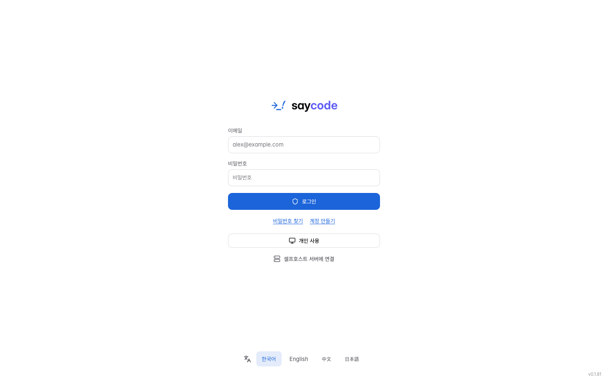
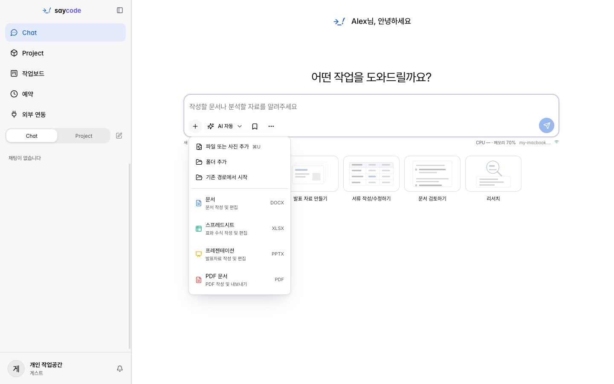
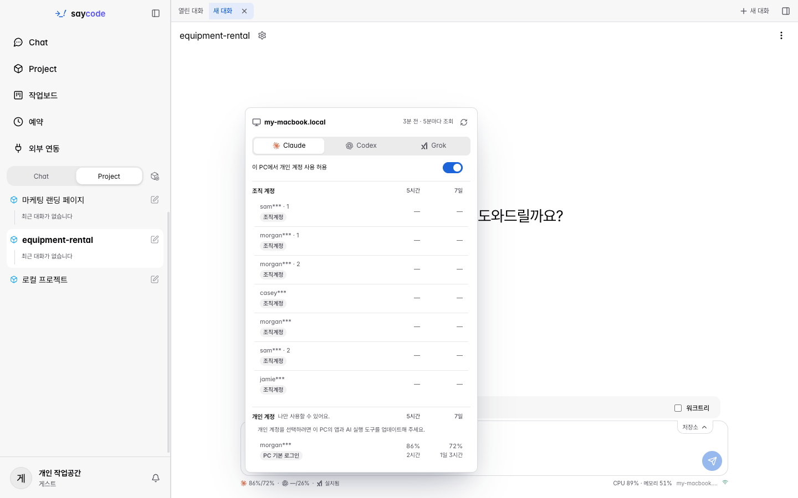
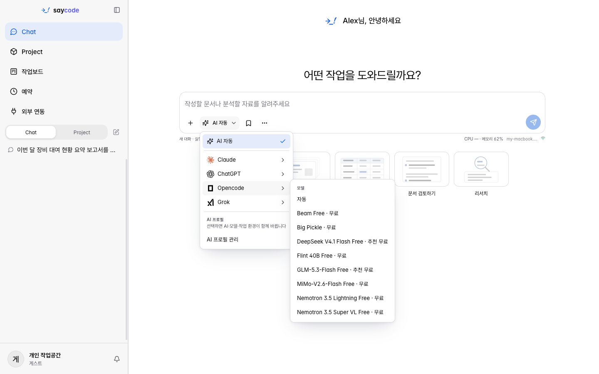
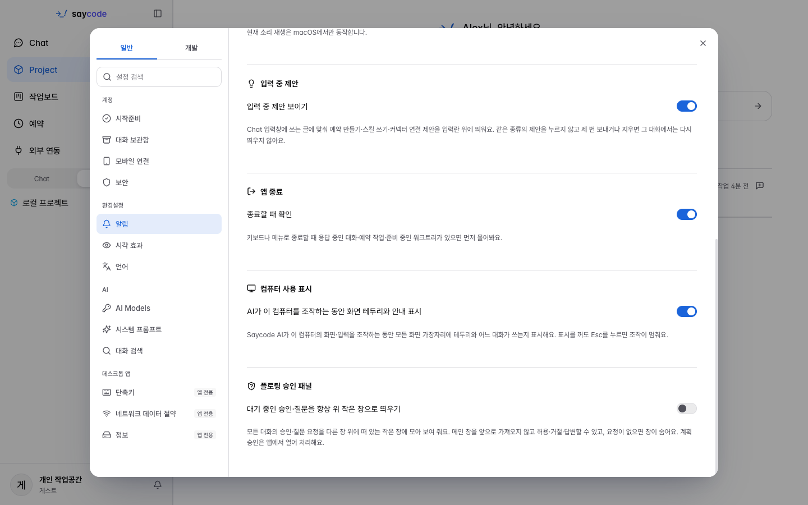
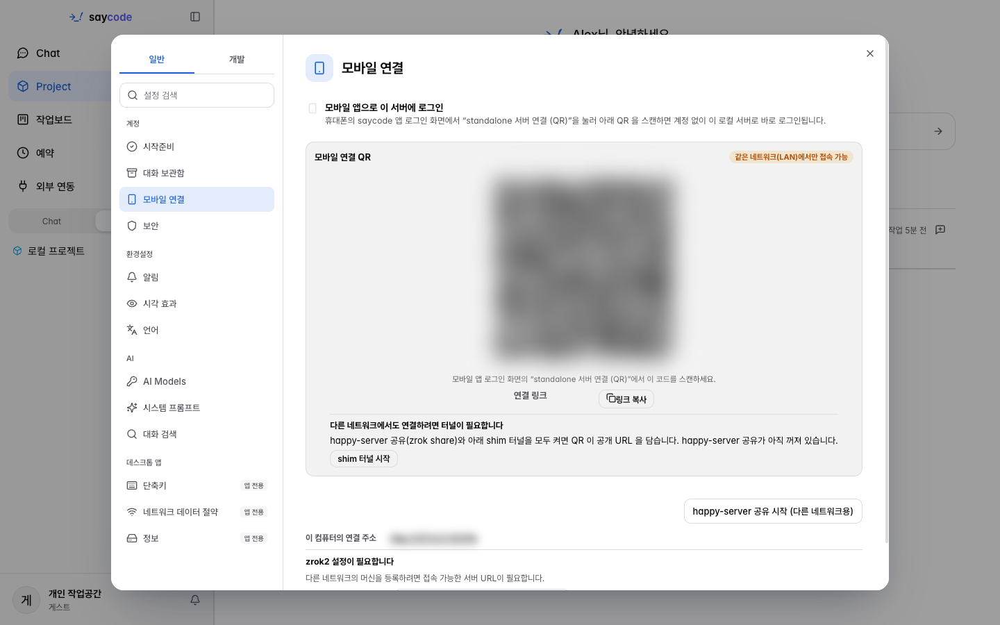
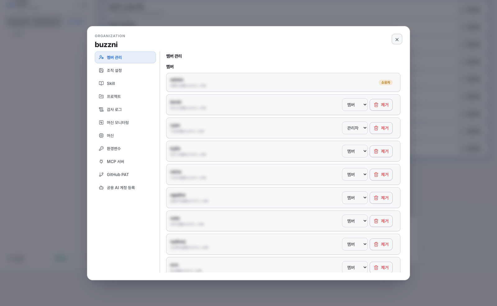
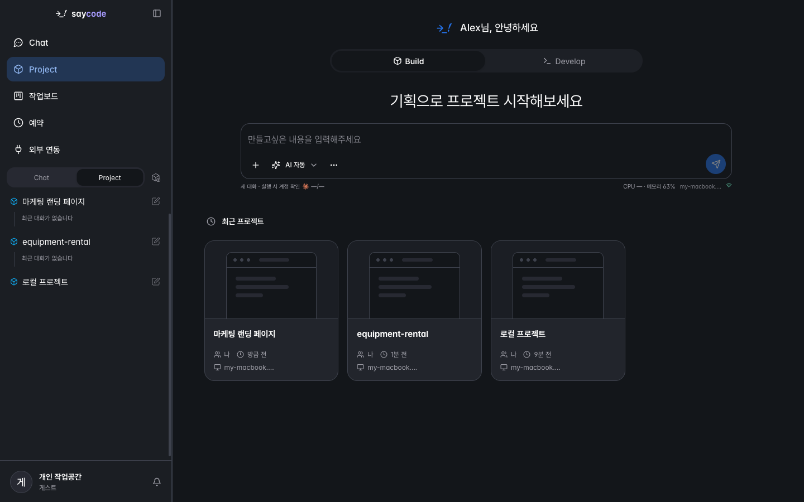
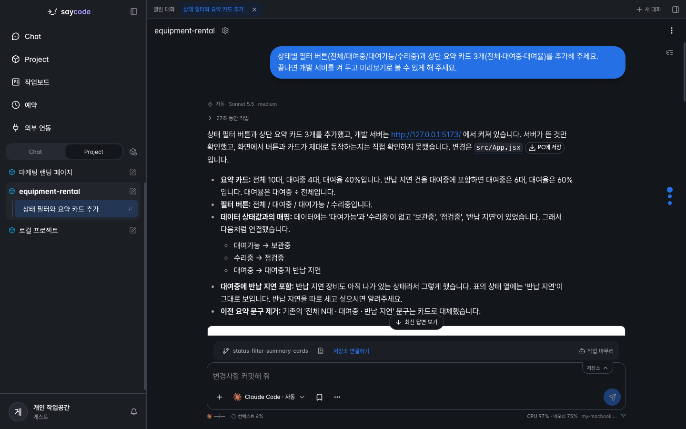
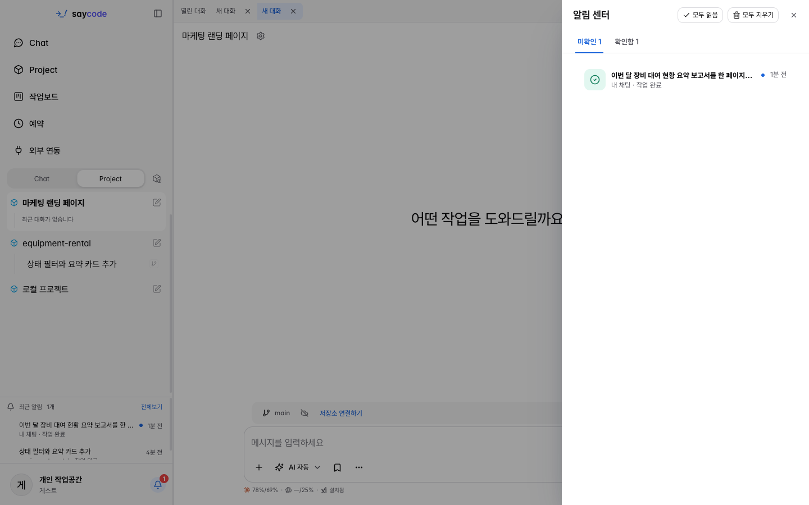

# Saycode Desktop

### 说出来，就变成软件。

**统一管理公司内所有 AI 订阅与 API 的运营层** ——
团队照常使用已经熟悉的最新模型（Claude · Codex · Grok · opencode），
账号、权限、模型选择、成本、部署则由公司在同一屏幕上统一管理。
**集中管理，成本减半。**

[English](README.md) | [한국어](README.ko.md) | **中文** | [日本語](README.ja.md)

 

### [⬇️ 下载 macOS 版 (Apple Silicon)](https://github.com/buzzni/saycode-desktop-releases/releases/download/v0.1.88/Saycode-0.1.88-arm64.dmg)

*已签名并公证的 DMG · 内置自动更新 · 无需账号即可开始*

### 📘 指南 — [在线阅读](https://buzzni.github.io/saycode-desktop-releases/guidebook/en/) · [下载 PDF](docs/guidebook/saycode-guidebook-en.pdf) · [Markdown](docs/GUIDE.md)

*指南提供英文版，另有[韩文版](docs/GUIDE.ko.md)。*

 

https://github.com/user-attachments/assets/a323660d-93d9-45a6-ac1b-85dc2f664523

*🔊 请打开声音 —— 使用真实 v0.1.81 界面制作的 92 秒介绍视频（英文字幕·背景音乐） · [下载 MP4](docs/assets/saycode-intro-en.mp4) · [字幕 SRT](docs/assets/saycode-intro-en.srt)*

<!-- release-notes:start -->
## 新功能与变更

- [最新发布说明](docs/releases/v0.1.41.ko.md)（韩文）
- [完整发布记录](docs/releases/README.ko.md)（韩文）
<!-- release-notes:end -->

---

## 30 秒速览

| 🗣️ **一句话就能变成应用** | 🗂️ **在一块面板上指挥智能体舰队** | ✅ **评审 → 提交 → 完成，一气呵成** |
|:---|:---|:---|
| 说出你想要的，智能体就会**在你的 Mac 上**编写真正的代码、启动开发服务器，并**自动打开预览**。 | 用**工作看板**同时指挥多个 Claude · Codex · Grok · opencode 对话。拖放卡片，下一条指令或评审请求就会自动发出。 | 一个**完成工作**菜单就能走完评审与 Commit & PR，结束的对话用**归档并完成**收尾。 |

> **v0.1.81 —— 上手更轻松，界面结构与网页版一致。** 自 v0.1.50 以来的 31 个版本带来了这些变化：
>
> - **无需账号即可开始** —— 在首屏点一次**个人使用**，**开始准备**就会自动进行；没有付费 AI 账号也能用**免费模型**开始对话。
> - **💸 无需付费账号，免费开始** —— 没有付费 AI 账号，也能直接用**免费模型（opencode）**开始。免费模型由 OpenCode 限时提供，各模型的数据政策不同（[使用指南](https://buzzni.github.io/saycode-desktop-releases/guidebook/en/#205-how-much-can-i-use-free-models)，英文）。
> - **全新侧边栏与我的设置** —— 用 **Chat · Project** 取代主页标签页，新增个人资料菜单、**我的设置（通用 · 开发）**、统一的**创建项目**窗口，术语也更清晰，如**工作电脑**、**工作看板**。
> - **更聪明的输入框** —— **AI · 模型 · 工作强度合为一个按钮（AI 自动）**，输入框下方显示 **AI 剩余额度**，回答期间可排**队列**，还有**对话摘要**、归档与暂时隐藏。
> - **从修改到收尾** —— 用**批注托盘**收集元素的浏览器、**整个分支 / 按轮次**的变更与文件面板、输入框上方的**完成工作**菜单、带筛选和前置任务的**工作看板**，登录后还有**计划**。

---

## 为什么选择 Saycode？

员工早已借助 ChatGPT 和 Claude 快速开展工作。但订阅和 API 合约却分散在各部门、各个人手中，
公司无法得知谁在用什么模型、用了多少。**一禁用，生产力就停摆；放开管，又会失去控制。**
成果留在个人电脑上，随着员工离职一起消失。

Saycode **不是与模型竞争的产品。** 它让团队照常使用已经熟悉的最新模型，
并在此之上叠加组织所需的管理、安全与部署能力 —— 是一层**运营层**。

| | 个人自行订阅时 | **通过 Saycode 共同使用时** |
|---|---|---|
| 账号与成本 | 按个人付费、账号分散，管理员无法查看用量 | **在中央管理、审计与成本控制下使用同一批模型** |
| 提示词与产出 | 归属于个人账号，人一走就随之消失 | **作为组织资产持续积累 —— 即使负责人更替也能保留** |
| 模型选择 | 被锁定在单一模型上，更好的模型出现也难以切换 | **按请求自动选择最优模型，不受供应商绑定，新模型即刻可用** |
| 代码与数据 | 流向外部云端 | **驻留在公司指定的工作电脑上 + 端到端加密（E2EE）** |
| 多智能体运行 | 一个个聊天窗口来回切换 | **用工作看板在同一屏幕上指挥整支舰队** |
| 产出 | 等待评审的分支 | **完成工作 → 评审 → Commit & PR → 部署到内网 URL** |

独自使用时，直接订阅是对的选择。**而当组织共同使用的那一刻起，所需要的东西就不一样了。**

### 公司管理员实际掌控的四件事

| | 内容 | 方式 |
|---|---|---|
| **谁能使用** | 账号与坐席 | 为每位员工分配并回收账号。公司拥有的 AI 订阅或 API 要挂在谁名下，也由公司决定。部门调动或离职时立即回收。 |
| **能用哪些 AI** | 模型与工作电脑策略 | 按团队或工作电脑开放可用的 AI，并为个别人设置例外。使用公司账号一次登录（SSO）。 |
| **用了多少** | 用量与成本 | 在同一屏幕上查看谁用了多少、花费了多少。在超出预算上限前发出提醒，超出后自动停止。 |
| **发生过什么** | 审计日志 | 记录谁在何时做了什么。可搜索并导出为文件。 |

### 我们率先采用并进行了实测

以下是 Buzzni 研发团队在 Saycode 上进行开发与运营后实测得到的结果。

| **49%** | 简单请求 **~90%** | 日常工作 **~80%** |
|:---:|:---:|:---:|
| 月度 AI 执行成本降低 —— 工作量不变，只是成本减少了 | 错别字、文案修正交给轻量模型处理 | 功能实现、重构交给中等模型处理 |

> 测量条件：Buzzni 研发团队 35 人 · 2026 年 6-7 月 · 以订阅与 API 执行成本为准 · 工作量保持不变。
> 单轮节省率与整体节省率是不同的指标。不保证客户环境能取得相同的节省率，
> 导入的第一个月会与客户一起测量基线。

---

## 这和 Agent IDE（Orca 等）有什么不同？

像 [Orca](https://www.onorca.dev) 这样的工具是 **Agent IDE**，专注于开发者的编码循环 ——
按 worktree 并行运行智能体、diff、评审、深度编辑器集成。它们在这方面做得非常出色，
其中一些还提供组织级的推广和治理能力。如果这正是你要解决的循环，
它们是不错的选择。

Saycode 瞄准的是一个不同的问题 —— 从智能体完成代码编写*之后*才开始的问题：

> **Agent IDE 让开发者能运行更多智能体。
> Saycode 把这些智能体构建的成果变成公司的资产。**

| | Agent IDE（Orca 等） | **Saycode** |
|---|---|---|
| 主要关注点 | 开发者的编码循环 | **公司的交付循环** —— 制作 → 评审 → 部署 → 共享 → 交接 |
| 管理单元 | 仓库 · worktree · 智能体会话 | **组织 · 团队 · 项目 · 工作电脑 · 坐席 · 部署成果** |
| "部署"的含义 | 把智能体工具安全地推广到组织内 | **把构建成果作为团队可访问的内网 URL 提供服务** |
| 一般的终点 | 经评审后合并进 Git 的改动 | **可共享、可交接、正在实际运行的内网服务** |
| AI 模型成本 | 用量追踪、账号切换 | **基于难度的自动路由 + 子智能体委派 —— 组织整体实测节省 49%** |
| 触达范围 | 主要是开发者 | **公司的全体成员** —— 开发者、产品经理、运维人员 |

两款产品在并行智能体、worktree、远程执行和本地优先安全性上是重叠的，
所以这些都不是你该做选择的依据。Saycode 在此之上增加的是一层**运营层**：

- **公司所有权** —— 项目、会话、规划文档和工作电脑归属于组织，而不是个人笔记本电脑。
  即使负责人离职或调岗，成果依然可搜索、可交接。
- **内网部署** —— 一键部署到固定的内网 URL（自动 SSL）。产出的不是一个
  等待评审的分支，而是团队今天就能打开使用的真实工具。
- **共享与交接** —— 同事可以浏览、克隆、打磨并把改动合并回去。
  别的团队完成的项目是一个起点，而不是需要重新制作的对象。
- **成本运营** —— 按请求难度自动路由到最便宜的适用模型（只有会话真正卡住时才升级到更高层级），
  机械性的子任务会委派给使用轻量模型的子智能体，
  而这一切都运行在集中管理的组织共用电脑之上。
  每条消息都会用徽章标明选择了哪个模型、为什么选择它。公司整体的 AI 成本
  由"查看"变为"运营"。

**什么时候该用哪个：** 如果你的目标是在自己的代码仓库中获得最深度的并行智能体编码体验，
Agent IDE 也是不错的选择 —— 而且没有理由不能两者兼用。如果你的目标是让 AI 构建的
软件成为**公司的基础设施** —— 部署在内网、跨团队共享、经得起人员交接、成本还可控 ——
那正是 Saycode 要解决的问题。

---

## 核心功能

<table>
<tr>
<td width="42%" valign="middle">

### 🧭 安装后即可开始 —— 无需账号

首屏是登录表单，下面就是**个人使用**和**连接自托管服务器**。点一次**个人使用 → 确认**，Saycode
就会启动内置服务器，把这台电脑注册为**工作电脑**，并**自动完成**“**开始准备**”——Saycode CLI、
AI 工具连接检查、通知提示音。这台电脑上已登录的 Claude、ChatGPT 会直接连接；没有付费 AI 账号也能通过
**使用免费模型开始**（opencode）立刻对话（需要本机联网；若组织限制了 AI 则无法使用）。个人使用时，
对话和项目只保存在这台电脑上。

</td>
<td>
 

</td>
</tr>
<tr>
<td width="42%" valign="middle">

### 🏠 在侧边栏按目的出发 —— Chat · Project

一切从左侧边栏分出去。**Chat** 是无需项目、直接提问和制作文档的地方；**Project** 则通过
**Build**（用说话来规划、新建项目）和 **Develop**（新项目 · 代码仓库 · ZIP/文件 · 我的文件夹）开始开发。
**创建项目**在一个窗口里选择**新项目 / Git 仓库 / ZIP 或文件 / 现有文件夹**（Git 仓库需要连接
GitHub 或 GitLab）。工作电脑、**我的设置**、**深色模式**都收在侧边栏底部的个人资料菜单里。

</td>
<td>
 
 

</td>
</tr>
<tr>
<td width="42%" valign="middle">

### 🗣️ 一句话，就能变成能运行的应用

*“帮我做一个咖啡订阅服务的落地页”* —— 就这一句，智能体会**在你的电脑上**创建并修改真正的文件。
工具执行折叠成一行行，过程清爽，回答随写随显。完成后，在右侧工作区的**浏览器 · 预览**里直接打开
结果。（视频已剪掉智能体的等待时间。）

</td>
<td>
 

</td>
</tr>
<tr>
<td width="42%" valign="middle">

### 📄 无需项目，直接开工 —— Chat 与文档模板

没有代码也没关系。在 **Chat** 里说 *“做一份第三季度设备租赁情况报告”*，结果文件会**直接在应用内打开**。
输入框的 **+** 可以附加文件、照片、文件夹，或**从现有目录开始**；选择文档 · 电子表格 · 演示文稿 · PDF
格式和模板（*Design Report*、*Minimal Letterhead*、**创建我的模板**），就能一直沿用同样的格式写下去。
在结果文件卡片上可以**保存到我的电脑**；登录后还能用**公开链接**分享 HTML 结果（可选择公开范围和有效期）。

</td>
<td>
 
 

</td>
</tr>
<tr>
<td width="42%" valign="middle">

### 🧩 工作区 —— 对话居中，工具在右

**显示工具 → 添加面板**，就能把文件 · 终端 · 浏览器 · 变更 · 预览贴在对话旁边。**变更**面板用左右对比
diff 展示**整个分支**（点某个提交只看该提交）或**按轮次**（本轮 · 上一轮之后 · 相对对话开始），还能按文件名或
变更内容搜索。**文件**面板提供全项目文件名搜索与**内容搜索**、CSV/TSV **以表格查看**，以及把产出集中
在一处的**成果汇总**。打开的工具按对话恢复，⌘⇧B 可收起/展开。

</td>
<td>
 
 

</td>
</tr>
<tr>
<td width="42%" valign="middle">

### 👀 边看边改 —— 选中界面元素，收进托盘一次发送

在工作区的**浏览器**里打开你的应用（`http://localhost:…`），点**选择元素**后在界面上点击多个元素，
它们会堆进下方的**批注托盘**。为每项写下需求，选好意图（**请修改 / 提问 / 参考**），再点**全部发送**——
选择器、样式和截图会填进输入框，你确认后发送即可。想自己直接改数值？在**设计调整**里调节间距、
布局和字体，再用**发送更改请求**交给智能体。回复结束后刷新页面，就能看到改动后的样子。

</td>
<td>
 

</td>
</tr>
<tr>
<td width="42%" valign="middle">

### 🤖 AI 自己选，模型也自动选 —— AI 自动

输入框下方**一个按钮**就能设定 AI（**Claude Code · Codex · Opencode · Grok**）、模型和**工作强度**。
默认的 **AI 自动**会按每次请求的难度挑选合适的模型与强度，并在每条消息上留下
*“自动 · Sonnet 5.5 · medium”* 徽章，说明选了什么。想固定的话直接选模型即可（工作强度菜单在你亲自选定模型后才会出现），
常用组合可保存为 **AI 配置**。旁边的 **AI 剩余额度**按钮会打开 Claude · Codex · Grok 的用量和各账号余量；
有多个账号时，**自动轮换账户**会在一个账号触顶后让工作继续。

</td>
<td>
 
 

</td>
</tr>
<tr>
<td width="42%" valign="middle">

### 💸 无需付费账号，免费开始 —— 免费模型（opencode）

没有 Claude 或 ChatGPT 付费账号也没关系：点一下**开始准备 → 使用免费模型开始**，就会把 opencode 安装到这台电脑上，
马上就能对话。安装前会显示安装位置和免费模型的使用条件，确认后才会安装。在输入框下方的 AI 菜单中选择
**Opencode**，免费模型会带上“免费”“推荐免费”标记；不选模型时，每条消息会自动使用推荐的免费模型。免费模型由
OpenCode **限时提供**，且**各模型对输入的保留与训练政策不同。** 公司或机密代码，请连接付费/组织 AI，或只使用提供方
声明不保留、不用于训练的模型。→ [使用指南 FAQ: How much can I use free models?（英文）](https://buzzni.github.io/saycode-desktop-releases/guidebook/en/#205-how-much-can-i-use-free-models)

</td>
<td>

</td>
</tr>
<tr>
<td width="42%" valign="middle">

### 💬 对话不间断 —— 队列、摘要、整理

AI 还在回答时，直接输入下一个需求并发送，它就会进入**队列**（可编辑、删除、调整顺序）；AI 反过来
提问时，输入框会变成**问题表单**。长对话可以用右侧的**消息导航轨**快速浏览，并把**对话摘要**（按请求
列出成果、变更文件和预览）固定在旁边。结束的对话用**归档**（有撤销提示，可在**对话归档箱**恢复）或
**暂时隐藏**（1 小时到下周一）来整理，打开的对话标签页会按项目恢复。

</td>
<td>
 

</td>
</tr>
<tr>
<td width="42%" valign="middle">

### 🗂️ 工作看板 —— 用看板指挥你的对话舰队

所有项目的所有对话汇在一块看板上：**等待输入 → 响应中 → 待机 → 审查中 → 完成 → PR 已合并**。每张卡片显示项目、
AI、模型、耗时和工作树。把卡片拖到**审查中**会弹出评审请求对话框，拖到**完成**则完成收尾。用**筛选**
（工作电脑 · 自动化 · PR 状态）和**前置任务**（卡片上的 `1/2` 徽章）安排顺序，并直接在卡片上运行
**自动驾驶**、**验证更改**和 **PR 守护**（需要 GitHub）。等待同一权限的多个对话，一次**全部允许（N）**即可处理。
工作看板默认隐藏——请开启**个人资料菜单 → 开发者功能设置 → 显示工作看板菜单**（**⌘⇧A** 不开启也能用）。

</td>
<td>
 

</td>
</tr>
<tr>
<td width="42%" valign="middle">

### ✅ 完成工作 —— 评审、提 PR、收尾

输入框上方那一行最右侧的**完成工作**按钮会展开菜单：**自我评审**（AI 自查，轮数可在**高级设置…**中调整）、
**请求独立评审…**（由另一个 AI 工具按你选的 AI、模型、强度和评审重点来检查，另有**评审记录**标签页）、
**Commit & PR**（处理 CI、评审机器人和冲突，直到合并到 base——仍有未满足的条件时不会合并，而是汇报）、
**归档并完成**。提 PR 在有工作树对话和远程仓库时才会出现；没有远程仓库时显示**提交**。响应中点击也没关系，
它会排队，等当前工作结束后接着执行。

</td>
<td>
 

</td>
</tr>
<tr>
<td width="42%" valign="middle">

### 🌿 工作树 —— 每个对话各用一份，删了也安全

打开输入框上方一行的**工作树**，对话就在专属分支上工作，在工作看板里并行运行多个对话也不会互相冲突。
新工作树从远程最新的默认分支起步，**带上当前更改**可以把进行中的修改一并带过去，
**项目工具 (⋮) → Git 操作 → 工作树…** 管理窗口还能批量清理旧工作树。删除前会提醒 `.env` 这类仅存在于本地的
文件，删掉的工作树可从**快照存档**中恢复（Git 项目；Windows 工作电脑除外）。

</td>
<td></td>
</tr>
<tr>
<td width="42%" valign="middle">

### 🔐 审批与安全 —— AI 能做什么，由你决定

AI 要执行有风险的操作时，会先弹出**需要留意的操作**审批卡片，你也可以**填写理由并拒绝**。即使主窗口不在
最前，也能在**浮动确认面板**（我的设置 → 通用 → 通知，默认关闭）里处理审批和提问；在 **AI 工具使用规则**里按
应用设置询问/禁止/允许（含 MCP 工具读/写）；用**全局暂停**一次停住所有自动运行；还可以在开发自动化里用
**用 AI 审核处理权限请求**，把重复的审批交给 AI。

</td>
<td>
 

</td>
</tr>
<tr>
<td width="42%" valign="middle">

### 🧠 会记忆、会学习的智能体

智能体把工作中验证过的方法作为**经验候选**提出后，只需在回答下方的卡片上点**批准 / 拒绝**。批准的经验
从下一次对话起自动生效。在**我的设置 → 开发 → Memory** 里管理记忆，并在新对话中获得相似的过往对话建议；
在**我的设置 → 通用 → 系统提示词**里，可逐项开关 Saycode 默认指令（包括 **Saycode 使用指南**）。

</td>
<td></td>
</tr>
<tr>
<td width="42%" valign="middle">

### 🖥️ 我的工作电脑，我的手机

这台电脑会在首次启动时自动注册；GPU 服务器、构建服务器、云端 VM 也可以通过
**我的设置 → 开发 → 工作电脑 → 注册机器**添加。新任务在哪台电脑上运行，可在个人资料菜单或输入框里选择；
在开发者功能设置里开启**显示 CPU 和内存**，就能在输入框下方看到负载。用 Saycode 移动端扫描
**我的设置 → 通用 → 移动端连接**里的二维码，同一个工作区就会在手机上打开；通知设置里的**移动端完成推送**会在
长任务结束的瞬间提醒你。

</td>
<td>
 

</td>
</tr>
<tr>
<td width="42%" valign="middle">

### 🔌 外部集成 —— 服务、扩展、即时通讯

登录后，侧边栏的**外部集成**可以连接 Notion · Slack · Google Drive · Gmail · KNOI · Figma · DirectCloud，
还能添加**自定义连接器**（MCP 地址）。未登录的个人使用会打开官方**扩展**（渠道适配器、插件管理器等）的
安装与管理界面，在**我的设置 → 开发 → 扩展**里也能做同样的事。连接**即时通讯渠道**（我的设置 → 通用，
仅限已登录账号）后，就能在 Slack · Telegram · Discord 里发起 Saycode 对话并接收进度。

</td>
<td></td>
</tr>
<tr>
<td width="42%" valign="middle">

### 🏢 团队工作区 —— 部署、共享、组织管控 *(需登录)*

用 saycode.ai 账号登录后，可以**部署到团队直接打开的内网 URL**（SSL 自动配置，每次部署刷新同一链接），
把项目以**协作**方式邀请他人，或按团队共享。在**您要在哪个组织工作？**里选择组织，并通过个人资料菜单的
**组织管理**管理成员、团队、权限、审计日志、AI 模型策略以及 LLM 用量与费用。个人使用中看不到的
**公开链接 · 计划 · 即时通讯渠道 · 外部服务集成**，登录后也会开放。打开已部署应用或报告的**最终用户
无需占用坐席。**

</td>
<td></td>
</tr>
<tr>
<td width="42%" valign="middle">

### 🌙 让你想一直留下来的工作区

在个人资料菜单里直接切换**深色模式**。信息密而不乱，界面沉稳。**快速打开**（⌘P——输入 `>` 只看命令）、
对话搜索 ⌘⇧F、工作看板 ⌘⇧A、工作面板 ⌘⇧B、置顶对话 ⌘1~9、恢复关闭的标签页 ⌘⇧T，都能在
**我的设置 → 通用 → 快捷键**里搜索并重新绑定。铃铛里的最近通知、Dock 角标，以及输入请求与任务完成的
提示音——细节累积起来，就是体验。

</td>
<td>
 
 

</td>
</tr>
</table>

### 还有这些

- ⌨️ **输入框效率** — 在空输入框按 **↑** 调出本对话之前的请求；书签形的**我的提示词**保存常用请求（存在账号里，换一台电脑也能用）；`@` 引用其他对话；`/recap`、`/btw`；长文本粘贴会折叠成卡片
- 🛟 **文件检查点** — 在新对话的 `⋯` 里开启（macOS），智能体修改文件前会留下原状态，经逐文件预览后安全恢复
- 🧭 **项目中心** — **项目工具 (⋮) → 设为项目中心**后，其他对话的完成和提问会以消息送达，智能体还能查看并指示同一项目的其他对话
- 🔁 **继续对话** — **项目工具 (⋮) → 继续对话**，可换用其他 AI 工具继续（Claude ↔ Codex），或用同一个 AI 另开分支
- 🔎 **对话搜索与快速打开** — ⌘⇧F 通过本机索引搜索过往对话；⌘P 快速打开文件和命令
- 🤖 **自动驾驶与自动质量验证** — 工作看板卡片上的自动驾驶会先评审、逐条确认需求的证据，之后才推进到 PR；PR 守护把 CI 失败、评审意见和冲突交还给智能体处理 *(PR 守护需要 GitHub)*
- 🗓️ **计划** *(需登录)* — 让 AI 在固定时间做事：*“每天上午 9 点总结昨天的 PR”*。可确认时区，结果会像普通对话一样沉淀下来，也能发到 Telegram、Slack
- 🔔 **通知与 Webhook** — 完成和输入请求通知在重启后依然保留，开发自动化可把会话事件以签名 Webhook 发送到你的端点
- 📄 **富文本文件查看器** — Markdown、HTML、PDF、DOCX 在应用内渲染；CSV/TSV 以表格打开，大型媒体流式播放
- 🔐 **安全默认值** — 聊天与终端端到端加密、Passkey/TOTP MFA *(团队)*，代码和数据留在你的工作电脑上

---

## 工作原理

| | | |
|---|---|---|
| **01 · 安装并开始** | **02 · 按目的出发** | **03 · 用说话来提需求** |
| 打开 DMG 选择**个人使用**，内置服务器启动，开始准备自动进行。 | 在侧边栏选择 Chat（文档、提问），或 Project 里的 Build（新规划）· Develop（仓库、ZIP、文件夹）。 | 一句自然语言就够：*“加上状态筛选按钮和汇总卡片”* |

| | |
|---|---|
| **04 · AI 在你的工作电脑上制作** — 智能体真正读写文件、执行命令。在右侧工作区用变更、终端、浏览器即时确认，多个对话则用工作看板统一指挥。 | **05 · 收尾并分享** — 用完成工作走完评审 → 提 PR → 归档并完成。若是团队工作区，可部署到内网 URL，并通过协作完成交接。 |

---

## 安装与首次启动

### macOS

1. 从 **[Releases](https://github.com/buzzni/saycode-desktop-releases/releases/latest)** 下载最新 DMG（Apple Silicon — Intel Mac 用的 x64 DMG 在同一页面）
2. 打开 DMG，把 **Saycode** 拖到 Applications
3. 启动后首屏是登录表单。在屏幕底部选择**语言**（한국어 · English · 中文 · 日本語）
4. 选择开始方式
   - **个人使用 → 确认** — 无需登录，直接在这台电脑上开始（对话和项目只保存在这台电脑上）
   - **登录** — 用 saycode.ai 账号开始。没有账号可在应用内**创建账户**；组织在登录后的**您要在哪个组织工作？**里选择
   - **连接自托管服务器** — 粘贴在自己的服务器上用 `saycode server connect` 获得的连接码，然后点**连接**

<table>
<tr>
<td width="33%"></td>
<td width="33%"></td>
<td width="33%"></td>
</tr>
<tr>
<td valign="top"><b>① 起始界面</b> — 登录表单下方是<b>个人使用</b>和<b>连接自托管服务器</b>，语言按钮在最底部。之后可在我的设置 → 通用 → 语言里更改。</td>
<td valign="top"><b>② 开始准备</b> — 按 Saycode CLI → Saycode 指令 → AI 工具 → 通知的顺序自动进行。AI 工具步骤只显示这台电脑上已连接的 AI；若没有，请选择<b>连接我的 AI 账号</b>（ChatGPT · Claude）或<b>使用免费模型开始</b>。</td>
<td valign="top"><b>③ 第一个项目</b> — 在 Project → Develop → <b>创建项目</b>中选择新项目 · Git 仓库 · ZIP 或文件 · 现有文件夹，并确认工作电脑（本机）。</td>
</tr>
</table>

开始准备可以用**稍后再做**跳过，之后随时可通过**个人资料菜单 → 我的设置 → 通用 → 开始准备 → 从此步骤自动运行**继续。
**Saycode 指令**默认为*关闭*；开启后会遵循委派子智能体、结果内联预览等 Saycode 工作流。

应用已通过 Developer ID 签名并公证，并会自动更新。
想看带截图的完整步骤，请参阅上方的**[指南](docs/GUIDE.md)**。

### 本地工作区与团队工作区

| | 个人使用 · Guest 本地工作区 | 登录 · 团队工作区（saycode.ai 登录） |
|---|---|---|
| 所需条件 | 无 —— 安装即可 | 组织账号（SSO · Passkey/TOTP MFA） |
| 数据位置 | 全部在这台 Mac | 代码与数据在指定的工作电脑，元数据与审计日志在组织控制台 |
| 智能体 · AI 自动选择 · Chat 与文档模板 · 工作看板 · 工作树 · 完成工作 · 浏览器 · 终端 · 搜索 · 经验/记忆 · 扩展 | ✅ | ✅ |
| 注册工作电脑 · 移动端连接 | ✅（移动端需同一网络或隧道） | ✅ |
| 公开链接 · 计划 · 即时通讯渠道 · 外部服务集成（Notion、Slack 等） | — | ✅ |
| 内网 URL 部署 · 协作 · 团队共享 · 项目标签 | — | ✅ |
| 组织控制台（坐席 · 团队 · 权限 · AI 模型策略 · 费用 · 审计日志） | — | ✅ |

先在本地开始，需要时再登录。本地项目会原样保留。

> **Windows / Linux** — 敬请期待。请关注 [Releases](https://github.com/buzzni/saycode-desktop-releases/releases) 获取最新消息。

---

## 导入场景 —— 从哪里开始由客户决定

这三种场景不是先后顺序，而是可选项。可以从其中一种开始，也可以组合使用。

| 💬 聊天与文档 | ⚙️ 个人业务自动化 | 🚀 应用构建与部署 |
|---|---|---|
| 会议纪要总结、企划书/报告初稿、搜索与摘要。只使用经批准的用户和模型，按组限制可用模型，并汇总用量与成本。 | 与内部协作工具、文档存储连接，自动化生成周期性报表、协助请求/审批流程等重复性工作。 | 业务部门自行构建内部工具并部署到内网 URL，覆盖成果审阅、审批流程。 |

**即使不是开发者，从第一周起也能使用** —— 经营支持（会议纪要、月度报告初稿、
政策问答）、销售与市场（提案初稿、VOC 分类）、电商运营（商品/价格/库存检查报告）、
人力与总务（规章说明、请求/审批流程、入职资料）——从目前靠手工、Excel、
即时消息处理的重复性工作开始。成果以链接形式共享，无需在消息软件中来回传附件
就能完成审阅。

---

## 面向团队的 Saycode

### 用一个月免费 PoC 先看数据

针对客户选定的场景实测用量、成本、策略和审计，并一起制作出
导入决策所需的结果报告。**PoC 期间可以照常使用 Premium 坐席的全部功能。**

| 第 1 周 · 基线 | 第 2-3 周 · 实际使用 | 第 4 周 · 结果报告 |
|---|---|---|
| 测量当前 AI 使用与成本基线，选定目标部门与 PoC 场景 | 应用于实际业务，实测用量与成本，验证策略与权限设置 | 汇总激活率、成本、策略执行结果，产出正式导入报价 |

PoC 期间一个月免费。期间产生的模型使用费用按客户自身合约计算。

### 价格 —— 只为亲自构建的人设坐席

这不是转售 AI 模型的工具。直接连接你现有的 AI 合约，
只为管理与执行环境收取坐席费用。

| 方案 | 价格 | 适用对象 | 包含内容 |
|---|---|---|---|
| **Office** | $10 / 人·月 | 面向以聊天与文档为主的全体员工 | 聊天与文档工作 · 成果查看/审阅/审批 · 用量仪表盘 |
| **Premium** ⭐ | $40 / 人·月 | 面向亲自构建并部署的一线人员 | Office 的全部功能 + 应用构建/智能体执行 · 内网 URL 部署 · SSO 集成 |
| **批量导入** | 按规模协商 | 全公司导入 · 特殊需求 | 全公司规模的单价 · 私有化部署/隔离网络配置 · 专属支持与 SLA |

- **AI 模型加价 0%** —— 直接连接你现有的 Anthropic、OpenAI、Azure、Bedrock、Vertex 合约。月度总成本 = 坐席费 + 外部 AI 订阅费 + API 使用费。
- **只需打开已部署应用或报告 URL 的最终使用者，不需要坐席。** 坐席为实名制，不共享账号。
- 可以设置预算上限和阈值提醒，超出上限时自动停止。
- 当前导入活动期间无初始配置费用。

- 🌐 官网：**[saycode.ai](https://saycode.ai)** · 介绍资料：**[saycodepoc.apps.saycode.ai](https://saycodepoc.apps.saycode.ai/)**
- 💼 导入咨询：[soo@buzzni.com](mailto:soo@buzzni.com)
- 🛠 技术咨询：[ryan@buzzni.com](mailto:ryan@buzzni.com)
- 🤝 客户支持：[ernie@buzzni.com](mailto:ernie@buzzni.com)

---

## 开源声明

Saycode Desktop 构建于开源软件之上。以下项目被打包或使用在其中
（已标注许可证），完整的许可证全文包含在打包后的应用中：

| 项目 | 用途 | 许可证 |
|---|---|---|
| [Happy](https://github.com/slopus/happy) (经由 [buzzni 分支](https://github.com/buzzni/happy)) | 独立模式中打包的加密智能体会话中继引擎 (`happy-cli` / `happy-server`) | MIT |
| [Electron](https://www.electronjs.org/) | 桌面应用外壳 | MIT |
| [React](https://react.dev/) | UI 框架 | MIT |
| [xterm.js](https://xtermjs.org/) (+ fit / web-links / WebGL 插件) | 远程终端渲染 | MIT |
| [socket.io-client](https://socket.io/) | 实时传输 | MIT |
| [react-markdown](https://github.com/remarkjs/react-markdown) + [remark-gfm](https://github.com/remarkjs/remark-gfm) | 聊天 Markdown 渲染 | MIT |
| [electron-updater](https://www.electron.build/) | 应用内自动更新 | MIT |
| [buffer](https://github.com/feross/buffer) | 二进制工具库 | MIT |
| [lucide-react](https://lucide.dev/) | 图标库 | ISC |
| [TweetNaCl.js](https://tweetnacl.js.org/) | 端到端加密原语 | Unlicense（公有领域） |

特别感谢 Kirill Dubovitskiy 及其贡献者们的
**[slopus/happy](https://github.com/slopus/happy)**（MIT），它是 Saycode
加密会话同步架构的基石。

---

**© 2026 [Buzzni](https://buzzni.com) · [saycode.ai](https://saycode.ai)**

*让公司里的每个人，说出来就能做出来。*

