

# Saycode Desktop 사용자 가이드

**설치부터 프로젝트 작업, 작업 마무리까지 — 순서대로 따라오면 됩니다.**
*v0.1.81 화면 기준 · 2026년 11월*

[English](GUIDE.md) | **한국어**

<!-- guidebook: version=v0.1.81 date=2026-11-01 -->

---

## 이 가이드 읽는 법

Saycode Desktop은 내 컴퓨터(또는 연결한 다른 컴퓨터)에서 AI가 실제로 파일을 만들고 코드를 고치고 명령을 실행하도록 맡기는 데스크톱 앱입니다. 이 가이드는 **처음 쓰는 분이 위에서 아래로 읽으며 따라 할 수 있게** 순서를 잡았습니다. 이미 앱을 쓰고 있다면 필요한 장만 골라 읽어도 됩니다. 예전 버전(v0.1.50 전후) 화면에 익숙하다면 맨 끝의 [바뀐 용어표](#부록-a-바뀐-용어표)부터 보세요.

### 이 가이드가 기준으로 삼는 것

- **버전**: Saycode Desktop **v0.1.81** (2026년 11월). 이후 업데이트에서 화면 이름이나 위치가 조금 달라질 수 있습니다.
- **운영체제**: macOS 화면을 기준으로 설명합니다. 단축키는 **⌘** 대신 Windows에서는 **Ctrl**을 쓰며, Windows에서 제한되는 기능은 해당 위치에 따로 적었습니다.
- **UI 언어**: 한국어 화면의 이름을 그대로 적었습니다. 영어 화면에서는 이름이 다를 수 있습니다.

### 표기 규칙

| 표기 | 뜻 |
|---|---|
| **굵은 글씨** | 화면에 보이는 버튼·메뉴·탭 이름 그대로입니다. |
| 프로필 메뉴 → **내 설정** → **일반** | 차례대로 누르는 경로입니다. |
| `코드 모양 글씨` | 직접 입력하거나 키보드로 누르는 값입니다. |
| **[로그인]** | Saycode 계정으로 로그인했을 때만 보이는 기능입니다. 로그인 없이 쓰는 **개인 사용**에서는 보이지 않습니다. |
| **[조직]** | 조직(팀)에 속해 있어야 쓰는 기능입니다. |
| **[개발자]** | 프로필 메뉴의 **개발자 기능 설정**에서 먼저 켜야 보이는 기능입니다. |

> [!NOTE]
> 각 장은 "무엇을 할 수 있나 → 조건 → 따라 하기 → 팁" 순서입니다. **조건**(로그인, 조직, 개발자 기능 설정, 서버 지원, macOS/Windows)은 따라 하기 앞에 적었으니 메뉴가 안 보이면 조건부터 확인하세요. 화면 예시는 로그인 없이 쓰는 **개인 사용** 기준이며, 로그인 계정에서만 달라지는 부분은 따로 표시했습니다. 화면 예시는 [개발자] **작업보드 메뉴 보이기**와 **CPU·메모리 보이기**를 켠 상태로 찍었습니다. 처음 설치한 앱에는 사이드바에 **작업보드**가 없고 입력창 아래에 CPU·메모리도 보이지 않습니다([3.4](#34-개발자-기능-설정)).

---

## 0. Saycode 한눈에 보기

**Saycode는 "내 작업PC에서 AI도구가 일하고, 나는 화면에서 지켜보며 이끄는" 앱입니다.** 먼저 앞으로 계속 나올 말 몇 가지만 익히면 이후 장이 훨씬 쉬워집니다.

### 핵심 용어

| 용어 | 쉬운 설명 |
|---|---|
| **작업PC** | AI가 실제로 파일을 만들고 명령을 실행하는 컴퓨터입니다. 처음에는 지금 쓰는 이 컴퓨터가 자동으로 작업PC가 되고, 서버나 다른 PC를 더 등록할 수도 있습니다. 예전 이름은 "머신"입니다. |
| **AI도구** | 실제로 일하는 AI 프로그램입니다. **Claude Code**, **Codex**, **Opencode**, **Grok** 등이 있고, 무엇을 쓸지 **AI 자동**에 맡기거나 직접 고릅니다. Chat 화면에서는 Claude·ChatGPT로 표시되기도 하고, 시작준비의 단계 이름은 "AI 도구"로 띄어 씁니다(같은 뜻입니다). |
| **실행기(런타임)** | 작업PC에서 AI를 실제로 돌리는 Saycode 프로그램입니다. 오래되면 일부 기능이 회색으로 비활성이 되며, 사유가 함께 표시됩니다. |
| **조직 정책** | 조직 관리자가 정한 사용 제한(허용 모델, 도구 규칙 등)입니다. 개인 사용에는 없습니다. |
| **모델** | AI도구 안에서 고르는 두뇌의 종류입니다. 가볍고 빠른 모델부터 어려운 문제용 상위 모델까지 있습니다. |
| **작업 강도** | AI가 얼마나 깊이 생각하고 답할지 정하는 단계입니다(예: Low ~ Max). 높을수록 오래 생각합니다. |
| **Chat** | 프로젝트 없이 바로 질문하고 문서·표·발표자료를 만드는 곳입니다. |
| **Project(프로젝트)** | 폴더 하나(대개 Git 저장소)를 연결해 두고 그 안에서 여러 대화로 코드를 만들고 고치는 단위입니다. |
| **대화** | AI와 주고받는 한 번의 작업 흐름입니다. 프로젝트 안에서는 대화마다 따로 진행·보관됩니다. |
| **작업트리** | 한 대화만을 위한 **복사본 작업 폴더**(브랜치)입니다. 여러 대화를 동시에 돌려도 서로 파일이 섞이지 않습니다. 새 대화의 체크박스에는 **워크트리**라고 표시됩니다. |
| **변경기록** | Git 커밋입니다. **변경기록 남기기**로 지금까지의 수정을 저장합니다. |
| **작업물** | AI가 대화 중에 만든 문서·이미지·HTML 같은 결과 파일입니다. 예전 이름은 "산출물"입니다. |
| **내 설정** | 앱의 모든 설정 화면입니다. 예전 이름은 "환경설정"이며 단축키는 그대로 **⌘,** 입니다. |

### Chat과 Project, 무엇이 다른가요?

| | **Chat** | **Project** |
|---|---|---|
| 용도 | 질문, 글쓰기, 문서·표·발표자료 만들기 | 앱·코드를 만들고 고치기 |
| 작업 위치 | 대화마다 자동으로 만들어지는 작업 폴더 | 내가 연결한 프로젝트 폴더 |
| 파일·변경·터미널·브라우저 패널 | 결과 파일 열람 중심 | 모두 사용 |
| 작업트리·PR·작업 마무리 | 없음 | 사용(Git 프로젝트일 때) |
| 대화 요약 레일·자동 보관 | 없음 | 사용 |

> [!TIP]
> 처음이라면 **Chat에서 가볍게 질문**해 보고 익숙해지면 **Project**로 넘어가는 순서를 권합니다.

### 작업의 한 바퀴

1. **준비** — 앱 설치, 시작 화면에서 **개인 사용**, [시작준비](#2-시작준비)에서 AI 연결
2. **시작** — [Chat](#4-chat으로-프로젝트-없이-일하기)에서 질문하거나 [프로젝트를 만들고](#5-프로젝트-만들기) 대화 열기
3. **지시** — [입력창](#6-프로젝트-대화와-입력창)에 한 문장으로 요청, AI·모델은 **AI 자동**에 맡겨도 됩니다
4. **확인** — [작업 영역](#8-작업-영역)에서 파일·변경·미리보기를 보고, [보면서 고치기](#9-보면서-고치기)로 수정 요청
5. **마무리** — [작업 마무리](#11-작업-마무리) 메뉴에서 리뷰 → PR 올리기 → 보관&완료

---

## 1. 설치와 첫 실행

**앱을 설치하고, 첫 화면에서 "어떻게 시작할지"를 고릅니다.** 계정 없이 바로 쓰는 **개인 사용**, 계정으로 **로그인**, 직접 운영하는 서버에 붙는 **셀프호스트 서버에 연결** 세 가지가 있습니다.

### 1.1 설치

1. **[최신 설치 파일을 내려받으세요.](https://github.com/buzzni/saycode-desktop-releases/releases/latest)** macOS는 Apple Silicon용과 Intel Mac용(x64) DMG가 따로 있습니다. Windows는 설치 프로그램을 받습니다.
2. macOS는 DMG를 열어 **Saycode**를 Applications 폴더로 끌어다 놓습니다. Windows는 설치 마법사를 따라 진행하고, 마지막 화면에서 **완료**를 누르면 앱이 열립니다(바로 열고 싶지 않다면 실행 항목의 체크를 해제하세요).
3. 앱은 서명·공증되어 있고 새 버전이 나오면 업데이트를 안내합니다([업데이트하기](#20-문제-해결과-faq) 참고).

### 1.2 시작 화면 살펴보기

로그인하지 않은 상태로 앱을 열면 아래 화면이 나옵니다.

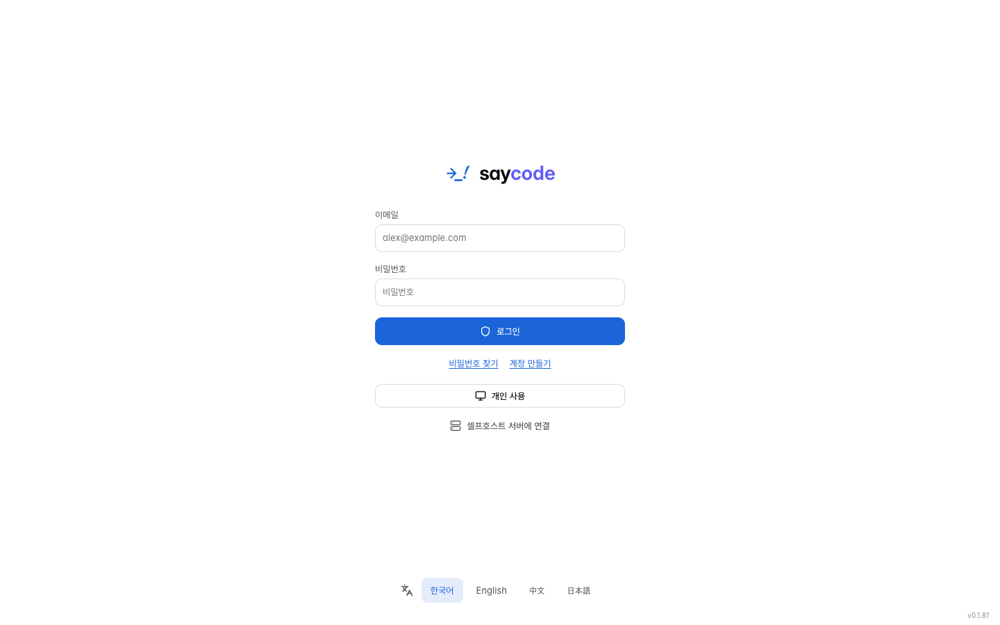

| 위치 | 이름 | 용도 |
|---|---|---|
| 위쪽 | **이메일** · **비밀번호** · **로그인** | Saycode 계정으로 로그인합니다. 조직(팀)을 쓴다면 이 방법입니다. |
| 로그인 아래 | **비밀번호 찾기** · **계정 만들기** | 앱 안에서 가입하거나 비밀번호를 다시 정합니다. |
| 가운데 | **개인 사용** | 계정 없이 내 PC에서 바로 시작합니다. |
| 맨 아래 | **셀프호스트 서버에 연결** | 직접 운영하는 Saycode 서버에 연결 코드로 접속합니다. |
| 화면 하단 | **한국어 / English / 中文 / 日本語** | 앱 언어. 누르면 바로 바뀌고, 나중에 **내 설정 → 일반 → 언어**에서도 바꿉니다. |

### 1.3 방법 ① 개인 사용 — 계정 없이 시작

**조건**: 없음. 로그인하지 않은 첫 화면에서만 보입니다. 이 방식에서는 대화와 프로젝트가 **이 PC에만** 저장됩니다.

1. 시작 화면에서 **개인 사용**을 누릅니다.
2. "개인 사용 (내 PC 연결)" 창이 나오면 안내를 읽고 **확인**을 누릅니다. 취소하려면 **취소**를 누르세요.
3. Saycode가 이 PC에서 작업공간을 준비합니다. 처음에는 10~30초쯤 걸릴 수 있습니다.
4. 준비가 끝나면 **"첫 작업까지 함께 준비해요"** 창이 자동으로 열립니다 → [2장 시작준비](#2-시작준비)로 이어집니다.

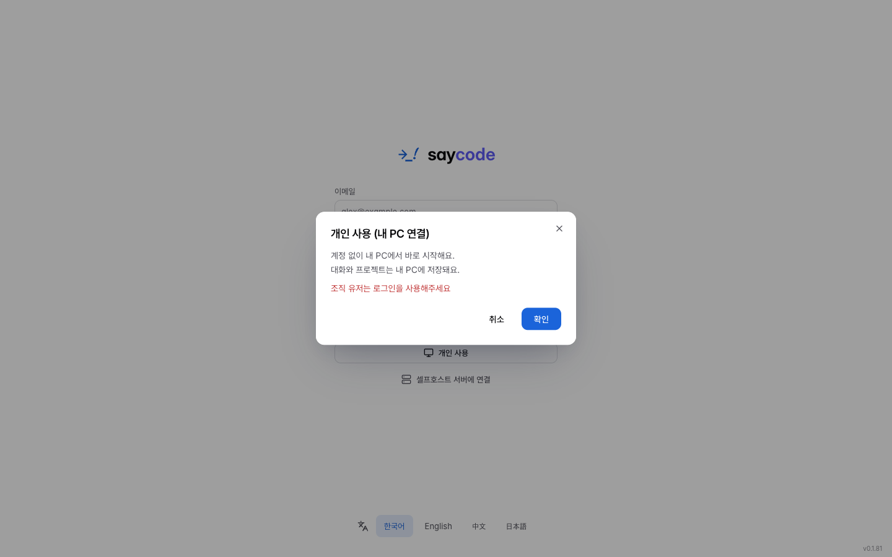

> [!NOTE]
> 창에 보이는 "조직 유저는 로그인을 사용해주세요"는 **조직에 속한 분은 개인 사용이 아니라 로그인으로 들어와야 한다**는 뜻입니다.

> [!TIP]
> 나중에 계정이 생기면 사이드바 맨 아래 프로필 버튼 → **로그인**으로 바꿔 팀 기능을 쓸 수 있습니다. 개인 사용에서 만든 로컬 프로젝트는 로그인 후에도 그대로 남습니다.

### 1.4 방법 ② 로그인 — 계정으로 시작

**조건**: Saycode 계정이 필요합니다. 계정이 없다면 아래 순서로 앱 안에서 만듭니다.

1. **계정 만들기**를 누릅니다.
2. **이메일**을 입력해 인증 코드를 받습니다. 받은 편지함(스팸함 포함)에 **6자리 인증코드**가 오며, 이를 입력합니다(화면에 따라 "인증 코드"로 띄어 쓰기도 합니다).
3. **비밀번호**와 **비밀번호 확인**을 입력해 가입을 마칩니다.

4. 가입한 계정으로 **이메일**·**비밀번호**를 입력하고 **로그인**을 누릅니다.

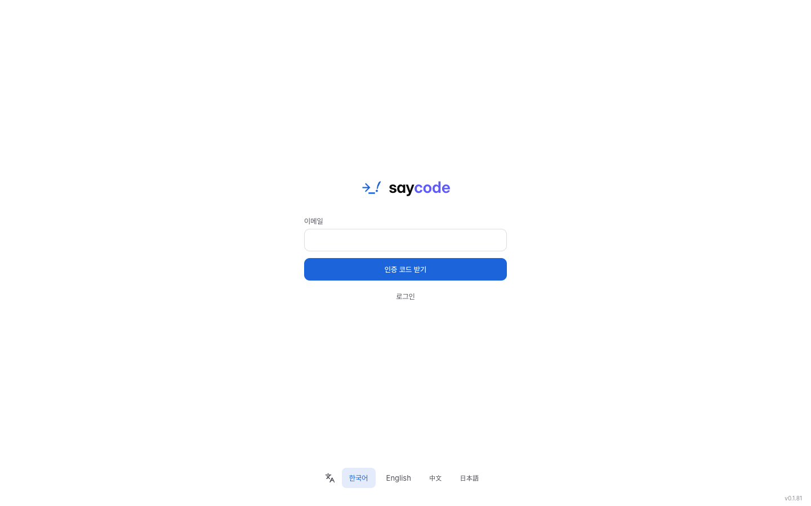

비밀번호를 잊었다면 **비밀번호 찾기** → **이메일** 입력 → **인증코드 보내기** → 6자리 코드 입력 → **새 비밀번호**·**비밀번호 확인** → **비밀번호 변경** → **로그인으로 돌아가기** 순서입니다.

> [!NOTE]
> 비밀번호 재설정 코드는 **10분 동안** 유효하고 최대 5번까지 확인할 수 있습니다. **다시 보내기**는 60초 뒤에 누를 수 있으며, 새 코드를 받으면 이전 코드는 쓸 수 없습니다. 변경 뒤에는 자동으로 로그인되지 않으니 다시 로그인하세요.

#### 조직에서 시작하기 [조직]

로그인 후 조직 계정이라면 **"어느 조직에서 작업할까요?"** 화면이 나옵니다.

1. 목록에서 작업할 조직을 고릅니다. 소속된 조직이 없으면 **작업공간 만들기**로 직접 만들거나, 받은 초대를 수락하거나, **초대 코드로 참여**에 코드를 넣고 **조직에 참여**를 누릅니다.
2. **다음**을 누르면 필요한 도구를 준비하고 이 컴퓨터를 조직의 작업PC로 등록한 뒤 AI 연결을 확인합니다.
3. 준비가 끝나면 **완료**를 누릅니다.

> [!TIP]
> 컴퓨터 준비가 막혔거나 지금 등록하고 싶지 않다면 **이 PC 나중에 등록**을 누르세요. 앱에는 바로 들어갈 수 있고, 등록은 나중에 **내 설정 → 개발 → 작업PC → 내 컴퓨터 등록**에서 할 수 있습니다. 조직에 다른 온라인 작업PC가 있다면 그 PC에서 대화할 수 있습니다.

### 1.5 방법 ③ 셀프호스트 서버에 연결

**조건**: 직접 운영하는 Saycode 서버(`saycode server`로 띄운 서버)와 서버에서 만든 **소유자 연결 코드**가 필요합니다. 일반 사용자는 건너뛰어도 됩니다.

1. 시작 화면에서 **셀프호스트 서버에 연결**을 누릅니다.
2. 서버에서 `saycode server connect`로 발급한 연결 코드를 **연결 코드** 칸에 붙여넣습니다.
3. **연결**을 누릅니다.

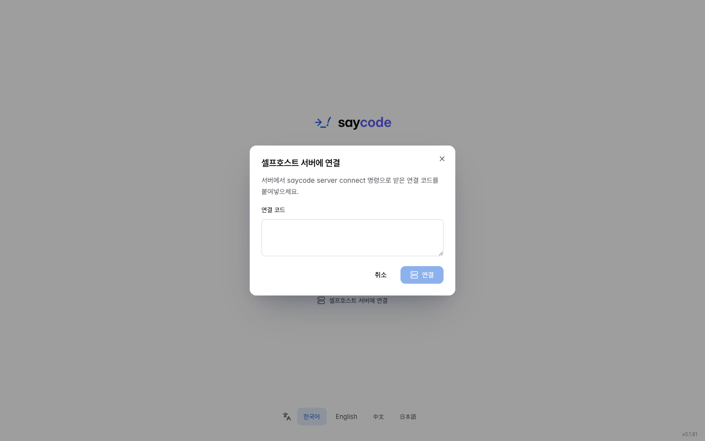

> [!NOTE]
> 회사가 따로 운영하는 서버에 연결하면 **시작준비**, **모바일 연결** 같은 일부 설정 메뉴가 보이지 않고, 작업PC 등록은 "새 작업PC에서 로그인 명령을 실행해 나온 연결 코드를 서버에서 승인"하는 방식이 됩니다.

---

## 2. 시작준비

**AI가 일할 수 있도록 이 컴퓨터를 준비하고 AI 계정을 연결하는 첫 설정입니다.** 개인 사용으로 처음 들어오면 **"첫 작업까지 함께 준비해요"** 창이 자동으로 열립니다.

> [!NOTE]
> **조건**: 로그인한 계정은 처음에 이 창 대신 조직 시작 화면이 나옵니다. 회사가 따로 운영하는 서버에 연결했다면 **시작준비** 메뉴가 보이지 않습니다. 시작준비는 닫아도 언제든 다시 열 수 있습니다.

### 2.1 단계 구성

왼쪽 목록은 **필수 설정**과 **추가 설정 — 선택**으로 나뉩니다. 필수 설정이 끝나면 "필수 설정 완료"가 표시되고, 나머지는 나중에 해도 됩니다. 다만 **대화를 시작하려면 사용 가능한 AI 연결이 하나는 있어야** 합니다. 단계 순서는 **Saycode CLI → Saycode 지시 사용 → AI 도구 → 알림**입니다.

| 구분 | 단계 | 하는 일 |
|---|---|---|
| 필수 | **Saycode CLI** | AI가 실제로 일하는 런타임을 준비합니다. 앱에 포함돼 있어 보통 곧바로 **설치됨**으로 표시되고, **터미널에서도 Saycode CLI 사용하기**(업데이트 실행)와 **추가 도구** 설치 상태(**다시 확인**)가 함께 보입니다. 이 컴퓨터를 작업PC로 등록하는 과정도 여기에 포함됩니다. |
| 추가 | **Saycode 지시 사용** | Saycode 기본 지시를 쓸지 정합니다. 나중에 **내 설정 → 일반 → 시스템 프롬프트**에서도 바꿀 수 있습니다([15장](#15-메모리교훈시스템-프롬프트)). |
| 추가 | **AI 도구** | 이 컴퓨터에 연결된 AI(Claude Code, Codex, Opencode 등)를 확인합니다. |
| 추가 | **알림** | AI가 **입력을 요청할 때**와 **작업을 마쳤을 때** 소리로 알릴지 정하고 **테스트 알림 보내기**로 확인합니다. |

아래쪽 버튼은 **이전** / **계속** / **완료**, 그리고 왼쪽의 **나중에 하기**입니다. 마지막 알림 단계에는 **첫 프로젝트 추가**와 **완료**가 나란히 있으며, **완료**를 누르면 닫힙니다. **이 단계부터 자동 진행** 버튼은 설치할 도구가 남아 있을 때 나타나며, 필요한 도구를 내려받아 설치합니다.

### 2.2 AI 연결하기

**AI 도구** 단계는 열 때 연결 정보를 한 번 확인하고(**연결 정보를 확인 중입니다.**) **연결된 AI만** 보여 줍니다. 이 컴퓨터에 이미 로그인된 Claude·ChatGPT는 따로 등록하지 않아도 **연결됨**으로 표시되고 그대로 사용됩니다.

연결된 AI가 없으면 **내 AI 계정을 연결해 주세요.** 안내와 함께 아래 버튼이 나옵니다. (이미 연결돼 있다면 이 안내 대신 연결된 AI 목록이 보입니다.)

1. **내 AI 계정 연결하기**를 누르고 **ChatGPT** 또는 **Claude**를 고릅니다(같은 창의 <strong>무료 모델 (opencode)</strong>은 아래 무료 모델 절차와 같습니다).
2. 브라우저가 열리면 로그인합니다. 안내에 따라 링크 버튼을 누르고 **인증 코드**를 입력합니다.
3. 돌아오면 연결 상태가 한 번 더 확인되어 **연결됨**으로 바뀝니다.

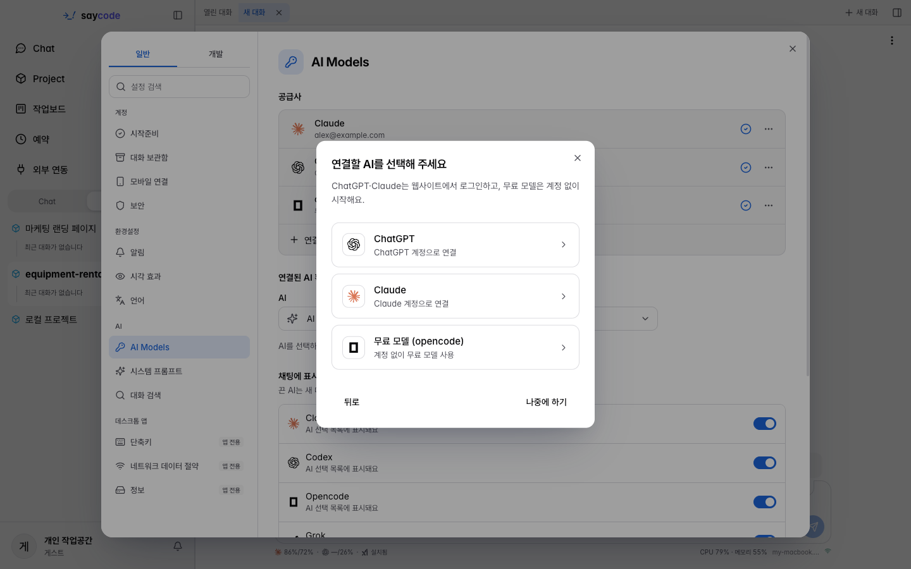

이 선택 창은 **내 설정 → 일반 → AI Models → 연결하기**에서도 같은 모양으로 열립니다.

유료 AI 계정이 없다면 **무료 모델로 시작하기**를 쓰세요. 유료 계정 없이도 바로 대화를 시작할 수 있는 길입니다. (자세한 내용은 [7.5](#75-무료-모델로-시작하기-opencode)에 있습니다.)

1. **무료 모델로 시작하기**를 누릅니다.
2. 확인 화면에서 설치 위치와 조건(기간 한정 제공, 모델마다 다른 보관·학습 정책, 유료 모델보다 낮을 수 있는 성능)을 읽습니다.
3. **설치하고 시작하기**를 누릅니다. 이미 opencode가 설치되어 있으면 "이미 설치된 opencode를 사용해요"가 나오고 버튼은 **확인하고 시작하기**입니다.
4. "무료 모델로 시작할 준비가 됐어요"가 나오면 새 대화의 AI도구에서 **Opencode**를 고르면 됩니다. 모델을 따로 고르지 않으면 메시지마다 추천 무료 모델이 자동으로 선택됩니다.

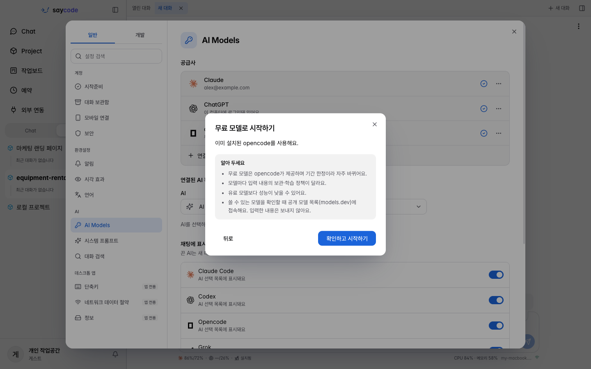

> [!IMPORTANT]
> **무료 모델의 조건**: 이 컴퓨터가 내 작업PC이고 온라인일 때만 설치할 수 있습니다. 조직이 쓸 AI를 제한했다면 설치가 막히고, Windows 시험판에서는 보이지 않습니다. 무료 모델 한도에 걸리면 다른 무료 모델로 최대 3번까지 자동 전환되며 유료 모델로는 절대 넘어가지 않습니다.

> [!WARNING]
> **회사·고객 코드나 기밀 자료는 주의하세요.** 무료 모델은 모델마다 입력(프롬프트·코드)의 보관·학습 정책이 다릅니다. 일부 모델은 무료 기간에 입력을 모델 개선에 쓸 수 있다고 밝히고 있습니다. 기밀 자료에는 제공사가 **보관하지 않고 학습에도 쓰지 않는다**고 밝힌 무료 모델만 쓰거나, 유료·조직 AI를 연결하세요([7.5](#75-무료-모델로-시작하기-opencode)).

같은 단계의 **채팅에 표시할 AI** 스위치로는 쓰지 않는 AI를 선택 목록에서 숨깁니다(최소 하나는 남습니다). 조직 계정이라면 AI 단계에 **조직 계정 연결하기**, **암호화키 확인**, **메시지 테스트** 버튼이 보이며 관리자와 함께 확인하세요.

### 2.3 나중에 다시 열기

1. 사이드바 맨 아래 **프로필 버튼**을 누릅니다.
2. **내 설정** → **일반** → **시작준비**를 엽니다.
3. 설치할 도구가 남아 있으면 **이 단계부터 자동 진행**을 누릅니다. 모두 설치됐다면(**추가 도구 7/7 설치됨**) 상태만 확인하고 **완료**로 닫습니다.

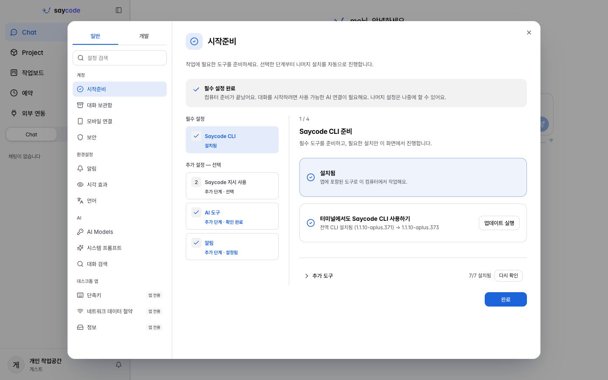

> [!TIP]
> Windows에서는 Node.js·uv·Git을 자동으로 설치해 줍니다. 자동 설치가 어렵다면 **직접 설치할게요**를 고르세요. 오류가 나면 **오류 상세 → 다음 조치 → 설치 안내**를 누르고, 진단 로그가 필요하면 **로그 복사**로 복사해 관리자나 지원 담당자에게 전달하세요.

> [!TIP]
> AI 계정은 나중에 **내 설정 → 일반 → AI Models**에서 **연결하기**, 행의 **…** 메뉴 → **연결 해제** / **Saycode에 다시 연결** / **계정 추가**로 관리합니다. 무료 모델은 Opencode 행 **…** → **설치하기**입니다([7.5](#75-무료-모델로-시작하기-opencode)).

---

## 3. 화면 둘러보기

**Saycode는 왼쪽 사이드바에서 시작하고, 설정은 왼쪽 아래 프로필 버튼에서 엽니다.** 이 장에서는 화면의 큰 길잡이 세 가지를 익힙니다.

### 3.1 사이드바

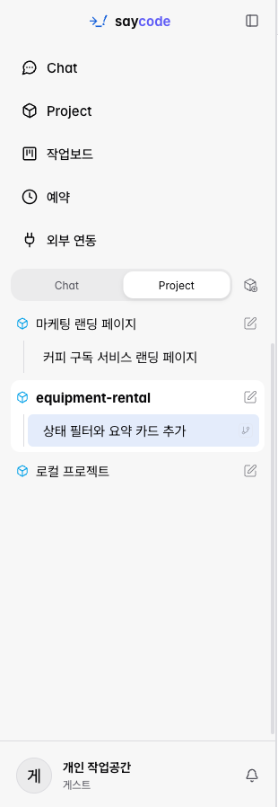

위에서 아래로 다음과 같이 구성됩니다.

| 영역 | 내용 |
|---|---|
| **Chat** | 프로젝트 없이 대화하는 시작 화면(`어떤 작업을 도와드릴까요?`) → [4장](#4-chat으로-프로젝트-없이-일하기) |
| **Project** | 프로젝트 홈. 안에 **Build**(말로 기획 시작)와 **Develop**(저장소·폴더로 시작) 모드가 있습니다 → [5장](#5-프로젝트-만들기) |
| **작업보드** | 모든 대화를 칸반으로 보는 화면. [개발자] 기본은 숨김 → [12장](#12-작업보드) |
| **예약** | 정해진 시간마다 AI에게 일을 맡기는 화면 → [13장](#13-예약) |
| **외부 연동** | 서비스 연결, 확장 설치 → [16장](#16-외부-연동확장메신저-채널) |
| **Chat / Project 탭** | 아래 목록을 내 채팅 목록과 프로젝트 목록 사이에서 전환합니다. 탭을 바꿔도 가운데 화면은 그대로입니다. 탭 오른쪽 버튼은 Project에서는 새 프로젝트(큐브+), Chat에서는 새 대화(연필)입니다. |
| 프로젝트·대화 목록 | 프로젝트를 누르면 대화 목록이 펼쳐집니다. 프로젝트 목록은 30개씩, 프로젝트당 대화는 10개씩 보이고 **더보기**로 더 불러옵니다. 대화 줄에는 작업트리 아이콘, PR 번호, 주황색 질문 아이콘(답을 기다리는 중), 응답 중 아이콘이 표시됩니다. |
| 맨 아래 **프로필 버튼** | 이름을 누르면 [프로필 메뉴](#32-프로필-메뉴)가 열립니다. 개인 사용에서는 "개인 작업공간 · 게스트"로 표시됩니다. |
| **종 아이콘** | **최근 알림**. 누르면 알림 영역이 켜지고, 알림을 누르면 해당 대화로 이동하며 **전체보기**로 알림 센터(**미확인 / 확인함** 탭)를 엽니다. |

**목록 검색**: 목록 맨 위에서 **위로 스크롤**하면 검색창이 나타납니다(⌘K). Project 목록에서는 검색창 오른쪽 점 세 개 버튼으로 **전체 / 내 프로젝트 / 함께 작업 / 공유받은 프로젝트** 보기 범위를 고를 수 있습니다.

**사이드바 접기·너비**: **⌘B**로 접고 펼칩니다. 접으면 왼쪽에 펼치기 / Chat / Project / 예약 / 톱니바퀴(내 설정) 아이콘만 남습니다. 펼친 상태에서는 오른쪽 경계를 끌어 너비를 바꿉니다.

> [!TIP]
> 프로젝트 줄에 마우스를 올리면 점 세 개(⋮) 메뉴에서 **고정**, **프로젝트 설정**, **모든 대화**를 고릅니다. 대화 줄의 메뉴는 [10장](#10-대화-관리)에서 설명합니다.

### 3.2 프로필 메뉴

사이드바 맨 아래 **프로필 버튼**을 누르면 열립니다.

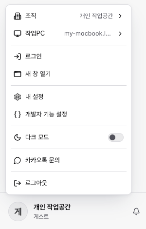

| 항목 | 설명 |
|---|---|
| **조직** | 작업할 조직을 바꿉니다. 개인 사용에서는 "개인 작업공간"으로 표시되고, 여러 조직에 속한 계정이라면 목록에서 고릅니다. |
| **작업PC** | 새 작업을 실행할 기본 작업PC를 고릅니다. 내가 등록한 작업PC와 **공용 PC**로 나뉘며, 켜져 있는 PC만 보입니다. |
| **로그인** / **로그아웃** | 개인 사용 중에는 **로그인**으로 계정에 로그인하고, 로그인 중에는 **로그아웃**(확인 창에서 한 번 더 누름)을 씁니다. |
| **새 창 열기** | 앱 창을 하나 더 엽니다(⌘N). |
| **내 설정** | 모든 설정(⌘,). [3.3](#33-내-설정의-일반과-개발)에서 설명합니다. |
| **개발자 기능 설정** | 숨겨진 기능을 켜는 스위치 모음 → [3.4](#34-개발자-기능-설정) |
| **다크 모드** | 어두운 테마를 켜고 끄는 스위치입니다. 메뉴가 열린 채로 남아 바로 바꿔 볼 수 있습니다. |
| **카카오톡 문의** (로그인하면 **사용 문의**) | 로그인하면 **사용 문의**(화면 이미지 3장까지 첨부 가능), 개인 사용 중에는 **카카오톡 문의**로 오픈채팅방이 열립니다. |
| **조직 관리** [조직] | 조직 소유자·관리자에게만 보입니다(보이는 경우 메뉴 맨 위). 비밀번호로 한 번 더 인증한 뒤 관리 창을 엽니다 → [18장](#18-팀과-조직) |
| **업데이트 확인** | 정식 설치본에서 보입니다. **업데이트 내려받기** → **재시작해서 업데이트** 순서로 새 버전을 설치합니다. |

### 3.3 내 설정의 일반과 개발

프로필 메뉴 → **내 설정**(⌘,)을 열면 왼쪽 위에서 **일반**과 **개발** 두 영역을 오갑니다. 일반의 왼쪽 메뉴는 **계정 / 환경설정 / AI / 데스크톱 앱** 묶음으로 나뉩니다. 왼쪽 위 **설정 검색**에 `다크`, `알림음`, `예약`, `자동 작업`처럼 찾는 기능을 입력하면 해당 메뉴만 추려 줍니다(옛 이름으로도 검색됩니다. 예: `머신` → 작업PC). 검색 결과 메뉴를 눌러야 오른쪽 본문이 바뀝니다.

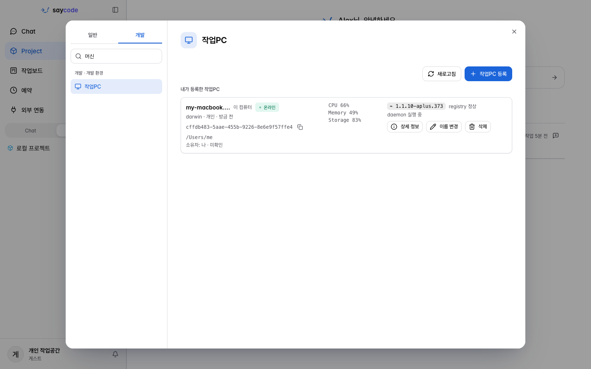

메뉴 전체 지도는 [부록 B.1·B.2](#부록-b-메뉴설정-지도)에 있습니다.

> [!NOTE]
> [로그인] 표시가 있는 메뉴는 개인 사용에서는 보이지 않습니다. 또한 조직 관리자가 끈 설정은 잠기고 "조직 정책으로 정해진 설정"이라는 안내가 붙습니다.

### 3.4 개발자 기능 설정

프로필 메뉴 → **개발자 기능 설정**을 누르면 내 설정의 **개발** 탭에서 아래 스위치가 열립니다. 기본은 모두 꺼져 있습니다.

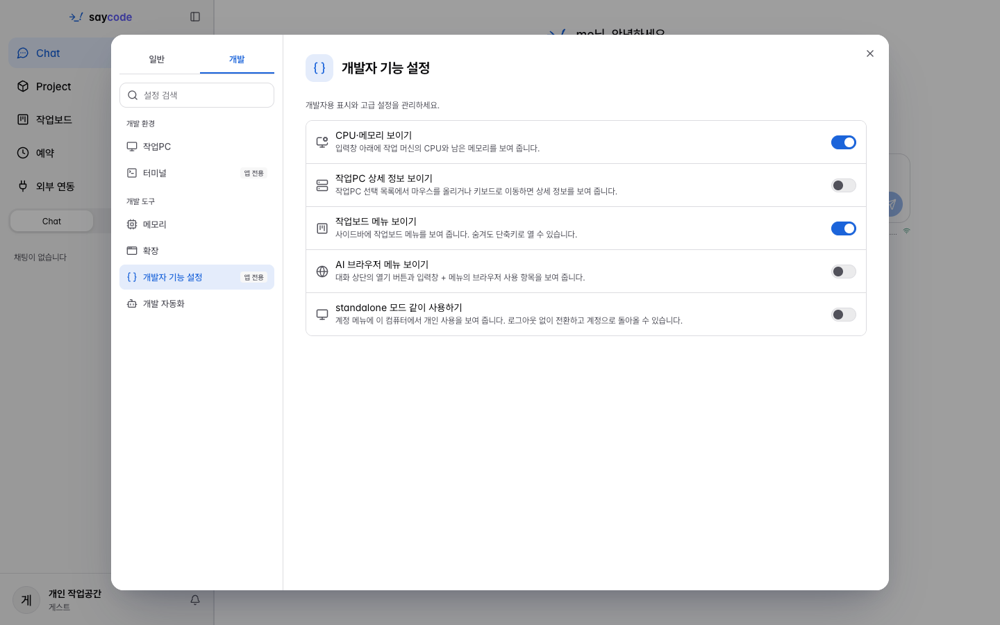

| 스위치 | 켜면 |
|---|---|
| **CPU·메모리 보이기** | 입력창 아래에 작업PC의 CPU·메모리 표시. 누르면 디스크·부하 등 상세 |
| **작업PC 상세 정보 보이기** | 작업PC 화면에 상세 정보 |
| **작업보드 메뉴 보이기** | 사이드바에 **작업보드** 메뉴 ([12장](#12-작업보드)) |
| **AI 브라우저 메뉴 보이기** | AI가 쓰는 브라우저 관련 메뉴(입력창 **+** → **이번 요청에 브라우저 사용**) |
| **standalone 모드 같이 사용하기** | 로그인 계정을 쓰면서 이 컴퓨터의 **개인 사용**도 병행. 켠 뒤 프로필 메뉴에 **이 컴퓨터에서 개인 사용**, 돌아올 때 **계정으로 돌아가기**가 생깁니다. |
| **조직 검색 설정** [조직] | 조직 소유자·관리자가 조직 전체 대화 검색 서버를 연결 |

---

## 4. Chat으로 프로젝트 없이 일하기

**프로젝트를 만들지 않고 바로 질문하고, 문서·표·발표자료를 만드는 곳입니다.** 개인 사용에서도 대화가 저장되고 이어집니다.

> [!NOTE]
> **조건**: 대화를 시작하려면 **온라인 작업PC**와 **연결된 AI**가 하나씩 필요합니다. 없으면 입력창 아래에 "작업PC 설정 열기" 또는 파란 **내 AI 연결** 안내가 나옵니다([2장](#2-시작준비)). 준비되기 전에는 입력창이 비활성으로 보이지만 쓰던 글은 보존됩니다.

### 4.1 첫 질문 보내기

1. 사이드바에서 **Chat**을 누릅니다.
2. 가운데 입력창(`어떤 작업을 도와드릴까요?`)에 요청을 적습니다.
3. 입력창 오른쪽의 **전송 버튼**(종이비행기)이나 Enter로 보냅니다.
4. 대화가 열리면 사이드바 **Chat 탭**의 목록에 쌓이고, 같은 화면에서 이어서 물어볼 수 있습니다.

입력창 아래 오른쪽의 **작업PC 이름**을 누르면 이 Chat을 실행할 작업PC를 바꿀 수 있습니다(온라인인 PC만 보입니다). 새 대화 이후에는 바꿀 수 없습니다.

> [!TIP]
> 입력창 아래의 **시작 예시 카드**(**PDF로 만들기 · 발표 자료 만들기 · 서류 작성/수정하기 · 문서 검토하기 · 리서치**)를 누르면 예시 요청이 채워집니다. **내 파일 올리기**로 내 자료를 올려 시작할 수도 있습니다.

### 4.2 문서 형식과 템플릿

DOCX·XLSX·PPTX·PDF 같은 Office 문서를 만들 때는 형식과 양식을 먼저 고르면 결과가 훨씬 안정적입니다.

1. 새 Chat 입력창 왼쪽 **+**(**추가**)를 누릅니다.
2. 메뉴에서 만들 문서 형식을 고릅니다 — **문서(DOCX) / 스프레드시트(XLSX) / 프레젠테이션(PPTX) / PDF 문서(PDF)**. 같은 메뉴에는 **파일 또는 사진 추가**(⌘U), **폴더 추가**, **기존 경로에서 시작**(이 컴퓨터의 기존 폴더를 작업 경로로 사용)도 있습니다.
3. 입력창 위에 **템플릿 갤러리**가 열립니다. 기본 양식(**Design Report**, **Minimal Letterhead**)이나 내가 저장한 개인 양식을 고릅니다. 고른 형식은 입력창 위의 칩에 표시되며 칩의 ✕로 해제합니다.
4. 양식을 따로 저장하고 싶다면 **내 템플릿 만들기**로 Office 파일과 작성 지침을 등록합니다.
5. 입력창에 만들 내용을 적고 보냅니다. 예: *"3분기 장비 대여 현황 보고서를 만들어줘."*

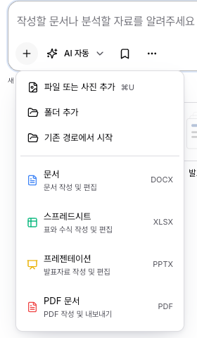

> [!NOTE]
> 기본 양식은 확장 설치 없이 쓸 수 있습니다. 개인 템플릿 원본은 허용된 **개인 작업PC**에서만 사용할 수 있습니다.

### 4.3 결과 파일 보기·저장·공유

AI가 만든 파일은 답변 안에 **파일 카드**로 나타납니다.

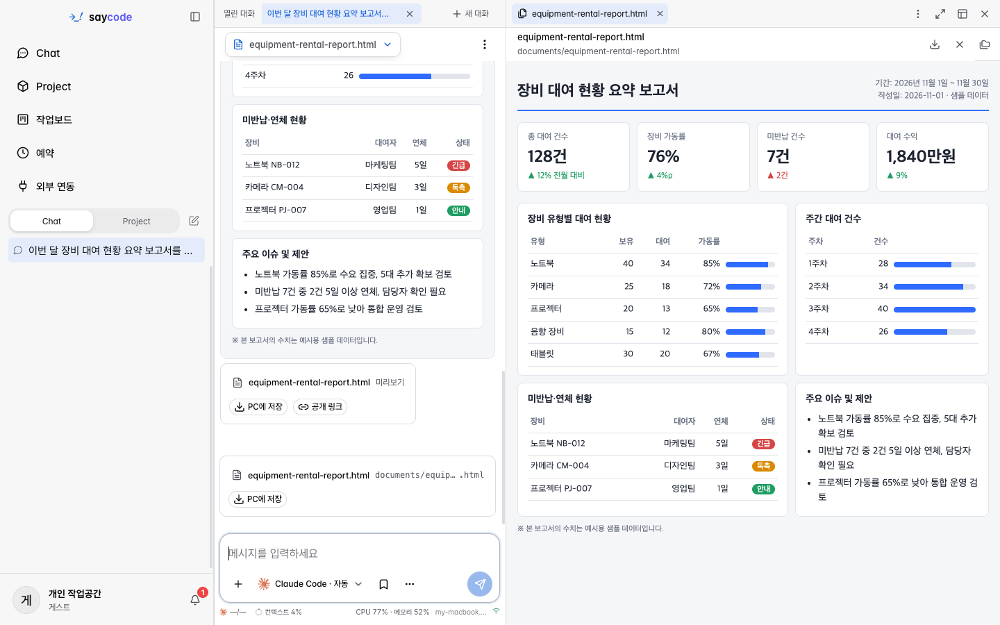

1. 답변 속 **파일 이름**을 누르면 오른쪽 작업 도구 패널에서 문서가 열립니다(DOCX·PDF·HTML·마크다운·이미지 지원). HTML 결과는 채팅 안에서 인라인 미리보기가 나오고, 완료 직후 오른쪽 패널에 자동으로 열리기도 합니다.
2. 파일 카드의 **PC에 저장**을 누르면 내 컴퓨터의 원하는 위치에 저장합니다.
3. **공개 링크** — 개인 사용에서도 HTML 결과 카드에 버튼이 보이지만, 링크를 만들어 공개하려면 [로그인] 계정이 필요합니다. **PC에 저장** 옆의 **공개 링크** 버튼을 누르면 공개 창이 열립니다.
   1. 처음 누르면 **설치 진행**이 나옵니다. 한 번 누르면 공개 링크 기능이 설치·활성화되고 링크 만들기까지 이어집니다.
   2. **공개 범위**를 고릅니다. 기본은 링크가 있는 **누구나**, **조직만**을 고르면 조직 구성원이 로그인해야 열립니다.
   3. **만료**를 1일·3일·7일·30일 중에서 고릅니다.
   4. **링크 복사**로 주소를 복사합니다. 공개를 멈추려면 같은 창에서 공개를 중지합니다.

> [!IMPORTANT]
> **공개 링크 만들기는 로그인한 계정에서 동작합니다.** 개인 사용에서는 **PC에 저장**과 앱 안 열람을 쓰세요. AI가 답변 중일 때는 공개 링크를 누를 수 없습니다.

### 4.4 Chat에서 쓸 수 있는 입력 기능

Chat 입력창에서도 프로젝트 대화와 같은 기능 대부분을 쓸 수 있습니다. 자세한 사용법은 [6장](#6-프로젝트-대화와-입력창)을 참고하세요.

- **+**: **파일 또는 사진 추가**(⌘U), **폴더 추가**, **기존 경로에서 시작**(이 컴퓨터의 기존 폴더를 작업 경로로 사용)
- AI가 답하는 동안 다음 요청을 **대기열**에 넣을 수 있고, AI의 질문은 **질문 폼**으로 답합니다.
- `/btw`(곁질문), `/recap`(요약), `/usage`(AI 사용량), 코드 상자·표·`[!NOTE]` 강조 상자 렌더링, 긴 붙여넣기 카드
- [로그인] "매일 오전 9시에 요약해줘"처럼 말로 **예약**을 만들 수 있습니다([13장](#13-예약)).

> [!TIP]
> 사용법이 궁금할 때는 Chat에서 *"다크 모드는 어디서 켜?"*처럼 물어보세요. Saycode AI가 앱 안내로 답하고 해당 설정 화면을 바로 열어 줍니다. 이 기능은 **내 설정 → 일반 → 시스템 프롬프트**의 **Saycode 사용 안내** 스위치로 끌 수 있습니다.

---

## 5. 프로젝트 만들기

**내 폴더나 저장소를 프로젝트로 연결해 두면, 그 안에서 여러 대화로 코드를 만들고 고칠 수 있습니다.** 한 창에서 네 가지 방법을 고릅니다.

> [!NOTE]
> **조건**: 프로젝트를 만들 **온라인 작업PC**가 필요합니다. **Git 저장소** 탭은 [로그인] GitHub 또는 GitLab 연결이 필요하며(**내 설정 → 개발 → 저장소**), 나머지 방식은 계정 없이도 됩니다.

### 5.1 Project 메뉴: Build와 Develop

사이드바 **Project**를 누르면 두 가지 시작 모드가 있습니다.

| 모드 | 이런 때 |
|---|---|
| **Build** | 만들고 싶은 것을 **말로 설명**해 기획부터 시작합니다. 입력창(`만들고싶은 내용을 입력해주세요`)에 적어 보내면 됩니다. 아래에는 **최근 프로젝트** 카드가 나옵니다. |
| **Develop** | 코드 저장소나 폴더로 개발을 시작하는 개발자용입니다. **프로젝트 만들기** · **코드 저장소 가져오기** · **Zip/파일 가져오기** · **머신 폴더 사용하기** 카드와 프로젝트 목록이 있습니다. |

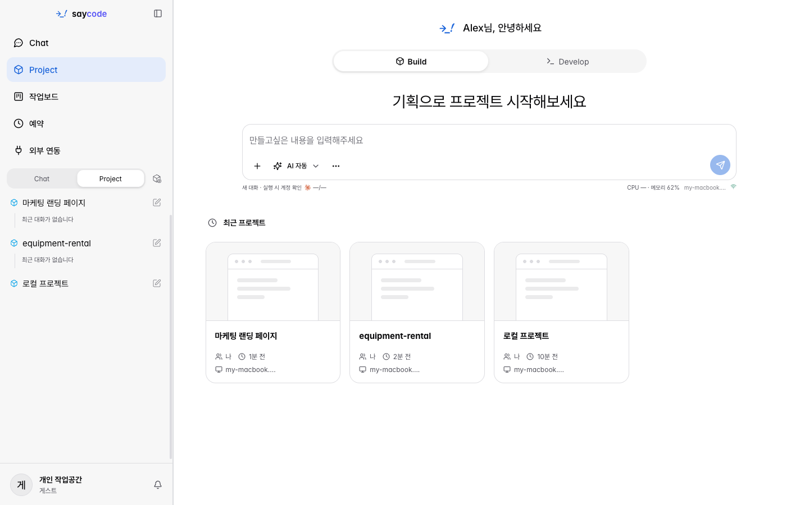

두 모드 모두 입력창 아래 오른쪽의 **작업PC 이름**을 눌러 어느 PC에서 시작할지 고를 수 있습니다.

### 5.2 프로젝트 만들기 창

1. 사이드바 **Project** → **Develop** → **프로젝트 만들기**를 누르면 제목이 **새 프로젝트**인 창이 열립니다(이 가이드에서는 "프로젝트 만들기 창"이라고 부릅니다). (사이드바 목록 탭 오른쪽의 큐브+ 버튼이나, Develop의 **코드 저장소 가져오기 / Zip/파일 가져오기 / 머신 폴더 사용하기** 카드로 해당 방식을 바로 열 수도 있습니다.)
2. 창 위쪽의 탭에서 방식을 고릅니다. 탭을 바꿔도 입력한 내용은 유지됩니다.

   | 탭 | 설명 |
   |---|---|
   | **새 프로젝트** | 이름만 정하면 빈 폴더에서 시작합니다. |
   | **Git 저장소** | 원격 저장소 주소로 작업PC에 복제합니다. |
   | **ZIP·파일** | 압축 파일이나 파일에서 프로젝트를 만듭니다. |
   | **기존 폴더** | 이미 있는 코드베이스를 그대로 연결합니다. |

3. **기존 폴더**에서는 선택한 작업PC의 사용자 홈부터 폴더를 탐색합니다. 숨김 폴더(`.`으로 시작)가 먼저 나열되므로, 경로를 **직접 입력하고 Enter**로 확인하는 편이 빠릅니다. 내 컴퓨터라면 **새로운 경로에서 시작**으로 운영체제 폴더 선택 창을 열 수 있습니다.
4. 창 맨 아래 왼쪽의 **작업PC: 이름**을 누르면 **작업PC 선택 창**이 열려 프로젝트가 만들어질 PC를 바꿀 수 있습니다(온라인 PC만 표시, Esc로 닫으면 선택은 그대로).
5. 이름을 확인하고 **프로젝트 만들기**(가져오는 방식에서는 **프로젝트 가져오기**)를 누릅니다.

> [!TIP]
> **새 프로젝트**는 만든 뒤 Develop 목록에서 폴더 위치를 확인할 수 있습니다. 처음이라면 **기존 폴더**로 내가 쓰던 코드 폴더를 열거나, **새 프로젝트**로 빈 폴더에서 시작해 보세요. **Git 저장소 프로젝트**여야 작업트리, 브랜치, PR 올리기가 모두 동작합니다.

### 5.3 프로젝트 설정

프로젝트를 연 상태에서 대화 위 프로젝트 이름 옆 **설정** 버튼(또는 사이드바 프로젝트 ⋮ → **프로젝트 설정**)으로 엽니다. **일반**과 **개발** 두 묶음으로 나뉩니다.

| 묶음 | 항목 |
|---|---|
| **일반** | **프로젝트 정보**(이름·설명·썸네일·태그·시작 패널), **데스크탑 설정**, **코드 저장소**, **작업PC** |
| **개발** | **실행**(개발 서버 명령·포트 → **실행 설정 저장**), **환경변수**, **개발 정보**, **프로젝트 삭제** |

로그인한 조직 프로젝트에는 **함께 작업**, **프로젝트 공유**, **MCP 서버** 같은 항목이 더 있습니다([18장](#18-팀과-조직)).

> [!NOTE]
> 값을 바꾸려면 **프로젝트 소유자**여야 하는 항목이 많습니다. 프로젝트 이름 옆 **태그**로 분류하고 사이드바에서 태그로 걸러 볼 수도 있습니다.

---

## 6. 프로젝트 대화와 입력창

**프로젝트를 열고 대화를 시작하면, 가운데는 대화, 오른쪽은 작업 영역으로 나뉩니다.** 이 장은 대화를 시작하고 입력창을 다루는 법을 설명합니다.

> [!NOTE]
> **조건**: 온라인 작업PC와 연결된 AI(또는 [무료 모델](#22-ai-연결하기))가 있어야 합니다.

### 6.1 첫 대화 — 한 문장으로 앱 만들기

1. 사이드바에서 프로젝트 이름 옆 **연필 아이콘(새 대화)** 을 누르거나, 프로젝트를 연 뒤 화면 맨 위 오른쪽의 **+ 새 대화**를 누릅니다. 새 대화 화면에 *"어떤 작업을 도와드릴까요?"*와 입력창(`메시지를 입력하세요`)이 나옵니다.
2. 입력창에 요청을 적습니다.

   > *"사내 장비 대여 현황 대시보드를 만들어줘. Vite + React로 상태별 요약 카드, 검색·상태 필터, 대여 목록 표(더미 데이터 20건)를 넣고 라이트 테마로. 개발 서버를 5173 포트로 켜두고 미리보기로 볼 수 있게 해줘."*

3. 전송 버튼(원형)이나 Enter로 보냅니다.
4. AI가 파일을 만들고 `npm install`·빌드·개발 서버 실행을 진행합니다. 도구 호출은 한 줄 행으로 접혀 보이고, 길게 생각한 내용(Thinking)은 기본으로 접혀 있습니다. 5줄이 넘는 코드는 **펼치기 (코드 N줄)** 로 펼칩니다.
5. 개발 서버가 뜨면 오른쪽 작업 영역에 브라우저·미리보기 탭이 열리는 경우가 많습니다. 열리지 않으면 [8.5](#85-브라우저와-미리보기)를 보세요.

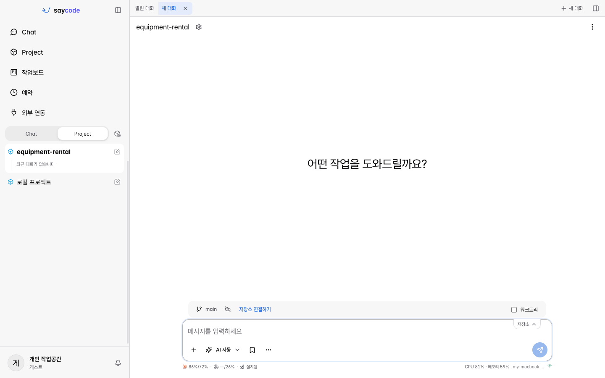

> [!TIP]
> 개발 서버가 필요하다면 요청에 *"개발 서버를 켜두고 미리보기로 볼 수 있게"*를 꼭 넣으세요. 그렇지 않으면 AI가 HTML 파일 하나로 끝낼 수 있습니다.

### 6.2 화면 구성

- **열린 대화 탭 줄**: 위쪽의 **열린 대화** 영역에 대화가 탭으로 열립니다. **+ 새 대화**(⌘T)로 같은 프로젝트에서 새 대화를 열고, 앱을 다시 켜도 프로젝트별로 복원됩니다.
- **헤더**: 프로젝트 이름, **설정** 아이콘, 오른쪽 **프로젝트 도구(⋮)**
- **오른쪽 가장자리**: 메시지 이동 레일(점)과 **대화 요약** 버튼([10장](#101-대화-요약과-메시지-이동-레일))
- **입력창**: 위 줄(저장소·브랜치·목표·작업 마무리)과 아래 줄(AI·모델·AI 잔여량)이 있습니다.

**프로젝트 도구(⋮)** 는 위쪽에 작업 패널(**파일 · 터미널 · 브라우저 · 변경 · 미리보기**, [8장](#8-작업-영역)), 가운데에 이 대화의 기능(검색, 고정, 알림 소리 끄기, **대화 이어가기**, **예약 작업**, **자식 AI도구 N개**), 아래에 프로젝트 기능(**Git 작업**, **자동화**(GitHub 트리거·스크립트 자동화), **에디터로 열기…**, 프로젝트 공유)이 모여 있습니다.

### 6.3 입력창에서 먼저 알아 둘 것

입력창은 **위 줄**(저장소·브랜치)과 **아래 줄**(AI·사용량)로 나뉩니다. 처음에는 다음 네 가지만 알면 됩니다.

- **AI 자동**(아래 줄 왼쪽 버튼): AI·모델·작업 강도를 한 버튼에서 고릅니다. 새 대화의 기본은 **AI 자동**이며, 보낸 뒤에는 `Claude Code · 자동`처럼 고른 AI와 모델이 표시됩니다 → [7장](#7-ai모델작업-강도와-사용량)
- **AI 잔여량**(아래 줄, 예: `86%/72%`): 누르면 계정별 남은 사용량 창이 열립니다 → [7.4](#74-ai-사용량-창). 옆의 `컨텍스트 N%`는 Claude 대화가 컨텍스트 창을 채운 정도이며 80% 이상이면 새 대화나 `/compact`를 권합니다.
- **워크트리** 체크박스(위 줄 오른쪽): 켜면 이 대화만의 **작업트리**(복사본 작업 폴더)에서 일합니다. Git 저장소 프로젝트의 **아직 보내지 않은 새 대화**에서만 설정할 수 있으니, 보내기 전에 체크 상태를 한 번 확인하세요(이전 대화의 선택이 남아 있을 수 있습니다).
- **작업 마무리**(위 줄 오른쪽 끝, 대화를 시작한 뒤 나타남): 리뷰·PR·보관을 한 메뉴에서 → [11장](#11-작업-마무리)

저장소 줄, 브랜치·PR 칩, 목표, **+** 와 **⋯** 메뉴의 항목은 [부록 B.3·B.4](#부록-b-메뉴설정-지도)에 정리했습니다.

### 6.4 입력창 메뉴와 특수 입력

**+**(파일·사진·폴더 첨부, ⌘U)와 **⋯**(프롬프트 검색, 파일 복원지점, 동시작업 등) 메뉴의 항목은 [부록 B.4](#부록-b-메뉴설정-지도)에 있습니다. 입력창에서는 다음 입력도 쓸 수 있습니다.

- `@` + 파일 이름 → 프로젝트 파일을 요청에 넣습니다.
- `@` + 대화 제목 → **대화** 묶음에서 같은 프로젝트의 다른 대화를 칩으로 붙여, AI가 그 대화를 읽고 답하게 합니다. 보관된 대화는 흐리게 표시됩니다.
- `/` → 명령 목록(위·아래 + Enter/Tab). 목록은 대화 AI에 맞춰 달라집니다.
- `/btw 질문`(곁질문): 진행 중인 작업을 멈추지 않고 지금 대화를 바탕으로 짧게 답한 카드가 입력창 위에 뜨며 기록에는 남지 않습니다. 이미 시작한 **Claude 대화**에서만 됩니다.
- `/recap`: "지금까지"와 "다음 행동"을 요약한 카드를 보여 줍니다. 내 메시지가 3개 이상인 **Claude 대화**에서만 됩니다. 뒤에 다른 글을 붙이면 일반 메시지로 보내집니다.
- 긴 텍스트를 붙여넣으면 `붙여넣은 텍스트 · N줄` 카드가 되고, 답변 속 글을 선택하거나 우클릭하면 **인용**할 수 있습니다.

### 6.5 내 프롬프트 — 자주 쓰는 요청 저장

1. 입력창에 자주 쓰는 문장을 적습니다.
2. 입력창의 **책갈피 아이콘**(**내 프롬프트**)을 누릅니다.
3. **입력 저장**을 누르면 저장됩니다.
4. 다음부터는 같은 책갈피 메뉴에서 문장을 눌러 입력창에 바로 넣습니다.

> [!NOTE]
> [로그인] 로그인 계정에 저장되어 다른 PC에서도 같은 목록이 보이고, 한 문장은 10,000자까지입니다. 저장한 문장은 모든 프로젝트에서 보입니다. 입력창이 비어 있을 때 **↑** 키는 *현재 대화*에서 보낸 요청만 차례로 불러옵니다.

### 6.6 대기열 — 답하는 동안 다음 요청 쌓기

AI가 답하는 중에도 입력창에 다음 요청을 적어 둘 수 있습니다.

1. 답하는 동안 입력창에 요청을 적고 Enter(또는 **대기열에 추가**)를 누릅니다. 대기열은 **최대 3개**이며 답이 끝나면 오래된 것부터 차례로 보냅니다. 카드의 드래그 핸들로 순서를 바꿀 수 있습니다.
2. 지금 답에 바로 전달하려면 대기 줄의 **즉시 요청**(보내기 아이콘, 또는 ⌘Enter)을 누릅니다.
3. 내용을 고치려면 줄의 **연필 아이콘(편집)** → 수정 → **체크 아이콘(저장)** 또는 **X 아이콘(편집 취소)** 으로 제자리에서 고칩니다. **휴지통 아이콘**은 대기 요청을 지웁니다.
4. 응답을 **중단**하면 대기열은 지워지지 않지만 **자동으로 보내지 않습니다.** 대기열 위 **중단됨** 줄의 **이어서 보내기**(재생 아이콘)를 누르거나 직접 새 메시지를 보내면 이어서 보냅니다.

### 6.7 AI의 질문에 답하기

AI가 선택지를 주며 질문하면 **입력창 자리가 질문 폼으로 바뀝니다.** 사이드바에서는 해당 대화 줄에 **주황색 질문 아이콘**이 붙습니다.

1. 선택지를 누르거나 **숫자 키(1~9)** 로 고릅니다. 직접 쓰고 싶으면 입력란에 적습니다.
2. 질문이 여러 개면 **이전 질문 / 다음 질문**(또는 **다음**)으로 넘어갑니다. 하나만 고르는 질문은 고르면 잠시 뒤 자동으로 다음으로 넘어갑니다.
3. 마지막에 **보내기**를 누릅니다. 답하지 않고 넘어가려면 **건너뛰기**를 누릅니다.

> [!NOTE]
> 질문에 답하지 않고 있어도 AI가 멈춘 것은 아닙니다. **여러분의 답을 기다리는 중**입니다. 대기열은 질문이 열려 있는 동안 전송되지 않습니다.

### 6.8 답변이 끝난 뒤

- **다음 단계 카드**: 파일을 바꾸거나 여러 단계 작업을 마친 답 끝에 "무엇이 됐고 무엇이 남았는지"와 함께 **커밋 요청 / PR 만들기 / PR 머지 / AI로 CI 수정 / 셀프 리뷰 / 완료로 보관** 같은 버튼이 나옵니다. 지금 할 수 있을 때만 보이며 [작업 마무리](#11-작업-마무리)와 같은 동작을 합니다. 작업PC의 Saycode CLI가 이 기능을 지원하는 버전이어야 하고, 데스크톱 앱에서 보낸 메시지의 답에만 붙습니다.
- **답변이 끊겼을 때**: AI가 중간에 멈췄다면 원인과 함께 **이어서 하기**가 나옵니다(직접 중단했다면 **다시 시도**). 일시적인 오류는 자동 재시도 카운트다운과 **취소** 버튼이, 사용 한도에 걸리면 "{시각}에 다시 시도"가 표시됩니다.
- **자식 AI도구**(서브 에이전트): AI가 자식 대화를 만들면 프로젝트 도구(⋮)에 **자식 AI도구 N개**가 나타나며 **지시 전달**·**중단**을 할 수 있습니다.
- **내 메시지 위에 마우스를 올리면** 연필 아이콘 **여기서 다시 쓰기**로 그 메시지 직전까지의 대화에서 새 대화를 만들어 고쳐 보낼 수 있습니다([10장](#10-대화-관리)).

---

## 7. AI·모델·작업 강도와 사용량

**어떤 AI가 얼마나 깊이 생각해 일할지 정하고, AI 계정의 남은 사용량을 확인합니다.** 대부분의 경우 **AI 자동**에 맡겨도 됩니다.

> [!NOTE]
> **조건**: 쓸 수 있는 AI와 모델만 목록에 보입니다. 새 대화에서는 모두 바꿀 수 있고, 진행 중인 대화에서는 **모델과 작업 강도만** 바꿀 수 있습니다(AI가 답하는 중에는 불가). 모델 목록은 업데이트로 바뀌므로 앱에 보이는 목록을 기준으로 하세요.

### 7.1 AI·모델·작업 강도 고르기

1. 새 대화에서 입력창 아래 줄의 **AI 자동**(또는 현재 모델명·강도가 보이는 버튼)을 누릅니다.
2. **AI 자동**을 고르면 Saycode가 요청 난이도를 보고 AI와 모델·강도를 정합니다. 직접 고르려면 **Claude Code / Codex / Opencode / Grok** 중 하나에 마우스를 올려 하위 메뉴에서 **모델**을 고릅니다(**자동**을 고르면 모델만 자동입니다). 오래된 모델은 **이전 모델** 묶음에 있습니다. 유료 AI 없이 쓰려면 **Opencode**의 무료 모델을 고릅니다([7.5](#75-무료-모델로-시작하기-opencode)).
3. 모델을 직접 고른 뒤 같은 버튼을 다시 열면 **작업 강도** 하위 메뉴가 나타납니다(AI 자동 상태에서는 보이지 않습니다). 모델에 따라 Low · Medium · High · Xhigh · Max(일부는 Ultra까지)가 있습니다.

4. 보낸 뒤 진행 중인 대화에서는 같은 버튼이 곧바로 **모델 목록**으로 열립니다.

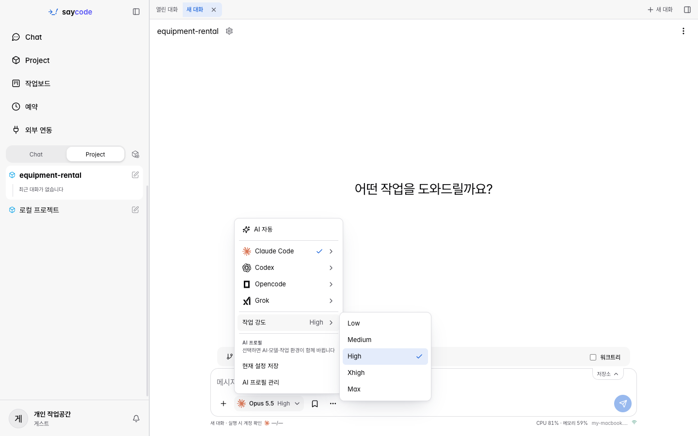

> [!TIP]
> **모델을 자동으로 두면** Saycode가 매 턴 난이도에 따라 모델을 정합니다. 오타 수정은 가볍게, 기능 구현은 적정하게, 정말 어려운 문제만 상위 모델로 보냅니다. 응답 위에 "자동 · 모델 · 실행 설정" 한 줄 배지(예: `자동 · Sonnet 5.5 · medium`)가 남아 어떻게 골랐는지 알 수 있습니다.

**바로가기**: 입력창에 포커스를 두고 **⌘⇧M**은 다음 모델로, **⌘⇧E**는 다음 작업 강도로 바꿉니다(응답 중이거나 선택지가 하나면 동작하지 않음).

### 7.2 AI 프로필 — 자주 쓰는 조합 저장

1. 새 대화에서 특정 AI를 고르고 모델·강도를 정합니다.
2. AI 버튼 메뉴에서 **현재 설정 저장**을 눌러 프로필로 저장합니다.
3. 다음부터 같은 메뉴의 **AI 프로필** 목록에서 골라 한 번에 적용합니다. 고치거나 지우려면 **AI 프로필 관리**를 누릅니다.

### 7.3 AI 목록과 기본값 정하기

**내 설정 → 일반 → AI Models**에서 다음을 설정합니다.

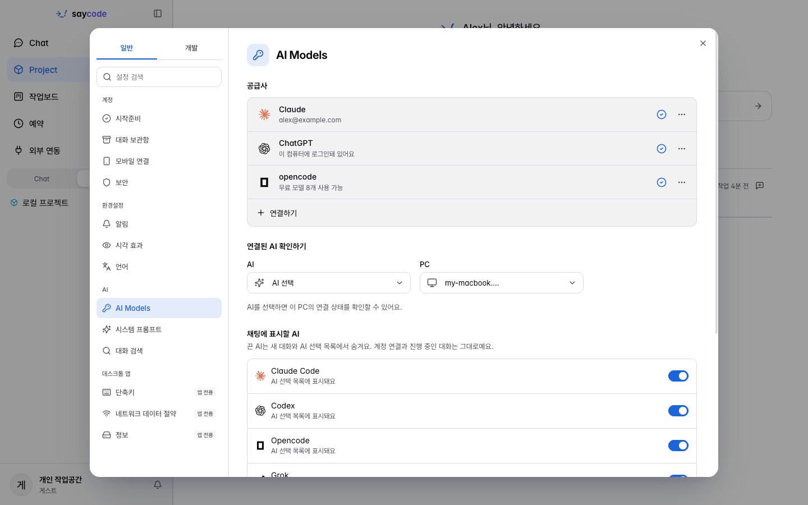

- **연결하기** — 브라우저로 내 Claude·ChatGPT 계정을 연결합니다. 행의 **…** 메뉴에서 **연결 해제**, **Saycode에 다시 연결**, **계정 추가**를 고릅니다.
- **Opencode 행 … → 설치하기** — 유료 계정 없이 쓰는 무료 모델을 설치합니다([7.5](#75-무료-모델로-시작하기-opencode)).
- **채팅에 표시할 AI** — 안 쓰는 AI를 선택 목록에서 숨깁니다(최소 1개는 표시).
- **새 대화 기본값** — Chat과 Project 새 대화의 AI도구·Model·Effort 기본값을 각각 정합니다.

진행 중인 프로젝트 대화를 다른 AI로 넘기려면 프로젝트 도구(⋮) → **대화 이어가기** → **다른 AI도구로 이어가기**를 사용하세요([10.7](#107-대화-이어가기와-갈래)).

### 7.4 AI 사용량 창

입력창 아래 **AI 잔여량** 버튼을 누르면 이 작업PC에 연결된 AI 계정과 남은 사용량이 열립니다.

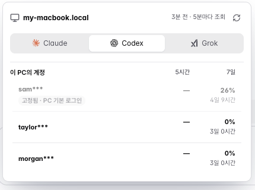

1. 맨 위 **AI 탭**(**Claude / Codex / Grok**)에서 볼 AI를 고릅니다. 창을 열 때마다 지금 입력창에서 고른 AI 탭이 먼저 열립니다.
2. **모든 PC** 줄에서 지금 쓸 수 있는지(**여유 있어요 / 얼마 안 남았어요 / 모두 다 썼어요**)를 봅니다. 내 PC가 두 대 이상일 때 보입니다.
3. **이 PC의 계정**에서 계정별 5시간·7일 사용률과 초기화까지 남은 시간을 봅니다. **계정별 사용량**을 펼치면 막대와 다음 초기화 뒤 평균을 보여 줍니다. 계정이 하나뿐인 개인 사용에서는 **모든 PC** 줄과 **계정별 사용량**이 없고 계정 한 줄만 보일 수 있습니다.
4. **자동순환계정**을 켜면 한 계정이 한도에 걸려도 다른 계정으로 자동 전환해 작업이 멈추지 않습니다(계정을 여러 개 연결했을 때).
5. 상단 **새로고침** 아이콘으로 최신 값을 다시 읽습니다. 입력창에 `/usage`만 보내도 같은 요약이 대화에 붙습니다(Claude 대화는 Claude가 직접 처리).

> [!NOTE]
> 작업PC가 온라인이어야 실제 값이 보입니다. 한도에 가까워지면 입력창 아래에 **사용률과 초기화까지 남은 시간**이 자동으로 표시되고, 전환할 수 있는 계정 수도 알려 줍니다. [로그인] 조직 계정 선택, 모든 PC 요약은 로그인·여러 PC 환경에서 보입니다.

사용 기록은 [로그인] **내 설정 → 일반 → 토큰 사용량**에서 개요·프로젝트별·모델별·출처별로 확인하고 최근 7·30·90일을 비교합니다.

### 7.5 무료 모델로 시작하기 (Opencode)

**Claude나 ChatGPT 유료 계정이 없어도** opencode를 이 컴퓨터에 설치해 무료 모델로 바로 대화할 수 있습니다(v0.1.80 이상). 유료 AI가 있는 사용자도 함께 설치해 두고 대화마다 골라 쓸 수 있습니다.

> [!NOTE]
> **조건**: 이 컴퓨터가 내 작업PC이고 온라인일 때만 설치할 수 있습니다. 조직이 AI 모델을 제한했다면 설치할 수 없고, Windows 시험판에서는 보이지 않습니다.

1. 다음 중 편한 곳에서 시작합니다.
   - [시작준비](#22-ai-연결하기)의 AI 단계에서 **무료 모델로 시작하기**
   - **내 AI 계정 연결하기** 창(또는 **내 설정 → 일반 → AI Models → 연결하기**)에서 **무료 모델 (opencode)**
   - **내 설정 → 일반 → AI Models**의 Opencode 행 **…** 메뉴 → **설치하기**
2. 설치 전에 Saycode가 **설치 위치**와 **무료 모델의 조건**(기간 한정 제공, 모델마다 다른 입력 보관·학습 정책, 유료 모델보다 낮을 수 있는 성능)을 보여 줍니다. 읽고 확인한 뒤에만 설치됩니다.
3. "무료 모델로 시작할 준비가 됐어요"가 나오면 끝입니다. 새 대화의 입력창 아래 AI 버튼에서 **Opencode**를 고릅니다(유료 AI 없이 시작했다면 이미 골라져 있습니다).
4. 모델 목록에서 무료 모델은 `무료`, 추천하는 모델은 `추천 무료`로 표시됩니다. **모델을 고르지 않으면** 메시지마다 추천 무료 모델이 자동으로 쓰입니다.

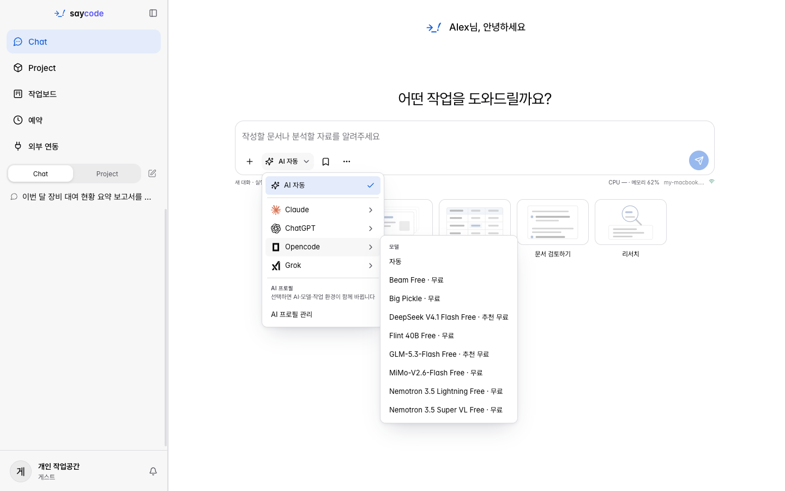

쓸 수 있는 무료 모델이 없으면 메시지를 보내지 않고 **다시 확인**하라고 안내합니다. 잠시 뒤 다시 확인하거나, 다른 AI를 연결하세요.

> [!WARNING]
> **무료 모델에 무엇을 보내는지 확인하세요.** 무료 모델은 OpenCode가 기간을 정해 제공하며, **모델마다 데이터 정책이 다릅니다**. OpenCode Zen 문서(2026년 11월 1일 확인 기준)에는 GLM-5.3-Flash Free와 DeepSeek V4.1 Flash Free는 입력을 보관하지 않고 학습에 쓰지 않는다고, Big Pickle 등 일부 모델은 무료 기간에 입력이 모델 개선에 쓰일 수 있다고, NVIDIA Nemotron 계열은 체험용이라 개인정보·기밀을 보내지 말라고 적혀 있습니다. 목록과 정책은 바뀔 수 있으니 [OpenCode Zen 문서](https://opencode.ai/docs/zen/)에서 직접 확인하세요.
> 회사·고객 코드나 기밀 자료는 제공사가 보관·학습을 하지 않는다고 밝힌 무료 모델만 쓰거나, 유료·조직 AI를 연결해 쓰세요.

하루에 얼마나 쓸 수 있는지는 [20.5](#205-무료-모델로-얼마나-쓸-수-있나요)에 정리했습니다.

---

## 8. 작업 영역

**프로젝트 화면의 오른쪽에서 파일·변경·터미널·브라우저·미리보기를 보며 AI의 작업을 확인합니다.** 가운데 대화와 나란히 놓여 대화와 작업 결과를 함께 볼 수 있습니다.

> [!NOTE]
> **조건**: 프로젝트에 **온라인 작업PC**가 연결되어 있어야 합니다. **변경** 탭은 Git 프로젝트에서만 쓸 수 있습니다.

### 8.1 열기와 패널 추가

1. 프로젝트 대화 오른쪽 위의 **도구 펼치기**(접을 때는 **도구 접기**, 단축키 **⌘⇧B**)를 누르면 **파일 · 터미널 · 브라우저 · 변경 · 미리보기** 목록이 바로 나옵니다. 열 도구를 고르세요.
2. 패널이 이미 열려 있으면 탭 줄 오른쪽의 **작업 패널 추가** 아이콘으로 다른 도구를 더 엽니다. 작업트리에 PR이 있으면 **PR 보기**도 있고, 설치한 확장이 더하는 도구(예: **Moai**)도 같은 메뉴에 나옵니다.
3. 탭을 끌어 순서를 바꾸고, **⌘W**로 닫습니다. 닫은 탭은 ⋮ 메뉴에서 다시 열 수 있고, 대화별로 열어 둔 도구가 복원됩니다.
4. 중간 경계를 끌어 너비를 조절하고, **패널 추가**로 터미널·브라우저·대화를 **오른쪽 또는 아래에 나란히** 열 수 있습니다(⌘⌥T / ⌘⌥B / ⌘⌥C). 작업 영역 오른쪽 위의 확대 아이콘으로 작업 영역을 넓게 펼칠 수 있습니다.

### 8.2 파일 탭

1. **도구 펼치기** → **파일**을 엽니다. 폴더 아이콘으로 파일 목록을 접고 펼치며, 파일을 누르면 내용이 열립니다(방향키·Enter로도 이동).
2. **파일 필터…** 칸에 이름을 입력하면 목록이 바로 걸러지고, **Enter**를 누르면 *프로젝트 전체 파일 이름*을 검색합니다.
3. 파일 **안의 내용**으로 찾으려면 검색창 옆 **내용 검색** 버튼을 켜고 검색어를 적은 뒤 Enter를 누릅니다. (작업PC가 지원할 때만 됩니다.)
4. AI가 만든 문서·이미지·HTML은 **작업물 모아보기**에서 한곳에 모아 봅니다. 범위를 **이 대화 / 이 프로젝트**로 고르고 열 작업물을 누릅니다.
5. 파일 행의 ⋮ → **Finder에서 보기**, `.csv`/`.tsv` 파일은 **표로 보기**(표 아이콘)로 열립니다. HTML·DOCX 뷰어는 앱의 다크 모드를 따릅니다.
6. 파일 패널의 ⋮ 메뉴에는 **새 파일 / 새 폴더 / 파일 업로드 / 파일 새로고침 / 폴더 접기**가 있습니다. 앱 밖에서 만든 파일이 목록에 안 보이면 **파일 새로고침**을 누르세요.

> [!TIP]
> 답변에 파일 이름이 나왔다고 패널이 저절로 열리지는 않습니다(작업물 파일은 완료 시 자동으로 열립니다). 파일 이름을 눌러 직접 여세요.

### 8.3 변경 탭

AI가 바꾼 파일과 바뀐 줄을 한눈에 확인합니다.

1. **작업 패널 추가** → **변경**을 엽니다.
2. 위쪽 탭에서 범위를 고릅니다 — **기록 안 한 변경 / 브랜치 전체 / 턴별**.
   - **브랜치 전체** — 작업트리 브랜치가 갈라진 뒤의 모든 변경기록과 아직 기록하지 않은 변경을 한 목록으로 봅니다. 아래 변경기록 목록에서 하나를 누르면 그 변경기록만 읽기 전용으로 보이고, **전체로 돌아가기**로 복귀합니다.
   - **턴별** — AI가 한 번 답한 단위(턴)로 봅니다. **이 턴 / 직전 턴 이후 / 대화 시작 대비** 중에서 고릅니다.

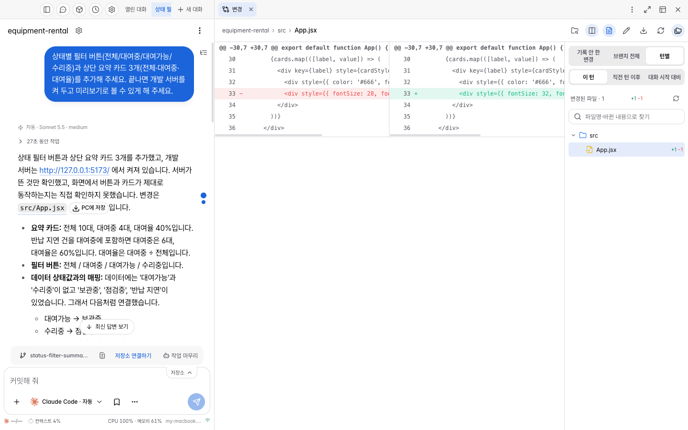

3. 파일을 누르면 **좌우 비교** diff(또는 **한 줄 비교**)가 열립니다. 바뀐 줄에 리뷰 코멘트를 달아 AI에게 보낼 수 있습니다.
4. **파일명·바뀐 내용으로 찾기**로 목록을 거르고, diff 안에서는 **⌘F**로 찾습니다.
5. 목록 끝의 **잠금 파일 / 생성된 파일 / 빌드 산출물** 그룹은 기본으로 접혀 있으니 누르면 펼쳐집니다.

> [!NOTE]
> **턴별**은 이 기능 이후에 시작한 턴부터, 내가 만든 대화에서 기록되며 macOS·Linux 로컬 Git 환경에서 지원됩니다. **브랜치 전체**는 작업트리에서 연 대화에서만 보입니다. 끝난 턴과 변경기록 단건 보기는 읽기 전용이라 줄 코멘트를 달 수 없습니다.

### 8.4 터미널 탭

작업PC에 붙은 실제 셸입니다. 탭을 바꿔도 살아 있고 연결이 끊기면 스스로 재연결하며 출력을 이어받습니다.

- **⌘F**: 터미널 안에서 찾기(`3/12`처럼 위치 표시)
- 링크 클릭: **앱 브라우저에서 열기 / 외부 브라우저에서 열기 / 주소 복사**
- 키보드 스크롤은 Shift+PageUp/PageDown, 우클릭 메뉴로 복사·붙여넣기
- 글꼴·글자 크기, **입력 미리 표시**는 **내 설정 → 개발 → 터미널**에서 바꿉니다.
- 터미널에서 pager가 열리면 `q`로 빠져나오거나 `git --no-pager log`처럼 실행하세요.

> [!NOTE]
> 작업PC의 실행기가 다시 시작되면 "이 터미널이 닫혀요"라는 안내와 함께 터미널이 닫힐 수 있습니다.

### 8.5 브라우저와 미리보기

- **브라우저** 패널에서 주소창에 `http://localhost:5173` 같은 주소를 입력하면 내 작업PC에서 돌아가는 앱이 바로 열립니다. 탭 줄·도구 막대·주소창이 한 창처럼 이어지고, 로그인·쿠키는 앱을 다시 켜도 남습니다(로그아웃이나 계정·조직을 바꾸면 지워집니다). → 고치는 방법은 [9장](#9-보면서-고치기)
- **미리보기**는 프로젝트의 개발 서버 결과를 보여 줍니다. 프로젝트 도구(⋮) → **미리보기**를 누르고, 탭에 "미리보기가 아직 실행 전입니다"가 보이면 그 안의 **미리보기 실행** 버튼을 누릅니다. 새로고침(두 화살표)과 **재시작**(한 방향 회전 화살표) 버튼은 따로 있습니다.
- 이미 띄워 둔 서버는 **리슨 포트 감지**가 찾아 줍니다. 목록에서 **연결**을 누르거나 포트 번호를 직접 입력하세요.

> [!TIP]
> 미리보기 탭에 "미리보기가 아직 실행 전입니다"만 보이면 프로젝트 설정 → **개발** → **실행**에 개발 서버 명령·포트가 저장되어 있지 않은 상태일 수 있습니다. 설정을 저장하거나, AI에게 서버를 켜 달라고 하거나 터미널에서 켠 뒤 **브라우저** 패널에 `http://localhost:<포트>`를 직접 열거나 **리슨 포트 감지**를 쓰세요.

프로젝트 설정 → **개발** → **실행**에 **개발 서버 명령**과 **개발 서버 포트**를 적고 **실행 설정 저장**을 누르면 미리보기가 그 값을 사용합니다.

### 8.6 PR 보기

[로그인] 대화 속 GitHub PR 링크를 누르면 오른쪽 작업 패널에서 PR의 설명·코멘트·리뷰·커밋을 시간순으로 읽습니다(Shift를 누른 채 클릭하면 외부 브라우저). **파일** 탭에서는 전체 diff를 보고 "이 PC에서 읽음"을 표시하며, **리뷰 지적 고치기**로 AI에게 수정을 맡기고, 조건이 맞으면 아래 머지 상태에서 **머지** → **병합**으로 합칩니다. 작업PC에 `gh`가 설치·로그인되어 있어야 하며 GitHub 저장소만 지원합니다.

---

## 9. 보면서 고치기

**실행 중인 화면에서 마음에 안 드는 요소를 직접 집어 AI에게 고쳐 달라고 요청합니다.** 요소를 여러 개 골라 한 번에 보내고, 여백·간격·글자도 직접 조절할 수 있습니다.

> [!NOTE]
> **조건**: 프로젝트 대화가 열려 있고, 고칠 앱이 작업PC에서 실행 중이어야 합니다(예: `http://localhost:5173`). 요소를 넣을 대화가 없으면(별도 창으로 띄운 브라우저 등) 주석 트레이에 담긴 채 이유가 안내됩니다. 컴포넌트와 소스 위치(파일·줄) 표시는 개발 서버 앱에서 React Source Locator 같은 확장이 켜져 있을 때만 붙습니다.

### 9.1 요소를 집어 주석 트레이에 담기

1. **도구 펼치기** → **작업 패널 추가** → **브라우저**를 열고 주소창에 앱 주소를 입력합니다.
2. 브라우저 도구 막대의 **요소를 골라 주석 트레이에 담기**(요소 선택) 버튼을 누릅니다.
3. 페이지에서 고칠 요소를 클릭하면 **아래 주석 트레이**에 한 줄로 담깁니다. 한 번 누를 때마다 요소 하나만 고르므로, 더 담으려면 버튼을 다시 누르세요(고르는 중 Esc로 취소).
4. 각 줄에 요청 내용(**코멘트**, 2,000자까지)을 적고 **의도**를 고릅니다 — **수정해 줘 / 질문 / 참고**.
5. 스크린샷 **썸네일**을 누르면 표시 창이 열립니다. **펜 · 사각형 · 지우개**와 빨강·노랑·파랑으로 표시하고 **적용**을 누릅니다(⌘Z로 되돌리기, 원본으로 복원 가능). 적용하면 썸네일에 **표시됨**이 붙습니다.
6. **모두 보내기**를 누르면 번호별 요청 글(셀렉터·스타일·HTML 정보)과 스크린샷이 **대화 입력창에 들어갑니다.** 바로 전송되지는 않으니 내용을 확인하고 **전송 버튼**을 누르세요.
7. AI가 코드를 고치면 개발 서버가 변경을 반영합니다. 화면이 그대로면 브라우저 패널의 **새로고침**을 누르세요.

> [!TIP]
> 트레이가 **비어 있을 때** **Shift**를 누른 채 요소를 클릭하면 트레이를 거치지 않고 그 요소 하나가 **바로 입력창에** 들어갑니다(빠르게 하나만 보낼 때).

> [!NOTE]
> 트레이는 브라우저 패널마다 따로 있고, 최대 **20개**까지 담깁니다. 패널을 닫거나 앱을 다시 시작하면 비워집니다. 새로고침해도 변경이 반영되지 않으면 개발 서버를 다시 시작하세요.

### 9.2 디자인 조정 — 직접 값을 바꿔 보기

AI에게 글로 설명하기 어려운 미세 조정은 직접 값을 바꿔 보고 그 결과를 요청으로 보냅니다.

1. 주석 트레이에 담은 요소 행의 **조절 아이콘(디자인 조정)** 을 누릅니다.
2. **간격**(안쪽 여백 padding, 바깥 여백 margin, 항목 간격 gap) · **배치**(방향·정렬·배분) · **글자**(크기·굵기·색) 항목에 값을 적고 Enter를 누르면 페이지에 바로 적용됩니다. 길이는 <strong>↑↓</strong>로 1씩(Shift와 함께 10씩) 바꾸고, 배치·굵기는 목록에서, 색은 색 선택기로 고릅니다.
3. 마음에 안 들면 항목 옆 되돌리기 또는 **모두 되돌리기**를 누릅니다.
4. **변경 요청 보내기**를 누르면 그 요소의 선택자·텍스트와 속성별 **전 → 후** 값이 입력창에 들어가고 트레이에서 빠집니다. 확인 후 보내면 AI가 소스 코드에 반영합니다.

> [!IMPORTANT]
> 디자인 조정은 **페이지에만 임시로** 적용됩니다. 새로고침하거나 다른 주소로 이동하면 원래대로 돌아가고 트레이에 기록한 디자인 변경도 지워집니다. 반드시 **변경 요청 보내기**로 AI에게 반영을 맡기세요. 바꾼 항목이 없으면 보낼 수 없습니다.

### 9.3 브라우저 도구 막대

도구 아이콘으로 **요소 선택**, **콘솔·네트워크 오류 수집**, **뷰포트**(데스크톱·태블릿·모바일 화면 크기), **쿠키 가져오기**(로그인 상태 이전), **새 창에서 열기**를 씁니다. 주소창의 **주소 후보**에서 감지된 로컬 서버 주소를 고르고, 새로고침은 Shift+클릭하면 캐시를 무시합니다. 새 창으로 띄운 브라우저에는 요소를 넣을 대화가 없을 수 있습니다.

---

## 10. 대화 관리

**대화가 많아져도 길을 잃지 않도록, 훑어보고, 정리하고, 찾고, 이어갑니다.**

### 10.1 대화 요약과 메시지 이동 레일

> [!NOTE]
> **조건**: **내 메시지가 2개 이상**인 프로젝트 대화에서 보입니다. Chat에는 아직 없습니다. 레일에는 지금 불러온 메시지만 보이며, 이전 기록은 대화 위쪽 이전 대화 버튼으로 불러옵니다.

1. 대화 오른쪽 끝(스크롤바 왼쪽)의 **레일**에서 점에 마우스를 올리면 요청 앞부분과 만든 작업물이 보입니다. 점을 누르면 그 메시지로 이동합니다(키보드: Tab → 위/아래 화살표 → Enter).
2. 레일 맨 위 **대화 요약** 버튼을 누르면 패널이 열려 이 대화의 **계획 · PR · 커밋 · 변경 파일 · 미리보기 · 리뷰 · 곁질문 · 백그라운드 작업**을 한눈에 봅니다.
3. 패널 항목을 누르면 해당 작업물이 나온 메시지로 이동하고, PR 옆 아이콘은 PR 화면을 엽니다.
4. **대화 옆에 고정**을 누르면 대화 옆 고정 열로 열립니다. 다른 대화로 가거나 앱을 다시 열면 닫혀 있으니 **대화 요약** 버튼으로 다시 엽니다.

### 10.2 열린 대화 탭

- **+ 새 대화**(⌘T)로 새 탭을 열고, 탭을 끌어 순서를 바꾸며 **⌘W**로 닫습니다. **⌘⇧T**는 닫은 탭 다시 열기, **⌘⇧J**는 질문·승인을 기다리는 대화로 바로 이동입니다(전체 단축키는 [19장](#19-단축키-모음)).
- 백그라운드 작업(빌드·테스트 감시, 자식 AI도구)이 도는 동안에는 응답이 끝나도 완료로 표시하지 않고 대화 탭에 **백그라운드 작업 중** 배지가 붙습니다.

### 10.3 고정

1. 대화 줄에 마우스를 올리고 오른쪽 **핀 버튼**을 누릅니다. 목록 맨 위 **고정된 대화** 영역에 모입니다.
2. 고정된 대화를 끌어 순서를 바꾸면 **⌘1~9**(Windows는 Ctrl+1~9)로 첫 아홉 대화를 바로 엽니다.
3. 풀 때는 같은 핀 버튼을 다시 누릅니다. [로그인] 로그인 계정에서는 다른 PC·웹에서도 같은 고정 목록이 보입니다.

### 10.4 보관하기 — 지금 안 보이게 정리

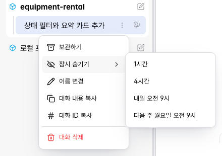

1. 프로젝트를 눌러 대화 목록을 펼치고, 대화에 마우스를 올려 **점 세 개(⋮)** 를 누릅니다.
2. **보관하기**를 누릅니다. **확인 창 없이 바로** 목록에서 사라지고 "대화를 보관했어요" 알림이 **10초** 동안 나옵니다.
3. 실수라면 알림의 **되돌리기** 또는 **⌘Z**(Windows는 Ctrl+Z)를 누릅니다. 알림의 **보관함으로 이동**은 [대화 보관함](#106-대화-보관함과-자동-보관)을 엽니다.

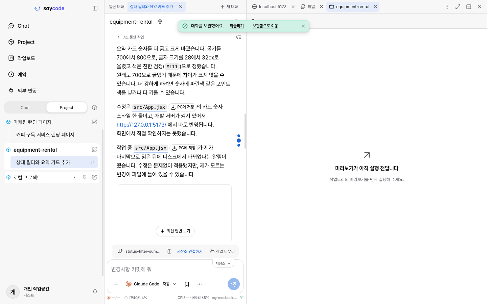

같은 ⋮ 메뉴에는 **이름 변경**, [로그인] **조직에 공유**, **대화 내용 복사**, **대화 ID 복사**, **대화 삭제**(확인 후 되돌릴 수 없음)도 있습니다.

> [!TIP]
> **여러 대화를 한 번에**: **Shift**를 누른 채 대화를 하나씩 클릭해 고르고, 선택된 대화의 ⋮ → **선택한 N개 보관** 또는 **선택한 N개 삭제**를 고릅니다. 작업트리가 연결된 대화가 있으면 확인 창에서 **보관** 또는 **보관 & 작업트리 삭제**를 고릅니다. 단일 대화 보관은 작업트리를 지우지 않습니다.

> [!TIP]
> 작업트리에 연결된 **PR이 병합된** 대화는 사이드바에서 마우스를 올리면 뜨는 창에 **병합됨**이 보이고 그 아래 **보관하기** 버튼으로 바로 보관할 수 있습니다. 대화로 *"이 대화 보관해줘"*라고 말해도 응답이 끝난 뒤 보관됩니다.

### 10.5 잠시 숨기기

당장은 신경 쓰지 않아도 되는 대화를 정한 시각까지 목록에서 치워 둡니다. 시각이 되거나 AI가 승인·질문으로 답을 기다리면 원래 자리로 돌아옵니다.

1. 대화 줄의 **⋮** → **잠시 숨기기**를 누릅니다.
2. **1시간 / 4시간 / 내일 오전 9시 / 다음 주 월요일 오전 9시** 중에서 고릅니다.
3. 숨긴 대화는 프로젝트 목록 아래 **숨긴 대화 N**을 눌러 펼치면 남은 시간과 함께 보입니다. 행을 누르면 그대로 열고, **눈 버튼(다시 보이기)** 을 누르면 바로 원래 목록으로 돌아옵니다.

> [!NOTE]
> 프로젝트 대화에서만 쓸 수 있습니다(Chat·여러 대화 동시 숨기기는 미지원). 숨긴 상태는 **이 컴퓨터에만** 저장됩니다. 숨기는 동안에는 비활동 자동 보관 기간을 세지 않습니다. 숨긴 직후 **되돌리기**나 ⌘Z로 취소할 수 있습니다.

### 10.6 대화 보관함과 자동 보관

보관한 대화는 사라지지 않고 **내 설정 → 일반 → 대화 보관함**에서 찾습니다.

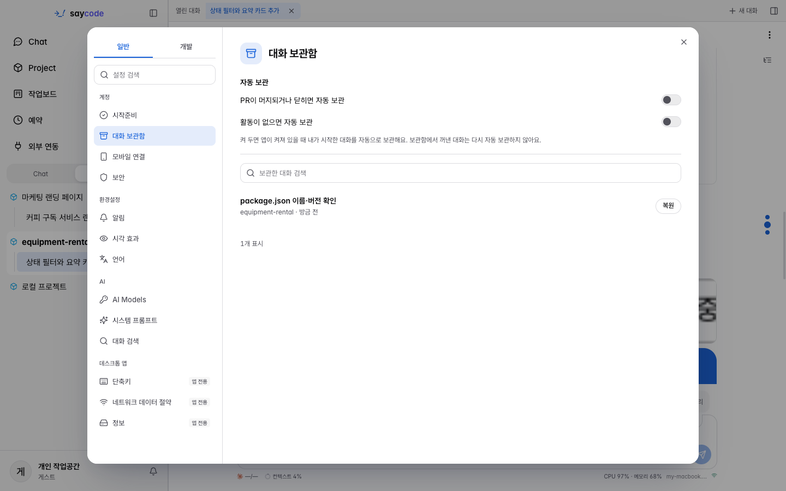

1. 맨 위에서 **자동 보관** 규칙을 확인하고, **보관한 대화 검색**으로 보관한 대화를 찾습니다. 
2. 대화 줄 오른쪽의 **복원**을 누릅니다(Project 대화는 확인 창에서 한 번 더). 기존 제목과 기록이 유지된 채 열리고 AI는 자동으로 실행되지 않습니다.

**자동 보관**은 대화 보관함 맨 위에서 켭니다(기본은 꺼짐).

- **PR이 머지되거나 닫히면 자동 보관**
- **활동이 없으면 자동 보관** + **활동 없는 기간**(1~90일, 기본 14일)

응답 중·입력 대기·방금 활동한(10분 이내)·화면에 열린·고정된 대화는 보관이 미뤄지고, 사이드바 줄의 보관 아이콘이 이유를 알려 줍니다. 한 번에 최대 3개씩 보관하며 작업트리는 지우지 않습니다.

### 10.7 대화 이어가기와 갈래

프로젝트 도구(⋮) → **대화 이어가기**(엇갈린 화살표 아이콘)에서 지금 대화를 그대로 둔 채 새 대화를 시작합니다.

| 메뉴 | 하는 일 |
|---|---|
| **다른 AI도구로 이어가기** | 다른 AI(예: Claude → Codex)로 이어 갑니다. 모델·작업 강도도 고릅니다. |
| **같은 AI로 갈래 만들기** | 같은 AI로 지금까지의 기록을 복제한 **갈래 대화**를 만들어 다른 방향을 시도합니다. 전체 또는 *특정 메시지까지*를 고르고 **갈래 만들기**를 누르면 새 탭이 열리고 헤더에 **갈래 원본** 링크가 생깁니다. 갈래는 원래 대화와 **같은 작업 폴더**를 공유합니다. |
| **터미널에서 이어가기** | 이 컴퓨터의 Claude·Codex 대화를 터미널에서 이어 갈 명령을 복사합니다. |
| **이 대화를 작업트리로 옮기기** / **이 대화를 본 폴더로 되돌리기** | 진행 중인 대화를 지금 변경사항과 함께 새 작업트리로 옮기거나 되돌립니다. 작업PC의 Saycode 실행기가 최신일 때만 선택할 수 있고, 회색이면 메뉴에 사유가 표시됩니다 ([11.6](#116-작업트리-안전망)). |

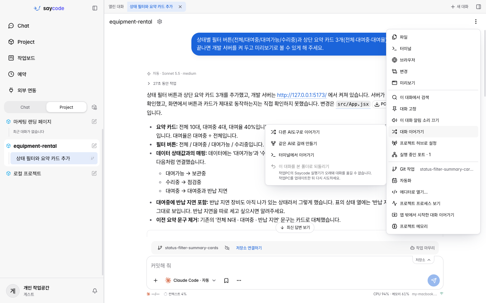

그 밖에:

- [로그인] 내 메시지에 마우스를 올려 **여기서 다시 쓰기**(연필)를 누르면, 그 메시지 직전까지의 대화로 새 대화가 열리고 입력창에 원래 메시지가 채워집니다(Claude 대화). 원래 대화는 그대로 남습니다.
- 입력창에서 `@`로 같은 프로젝트의 다른 대화를 칩으로 붙여 AI가 읽게 할 수 있습니다([6.4](#64-입력창-메뉴와-특수-입력)).
- 프로젝트 도구 → **앱 밖에서 시작한 대화 이어가기**로 터미널 등 앱 밖에서 시작한 AI 대화를 가져옵니다.

### 10.8 찾기 — 대화 검색과 빠른 열기

| 방법 | 단축키 | 하는 일 |
|---|---|---|
| **대화 내 검색** | ⌘F | 열린 대화 안에서 단어를 찾아 이동. **전체 대화에서 검색**으로 넘길 수 있습니다. |
| **대화 검색** | ⌘⇧F | 모든 대화의 제목·내 요청·AI 응답에서 단어를 찾습니다. [로그인] **시맨틱** 탭은 뜻으로 지금 프로젝트의 기억을 찾습니다. |
| **빠른 열기** | ⌘P | 프로젝트·대화·파일 이름을 입력해 바로 엽니다. **>** 를 맨 앞에 입력하면 새 대화·응답 중단·터미널 열기·패널 분할·설정 열기·대화 고정/보관·작업보드 같은 **명령**만 보입니다(⌘⇧P로 바로 열림). |
| **사이드바 검색** | ⌘K | 프로젝트 목록을 이름으로 거릅니다. |

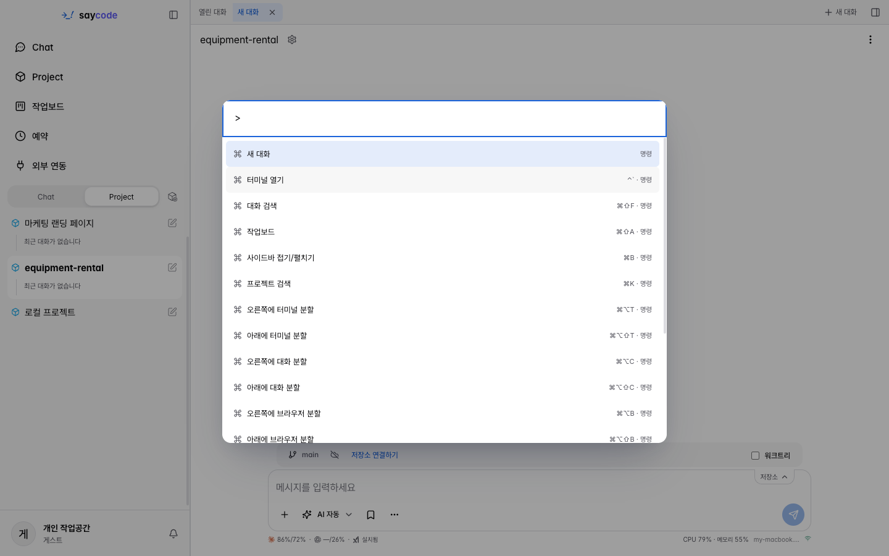 를 입력해 연 명령 목록 — 새 대화, 터미널 열기, 대화 검색, 작업보드, 화면 분할 등" />

> [!NOTE]
> 대화 검색을 쓰려면 **내 설정 → 일반 → 대화 검색 → 대화 검색 사용**이 켜져 있어야 합니다. **검색 인덱스 삭제**로 저장된 검색 데이터를 지울 수 있습니다.

---

## 11. 작업 마무리

**AI가 만든 변경을 점검하고, PR을 올리고, 대화를 정리하는 마지막 단계입니다.** 입력창 위 줄의 **작업 마무리** 메뉴 하나에서 모두 시작합니다.

> [!NOTE]
> **조건**: 이미 시작한 프로젝트 대화에서만 보입니다(입력창 위 줄을 접어 두었거나 AI 질문 화면이 떠 있으면 숨겨집니다). **PR 올리기**는 **작업트리에서 연 대화**여야 하고 원격 저장소가 필요합니다(없으면 **변경기록 남기기**로 바뀝니다).

### 11.1 작업 마무리 메뉴

1. 프로젝트 대화를 엽니다.
2. 입력창 위 줄 **오른쪽 끝**의 로봇 아이콘 **작업 마무리** 버튼을 누릅니다.
3. 메뉴에서 원하는 항목을 고릅니다.

| 메뉴 | 한 줄 설명 |
|---|---|
| **작업 리뷰하기** | 지금 일하는 AI가 변경을 점검하고 문제를 직접 고칩니다. |
| **독립 리뷰 요청…** | 다른 AI가 읽기 전용으로 검토하고 결과만 전달합니다. |
| **PR 올리기** | 리뷰·테스트·커밋·push·PR 생성에 CI와 리뷰 봇 처리, 머지까지 맡깁니다. 원격 저장소가 있을 때 보입니다. |
| **변경기록 남기기** | 원격 저장소가 없을 때 **PR 올리기** 대신 보입니다. 변경을 로컬 변경기록(커밋)으로 남깁니다. |
| **보관&완료** | 대화를 보관하고 마무리합니다. |
| **고급 설정…** | 반복 횟수, 독립 리뷰어, 완료 전 확인을 정합니다. |

AI가 응답 중이면 **작업 리뷰하기 · PR 올리기**를 누를 때 항목 아래 "지금 작업이 끝나면 이어서 실행해요"가 보이고, 누르면 입력창 위 **대기열**에 들어가 끝난 뒤 차례로 실행됩니다(끌어서 순서 변경·삭제).

### 11.2 작업 리뷰하기

1. **작업 마무리** → **작업 리뷰하기**를 누릅니다.
2. 같은 AI가 변경을 점검하고 문제를 직접 고칩니다. **medium 이상** 지적이 나오면 정해 둔 **반복 횟수**만큼 리뷰를 이어 가고, 없으면 첫 회에서 끝납니다.
3. 도중에 멈추려면 **작업 리뷰 중지**를 누릅니다. 조회가 실패하면 **작업 리뷰 상태 다시 확인**, 종료 후 새로 시작하려면 **작업 리뷰 다시 시작**을 누릅니다.

반복 횟수는 <strong>작업 마무리 → 고급 설정…</strong>의 **작업 리뷰 반복 횟수**에서 바꿉니다(기본 7).

### 11.3 독립 리뷰 요청

코드를 쓴 AI와 **다른 AI**에게 새 눈으로 검토시키고 싶을 때 씁니다. 리뷰어는 현재 대화와 분리된 새 대화에서 **읽기 전용**(파일 편집·commit·push 금지)으로 일합니다.

1. **작업 마무리** → <strong>독립 리뷰 요청…</strong>을 누릅니다.
2. **AI도구 · 모델 · 작업 강도 · 리뷰 초점**을 고릅니다. 코드를 쓴 모델과 다른 리뷰어가 먼저 제안됩니다.
3. **독립 리뷰 요청** 버튼을 누릅니다. 성공하면 **리뷰 기록** 탭으로 이동합니다.
4. **리뷰 기록**에서 진행 상태와 결과를 보고 **재시도 / 결과 전달 / 정리**를 합니다.

> [!NOTE]
> 읽기 전용 제한은 Claude 리뷰어에만 적용됩니다. 작업보드에서 이런 카드에는 **읽기 전용** 배지가 붙습니다.

### 11.4 PR 올리기

1. **작업 마무리** → **PR 올리기**를 누릅니다. 확인 창 없이 곧바로 요청됩니다.
2. AI가 PR을 만든 뒤 **CI 실패, 리뷰 봇 지적, 스택 PR, 충돌**을 처리하고, 모두 통과하면 **base 브랜치에 머지까지** 합니다.
3. 봇 판정이 없거나 필수 승인 리뷰가 남는 등 조건이 남으면 **머지하지 않고** 남은 상태를 보고합니다.
4. 진행 상황은 입력창 위 **PR 번호 칩**(열림·병합됨·닫힘, CI 배지)과 [PR 보기](#86-pr-보기)에서 확인합니다.

> [!IMPORTANT]
> 원격 저장소가 연결되지 않은 프로젝트에서는 PR을 만들 수 없어 **변경기록 남기기**(로컬 커밋)까지만 요청합니다. [로그인] GitHub 연결과 작업PC의 `gh` 로그인이 필요한 부분이 있습니다.

### 11.5 보관&완료

1. **작업 마무리** → **보관&완료**를 누릅니다.
2. 대화가 보관되고 "되돌리기"가 나옵니다. 작업트리는 지우지 않습니다.
3. <strong>고급 설정…</strong>의 **보관&완료 전에 확인**을 켜면 보관 전에 확인 창이 뜹니다.

작업트리까지 정리하고 싶다면 사이드바에서 여러 대화를 골라 **보관 & 작업트리 삭제**를 쓰거나 [작업트리 목록](#116-작업트리-안전망)에서 삭제하세요.

### 11.6 작업트리 안전망

**작업트리**는 대화마다 만들어지는 복사본 작업 폴더라서, 여러 대화를 동시에 돌려도 서로 부딪히지 않습니다. Saycode는 작업트리를 지워도 작업이 사라지지 않도록 안전장치를 둡니다.

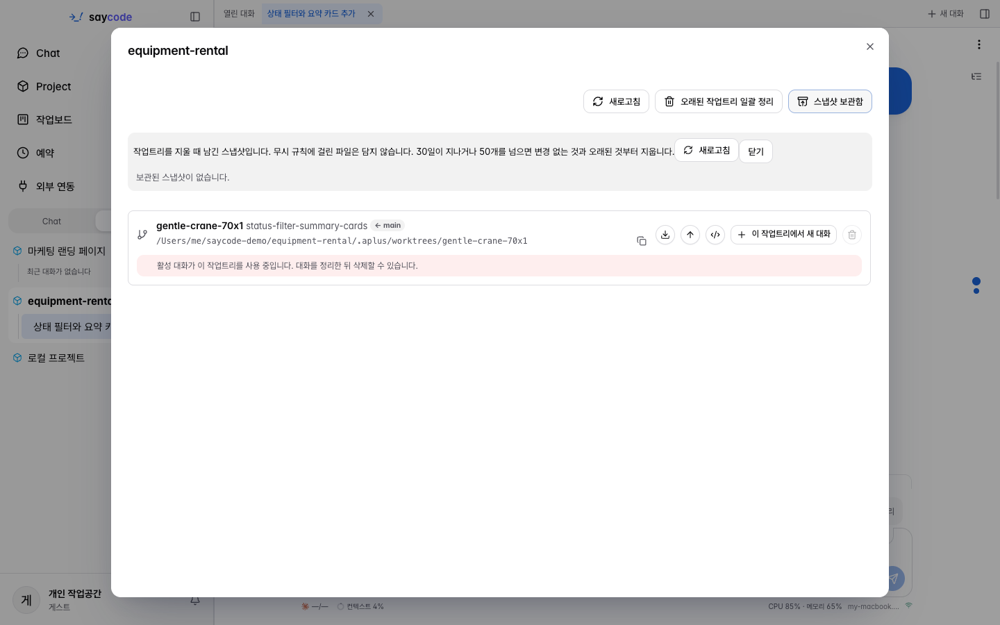

- **새 작업트리는 원격 최신 기본 브랜치**(`origin/main` 등)에서 시작합니다. 원격을 받지 못하면 이유와 함께 로컬 브랜치 기준으로 시작할지 묻습니다.
- 삭제 전에는 이 작업트리에만 있는 **로컬 전용 파일**(`.env` 등)의 수와 폴더를 알려 줍니다.
- 지우기 전에 **스냅샷**을 남깁니다(커밋하지 않은 변경·새 파일 포함, 무시 규칙에 걸린 파일은 제외).

**작업트리 목록 열기**

1. 프로젝트 대화에서 **프로젝트 도구(⋮)** → **Git 작업**을 엽니다.
2. <strong>작업트리…</strong>를 누릅니다.
3. 위쪽에 **새로고침 / 오래된 작업트리 일괄 정리 / 스냅샷 보관함** 버튼이 있고, 작업트리 줄마다 경로 복사·가져오기·보내기·에디터 아이콘, **이 작업트리에서 새 대화**, 삭제(휴지통)가 있습니다. 지금 열린 대화가 쓰는 작업트리는 "대화를 정리한 뒤 삭제할 수 있습니다"라고 안내되며 삭제할 수 없습니다.

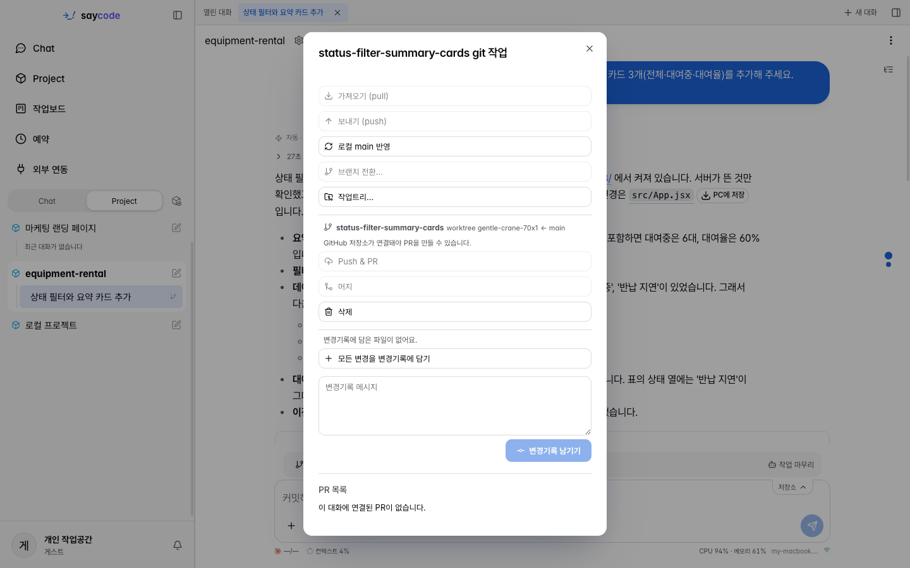

**지운 작업트리 되살리기**

1. 작업트리 창에서 **스냅샷 보관함**을 엽니다.
2. 되살릴 줄의 **복원**을 누릅니다. 원래 경로에 작업트리가 다시 생기고 커밋하지 않은 변경까지 돌아옵니다.

> [!NOTE]
> 스냅샷은 만들 때 30일이 지난 것을 지우고 50개를 넘으면 오래된 것부터 지웁니다. Windows 작업PC에서는 아직 스냅샷을 만들지 않습니다. 앱 밖에서 만든 작업트리는 **변경 가져오기**(충돌 미리보기)로 가져옵니다.

### 11.7 파일 복원지점과 변경기록

**파일 복원지점** — Git이 없는 폴더나 작업트리를 쓰지 않는 대화에서도 AI가 바꾼 파일을 되돌릴 수 있습니다.

1. 새 대화에서 **⋯**(대화 추가 옵션) → **파일 복원지점**을 켭니다(macOS·Linux 작업PC).
2. 대화 중 입력창 위 오른쪽의 **파일 복원지점**을 눌러 펼칩니다.
3. 되돌릴 시점의 **미리보기**를 눌러 파일별 비교를 보고, **이 미리보기의 파일 변경을 확인했습니다**에 체크한 뒤 **파일 상태 복원**을 누릅니다.

**변경기록 남기기** — 작업 마무리 메뉴의 **변경기록 남기기**, 또는 입력창 위 브랜치 이름 버튼 → 담은 파일이 없으면 **모든 변경을 변경기록에 담기** → **변경기록 메시지** 입력 → **변경기록 남기기**를 누릅니다. 설정(**개발 자동화**)에서 AI 생성을 켜면 메시지를 AI가 써 주는 버튼이 나타납니다(자동으로 커밋하지는 않습니다).

---

## 12. 작업보드

**모든 프로젝트의 모든 대화를 칸반으로 펼쳐 놓고 여러 AI를 한 번에 지휘합니다.** 대화가 여러 개 동시에 돌 때 "지금 내 답을 기다리는 것"부터 찾기에 좋습니다.

> [!NOTE]
> **조건**: 개발자용 메뉴라 처음에는 **숨겨져** 있습니다. 프로필 메뉴 → **개발자 기능 설정** → **작업보드 메뉴 보이기**를 켜면 사이드바에 **작업보드**가 나타납니다(단축키 **⌘⇧A**는 켜지 않아도 동작). 가로 폭이 넓을수록(1720px 이상) 여섯 칸이 한 화면에 들어옵니다. 조직 정책이 오토파일럿을 끄면 "오토파일럿 사용 불가 · 조직 정책"이 보입니다.

### 12.1 칸의 의미

| 칸 | 의미 |
|---|---|
| **입력 대기** | 질문·권한·계획 승인 응답이 필요한 대화 — 가장 먼저 볼 곳 |
| **응답 중** | 지금 일하는 중. 카드를 여기에 놓으면 지시를 보냅니다 |
| **대기** | 다음 지시를 기다리는 중 |
| **리뷰 중** | 카드를 놓으면 리뷰를 요청합니다(모델과 프롬프트가 채워진 확인 창이 열림) |
| **완료** | 카드를 놓으면 대화를 완료로 옮깁니다 |
| **PR 병합됨** | PR이 머지되어 끝난 대화 |

카드에는 프로젝트·제목·AI·경과 시간·브랜치(작업트리) 이름이 보입니다. 카드 제목을 누르면 마지막 요청과 최신 응답을 미리 보고 **대화로 이동**할 수 있고, 오른쪽 위 검색창으로 제목·프롬프트를 거릅니다. 카드를 **리뷰 중** 칸으로 끌어 놓으면 **리뷰 요청 보내기** 창(모델·기본 문구)이 열립니다.

### 12.2 필터와 선행 작업

1. **필터**를 눌러 **작업PC**, **자동화로 만든 대화 숨기기**, **PR 상태**(PR 없음·PR 열림·PR 머지됨)를 고릅니다. 버튼이 **필터 N개 적용**으로 바뀌고, 옆 X로 모두 풉니다.
2. **선행 작업**: 뒤에 할 카드를 눌러 상세를 열고 **선행 작업 추가** → 먼저 끝나야 하는 카드를 고르고 **추가**합니다. 선행이 끝나기 전에 시작하려 하면 막힌 카드 이름을 알려 주고, 오토파일럿 카드는 선행이 끝나는 대로 지시를 자동 전송합니다. 카드에는 `선행 1/2` 배지가 붙습니다.

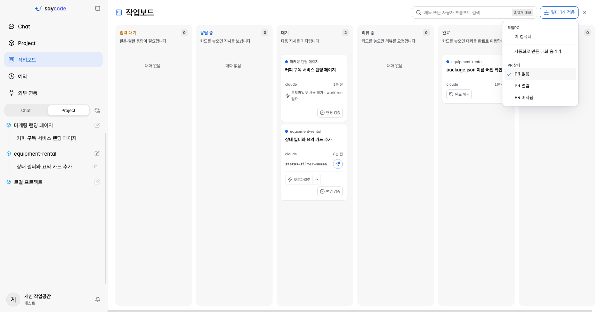

### 12.3 카드의 도구

| 버튼 | 하는 일 |
|---|---|
| **Commit & PR** (종이비행기) | 작업트리 카드에서 PR 작성을 요청합니다(작업 마무리의 **PR 올리기**와 같은 동작). |
| **오토파일럿** | AI 작업이 끝나면 리뷰하고, medium 이상 지적이 없고 요구사항마다 증거(테스트 결과·파일·커밋)가 있으면 Commit & PR까지 자동 진행합니다. 같은 장애가 3번 반복되면 멈추고 답을 기다립니다. 옆 화살표의 **독립 리뷰로 실행**도 선택할 수 있습니다. **작업트리 카드에서만** 쓸 수 있으며 응답을 중단하면 꺼집니다. |
| **PR 지킴이** | PR이 열린 카드에서 CI 실패·리뷰 봇 수정·충돌을 대신 지시하고 머지 가능해지면 알립니다(머지는 하지 않음). [로그인] `gh` 로그인 필요 |
| **변경 검증** | 그 대화의 작업트리(없으면 프로젝트 폴더)에서 빌드·테스트·구동 레시피를 실행합니다. `package.json` 스크립트·Makefile·`.aplus/verify.json` 중 하나가 있어야 합니다. |

> [!TIP]
> 맨 위에 **"대화 N개가 같은 권한을 기다려요"** 카드가 보이면 **전부 허용 (N)** 또는 **전부 거절**로 한 번에 처리할 수 있습니다([14.2](#142-승인-카드-다루기)).

> [!NOTE]
> **보관&완료**한 대화는 **완료** 칸에 카드로 남고, 카드의 **완료 해제**로 다시 이어 갈 수 있습니다(설정의 대화 보관함에서 **복원**해도 됩니다). PR이 병합된 대화는 **PR 병합됨** 칸으로 옮겨집니다. 개인 사용(로컬)에서도 보드·필터·선행 작업을 쓸 수 있으며, **PR 지킴이**는 GitHub 연결이 필요합니다.

---

## 13. 예약

**정해진 시간마다 AI에게 일을 맡깁니다.** 예: "매일 오전 9시에 어제 PR을 요약해서 알려줘".

> [!NOTE]
> **조건**: 사이드바 **예약** 메뉴는 모든 사용자에게 보이지만, [로그인] **예약을 만들고 관리하려면 클라우드 계정으로 로그인**해야 합니다. 예약 시각에는 **실행 PC가 켜져 있고 AI가 연결**되어 있어야 하며, 서버·CLI가 지원하는 버전이어야 합니다. 조직이 예약을 끄면 예약 화면에 "조직 정책으로 예약을 쓸 수 없어요"가 표시됩니다.

개인 사용에서는 예약 화면에 "클라우드 계정으로 로그인하면 Chat 예약을 관리할 수 있습니다." 안내만 나옵니다. 아래 설명은 로그인한 계정 기준입니다.

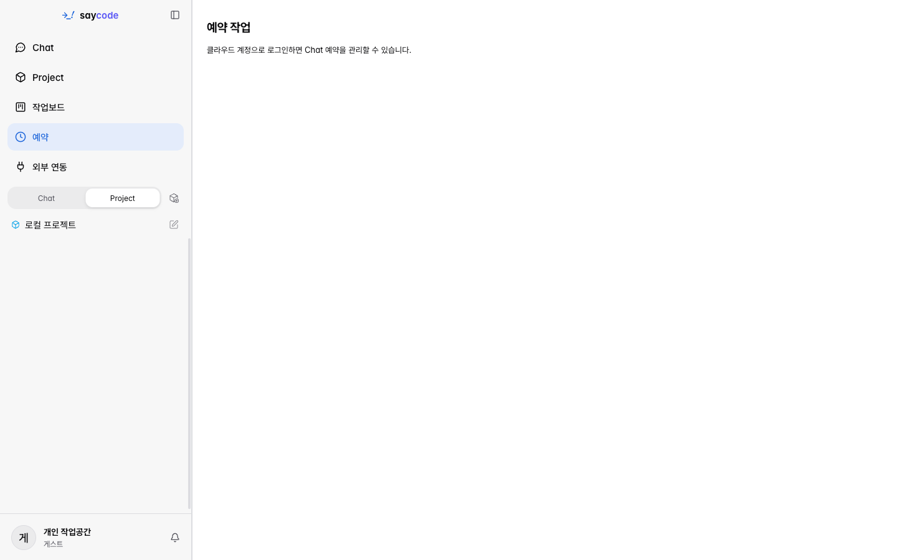

### 13.1 새 예약 만들기

1. 사이드바 **예약**을 누르고 **새 예약**을 누릅니다. 예약이 하나도 없으면 예시 버튼으로 시작할 수도 있습니다.
2. **할 일**에 AI가 할 일을 적습니다.
3. **반복**을 고릅니다.
   - **매일** — 정해진 시각에 실행합니다.
   - **매주** — 요일 버튼을 하나 이상 고르고 시각을 정합니다.
   - **한 번** — 날짜와 시각을 정합니다(지난 시각은 저장 불가).
   - 시간 간격 방식은 **예약하고 시작**을 눌러 첫 실행을 요청하고 같은 간격으로 반복합니다(15분 이상).
4. 시각 옆에 표시된 **시간대**를 확인합니다. 예: `매일 09:00 · 대한민국 시간`과 그 아래 `내 시간(대한민국 시간)으로 다음 실행: …`. 시간대는 **고급 → 시간대**에서 바꿉니다.
5. **예약하기**를 누릅니다.

### 13.2 고급 설정

**고급**을 펼치면 다음을 바꿀 수 있습니다.

- **이름**, 연결할 **대화**, 실행할 **PC**, 사용할 **AI** (새 Chat은 마지막으로 선택한 AI·모델을 사용)
- **결과 보내기** — 예약이 끝나면 답변 앞부분(최대 1,500자)을 페어링한 **Telegram·Slack** 개인 대화로 보냅니다.
- **실패 알림** — 실패 이유 한 줄을 같은 곳 또는 다른 대화로 받습니다. 둘 다 처음에는 *보내지 않음*입니다.
- **코드 작업 추가** — Node.js 스크립트를 예약으로 실행합니다.

> [!NOTE]
> 메신저 전달은 [로그인] 메신저 채널이 연결된 계정에서 가능하고([16.3](#163-메신저-채널)) Discord는 아직 선택할 수 없습니다. 같은 이유로 계속 실패하면 하루에 한 번만 알립니다.

### 13.3 예약 확인과 관리

- 예약 결과는 **일반 대화로 쌓이고** 알림 카드에 요약됩니다. 승인 대기가 만료되면 만료 표시가 붙습니다.
- 대화 상단의 요청·일정 버튼, 또는 대화 ⋮ → **예약 작업**에서 **예약 내용**(요청 전문·주기·상태·PC)을 봅니다. 예약 행의 **더보기**에서 **실행 이력 · 편집 · 일시정지 · 삭제**를 고릅니다.
- 시각이 지난 **한 번** 예약은 **다시 켜기**로 새 시각에 다시 실행합니다. PC가 꺼져 있어 놓친 한 번 예약은 나중에 실행되지 않습니다.
- 말로도 관리됩니다. Chat에서 *"15분마다 접속 상태를 확인해줘"*, *"이 예약 그만해"*, *"이 예약 다시 시작해"*라고 말하세요(간격은 최소 15분).

> [!TIP]
> 모든 예약을 한꺼번에 잠시 멈추려면 **내 설정 → 일반 → 보안 → 자동 작업 일시정지**를 켜세요([14.6](#146-자동-작업-일시정지와-조직-정책)).

---

## 14. 권한·승인·보안

**AI가 컴퓨터에서 위험한 일을 하기 전에 내가 허락하고, 필요하면 규칙으로 미리 정해 둘 수 있습니다.** 이 장은 승인 카드부터 보안 설정까지 순서대로 설명합니다.

### 14.1 데이터는 어디에 저장되나요?

**개인 사용**에서는 대화·프로젝트·결과물이 모두 **이 PC에만** 저장되고(AI 응답은 연결한 AI 서비스와 주고받습니다), **로그인**하면 계정(조직)에 저장되며 신뢰 기기에서만 암호화 데이터를 열 수 있습니다. 앱 안 브라우저의 로그인·쿠키는 로그아웃하거나 계정·조직을 바꾸면 지워집니다.

### 14.2 승인 카드 다루기

AI가 명령 실행·파일 쓰기·네트워크·MCP 도구를 쓰려 할 때 대화에 **승인 카드**가 나타납니다.

1. 카드의 내용을 확인하고 **허용** 또는 **거절**을 누릅니다. 카드에 **이 대화에서 허용**이 있으면 그 대화에서만 허용됩니다. 단축키는 **Enter(허용)** / **Esc(거절)** 입니다. (**내 설정 → 일반 → 단축키 → 권한 요청에 Enter·Esc로 응답** 스위치로 끌 수 있습니다.)
2. 삭제·관리자 권한·원격 코드 실행·강제 push·비밀번호 파일 접근처럼 위험할 수 있으면 카드에 **주의가 필요한 작업**과 이유가 붙습니다. 이런 카드는 Enter로 바로 허용되지 않고 허용 버튼이 **위험할 수 있어요 — 그래도 허용**으로 바뀌어, 한 번 더 눌러야 합니다.
3. 거절 이유를 AI에게 전하려면 버튼 아래 **이유를 적고 거절**을 펼쳐 이유를 쓰고 **이유와 함께 거절**을 누릅니다(Claude 대화). 빈 칸이면 그냥 거절입니다.
4. 대화 여러 개가 **똑같은 권한**을 기다리면 알림 센터나 작업보드 맨 위에 **"대화 N개가 같은 권한을 기다려요"** 카드로 묶입니다. 요청 내용을 펼쳐 확인하고 **전부 허용 (N)** 또는 **전부 거절**을 누르세요. 개별 확인은 **개별 보기**입니다.

> [!NOTE]
> 질문·계획 승인·폴더 접근 요청, 위험 규칙에 걸린 요청은 묶이지 않고 해당 대화에서 하나씩 답합니다.

### 14.3 알림과 플로팅 승인 패널

**내 설정 → 일반 → 알림**에서 정합니다. 아래 표는 화면 위에서 아래 순서이며, 아래쪽 항목은 스크롤해야 보입니다.

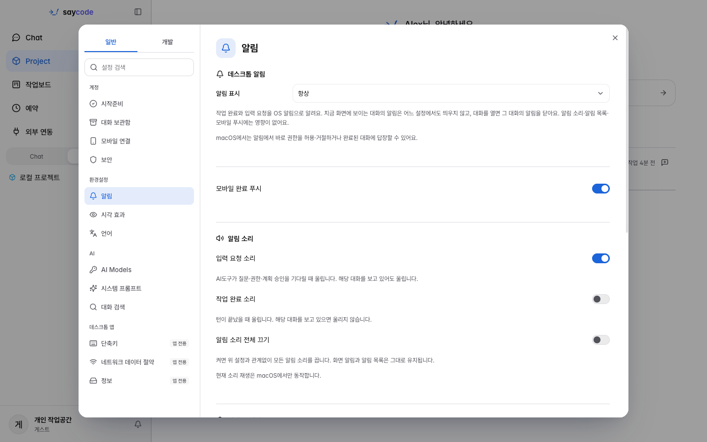

| 항목 | 설명 |
|---|---|
| **알림 표시** | 데스크톱 알림을 **항상 / 앱을 보고 있지 않을 때만 / 끄기** 중에서 고릅니다. 지금 화면에 보이는 대화는 알림을 띄우지 않습니다. macOS 알림에서는 **허용 / 이번 세션 허용 / 거절**로 바로 답하고, 완료 알림에는 답장할 수 있습니다. |
| **모바일 완료 푸시** | 작업이 끝나면 휴대폰으로 푸시를 받습니다([17장](#17-작업pc와-모바일)). |
| 알림 소리 | **입력 요청 소리 / 작업 완료 소리 / 알림 소리 전체 끄기** (현재 macOS에서만 소리가 납니다). |
| **플로팅 승인 패널** | 켜면 기다리는 승인·질문이 오른쪽 위 작은 패널에 카드로 모입니다(드래그로 이동). 지금 쓰는 앱의 포커스를 가져가지 않고 바로 허용·거절하거나 답할 수 있습니다. **기본은 꺼짐**입니다. |
| **컴퓨터 사용 표시** | AI가 이 컴퓨터의 화면·입력을 조작하는 동안 화면 가장자리 테두리와 안내를 띄웁니다. 조작 중 **Esc**를 누르면 바로 멈춥니다. |
| **종료할 때 확인** | 응답 중인 대화·예약 작업·준비 중인 작업트리가 있으면 종료 전에 알려 줍니다(**종료** / **취소** / 다시 묻지 않기). |

### 14.4 AI 도구 사용 규칙

**내 설정 → 일반 → 보안 → AI 도구 사용 규칙**에서 AI가 컴퓨터 화면을 조작하거나 MCP 도구를 쓰기 직전의 규칙을 미리 정합니다.

1. **쓰기 도구도 실행 전에 묻기** 스위치를 켜면 만들기·수정 같은 쓰기 MCP 도구도 확인을 받습니다.
2. **내가 정한 앱**에 앱 식별자(macOS 번들 ID 또는 Windows 실행 파일 이름)를 넣고 **묻기 · 차단 · 허용** 중 하나를 골라 **추가**합니다.
3. **MCP 도구**에서 열려 있는 대화가 받은 서버마다 **기본값 · 묻기 · 차단 · 허용**을 고릅니다. 이름에 보내기·삭제·결제가 들어간 도구는 `(항상 확인)`으로 표시됩니다.
4. 대화에서 허용한 앱·도구는 대화가 끝나거나 30분이 지나면 다시 확인하며, 이 창의 **이 대화에서 허용한 앱·도구**에서 미리 거둘 수도 있습니다.

> [!NOTE]
> 이 PC가 작업PC로 연결되어 있어야 저장할 수 있고, 규칙은 다음 도구 호출부터 적용됩니다. **허용**으로 정해도 삭제·결제 같은 위험 동작은 매번 확인합니다.

### 14.5 AI 심사로 권한 요청 처리

승인 카드를 일일이 누르기 번거롭다면 **내 설정 → 개발 → 개발 자동화 → AI 심사로 권한 요청 처리**를 켜 보세요. 저비용 AI가 프로젝트 지침에 비춰 허용·거절하고 판단하지 못한 요청만 사람에게 넘깁니다(판정은 대화에 한 줄로 남습니다).

- **기본은 꺼짐**이며 내가 만든 Claude·Codex 프로젝트 대화에만 적용됩니다.
- 루트 삭제·sudo·강제 push·자격증명 파일 같은 고위험 요청, 심사 실패·1분 초과는 **자동으로 허용하지 않고** 직접 확인합니다.
- 거절된 요청을 한 번만 다시 허용하려면 그 대화에서 `/approve`를 보내고 **한 번 허용**을 누릅니다.

같은 **개발 자동화** 화면에서 **같은 일을 반복하면 세션 자동 중지**, **응답을 중단하면 자식 대화도 중단**, **절전·재시작으로 끊긴 작업을 자동으로 이어가기**, **오토파일럿 및 품질 검토**(오토파일럿 독립 리뷰 AI, 자율 품질 게이트), 세션 이벤트 웹훅 등도 정합니다.

### 14.6 자동 작업 일시정지와 조직 정책

**내 설정 → 일반 → 보안**에는 다음이 있습니다.

- **자동 작업 일시정지** — 켜면 예약 작업·GitHub 자동 실행·작업보드의 다음 단계가 시작되지 않습니다. 끄면 이어서 진행되며, **이미 진행 중인 대화는 중단되지 않습니다.** 개인 사용에서도 쓸 수 있습니다.
- **조직 정책** [조직] — 로그인한 조직 계정에서만 보입니다. 조직 관리자가 정한 제한(허용 모델, 도구 규칙, 오토파일럿 끄기 등)을 확인합니다. 여기서는 바꿀 수 없고 소유자·관리자는 웹 관리 콘솔에서 바꿉니다.
- **신뢰 기기** [로그인] — 로그인 계정에서만 보입니다. 암호화 데이터를 열 수 있는 기기 목록. 모르는 기기는 **신뢰 기기 폐기**로 지웁니다.
- 익명 사용 통계 보내기, 비밀번호, 로그인 정보 저장 방식도 이 탭에 있습니다.

---

## 15. 메모리·교훈·시스템 프롬프트

**AI가 내 방식을 기억하고, 프로젝트에서 얻은 방법을 교훈으로 쌓고, 항상 따를 기본 지시를 정합니다.**

### 15.1 시스템 프롬프트 — 항상 따를 기본 지시

**내 설정 → 일반 → 시스템 프롬프트**에서 설정합니다.

1. **지시문** 칸에 AI가 항상 따를 지시를 적고 **저장**을 누릅니다. 저장하지 않고 닫으면 계속 편집할지, 변경을 버릴지 묻습니다.
2. **TypeScript로 작성**, **한국어** 같은 프리셋은 누르는 즉시 저장됩니다(작성 중인 지시문이 있으면 적용 전에 확인).
3. 아래 **Saycode 기본 지시** 스위치(기본 행동 지시 사용)로 Saycode가 제공하는 기본 지시를 통째로 켜고 끕니다. 세부 설정을 펼치면 항목별로 고를 수 있습니다 — 자식 AI도구 호출, 내부 작업 위임, 결과물 인라인 미리보기, **Saycode 사용 안내**, 브라우저·컴퓨터 사용 확인, 기획부터 시작 워크플로우, 커밋 크레딧 등.

> [!TIP]
> **Saycode 사용 안내**를 켜 두면 "이 기능 어디서 켜?" 같은 사용법 질문에 AI가 앱 안내로 답하고 설정 화면 링크를 줍니다. **다음 단계 카드**([6.8](#68-답변이-끝난-뒤))도 이 기본 지시가 켜져 있어야 나옵니다.

### 15.2 내 채팅 개인화

[로그인] **내 설정 → 일반 → 내 채팅 개인화**에서 **내 채팅에서 이 정보 사용**을 켜고 AI가 알아 두면 좋을 나에 대한 정보(직무, 선호하는 말투 등)를 적어 **저장**합니다. **Chat에서만** 쓰이고 프로젝트 대화에는 쓰이지 않습니다.

### 15.3 교훈 — 프로젝트에서 얻은 방법 쌓기

AI가 작업하다 확인한 방법(예: "이 프로젝트는 테스트를 이 명령으로 돌린다")을 **교훈 후보**로 제안하면, 그 답변 아래에 **교훈 승인 카드**가 나타납니다.

1. 카드의 제안 내용을 읽습니다.
2. **승인**하면 그 교훈이 이후 같은 프로젝트의 대화에서 쓰입니다. **거절**하면 버려집니다.
3. 이미 있는 교훈을 고쳐 쓰자는 제안은 카드에 **기존 교훈 갱신**으로 표시되고 지금 교훈과 제안 내용이 나란히 보입니다. 비교한 뒤 승인하면 같은 자리에서 새 내용으로 바뀌고 이력은 남습니다.

교훈과 후보 목록은 프로젝트 도구(⋮) → **프로젝트 메모리**에서 한 번에 봅니다.

### 15.4 메모리 설정

**내 설정 → 개발 → 메모리**에서 AI의 기억을 관리합니다.

- **새 대화에서 유사 과거 대화 제안** — 새 대화를 시작할 때 비슷한 과거 대화를 제안합니다(앱 전체 설정).
- **대상 프로젝트**를 고르면 그 프로젝트의 메모리 설치 상태와 대시보드를 관리합니다.
- **기억 보호 규칙** — 기억하지 말아야 할 항목을 **새 금지 항목** 칸에 적고 **추가**합니다.
- **메모리 기록 및 검색**에서 남은 기억을 찾아 **삭제**합니다. 지운 직후 알림의 **되돌리기**를 **10초 안에** 누르면 취소됩니다.
- **MongoDB 메모리 동기화**는 회사 MongoDB를 쓰는 조직용 선택 기능입니다.

---

## 16. 외부 연동·확장·메신저 채널

**Notion·Slack 같은 서비스와 연결하고, 필요한 기능을 확장으로 설치하고, 메신저에서 Saycode에게 일을 맡깁니다.**

### 16.1 외부 연동 화면

사이드바 **외부 연동**을 누릅니다. 화면은 로그인 여부에 따라 다릅니다.

| 상태 | 보이는 것 |
|---|---|
| **개인 사용** | 확장 설치·관리 화면(채널 어댑터, 플러그인 관리자 등) |
| [로그인] **로그인** | 서비스 목록(**Notion · Slack · Google Drive · Gmail · KNOI · Figma · DirectCloud**)과 **커스텀 커넥터(+)** |

[로그인] 서비스 연결: 목록에서 서비스 줄의 **연결**을 누르고, 열리는 브라우저에서 로그인해 허용합니다(KNOI는 API 키 입력). Google 서비스는 회사 계정으로만 연결됩니다. 연결한 서비스는 **내 설정 → 일반 → 커넥터**에서 **연결 해제**할 수 있습니다.

**커스텀 커넥터** — OAuth를 지원하는 MCP 서버를 주소로 직접 연결합니다. <strong>+</strong>를 눌러 **이름**과 **MCP 주소**를 넣고 추가한 뒤 그 행의 **연결**을 누르세요. 조직 관리자가 등록한 MCP는 행의 **로그인**을 누릅니다(+ 버튼은 서버가 커스텀 커넥터를 켰을 때만 보입니다).

**Figma 디자인 편집** — AI가 Figma에서 프레임과 화면을 직접 만들고 고치게 합니다. **외부 연동** → Figma 줄에서 이 컴퓨터의 상태를 확인하고 **연결**을 누른 뒤, 작업PC와 AI(**Claude Code** 또는 **Codex**)별로 **연결하기**를 누르고 브라우저에서 **허용**하세요. 상태가 **사용 가능**으로 바뀌면 새 대화에서 Figma 작업을 요청합니다.

### 16.2 확장 설치하기

확장은 필요한 기능만 골라 설치하는 부가 기능입니다. **내 설정 → 개발 → 확장**에서 관리합니다.

1. **설치 가능한 확장** 목록에서 목적을 확인하고 원하는 확장의 **설치**를 누릅니다.
2. **활성화**를 누릅니다. (설치만으로는 동작하지 않습니다.)
3. 요청 권한(예: `channels.receive`, `sessions.control`)이 보이면 하나씩 확인하고 **권한 승인 및 활성화**를 누릅니다.
4. 지우려면 **제거**를 누르고 확인에서 한 번 더 누릅니다. 상태는 **비활성화됨 · 활성화됨 · 실행 중 · 격리됨** 배지로 보입니다.

공식 확장 예: **Telegram·Slack·Discord 채널 어댑터**(메신저에서 Saycode 사용), **플러그인 관리자**(스킬·플러그인 관리), **Moai 작업 보드**(작업 패널 ⋮ → **Moai**, macOS Apple Silicon·Linux x64), **미디어 미리보기**, **React Source Locator**(브라우저에서 고른 요소에 컴포넌트·소스 위치 부착, [9장](#9-보면서-고치기)), **공개 링크**(확장 목록에서 설치하지 않아도 결과 파일 카드의 **공개 링크** → **설치 진행**으로 바로 설치됩니다).

내려받은 확장 파일은 **로컬 설치 및 개발** → **로컬 파일 설치**로 설치합니다.

### 16.3 메신저 채널

[로그인] Slack·Telegram·Discord를 연결해 메신저에서 Saycode에게 일을 맡기고 진행 상황을 받습니다. **로그인한 계정에서만** 보입니다.

1. **내 설정 → 일반 → 메신저 채널**을 엽니다.
2. **Slack 연결 / Telegram 연결 / Discord 연결** 중 쓰려는 칸을 찾습니다. "기능이 꺼져 있다"는 안내가 보이면 먼저 **설치하고 켜기**를 누릅니다.
3. 칸의 안내 순서대로 봇을 만들고 토큰을 붙여 넣어 확인합니다(Slack은 4단계 안내와 **Slack 앱 만들기** 버튼이 있습니다).
4. 메신저에서 Saycode 연결을 허용합니다.
5. 첫 연결 때 <strong>어디서 실행할까요?</strong>가 나옵니다. 기본은 *Desktop을 꺼도 응답하는 다른 작업PC*로 옮겨 앱을 꺼도 수신이 유지되는 방식입니다.
6. 연결마다 사용할 AI·모델과 응답 수준을 정하고, 메신저에서는 `/settings`, `/stop` 같은 명령을 씁니다.

> [!NOTE]
> 메신저에서는 허용한 프로젝트·작업PC·작업만 제어할 수 있습니다. 예약 결과 전달에도 이 연결을 씁니다([13.2](#132-고급-설정)).

---

## 17. 작업PC와 모바일

**AI가 일하는 컴퓨터를 등록·관리하고, 휴대폰으로 같은 작업공간을 지켜봅니다.**

### 17.1 작업PC

이 컴퓨터는 첫 실행(시작준비)에서 자동으로 작업PC가 됩니다. GPU 서버·빌드 서버·클라우드 VM 같은 다른 컴퓨터도 등록하면, 코드와 데이터 옆에서 AI가 일하게 할 수 있습니다.

**목록 보기** — **내 설정 → 개발 → 작업PC**에서 **내가 등록한 작업PC**와 **공용 PC**로 나뉜 목록과 상태를 봅니다. 행을 눌러 상세를 열고 이름 변경·삭제, Saycode CLI 업데이트를 할 수 있습니다. 같은 이름의 PC는 구분되어 표시됩니다.

**다른 컴퓨터 등록하기**

1. **내 설정 → 개발 → 작업PC → 작업PC 등록**을 누릅니다.
2. 작업PC 종류를 고릅니다. 로그인했다면 **전용 작업PC**나 **공용 PC**, 개인 사용 중이라면 **개인**입니다.
3. **등록 코드 만들기**를 누릅니다.
4. 등록할 컴퓨터에 CLI를 설치하고 화면에 나온 명령을 그 컴퓨터에서 실행합니다.
5. 몇 초 뒤 **온라인**으로 뜨면 완료입니다. 이제 프로젝트를 만들 때(**작업PC 선택 창**)나 프로필 메뉴 → **작업PC**에서 그 PC를 고를 수 있습니다.

> [!NOTE]
> 로그인한 계정이라면 지금 쓰는 컴퓨터는 **내 컴퓨터 등록** 버튼으로 바로 등록합니다. 회사가 따로 운영하는 서버에서는 **등록 코드** 대신 새 PC에서 로그인 명령을 실행해 나온 연결 코드를 서버에서 승인합니다.

**PC 공유 설정** [조직] — 조직 작업PC를 여럿이 쓰는 **공용 PC**로, 한 사람만 쓰는 **전용 PC**로 바꿉니다. 공용으로 바꾼 뒤 **PC 사용 가능 사용자**를 체크하고 **저장**합니다.

**실행기 교대·재시작** — 작업PC 상세의 **지금 교대**로 실행기를 교체할 수 있고, 재시작 중에 보낸 요청은 끝난 뒤 자동으로 시작됩니다("재시작 준비 중"). [개발자] 입력창 아래의 **CPU·메모리**를 누르면 디스크·부하 같은 작업PC 상세도 볼 수 있습니다.

### 17.2 모바일 연결

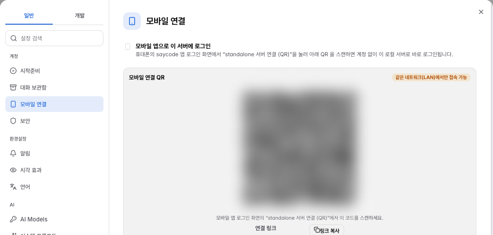

> [!NOTE]
> **조건**: Saycode 공식 서버의 계정으로 로그인했거나 이 컴퓨터에서 **개인 사용** 중일 때 보입니다. 회사가 따로 운영하는 서버에서는 보이지 않습니다.

1. 휴대폰에 Saycode 모바일 앱을 설치하고 로그인(또는 연결)합니다.
2. 데스크톱에서 **내 설정 → 일반 → 모바일 연결**을 엽니다.
3. 화면의 **QR 코드**를 휴대폰 앱으로 스캔합니다. 계정으로 로그인한 경우 QR이 만료되었다면 **새 QR 만들기**를 누른 뒤 다시 스캔하세요.
4. 개인 사용에서는 **접속 범위**가 표시됩니다. 같은 네트워크에서는 바로 연결되고, 다른 네트워크에서는 **링크 복사**나 터널 버튼으로 연결합니다.

연결하면 같은 작업공간의 대화를 실시간으로 지켜보고, 긴 작업이 끝나는 순간 **모바일 완료 푸시**(내 설정 → 알림)를 받습니다.

---

## 18. 팀과 조직

**로그인하면 팀과 함께 쓰는 기능이 열립니다.** 이 장은 로그인(또는 조직)이 필요한 기능을 한눈에 정리합니다. 로컬 작업공간만으로도 Chat, 프로젝트, 작업트리, 작업 마무리, 작업 영역은 모두 쓸 수 있습니다.

### 18.1 로그인이 필요한 기능

| 기능 | 위치 | 설명 |
|---|---|---|
| 조직 시작과 전환 | 로그인 후 **어느 조직에서 작업할까요?**, 프로필 메뉴 → **조직** | 작업할 조직을 고르고 이 컴퓨터를 조직 작업PC로 등록합니다. |
| 조직 만들기·참여 | **작업공간 만들기**, **초대 코드로 참여**, **내 설정 → 일반 → 다른 조직 참여** | 받은 초대는 수락/거절, 이메일 초대 링크로도 참여합니다. |
| **조직 관리** | 프로필 메뉴 맨 위 | 소유자·관리자 전용 웹 관리 콘솔 — 멤버·팀·권한·모델 정책·감사 로그, **유저 초대**, 보안 준비(2단계 인증, 복구 코드), 운영 → **LLM 사용량·비용** → **사용 명세서**(CSV/인쇄). |
| 프로젝트 공유·함께 작업 | 프로젝트 설정 → **프로젝트 공유**, **함께 작업**(그 밖에 **MCP 서버**, **SSO 로그인**, **환경 마운트**) | 공개 범위·공유 팀 설정, 팀원 초대(프로젝트 소유자). 사이드바 목록은 **전체 / 내 프로젝트 / 함께 작업 / 공유받은 프로젝트**로 거릅니다. |
| 공용 PC·연동 기능 | **PC 공유 설정**, 커넥터·메신저 채널·공개 링크·예약, **사용 문의** | [13](#13-예약), [16](#16-외부-연동확장메신저-채널)장 참고 |
| 조직 AI 계정 | 시작준비 AI 단계, **AI Models**, **AI 사용량** 창 | 조직 Claude 계정 자동 선택·교체, 공용 PC 한도 시 다른 조직 계정으로 이어감, 개인 Claude 이어가기(**이 컴퓨터에서 개인 Claude 계정 사용 허용**) |
| **조직 정책** | **내 설정 → 일반 → 보안** | 관리자가 정한 제한을 확인합니다. 허용 모델만 선택 가능하고 정책에서도 **AI 자동**이 됩니다. |
| 종단간 암호화 | 시작준비, **보안 → 신뢰 기기**, **암호화키 확인** | 대화를 암호화해 신뢰 기기에서만 열 수 있게 합니다. 복구 키는 안전하게 보관하세요. |

조직 관리 콘솔은 웹에서 열리며 멤버·팀·권한·모델 정책·감사 로그 메뉴로 구성됩니다.

> [!TIP]
> 로그인한 뒤에도 이 컴퓨터에서 개인 사용 프로젝트를 병행하고 싶다면 프로필 메뉴 → **개발자 기능 설정** → **standalone 모드 같이 사용하기**를 켜세요. 프로필 메뉴에 **이 컴퓨터에서 개인 사용**이 생기고, 돌아올 때는 **계정으로 돌아가기**를 누릅니다.

> [!NOTE]
> 배포된 앱·리포트 URL을 여는 최종 이용자에게는 좌석이 필요 없습니다. 로컬 프로젝트는 로그인한 뒤에도 그대로 남습니다.

---

## 19. 단축키 모음

**⌘ 대신 Windows는 Ctrl을 씁니다.** 모든 단축키는 **내 설정 → 일반 → 단축키**에서 검색하고 바꿀 수 있습니다. 동작 이름을 누르면 설명이 펼쳐지고, 오른쪽 키 버튼을 누른 뒤 새 조합을 누르면 바뀝니다(Esc로 취소, 바꾼 항목의 **기본값**으로 복원).

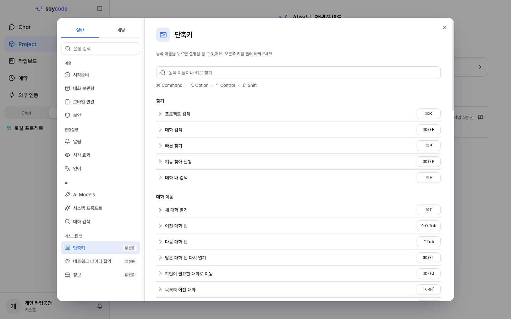

| 구분 | 동작 | 단축키 |
|---|---|---|
| 화면과 이동 | 내 설정 열기 / 사이드바 접기·펼치기 | ⌘, / ⌘B |
| | **빠른 열기**(단축키 화면 이름: 빠른 찾기) / 명령 찾아 실행(기능 찾아 실행) | ⌘P / ⌘⇧P |
| | 프로젝트 검색(사이드바) / **대화 검색**(전체) | ⌘K / ⌘⇧F |
| | 대화 내 검색·터미널 찾기·diff 찾기 | ⌘F |
| | **작업보드** 열기 / 확인이 필요한 대화로 이동 | ⌘⇧A / ⌘⇧J |
| | 새 창 | ⌘N |
| 대화와 탭 | 새 대화(탭) / 탭 닫기 / 닫은 탭 다시 열기 | ⌘T / ⌘W / ⌘⇧T |
| | 다음·이전 대화 탭 | Ctrl+Tab / Ctrl+Shift+Tab |
| | 목록의 이전·다음 대화 | ⌥⇧[ / ⌥⇧] |
| | 고정한 첫 아홉 대화로 이동 | ⌘1 ~ ⌘9 |
| | 보관·고정·숨기기 되돌리기 | ⌘Z |
| 입력창과 AI | 파일·사진 추가 / 대기 요청 즉시 전송 | ⌘U / ⌘Enter |
| | 빈 입력창에서 이전 요청 불러오기 / 프롬프트 검색(macOS) | ↑ / Ctrl+R |
| | 응답 중단 | ⌘. |
| | 다음 모델 / 다음 작업 강도 | ⌘⇧M / ⌘⇧E |
| | 권한 요청 허용·거절 / AI 질문 선택지 | Enter·Esc / 1 ~ 9 |
| 작업 영역 | 작업 패널 접기·펼치기 / 터미널 열기 | ⌘⇧B / Ctrl+\` |
| | 오른쪽·아래에 새 대화 / 터미널 / 브라우저 | ⌘⌥C / ⌘⌥T / ⌘⌥B |
| | 파일 저장 | ⌘S |

---

## 20. 문제 해결과 FAQ

### 20.1 대화 상태 읽는 법

| 표시 | 뜻 |
|---|---|
| 도는 아이콘 / *응답 중* | AI가 지금 일하는 중입니다. 응답이 끝나도 백그라운드 작업이 돌면 아이콘이 남습니다. |
| *대기* | 다음 지시를 기다리는 중입니다. |
| 주황색 질문 아이콘 / *입력 대기* | 질문·권한 응답을 기다리는 중입니다. **AI가 멈춘 게 아니라 여러분을 기다리는 중**입니다. |
| *완료*·보관됨 | 보관&완료로 정리된 대화입니다. 보관함에서 복원합니다. |

### 20.2 업데이트하기

- 새 버전이 나오면 **알림 카드**에서 다운로드 진행률과 **재시작**이 보입니다. 프로필 메뉴 → **업데이트 확인** → **업데이트 내려받기** → **재시작해서 업데이트**로 직접 해도 됩니다. **내 설정 → 일반 → 정보 → 업데이트 확인**도 같습니다.
- 여러 버전이 밀렸다면 최신 버전으로 한 번에 설치합니다. 재시작 뒤 **New Updated!** 카드(영문 표시)의 **Release notes**에서 바뀐 내용을 앱 언어로 봅니다.
- 앱을 끌 때 응답 중인 대화나 예약 작업이 있으면 알려 줍니다(**종료 / 취소**).

### 20.3 도움 요청하기

- **진단 정보 저장** — macOS 메뉴 막대 **Help → 문제 해결 → 진단 정보 저장…**, 또는 **내 설정 → 일반 → 정보 → 문제 해결 → 진단 정보 저장…**(Windows도 이 경로). 토큰·이메일·사용자 이름을 가린 zip이 저장됩니다. 보내기 전에 내용을 한 번 확인하세요. **버전 정보 복사**로 앱·OS·데몬 버전을 복사할 수 있습니다.
- **Help → 새 소식**에서 릴리스 노트를 읽습니다.
- [로그인] 프로필 메뉴 → **사용 문의** / 개인 사용에서는 **카카오톡 문의**.
- 문의: [saycode.ai](https://saycode.ai) · 기술 문의 [ryan@buzzni.com](mailto:ryan@buzzni.com)

### 20.4 자주 묻는 질문

**Q. 대화를 시작하려는데 입력창이 비활성이고 안내만 나옵니다.**
A. 온라인 작업PC나 연결된 AI가 없다는 뜻입니다. 안내의 **작업PC 설정 열기** / **내 AI 연결**을 누르거나 [시작준비](#2-시작준비)를 다시 여세요. 작성 중인 글과 첨부는 그대로 보존됩니다.

**Q. AI 연결이 안 됩니다 / 유료 AI 계정이 없어요.**
A. **내 설정 → 일반 → AI Models**에서 **연결하기**로 Claude·ChatGPT를 연결하거나 **무료 모델로 시작하기**(Opencode)를 쓰세요([7.5](#75-무료-모델로-시작하기-opencode)). 무료 모델의 사용 한도는 [20.5](#205-무료-모델로-얼마나-쓸-수-있나요)를 보세요. 로그아웃된 ChatGPT는 행의 **… → 계정 풀에서 복원**을 먼저 시도하세요.

**Q. 작업보드·CPU·메모리 같은 메뉴가 안 보여요.**
A. 프로필 메뉴 → **개발자 기능 설정**에서 해당 스위치를 켜야 합니다([3.4](#34-개발자-기능-설정)).

**Q. 예약 만들기, 메신저 채널, 커넥터, 공개 링크 만들기가 안 돼요.**
A. 로그인이 필요한 기능입니다. 메뉴나 버튼은 보여도 개인 사용에서는 쓸 수 없으니 프로필 메뉴 → **로그인**으로 로그인하세요([18장](#18-팀과-조직)).

**Q. 미리보기가 비어 있어요.**
A. 프로젝트 설정 → **개발** → **실행**에 개발 서버 명령·포트를 저장했는지 확인하세요. 없으면 AI에게 *"개발 서버를 켜두고 미리보기로 볼 수 있게"*라고 요청하거나 터미널에서 서버를 켠 뒤 **브라우저**에 `http://localhost:<포트>`를 입력하세요.

**Q. 대화를 실수로 보관했어요.**
A. 보관 직후 10초 안에 **되돌리기** 또는 ⌘Z. 시간이 지났다면 **내 설정 → 일반 → 대화 보관함**에서 **복원**하세요.

**Q. 답변이 중간에 끊겼어요.**
A. 끊긴 이유가 안내 줄에 나오고 **이어서 하기**(직접 중단했다면 **다시 시도**)를 누르면 이어집니다. 사용 한도에 걸렸다면 초기화 시각에 다시 시도하거나 다른 계정·AI로 이어가세요([7.4](#74-ai-사용량-창)).

**Q. 작업트리를 지웠어요 / 같은 일을 반복하다 AI가 멈췄어요 / 막힌 것 같아요.**
A. 지운 작업트리는 작업트리 창의 **스냅샷 보관함 → 복원**([11.6](#116-작업트리-안전망)). 반복 감지로 멈췄다면(**개발 자동화**의 **같은 일을 반복하면 세션 자동 중지**) 요청을 더 작게 쪼개거나 <strong>독립 리뷰 요청…</strong>으로 다른 AI의 시각을 받아 보세요.

### 20.5 무료 모델로 얼마나 쓸 수 있나요?

**공식적으로 확인된 것**: OpenCode Zen 문서(2026년 11월 1일 확인)는 무료 모델 대부분을 "기간 한정"으로 소개하며, **하루 토큰 수나 요청 횟수 같은 한도를 공개하지 않습니다.** 무료 모델은 OpenCode를 통해서만 쓸 수 있고, 어떤 모델이 얼마나 오래 무료일지는 바뀔 수 있습니다.

**참고치 (비공식)**: 사용자들이 GitHub 이슈([anomalyco/opencode#15585](https://github.com/anomalyco/opencode/issues/15585) 등)에 남긴 관측은 대략 다음과 같습니다.

- 한도는 **하루 단위**이고 **현지 시간 자정에 초기화**되는 것으로 보입니다.
- 하루 사용량은 **약 0.3달러어치(토큰으로 대략 30만~50만 개)** 안팎이라는 추정이 많습니다.
- 짧은 시간에 몰아 보내면 **분당 15~20회 안팎**에서 잠시 제한되는 경우가 보고됩니다.

> [!NOTE]
> 위 숫자는 **사용자 관측과 추정일 뿐**입니다. OpenCode는 공식 한도를 공개하지 않았고 확인해 주지도 않았으며, 모델과 시기에 따라 **언제든 바뀔 수 있습니다.** 이 가이드가 보장하는 값이 아니니 계획의 근거로 삼지 마세요.

**한도를 넘으면**: 응답에 `Free usage exceeded`(무료 사용량 초과) 같은 안내가 나올 수 있습니다. Saycode는 무료 모델 한도에 걸리면 다른 무료 모델로 **최대 3번까지 자동 전환**하고, 유료 모델로는 절대 넘어가지 않습니다. 그래도 막히면 다음 중 하나를 고르세요.

1. **초기화를 기다립니다.** 다음 날 자정(현지 시간) 이후 다시 시도합니다.
2. **다른 무료 모델로 바꿉니다.** 입력창 아래 AI 메뉴에서 Opencode의 다른 `무료` 모델을 직접 고릅니다([7.5](#75-무료-모델로-시작하기-opencode)).
3. **유료 AI를 연결합니다.** **내 설정 → 일반 → AI Models → 연결하기**에서 Claude나 ChatGPT를 연결하면 한도 걱정 없이 이어 갈 수 있습니다([2.2](#22-ai-연결하기)).

> [!WARNING]
> 회사·고객 코드나 기밀 자료는 제공사가 **입력을 보관하지 않고 학습에도 쓰지 않는다**고 밝힌 무료 모델만 쓰거나, 유료·조직 AI를 연결해 쓰세요. 모델별 정책은 [OpenCode Zen 문서](https://opencode.ai/docs/zen/)에서 확인합니다.

---

## 부록 A. 바뀐 용어표

v0.1.50 전후 화면에 익숙한 분을 위한 대응표입니다. (영어 화면은 그대로인 항목이 많습니다.)

| 옛 이름 | 지금 이름 | 위치·비고 |
|---|---|---|
| 환경설정 | **내 설정** (일반 / 개발) | 프로필 메뉴 → 내 설정, **⌘,** |
| 기획 시작(Build) | Build 탭 입력창 | 사이드바 Project → Build |
| Review 패널 | **변경** | 작업 패널 추가 |
| Quick Open | **빠른 열기** | 단축키 화면에서는 "빠른 찾기" |
| 온보딩 체크리스트 | **시작준비** | 내 설정 → 일반 → 시작준비 |
| 머신 / 로컬 머신 | **작업PC** | 내 설정 → 개발 → 작업PC |
| 공유·공용 머신 | **공용 PC** | |
| 에이전트 / Agent | **AI도구** | |
| Default (모델) | **자동** (**AI 자동**) | 입력창 아래 한 버튼 |
| AI 선택 + 모델 + 추론 강도 | **한 버튼 두 단계 메뉴** (AI → 모델 / **작업 강도**) | 입력창 아래 줄 |
| 대화 헤더 AI 잔량 칩 (`✱ 71%/17%…`) | 입력창 아래 **AI 잔여량** 버튼 → **AI 사용량** 창 | "AI 잔여량 보이기" 스위치는 사라지고 항상 표시 |
| AI 연결 설정 | **AI Models** | 내 설정 → 일반 |
| Saycode 홈 · 홈의 Chat/Build/Develop 탭 | 사이드바 **Chat** / **Project**(안의 **Build** / **Develop**) | |
| 새 프로젝트 / 기존 폴더 열기 / Git URL에서 복제 / ZIP으로 가져오기 | **프로젝트 만들기** 창의 **새 프로젝트 / Git 저장소 / ZIP·파일 / 기존 폴더** 탭 | Develop 카드는 **코드 저장소 가져오기 / Zip/파일 가져오기 / 머신 폴더 사용하기** |
| 계정 영역 · ⋯ 메뉴 · 테마(라이트·다크·자동) | **프로필 메뉴** · **다크 모드** 스위치 | AI 잔여량·CPU 표시 스위치는 **개발자 기능 설정**으로 |
| 작업 보드 | **작업보드** (기본 숨김) | 개발자 기능 설정 → 작업보드 메뉴 보이기 |
| 작업 마무리 허브 창 | 입력창 위 줄 **작업 마무리** 메뉴 | |
| 현재 에이전트로 점검 / 셀프 리뷰 | **작업 리뷰하기** | 반복 횟수는 **고급 설정…** |
| 독립 리뷰어에게 맡기기 | **독립 리뷰 요청…** | **리뷰 기록** 탭 |
| Commit & PR | **PR 올리기** | 작업보드 카드·오토파일럿 쪽 표기는 **Commit & PR** 그대로 |
| 완료 처리 / 완료로 이동 | **보관&완료** | |
| 보관된 대화 | **대화 보관함** | 내 설정 → 일반 → 대화 보관함 |
| 세션 ID 복사 | **대화 ID 복사** | |
| 전역 일시정지 | **자동 작업 일시정지** | 내 설정 → 일반 → 보안 |
| 자주 쓰는 프롬프트 / Quick Commands (핀 아이콘) | **내 프롬프트** (책갈피 아이콘, **입력 저장**) | |
| 작업 사본 (worktree) | **작업트리** (새 대화 체크박스는 **워크트리**) | |
| 파일 체크포인트 보호 | **파일 복원지점** | 새 대화 ⋯ 메뉴 |
| 커밋 | **변경기록** | **변경기록 남기기** |
| 산출물 | **작업물** | **작업물 모아보기** |
| 요소를 선택해 채팅으로 보내기 | **요소를 골라 주석 트레이에 담기** → **모두 보내기** | Shift+클릭은 즉시 전송 |
| 헤더 ⋯ 다른 에이전트로 이어가기 | 프로젝트 도구 → **대화 이어가기** → **다른 AI도구로 이어가기** | |
| 어떻게 사용하시겠어요? 개인 사용 / 조직 사용 | 시작 화면의 **개인 사용** / **로그인** | 조직 사용 = 로그인 |
| 머신 등록 | **작업PC 등록** | |

---

## 부록 B. 메뉴·설정 지도

본문에서 다루지 않은 메뉴·버튼 이름을 한곳에 모았습니다. 찾는 이름이 있을 때 사전처럼 쓰세요.

### B.1~B.2 내 설정의 메뉴

내 설정(프로필 메뉴 → **내 설정**, ⌘,)의 왼쪽 메뉴입니다. [로그인] 표시가 있는 메뉴는 개인 사용에서는 보이지 않습니다.

#### B.1 일반 영역 메뉴

| 묶음 | 메뉴 (자세한 설명) |
|---|---|
| 계정 | **시작준비**([2장](#2-시작준비)) · **프로필**[로그인] (표시 이름, 소속 팀) · **대화 보관함**([10장](#10-대화-관리)) · **모바일 연결**([17장](#17-작업pc와-모바일)) · **보안**([14장](#14-권한승인보안)) · **다른 조직 참여**[로그인] · **토큰 사용량**[로그인] (개요·프로젝트별·모델별·출처별 사용량과 예상 비용) · **커넥터**[로그인] · **메신저 채널**[로그인] ([16장](#16-외부-연동확장메신저-채널)) · **스킬**[로그인] |
| 환경설정 | **알림**([14장](#14-권한승인보안)) · **시각 효과**(다크 모드, 화면 효과 자동/전체 효과/효과 줄이기) · **언어** |
| AI | **AI Models**([7장](#7-ai모델작업-강도와-사용량), 무료 모델은 [7.5](#75-무료-모델로-시작하기-opencode)) · **시스템 프롬프트**·**내 채팅 개인화**([15장](#15-메모리교훈시스템-프롬프트)) · **대화 검색**([10장](#10-대화-관리)) |
| 데스크톱 앱 | **단축키**([19장](#19-단축키-모음)) · **네트워크 데이터 절약**(테더링·종량제에서 백그라운드 데이터 줄이기) · **정보**(버전, **업데이트 확인**, **문제 해결**, [20장](#20-문제-해결과-faq)) |

#### B.2 개발 영역 메뉴

| 메뉴 | 설명 |
|---|---|
| **작업PC** | 작업PC 목록·등록·공유([17장](#17-작업pc와-모바일)) |
| **확장** | 공식 확장 설치·활성화, 로컬 파일 설치([16장](#16-외부-연동확장메신저-채널)) |
| **터미널** | 앱 안 터미널 글꼴·글자 크기, **입력 미리 표시** |
| **개발 자동화** | 오토파일럿·AI 심사·반복 감지 자동 중지 등([11](#11-작업-마무리)·[12](#12-작업보드)·[14장](#14-권한승인보안)) |
| **환경 변수**[로그인] · **저장소**[로그인] | 환경 변수·비밀 값, GitHub·GitLab 계정 연결 |
| **메모리** | AI의 기억 관리, 기억 보호 규칙([15장](#15-메모리교훈시스템-프롬프트)) |
| **개발자 기능 설정** | 숨겨진 기능 스위치([3.4](#34-개발자-기능-설정)) |

### B.3 입력창 아래 줄과 위 줄

| 요소 | 설명 |
|---|---|
| **AI 자동** (또는 `Claude Code · 자동`처럼 고른 AI·모델 버튼) | AI·모델·작업 강도를 **한 버튼**에서 고릅니다. 새 대화의 기본은 **AI 자동**입니다 → [7장](#7-ai모델작업-강도와-사용량) |
| **AI 잔여량** (서비스별 남은 비율, 예: `86%/72%`) | 누르면 계정별 남은 사용량 창이 열립니다 → [7.4](#74-ai-사용량-창) |
| `컨텍스트 N%` | Claude 대화가 컨텍스트 창을 얼마나 채웠는지. 80% 이상이면 새 대화나 `/compact`를 권합니다. |
| **CPU·메모리** [개발자] | 작업PC 상태 요약(개발자 기능 설정에서 켬) |
| 작업PC 이름 | 이 대화가 실행되는 컴퓨터와 연결 상태 |

| 요소 | 설명 |
|---|---|
| **저장소** | 입력창 위 오른쪽의 작은 **저장소** 버튼이 브랜치·워크트리 같은 저장소 도구 줄을 접고 펼칩니다. 원격 저장소가 없으면 브랜치 이름 옆에 **저장소 연결하기**가 나옵니다. |
| **워크트리** 체크박스(줄 오른쪽) | 새 대화에서 켜면 이 대화만의 **작업트리**(복사본 작업 폴더)에서 일합니다. 옆 방식 버튼에서 **새로 만들기 / 기존 항목 사용 / PR에서 시작 / 이슈에서 시작**을 고르고, **Base** 버튼으로 기준 브랜치를 정합니다. |
| **지금 변경사항 가져가기** | 방식이 **새로 만들기**일 때, 프로젝트 폴더의 커밋하지 않은 변경과 새 파일을 새 작업트리로 한 번 복사합니다. 원래 폴더는 그대로입니다. |
| 브랜치 이름 + **PR 번호 칩** | 누르면 **가져오기 (pull)**, **보내기 (push)** 와 Git 상태를 봅니다. PR 번호 옆 배지로 열림·병합됨·닫힘, CI 실패를 확인합니다. |
| **목표** | `/goal`로 건 목표가 한 줄로 보이고 **목표 바꾸기 / 목표 지우기**를 쓸 수 있습니다. |
| **자식 AI도구 실행 중**(서브 에이전트) | AI가 만든 자식 대화가 돌아가는 동안 작업 이름과 함께 표시됩니다. |
| **작업 마무리** | 대화를 시작한 뒤 줄 오른쪽 끝에 나타나는 로봇 아이콘 버튼 → [11장](#11-작업-마무리) |

> [!NOTE]
> 작업트리·**지금 변경사항 가져가기**는 **Git 저장소 프로젝트**에서만, 그리고 **아직 보내지 않은 새 대화**에서만 설정할 수 있습니다. 새 대화를 열 때 직전에 켰던 **워크트리** 체크가 그대로 켜져 있을 수 있으니 보내기 전에 확인하세요. Windows 작업PC에서는 스냅샷·변경 가져가기·대화 옮기기가 아직 지원되지 않습니다.

### B.4 입력창의 + 메뉴와 ⋯ 메뉴

**+ (추가)**

| 메뉴 | 하는 일 |
|---|---|
| **파일 또는 사진 추가** (⌘U) | 파일·사진을 첨부합니다. 입력창으로 끌어다 놓아도 됩니다. 이 기기에 총 1GiB까지 저장되고, 보내기 전 첨부는 대화를 옮기거나 앱을 다시 켜도 복원됩니다. |
| **폴더 추가** | 폴더를 통째로 첨부합니다. |
| **이번 요청에 브라우저 사용** [개발자] | **AI 브라우저 메뉴 보이기**를 켠 경우, 이번 요청에서 AI가 브라우저를 쓰게 합니다. |

**⋯ (대화 추가 옵션)**

| 메뉴 | 하는 일 |
|---|---|
| **프롬프트 검색** | 전에 보낸 요청과 첨부 경로를 검색해 입력창에 넣습니다. macOS에서는 Ctrl+R도 됩니다. |
| **Auto Router** | 모델 자동 지정이 켜져 있는지 보여 줍니다. *새 대화에서만* |
| **파일 복원지점** | AI가 파일을 바꿀 때마다 상태를 기록해 되돌릴 수 있게 합니다 ([11.7](#117-파일-복원지점과-변경기록)). *새 대화에서만, macOS·Linux 작업PC, 동시작업과 함께 쓸 수 없음* |
| **프로젝트 허브로 설정** | 이 대화가 같은 프로젝트의 다른 대화들이 끝났다는 소식·질문을 모아 받는 허브가 됩니다(프로젝트마다 하나). *새 대화에서만* |
| **동시작업** | 같은 요청을 여러 대화로 동시에 시작해 결과를 비교합니다. 후보 수와 함께 돌릴 AI를 정합니다. *Git 프로젝트 + 워크트리 새로 만들기 필요* |

---

더 궁금한 것이 있나요? [saycode.ai](https://saycode.ai) · 기술 문의 [ryan@buzzni.com](mailto:ryan@buzzni.com)

**© 2026 [Buzzni](https://buzzni.com)**

<!-- images: icon.png, start-screen.png, first-run.gif, personal-use-confirm.png, login-signup.png, login-selfhost.png, onboarding-checklist.png, ai-connect-picker.png, onboarding-free-model.png, settings-onboarding.png, sidebar-crop.png, profile-menu-crop.png, settings-search-alias.png, dev-features-toggle-on.png, home-chat.png, chat-plus-menu-crop.png, doc-templates.png, result-file-card.png, chat-result-html-panel.png, home-develop.png, home-build.png, create-project-modal-new.png, create-project-modal.png, project-new-chat.png, build-by-chat.gif, project-chat.png, composer-queue.png, composer-ai-menu.png, composer-ai-menu-effort.png, auto-route-badge.png, settings-ai-models.png, ai-usage-popover-crop.png, workspace-add-panel.png, files-panel.png, workspace-diff.png, workspace-diff-turns.png, annotation-tray.gif, browser-panel.png, conversation-summary.png, sidebar-conversation-menu-crop.png, archive-undo-toast.png, settings-archive.png, conversation-continue-menu.png, quick-open-commands.png, work-finish-menu.png, independent-review-modal.png, worktree-snapshots.png, git-actions-dialog.png, worktree-manager.png, agent-board.png, agent-board.gif, agent-board-filter.png, schedule-guest-empty.png, settings-notifications.png, settings-security.png, settings-system-prompt.png, integrations.png, settings-workpc.png, mobile-companion-crop.png, settings-shortcuts.png -->
