

# Saycode Desktop User Guide

**From installation to project work to wrapping up — just follow along, in order.**
*Based on the v0.1.81 UI · November 2026*

**English** | [한국어](GUIDE.ko.md)

<!-- guidebook: version=v0.1.81 date=2026-11-01 -->

---

## How to read this guide

Saycode Desktop is a desktop app that lets AI create files, edit code and run commands for real, on your computer (or on another computer you connect). This guide is ordered so that **a first-time user can read from top to bottom and follow along**. If you already use the app, read only the chapters you need. If you know the older UI (around v0.1.50), start with the [Renamed terms](#appendix-a-renamed-terms) at the very end.

> [!NOTE]
> Screenshots in this guide show the Korean UI; labels in the text are the English UI labels. Switch language at the bottom of the start screen or in **My settings** → **General** → **Language**.

### What this guide is based on

- **Version**: Saycode Desktop **v0.1.81** (November 2026). Screen names and locations may differ slightly in later updates.
- **Operating system**: Explanations follow the macOS UI. On Windows, use **Ctrl** instead of **⌘** in shortcuts; features that are limited on Windows are noted where they appear.
- **UI language**: Labels are written exactly as they appear in the English UI. Screenshots show the Korean UI.

### Notation

| Notation | Meaning |
|---|---|
| **Bold text** | The exact name of a button, menu or tab as it appears on screen. |
| Profile menu → **My settings** → **General** | A path to click through, in order. |
| `Code-style text` | A value you type, or keys you press. |
| **[Signed in]** | A feature that is visible only when you are signed in with a Saycode account. It does not appear in **Personal use**, where you work without signing in. |
| **[Organization]** | A feature that requires belonging to an organization (team). |
| **[Developer]** | A feature that appears only after you turn it on under **Developer feature settings** in the profile menu. |

> [!NOTE]
> Each chapter follows the order "what you can do → requirements → steps → tips". The **requirements** (sign-in, organization, developer feature settings, server support, macOS/Windows) come before the steps, so if a menu is missing, check the requirements first. The screenshots were taken in **Personal use** (without signing in); parts that differ only for signed-in accounts are marked separately. The screenshots were taken with the [Developer] **Show Work board menu** and **Show CPU & memory** switches on. In a freshly installed app, the sidebar has no **Work board** and no CPU/memory readout appears under the composer ([3.4](#34-developer-feature-settings)).

---

## 0. Saycode at a glance

**Saycode is an app where "AI agents work on my machine while I watch on screen and steer."** Learn a few terms that will keep coming up and the later chapters get much easier.

### Key terms

| Term | In plain words |
|---|---|
| **Machine** | The computer where the AI actually creates files and runs commands. At first, the computer you are using automatically becomes your machine, and you can register servers or other PCs as well. |
| **Agent** | The AI program that does the actual work: **Claude Code**, **Codex**, **Opencode**, **Grok** and so on. You either leave the choice to **AI Auto** or pick one yourself. In Chat they may appear as Claude and ChatGPT, and the step name in Getting started is written "AI tools" (the same thing). |
| **Runner (runtime)** | The Saycode program that actually runs the AI on your machine. When it gets old, some features turn gray and are disabled, with the reason shown. |
| **Organization policy** | Usage limits set by an organization admin (allowed models, tool rules and so on). Personal use has none. |
| **Model** | The kind of brain you pick inside an agent, from light, fast models to top-tier models for hard problems. |
| **Effort** | The level that decides how deeply the AI thinks before answering (for example Low to Max). The higher it is, the longer the AI thinks. |
| **Chat** | The place to ask questions right away, without a project, and to create documents, tables and presentations. |
| **Project** | A unit that connects one folder (usually a Git repository) and lets you build and edit code in many conversations inside it. |
| **Conversation** | One flow of back-and-forth work with the AI. Inside a project, each conversation runs and is stored separately. |
| **Worktree** | A **copy of the working folder** (a branch) just for one conversation. Even when several conversations run at once, their files never get mixed up. The checkbox in a new conversation is labeled **Work copy**. |
| **Commit** | A Git commit. Use **Commit** to save your edits so far. |
| **Artifact** | A result file the AI creates during a conversation, such as a document, image or HTML page. The old name was "Outputs". |
| **My settings** | All the app's settings screens. The old name was "Settings"; the shortcut is still **⌘,**. |

### Chat vs. Project: what's the difference?

| | **Chat** | **Project** |
|---|---|---|
| Used for | Questions, writing, creating documents, tables and presentations | Building and editing apps and code |
| Where work happens | A working folder created automatically for each conversation | The project folder you connected |
| Files, changes, terminal and browser panels | Mainly for viewing result files | All available |
| Worktree, PR, Work completion | Not available | Available (for Git projects) |
| Conversation summary rail, auto-archive | Not available | Available |

> [!TIP]
> If you are new, try **asking light questions in Chat** first, and move on to **Project** once you are comfortable.

### One round of work

1. **Prepare** — Install the app, choose **Personal use** on the start screen, and connect an AI in [Getting started](#2-getting-started).
2. **Start** — Ask a question in [Chat](#4-work-without-a-project-in-chat), or [create a project](#5-create-a-project) and open a conversation.
3. **Instruct** — Make a request in one sentence in the [composer](#6-project-conversations-and-the-composer). You can leave the AI and model to **AI Auto**.
4. **Check** — Look at files, changes and the preview in the [workspace](#8-the-workspace), and ask for fixes with [See it, fix it](#9-see-it-fix-it).
5. **Wrap up** — In the [Work completion](#11-work-completion) menu: review → Commit & PR → Archive & Done.

---

## 1. Install and first run

**Install the app, then choose "how to start" on the first screen.** There are three ways: **Personal use**, which works right away without an account; **Login** with an account; and **Connect to a self-hosted server**, which connects to a server you run yourself.

### 1.1 Install

1. **[Download the latest installer.](https://github.com/buzzni/saycode-desktop-releases/releases/latest)** For macOS there are separate DMGs for Apple Silicon and for Intel Macs (x64). For Windows, download the installer.
2. On macOS, open the DMG and drag **Saycode** into the Applications folder. On Windows, follow the setup wizard and press **Finish** on the last screen to open the app (to avoid opening it right away, clear the launch checkbox).
3. The app is signed and notarized, and it tells you when a new version is available (see [Update the app](#20-troubleshooting-and-faq)).

### 1.2 The start screen

When you open the app without being signed in, you see the screen below.

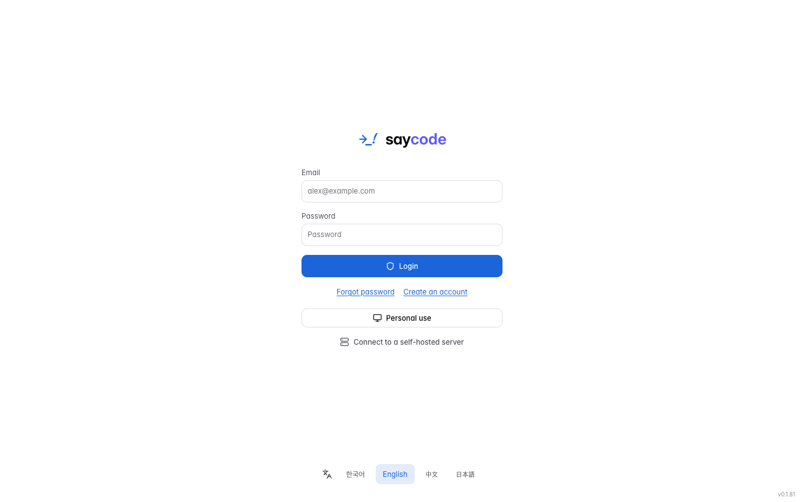

| Location | Name | Purpose |
|---|---|---|
| Top | **Email** · **Password** · **Login** | Sign in with a Saycode account. If you use an organization (team), this is the way in. |
| Below Login | **Forgot password** · **Create an account** | Sign up inside the app or reset your password. |
| Middle | **Personal use** | Start right away on your PC, with no account. |
| Bottom | **Connect to a self-hosted server** | Connect to a Saycode server you run yourself, using a connection code. |
| Bottom of the screen | **한국어 / English / 中文 / 日本語** | The app language. It changes immediately when you click, and you can change it later in **My settings** → **General** → **Language**. |

### 1.3 Option ① Personal use — start without an account

**Requirements**: none. It appears only on the first screen when you are not signed in. In this mode, conversations and projects are stored **only on this PC**.

1. On the start screen, click **Personal use**.
2. When the "Personal use (connect my PC)" window appears, read the notice and click **Confirm**. To cancel, click **Cancel**.
3. Saycode prepares a workspace on this PC. The first time, it can take about 10 to 30 seconds.
4. When it is ready, the **"Let’s get your first task ready"** window opens automatically → this leads on to [Chapter 2, Getting started](#2-getting-started).

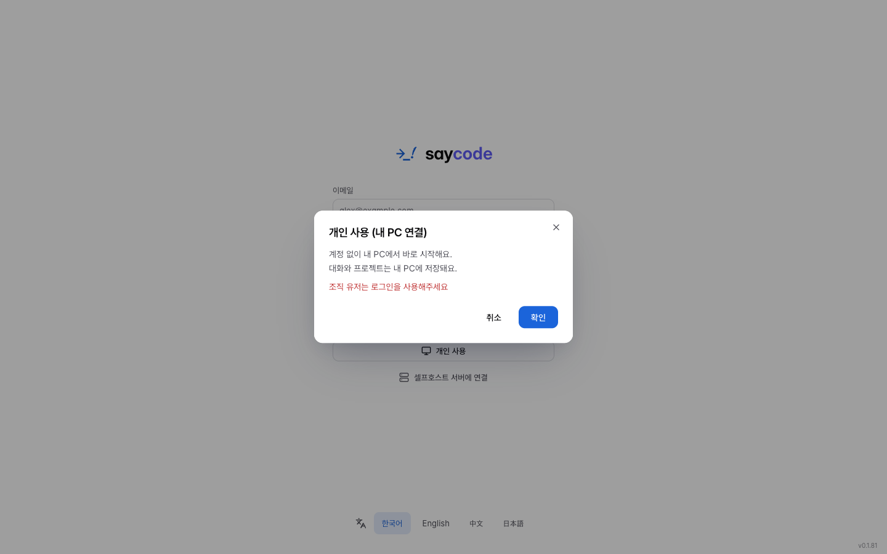

> [!NOTE]
> The line "Organization users, please sign in." in the window means **if you belong to an organization, you need to come in with Login, not Personal use**.

> [!TIP]
> If you get an account later, you can switch to it from the profile button at the bottom of the sidebar → **Login** and use team features. Local projects you created in Personal use stay as they are after you sign in.

### 1.4 Option ② Login — start with an account

**Requirements**: You need a Saycode account. If you do not have one, create it inside the app as follows.

1. Click **Create an account**.
2. Enter your **Email** to receive a verification code. A **6-digit verification code** arrives in your inbox (check spam too); enter it.
3. Enter **Password** and **Confirm password** to finish signing up.

4. Enter the **Email** and **Password** of the account you created and click **Login**.

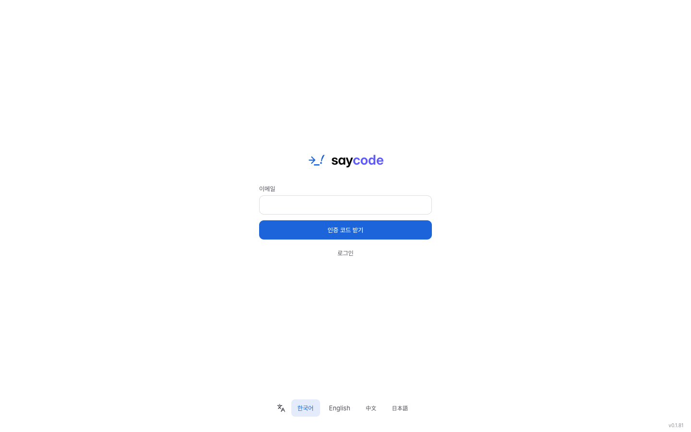

If you forgot your password, the order is **Forgot password** → enter your **Email** → **Send verification code** → enter the 6-digit code → **New password** and **Confirm password** → **Change password** → **Back to sign in**.

> [!NOTE]
> The password reset code is valid for **10 minutes** and can be checked up to 5 times. You can press **Resend** after 60 seconds, and once you get a new code the earlier one no longer works. You are not signed in automatically after the change, so sign in again.

#### Start with an organization [Organization]

If you sign in with an organization account, the **"Which organization will you work in?"** screen appears.

1. Choose the organization to work in from the list. If you do not belong to any organization, create one with **Create a workspace**, accept an invitation you received, or enter a code in **Join with an invite code** and click **Join organization**.
2. Click **Next**. Saycode prepares the tools it needs, registers this computer as the organization's machine, and checks the AI connection.
3. When it is ready, click **Complete**.

> [!TIP]
> If computer setup is stuck or you do not want to register right now, click **Start without this computer**. You enter the app immediately and can register later at **My settings** → **Develop** → **Machines** → **Register my computer**. If the organization has another online machine, you can chat on that machine.

### 1.5 Option ③ Connect to a self-hosted server

**Requirements**: A Saycode server you run yourself (started with `saycode server`) and the **owner connection code** created on that server. Most users can skip this.

1. On the start screen, click **Connect to a self-hosted server**.
2. Paste the connection code issued with `saycode server connect` on the server into the **Connection code** field.
3. Click **Connect**.

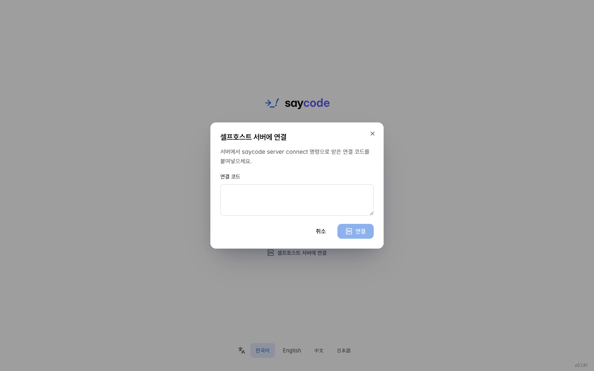

> [!NOTE]
> If you connect to a server that your company runs separately, some settings menus, such as **Getting started** and **Mobile link**, do not appear, and registering a machine works by "running the login command on the new machine and approving the resulting connection code on the server".

---

## 2. Getting started

**This is the first setup that prepares this computer so the AI can work and connects your AI accounts.** When you first enter with Personal use, the **"Let’s get your first task ready"** window opens automatically.

> [!NOTE]
> **Requirements**: A signed-in account sees the organization start screen first instead of this window. If you connected to a server that your company runs separately, the **Getting started** menu does not appear. You can close Getting started and reopen it any time.

### 2.1 The steps

The list on the left is split into **Required setup** and **Additional setup — optional**. When the required setup is finished, "Required setup complete" is shown, and you can do the rest later. However, **you need at least one usable AI connection to start a conversation**. The order of the steps is **Saycode CLI → Saycode instructions → AI tools → Notifications**.

| Group | Step | What it does |
|---|---|---|
| Required | **Saycode CLI** | Prepares the runtime where the AI actually works. It is bundled with the app, so it usually shows **Installed** right away, and **Use the Saycode CLI in your terminal too** (run update) and the install status of **More tools** (**Check again**) are shown with it. Registering this computer as a machine is part of this step too. |
| Additional | **Saycode instructions** | Decides whether to use Saycode's default instructions. You can change it later in **My settings** → **General** → **System Prompt** ([Chapter 15](#15-memory-lessons-and-the-system-prompt)). |
| Additional | **AI tools** | Checks the AI that is connected to this computer (Claude Code, Codex, Opencode and so on). |
| Additional | **Notifications** | Decides whether to play a sound **when the AI asks for input** and **when it finishes work**, and confirms with **Send test notification**. |

The buttons at the bottom are **Back** / **Continue** / **Finish**, and **Do this later** on the left. On the last step, Notifications, **Add your first project** and **Finish** sit side by side, and **Finish** closes the window. The **Run automatically from this step** button appears when there are tools left to install, and it downloads and installs the tools you need.

### 2.2 Connect an AI

The **AI tools** step checks the connection details once when you open it (**Checking connection details…**) and shows **only connected AIs**. Claude and ChatGPT that are already signed in on this computer show as **Connected** without any registration and are used as they are.

If no AI is connected, you see **Connect your AI account.** with the buttons below. (If one is already connected, the list of connected AIs appears instead of this notice.)

1. Click **Connect my AI account** and choose **ChatGPT** or **Claude** (the <strong>Free models (opencode)</strong> choice in the same window follows the free-model steps below).
2. When the browser opens, sign in. Follow the instructions to click the link button and enter the **verification code**.
3. When you come back, the connection status is checked once more and changes to **Connected**.

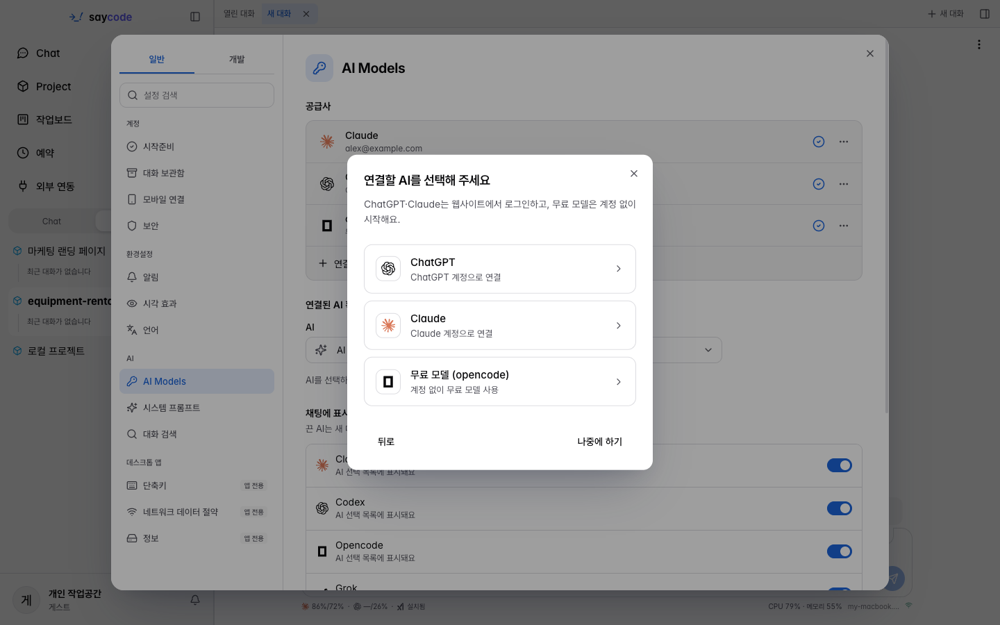

This picker window opens in the same form from **My settings** → **General** → **AI Models** → **Connect**.

If you have no paid AI account, use **Start with free models**.

1. Click **Start with free models**.
2. On the confirmation screen, read the install location and the conditions (offered for a limited time, a retention and training policy that differs by model, and performance that may be lower than paid models).
3. Click **Install and start**. If opencode is already installed, "Uses the opencode already installed here." appears and the button is **Check and start**.
4. When "Ready to start with free models." appears, choose **Opencode** as the agent in a new conversation. If you do not choose a model, a recommended free model is picked automatically for each message.

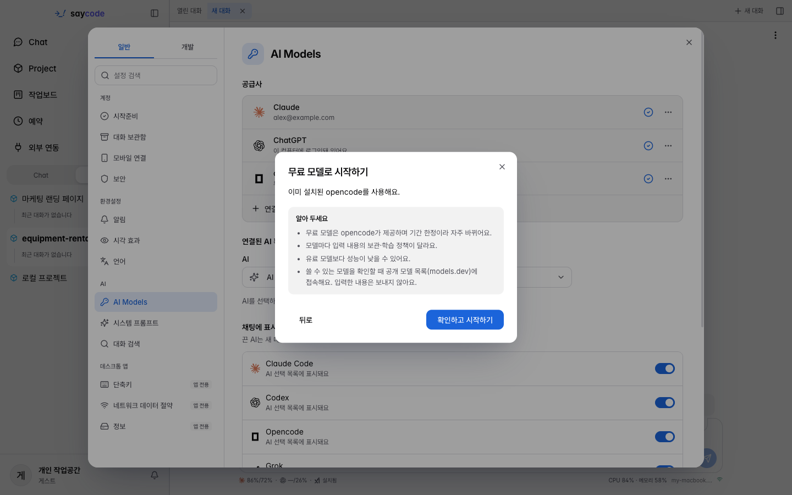

> [!IMPORTANT]
> **Free model conditions**: You can install it only when this computer is your own machine and it is online. If your organization limits the AI you can use, installation is blocked, and it does not appear in Windows trial builds. When you hit a free-model limit, Saycode switches automatically to another free model up to 3 times, and it never moves on to a paid model.

The **AI shown in chat** switch in the same step hides AIs you do not use from the selection list (at least one stays). With an organization account, the AI step shows the **Connect organization accounts**, **Verify encryption key** and **Test message** buttons; check them together with your admin.

### 2.3 Reopen it later

1. Click the **profile button** at the bottom of the sidebar.
2. Open **My settings** → **General** → **Getting started**.
3. If there are tools left to install, click **Run automatically from this step**. If everything is installed (**More tools 7/7 installed**), just check the status and close it with **Finish**.

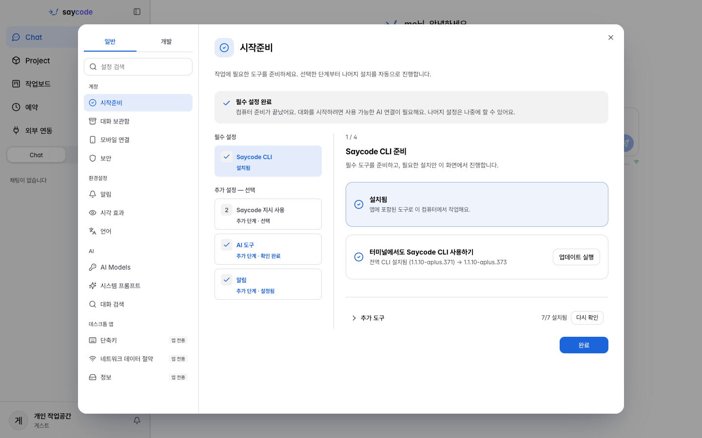

> [!TIP]
> On Windows, Node.js, uv and Git are installed for you automatically. If automatic installation is difficult, choose **I'll install them myself**. If an error appears, click **Error details → Next steps → Installation guide**, and if you need a diagnostic log, copy it with **Copy log** and send it to your admin or support contact.

> [!TIP]
> You can manage AI accounts later in **My settings** → **General** → **AI Models** with **Connect**, and with the **…** menu on a row → **Disconnect** / **Reconnect to Saycode** / **Add account**. For free models, use **…** on the Opencode row → **Install** ([Chapter 7](#7-ai-models-effort-and-usage)).

---

## 3. A tour of the screen

**Saycode starts from the left sidebar, and you open settings from the profile button at the bottom left.** This chapter introduces the three big landmarks on screen.

### 3.1 The sidebar

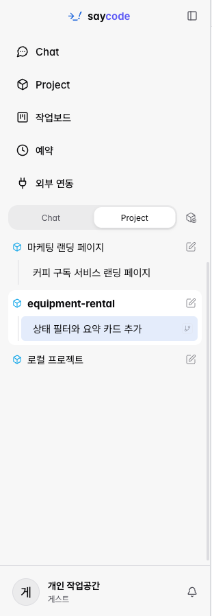

It is organized as follows, from top to bottom.

| Area | Contents |
|---|---|
| **Chat** | The start screen for conversations without a project (`What can I help you with?`) → [Chapter 4](#4-work-without-a-project-in-chat) |
| **Project** | The project home. It has two modes, **Build** (start planning by talking) and **Develop** (start from a repository or folder) → [Chapter 5](#5-create-a-project) |
| **Work board** | A kanban view of all conversations. [Developer] Hidden by default → [Chapter 12](#12-work-board) |
| **Schedules** | The screen for handing work to the AI at set times → [Chapter 13](#13-schedules) |
| **Integrations** | Connect services and install extensions → [Chapter 16](#16-integrations-extensions-and-messenger-channels) |
| **Chat / Project tabs** | Switch the list below between your chat list and your project list. The center screen stays the same when you change tabs. The button to the right of the tabs is New project (a cube with +) in Project and New chat (a pencil) in Chat. |
| Project and conversation list | Click a project to expand its conversation list. The project list shows 30 at a time and each project shows 10 conversations, with **More** to load more. Conversation rows show a worktree icon, the PR number, an orange question icon (waiting for your answer) and a responding icon. |
| **Profile button** at the very bottom | Click the name to open the [profile menu](#32-the-profile-menu). In Personal use it appears as "Personal workspace · Guest". |
| **Bell icon** | **Recent notifications**. Click it to turn on the notification area; clicking a notification takes you to that conversation, and **View all** opens the notification center (**Unread / Read** tabs). |

**List search**: **Scroll up** at the very top of the list and a search box appears (⌘K). In the Project list, the three-dot button on the right of the search box lets you pick the view scope: **All / My projects / Collaborating / Shared with me**.

**Collapse and width**: Collapse and expand with **⌘B**. When collapsed, only the expand / Chat / Project / Schedules / gear (My settings) icons remain on the left. When expanded, drag the right edge to change the width.

> [!TIP]
> Hover over a project row and use the three-dot (⋮) menu to choose **Pin**, **Project settings** and **All chats**. The conversation row menu is covered in [Chapter 10](#10-manage-conversations).

### 3.2 The profile menu

Click the **profile button** at the very bottom of the sidebar to open it.

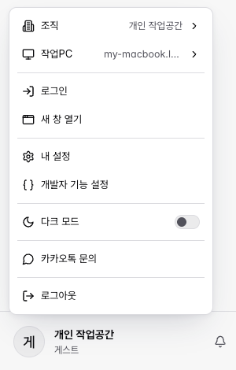

| Item | Description |
|---|---|
| **Select organization** | Switch the organization you work in. In Personal use it shows "Personal workspace", and if your account belongs to several organizations, choose from the list. |
| **Select machine** | Choose the default machine for running new work. It is split into the machines you registered and **Shared machines**, and only machines that are turned on appear. |
| **Login** / **Log out** | In Personal use, **Login** signs you in to an account. While signed in, use **Log out** (press once more in the confirmation window). |
| **New window** | Opens one more app window (⌘N). |
| **My settings** | All settings (⌘,). Explained in [3.3](#33-general-and-develop-in-my-settings). |
| **Developer feature settings** | A set of switches for hidden features → [3.4](#34-developer-feature-settings) |
| **Dark mode** | A switch that turns the dark theme on and off. The menu stays open so you can try it right away. |
| **Ask on KakaoTalk** (when signed in, **Contact support**) | When signed in, **Contact support** (you can attach up to 3 screenshots); in Personal use, **Ask on KakaoTalk** opens an open chat room. |
| **Organization admin** [Organization] | Visible only to organization owners and admins (at the very top of the menu when shown). You verify with your password once more, then the admin window opens → [Chapter 18](#18-teams-and-organizations) |
| **Check for updates** | Visible in official installs. Install a new version with **Download update** → **Restart to update**. |

### 3.3 General and Develop in My settings

When you open profile menu → **My settings** (⌘,), you switch between two areas at the top left: **General** and **Develop**. The left menu of General is divided into the groups **Account / Preferences / AI / Desktop app**. Type what you are looking for into **Search settings** at the top left, such as `dark mode`, `sound`, `pause` or `automatic work`, and only the matching menus are shown (old names work too, for example `checklist` finds **Getting started**). You have to click a menu in the results for the right-hand content to change.

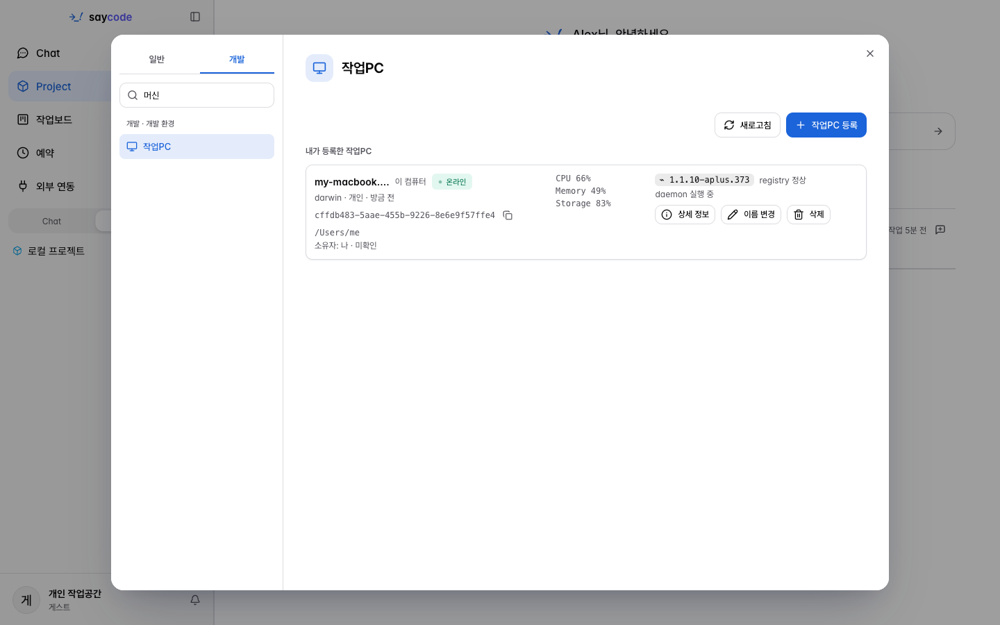

A full map of the menus is in [Appendix B.1 and B.2](#appendix-b-menu-and-settings-map).

> [!NOTE]
> Menus marked [Signed in] do not appear in Personal use. Also, settings that an organization admin turns off are locked and carry the notice "Set by your organization policy, so you cannot change it."

### 3.4 Developer feature settings

Click profile menu → **Developer feature settings** and the switches below open in the **Develop** tab of My settings. All are off by default.

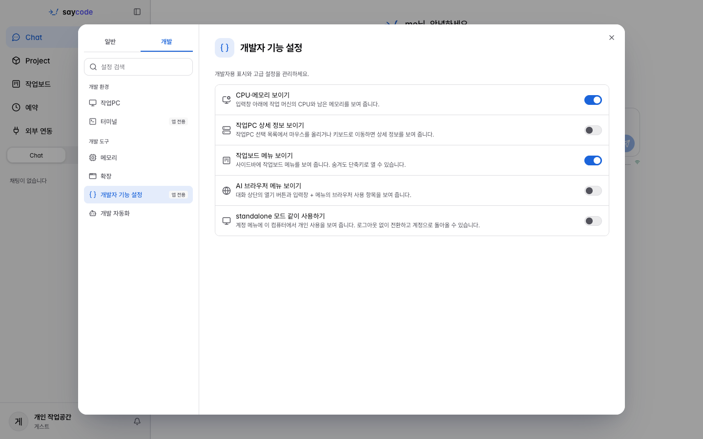

| Switch | When on |
|---|---|
| **Show CPU & memory** | Shows the machine's CPU and memory under the composer. Click it for details such as disk and load |
| **Show machine details** | Shows details on the machine screen |
| **Show Work board menu** | Adds the **Work board** menu to the sidebar ([Chapter 12](#12-work-board)) |
| **Show AI Browser menu** | Menus related to the browser the AI uses (composer **+** → **Use browser for this request**) |
| **Use standalone mode alongside your account** | Use this computer's **Personal use** alongside your signed-in account. After you turn it on, the profile menu gains **Switch to local-only mode**, and **Back to account** to return. |
| **Organization search settings** [Organization] | Organization owners and admins connect a search server for conversations across the whole organization |

---

## 4. Work without a project in Chat

**This is where you ask questions right away, without creating a project, and create documents, tables and presentations.** Conversations are saved and can be continued even in Personal use.

> [!NOTE]
> **Requirements**: To start a conversation you need **one online machine** and **one connected AI**. If either is missing, "Open machine settings" or a blue **Connect my AI** notice appears under the composer ([Chapter 2](#2-getting-started)). Until you are ready the composer looks disabled, but what you have typed is kept.

### 4.1 Send your first question

1. Click **Chat** in the sidebar.
2. Type your request in the center composer (`What can I help you with?`).
3. Send it with the **send button** (paper airplane) on the right of the composer, or with Enter.
4. When the conversation opens, it is added to the list in the sidebar's **Chat tab**, and you can keep asking in the same screen.

Click the **machine name** at the bottom right under the composer to change the machine that runs this Chat (only online machines appear). You cannot change it after the new conversation starts.

> [!TIP]
> Click a **starter card** under the composer (**Make a PDF · Build slides · Write & edit docs · Review a document · Research**) and an example request is filled in. You can also start with your own material using **Upload my file**.

### 4.2 Document formats and templates

When you create an Office document such as DOCX, XLSX, PPTX or PDF, choosing the format and template first makes the result much more reliable.

1. In a new Chat, click the **+** (**Add**) on the left of the composer.
2. In the menu, choose the document format to create — **Document (DOCX) / Spreadsheet (XLSX) / Presentation (PPTX) / PDF document (PDF)**. The same menu also has **Add files or photos** (⌘U), **Add folder** and **Start in existing directory** (use an existing folder on this computer as the working path).
3. A **template gallery** opens above the composer. Choose a default template (**Design Report**, **Minimal Letterhead**) or a personal template you saved. The format you chose shows as a chip above the composer, and you clear it with the chip's ✕.
4. To save your own template, register an Office file and writing instructions with **Create my template**.
5. Type what you want created in the composer and send it. Example: *"Create a Q3 equipment rental status report."*

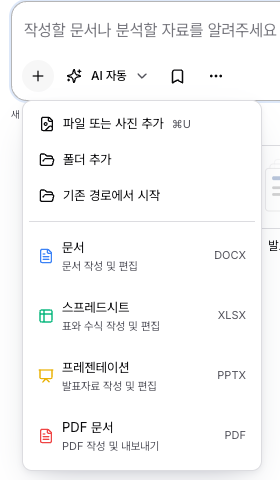

> [!NOTE]
> The default templates work without installing an extension. The source files of personal templates can be used only on an allowed **personal machine**.

### 4.3 View, save and share result files

Files the AI creates appear as **file cards** inside the answer.

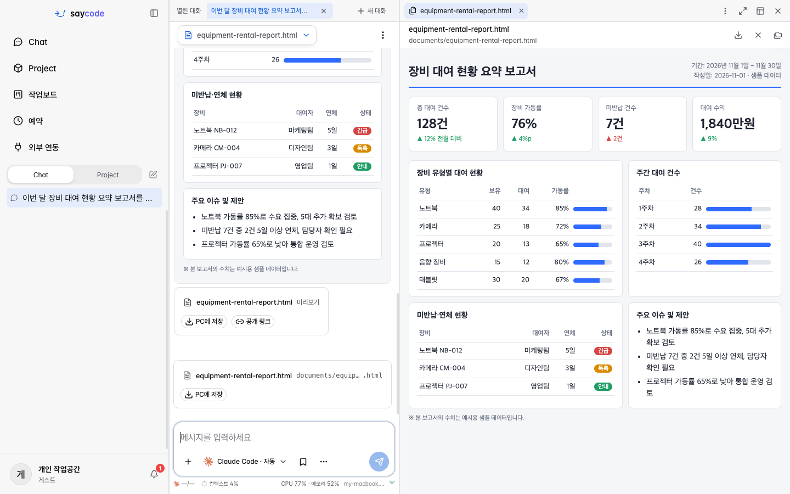

1. Click the **file name** in the answer and the document opens in the right-hand workspace tools panel (DOCX, PDF, HTML, Markdown and images are supported). HTML results show an inline preview in the chat, and sometimes open automatically in the right panel right after they finish.
2. Click **Save to my computer** on the file card to save it to a location of your choice on your computer.
3. **Public link** — The button also appears on HTML result cards in Personal use, but creating and publishing a link requires a [Signed in] account. Click the **Public link** button next to **Save to my computer** and the publishing window opens.
   1. The first time, **Install** appears. One click installs and activates the public-link feature and continues straight on to creating the link.
   2. Choose **Who can open**. The default is **Anyone with the link**; if you choose **Organization only**, organization members must sign in to open it.
   3. Choose **Expires** from 1 day, 3 days, 7 days or 30 days.
   4. Copy the address with **Copy link**. To stop publishing, use **Stop publishing** in the same window.

> [!IMPORTANT]
> **Creating a public link works with a signed-in account.** In Personal use, use **Save to my computer** and viewing inside the app. You cannot click Public link while the AI is answering.

### 4.4 Input features available in Chat

Most of the same features as in project conversations are available in the Chat composer. See [Chapter 6](#6-project-conversations-and-the-composer) for details.

- **+**: **Add files or photos** (⌘U), **Add folder**, **Start in existing directory** (use an existing folder on this computer as the working path)
- While the AI answers, you can put your next request in the **queue**, and you answer the AI's questions with the **question form**.
- `/btw` (side question), `/recap` (summary), `/usage` (AI usage), rendering of code blocks, tables and `[!NOTE]` callouts, and pasted-text cards for long pastes
- [Signed in] You can create a **schedule** by just saying so, for example "Summarize this every day at 9 a.m." ([Chapter 13](#13-schedules)).

> [!TIP]
> When you wonder how to use something, ask in Chat, for example *"Where do I turn on dark mode?"* The Saycode AI answers with in-app guidance and opens the matching settings screen right away. You can turn this off with the **Saycode usage guide** switch under **My settings** → **General** → **System Prompt**.

---

## 5. Create a project

**Connect your folder or repository as a project, and you can build and edit code in many conversations inside it.** You choose among four methods in one window.

> [!NOTE]
> **Requirements**: You need an **online machine** to create the project on. The **Git repository** tab requires a [Signed in] GitHub or GitLab connection (**My settings** → **Develop** → **Repositories**); the other methods work without an account.

### 5.1 The Project menu: Build and Develop

Click **Project** in the sidebar and you see two start modes.

| Mode | When to use it |
|---|---|
| **Build** | Describe what you want to build **in words** and start from planning. Type into the composer (`What would you like to build?`) and send. **Recent projects** cards appear below. |
| **Develop** | For developers who start from a code repository or folder. It has the **Create a project** · **Import code repository** · **Import ZIP/files** · **Use a machine folder** cards and the project list. |

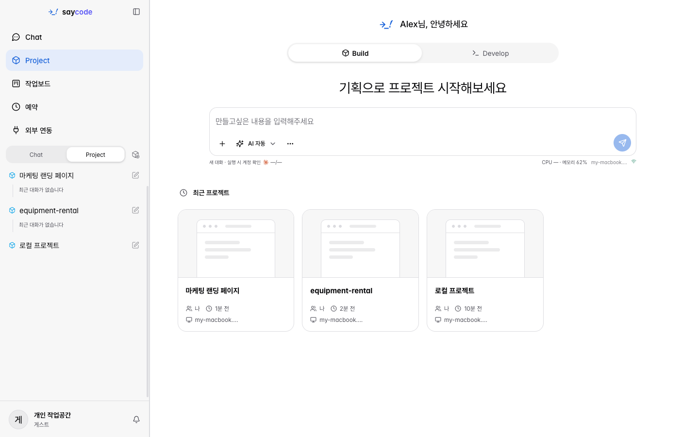

In both modes, click the **machine name** at the bottom right under the composer to choose which machine to start on.

### 5.2 The New project window

1. Click sidebar **Project** → **Develop** → **Create a project** and a window titled **New project** opens (this guide calls it "the New project window"). (You can also open a specific method directly with the cube-plus button to the right of the sidebar list tabs, or with the **Import code repository / Import ZIP/files / Use a machine folder** cards in Develop.)
2. Choose a method with the tabs at the top of the window. The values you entered are kept when you switch tabs.

   | Tab | Description |
   |---|---|
   | **New project** | Just choose a name and start from an empty folder. |
   | **Git repository** | Clone from a remote repository address onto the machine. |
   | **ZIP or files** | Create a project from a compressed file or from files. |
   | **Existing folder** | Connect an existing codebase as it is. |

3. In **Existing folder**, folders are browsed starting from the home directory of the selected machine. Hidden folders (starting with `.`) are listed first, so it is faster to **type the path directly and press Enter**. On your own computer, **Start from a new path** opens the operating system's folder picker.
4. Click **Machine: name** at the bottom left of the window to open the **Choose a machine** window and change the machine the project is created on (only online machines are shown; closing with Esc keeps the selection).
5. Check the name and click **Create project** (**Import project** for the import methods).

> [!TIP]
> For a **New project**, you can check the folder location in the Develop list after you create it. If you are new, open a code folder you already use with **Existing folder**, or start from an empty folder with **New project**. Worktrees, branches and Commit & PR all work only for **Git repository projects**.

### 5.3 Project settings

With a project open, use the **Settings** button next to the project name above the conversation (or the sidebar project's ⋮ → **Project settings**). It is divided into two groups, **General** and **Developer**.

| Group | Items |
|---|---|
| **General** | **Project info** (name, description, thumbnail, tags, start panel), **Desktop settings**, **Code repository**, **Work PC** |
| **Developer** | **Run** (dev server command and port → **Save run settings**), **Environment variables**, **Developer information**, **Delete project** |

Signed-in organization projects have more items, such as **Work together**, **Project sharing** and **MCP servers** ([Chapter 18](#18-teams-and-organizations)).

> [!NOTE]
> Many items can be changed only by the **project owner**. You can classify projects with **Tags** next to the project name and filter by tag in the sidebar.

---

## 6. Project conversations and the composer

**When you open a project and start a conversation, the center is the conversation and the right side is the workspace.** This chapter explains how to start a conversation and use the composer.

> [!NOTE]
> **Requirements**: You need an online machine and a connected AI (or a [free model](#22-connect-an-ai)).

### 6.1 Your first conversation — build an app with one sentence

1. In the sidebar, click the **pencil icon (new conversation)** next to the project name, or open the project and click **+ New Chat** at the top right of the screen. The new conversation screen shows *"What can I help you with?"* and the composer (`Type a message`).
2. Type your request in the composer.

   > *"Build an internal equipment rental dashboard. Use Vite + React with status summary cards, search and status filters, and a rental table (20 rows of dummy data), in a light theme. Keep the dev server running on port 5173 so I can see it in the preview."*

3. Send it with the send button (the round one) or with Enter.
4. The AI creates the files and goes on to `npm install`, the build and running the dev server. Tool calls are collapsed into one-line rows, and long reasoning (Thinking) is collapsed by default. Expand code over 5 lines with **Show all (N lines of code)**.
5. When the dev server comes up, browser and preview tabs often open in the right-hand workspace. If they do not open, see [8.5](#85-browser-and-preview).

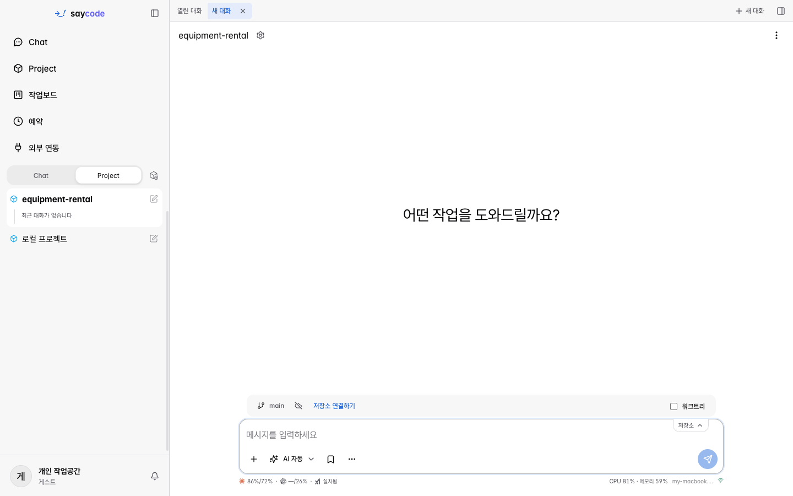

> [!TIP]
> If you need a dev server, be sure to include *"keep the dev server running so I can see it in the preview"* in your request. Otherwise the AI may finish with a single HTML file.

### 6.2 Screen layout

- **Open conversations tab row**: Conversations open as tabs in the **Open conversations** area at the top. **+ New Chat** (⌘T) opens a new conversation in the same project, and they are restored per project even after you restart the app.
- **Header**: the project name, the **Settings** icon, and **Project tools (⋮)** on the right
- **Right edge**: the message rail (dots) and the **Conversation summary** button ([Chapter 10](#101-conversation-summary-and-the-message-rail))
- **Composer**: it has an upper row (repository, branch, goal, Work completion) and a lower row (AI, model, AI remaining usage).

**Project tools (⋮)** gathers the work panels at the top (**Files · Terminal · Browser · Change · Preview**, [Chapter 8](#8-the-workspace)), the features of this conversation in the middle (search, pin, mute notification sound, **Continue conversation**, **Scheduled tasks**, **N child agents**), and the project features at the bottom (**Git actions**, **Automation** (GitHub triggers and script automations), **Open in editor…**, project sharing).

### 6.3 What to know about the composer first

The composer is split into an **upper row** (repository, branch) and a **lower row** (AI, usage). At first you only need to know these four things.

- **AI Auto** (the button at the left of the lower row): Choose the AI, model and effort from one button. The default for a new conversation is **AI Auto**, and after you send, it shows the chosen AI and model, such as `Claude Code · Auto` → [Chapter 7](#7-ai-models-effort-and-usage)
- **AI remaining usage** (lower row, for example `86%/72%`): Click it to open a window with the remaining usage per account → [7.4](#74-the-ai-usage-window). Next to it, `Context N%` is how full the context window of a Claude conversation is; at 80% or more, starting a new conversation or `/compact` is recommended.
- The **Work copy** checkbox (right of the upper row): When on, you work in a **worktree** (a copy of the working folder) used only by this conversation. It can be set only in a **new conversation that has not been sent yet** in a Git repository project, so check the box once before sending (the choice from your previous conversation may still be set).
- **Work completion** (far right of the upper row, appears after the conversation starts): Review, PR and archive from one menu → [Chapter 11](#11-work-completion)

The items in the repository row, the branch and PR chips, the goal, and the **+** and **⋯** menus are listed in [Appendix B.3 and B.4](#appendix-b-menu-and-settings-map).

### 6.4 Composer menus and special input

The items of the **+** (attach files, photos and folders, ⌘U) and **⋯** (search prompts, file checkpoints, parallel run and more) menus are in [Appendix B.4](#appendix-b-menu-and-settings-map). In the composer you can also use these inputs.

- `@` + file name → put a project file into your request.
- `@` + conversation title → in the **Conversations** group, attach another conversation from the same project as a chip so the AI reads it and answers. Archived conversations appear dimmed.
- `/` → the command list (up and down + Enter/Tab). The list changes depending on the conversation's AI.
- `/btw question` (side question): a short answer based on the current conversation appears as a card above the composer without interrupting the work in progress, and it is not saved in the history. It works only in a **Claude conversation** that has already started.
- `/recap`: shows a card summarizing "so far" and "next step". It works only in a **Claude conversation** with 3 or more of your messages. If you add other text after it, it is sent as a regular message.
- When you paste long text it becomes a `Pasted text · N lines` card, and you can **Quote** text by selecting it in an answer or right-clicking.

### 6.5 My prompts — save frequent requests

1. Type a sentence you use often in the composer.
2. Click the **bookmark icon** (**My prompts**) in the composer.
3. Click **Save current message** to save it.
4. From then on, click the sentence in the same bookmark menu to put it straight into the composer.

> [!NOTE]
> [Signed in] They are saved to your signed-in account, so the same list appears on other PCs, and one sentence can be up to 10,000 characters. Saved sentences appear in every project. When the composer is empty, the **↑** key recalls only the requests sent in the *current conversation*, one after another.

### 6.6 The queue — stack your next requests while the AI answers

You can type your next request in the composer even while the AI is answering.

1. While the AI answers, type a request in the composer and press Enter (or **Add to queue**). The queue holds **up to 3** requests and sends them one by one, oldest first, once the answer finishes. You can reorder them with the card's drag handle.
2. To hand something to the current answer right away, click **Send now** on the queued row (the send icon, or ⌘Enter).
3. To change the content, edit in place with the row's **pencil icon (edit)** → change → **check icon (save)** or **X icon (cancel edit)**. The **trash icon** deletes the queued request.
4. When you **stop** a response, the queue is not cleared but **it is not sent automatically**. Click **Resume sending** (the play icon) on the **Stopped** row above the queue, or send a new message yourself, and sending continues.

### 6.7 Answer the AI's questions

When the AI asks a question with choices, **the composer turns into a question form.** In the sidebar, an **orange question icon** is attached to that conversation row.

1. Click a choice or pick one with the **number keys (1–9)**. If you want to write your own, type it in the field.
2. If there are several questions, move on with **Previous question / Next question** (or **Next**). For a single-choice question, it moves to the next one automatically a moment after you choose.
3. At the end, click **Send**. To move on without answering, click **Skip**.

> [!NOTE]
> If you leave a question unanswered, the AI has not stopped. It is **waiting for your answer**. The queue is not sent while a question is open.

### 6.8 After a response

- **Next step card**: At the end of an answer that changed files or finished a multi-step task, buttons such as **Request commit / Create PR / Merge PR / Fix CI with AI / Self review / Archive as done** appear along with "what is done and what is left". They show only when they can be done now, and they do the same thing as [Work completion](#11-work-completion). The machine's Saycode CLI must be a version that supports this, and it is attached only to answers to messages sent from the desktop app.
- **When a response is cut off**: If the AI stopped midway, **Continue** appears with the cause (**Try again** if you stopped it yourself). For a temporary error, an automatic retry countdown and a **Cancel** button appear, and if you hit a usage limit, "Retry at {time}" is shown.
- **Child agents** (sub-agents): When the AI creates child conversations, **N child agents** appears in Project tools (⋮), and you can use **Steer** and **Stop**.
- **Hover over one of your messages** to see the pencil icon **Rewrite from here**, which creates a new conversation from the conversation up to just before that message so you can fix it and resend ([Chapter 10](#10-manage-conversations)).

---

## 7. AI, models, effort and usage

**Decide which AI works and how deeply it thinks, and check the remaining usage of your AI accounts.** In most cases, leaving it to **AI Auto** is fine.

> [!NOTE]
> **Requirements**: Only the AIs and models you can use appear in the list. In a new conversation you can change everything, and in a conversation in progress you can change **only the model and effort** (not while the AI is answering). The model list changes with updates, so rely on the list you see in the app.

### 7.1 Choose the AI, model and effort

1. In a new conversation, click **AI Auto** (or the button that shows the current model name and effort) in the lower row of the composer.
2. If you choose **AI Auto**, Saycode looks at how hard the request is and picks the AI, model and effort. To choose yourself, hover over one of **Claude Code / Codex / Opencode / Grok** and pick a **model** in the submenu (choosing **Auto** makes only the model automatic). Older models are in the **Legacy models** group.
3. After you choose a model yourself, reopening the same button shows an **Effort** submenu (it does not appear while in AI Auto). Depending on the model there are Low · Medium · High · Xhigh · Max (and Ultra for some).

4. In a conversation in progress after sending, the same button opens straight to the **model list**.

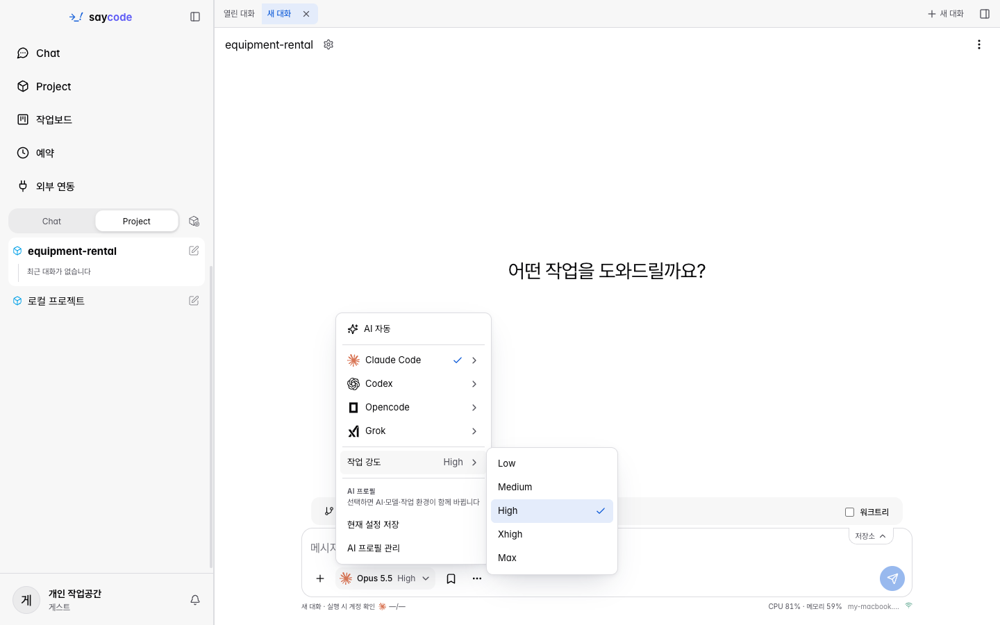

> [!TIP]
> **If you leave the model on Auto**, Saycode picks the model each turn according to difficulty. It handles a typo fix lightly, a feature build at a fitting level, and sends only truly hard problems to a top-tier model. A one-line badge "Auto · model · run settings" (for example `Auto · Sonnet 5.5 · medium`) stays above the response so you can see how it chose.

**Shortcuts**: With focus in the composer, **⌘⇧M** switches to the next model and **⌘⇧E** to the next effort (they do nothing while a response is in progress or when there is only one choice).

### 7.2 AI profiles — save favorite combinations

1. In a new conversation, choose a specific AI and set the model and effort.
2. In the AI button menu, click **Save current setup** to save it as a profile.
3. From then on, pick it from the **AI profiles** list in the same menu to apply it all at once. To edit or delete, click **Manage AI profiles**.

### 7.3 Set the AI list and defaults

Set the following in **My settings** → **General** → **AI Models**.

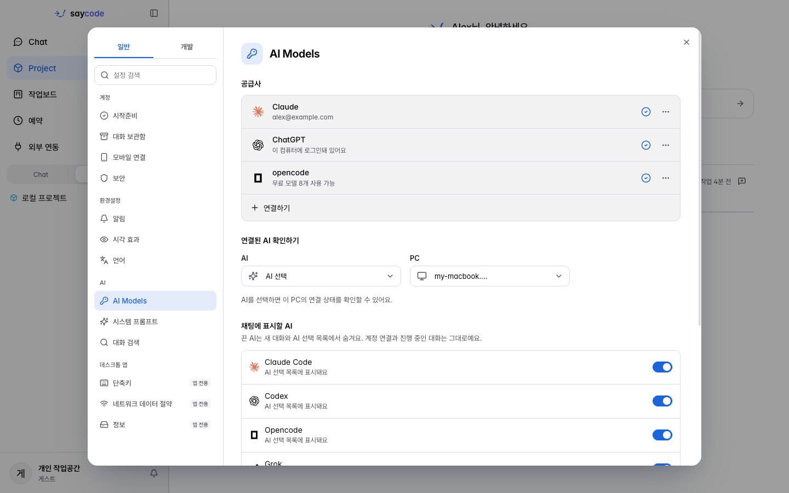

- **Connect** — Connect your own Claude or ChatGPT account through the browser. In the row's **…** menu, choose **Disconnect**, **Reconnect to Saycode** or **Add account**.
- **AI shown in chat** — Hide AIs you do not use from the selection list (at least 1 stays shown).
- **New conversation defaults** — Set the default agent, Model and Effort for new Chat and Project conversations separately.

To hand a project conversation in progress over to another AI, use Project tools (⋮) → **Continue conversation** → **Continue with another agent** ([10.7](#107-continue-and-branch)).

### 7.4 The AI usage window

Click the **AI remaining usage** button under the composer to see the AI accounts connected to this machine and their remaining usage.

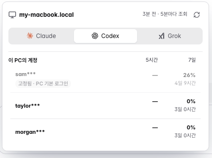

1. Choose the AI to view with the **AI tabs** at the top (**Claude / Codex / Grok**). Each time you open the window, the tab of the AI currently chosen in the composer opens first.
2. In the **All PCs** row, see whether you can use it now (**Room left / Running low / All used up**). It appears when you have two or more PCs.
3. Under **Accounts on this PC**, see each account's 5-hour and 7-day usage and the time left until reset. Expand **Usage by account** to see bars and the average after the next reset. In Personal use with only one account, the **All PCs** row and **Usage by account** may be missing and just one account row shows.
4. Turn on **Auto account rotation** and, even if one account hits its limit, Saycode switches to another account automatically so work does not stop (when you have connected several accounts).
5. The **Refresh** icon at the top rereads the latest values. Sending just `/usage` in the composer also attaches the same summary to the conversation (in Claude conversations, Claude handles it itself).

> [!NOTE]
> The machine must be online to see real values. As you near a limit, the **usage and the time left until reset** are shown automatically under the composer, along with the number of accounts you can switch to. [Signed in] Organization account selection and the all-PCs summary appear in signed-in, multi-PC environments.

For your usage history, use [Signed in] **My settings** → **General** → **Token usage** to see an overview and breakdowns by project, model and source, and compare the last 7, 30 and 90 days.

---

## 8. The workspace

**On the right side of the project screen, you check the AI's work by looking at files, changes, the terminal, the browser and the preview.** It sits next to the center conversation, so you can see the conversation and the work results together.

> [!NOTE]
> **Requirements**: The project must have an **online machine** connected. The **Diff** tab is available only in Git projects.

### 8.1 Open it and add panels

1. Click **Show tools** at the top right of the project conversation (when collapsing, **Hide tools**; shortcut **⌘⇧B**), and the list **Files · Terminal · Browser · Diff · Preview** appears right away. Choose the tool to open.
2. If a panel is already open, open more tools with the **Add tool panel** icon on the right of the tab row. If the worktree has a PR, **Pull request** is there too, and tools added by extensions you installed (for example **Moai**) appear in the same menu.
3. Drag tabs to reorder them and close them with **⌘W**. Closed tabs can be reopened from the ⋮ menu, and the tools you had open are restored per conversation.
4. Drag the middle divider to adjust the width, and use **Add panel** to open a terminal, browser or conversation **side by side to the right or below** (⌘⌥T / ⌘⌥B / ⌘⌥C). The expand icon at the top right of the workspace widens it.

### 8.2 The Files tab

1. Open **Show tools** → **Files**. Collapse and expand the file list with the folder icons, and click a file to open its contents (you can also move with arrow keys and Enter).
2. Type a name into the **Filter files…** box and the list is filtered right away; press **Enter** to search *file names across the whole project*.
3. To search by what is **inside** files, turn on the **Search file contents** button next to the search box, type your term and press Enter. (This works only when the machine supports it.)
4. Documents, images and HTML the AI created are gathered in one place in **Artifacts**. Choose the scope **This conversation / This project** and click the artifact to open.
5. In a file row's ⋮ menu, use **Reveal in Finder**; `.csv`/`.tsv` files open with **View as table** (the table icon). The HTML and DOCX viewers follow the app's dark mode.
6. The file panel's ⋮ menu has **New file / New folder / Upload files / Refresh files / Collapse folders**. If a file you created outside the app does not show in the list, click **Refresh files**.

> [!TIP]
> Just because a file name appears in an answer does not mean the panel opens by itself (artifact files do open automatically when they finish). Click the file name to open it yourself.

### 8.3 The Diff tab

See at a glance the files the AI changed and the lines that changed.

1. Open **Add tool panel** → **Diff**.
2. Choose the scope with the tabs at the top — **Uncommitted / Whole branch / By turn**.
   - **Whole branch** — See all commits since the worktree branch diverged, plus changes not yet committed, in one list. Click one in the commit list below and only that commit is shown, read-only; return with **Back to all changes**.
   - **By turn** — View by the unit of one AI answer (a turn). Choose among **This turn / Since last turn / Since chat start**.

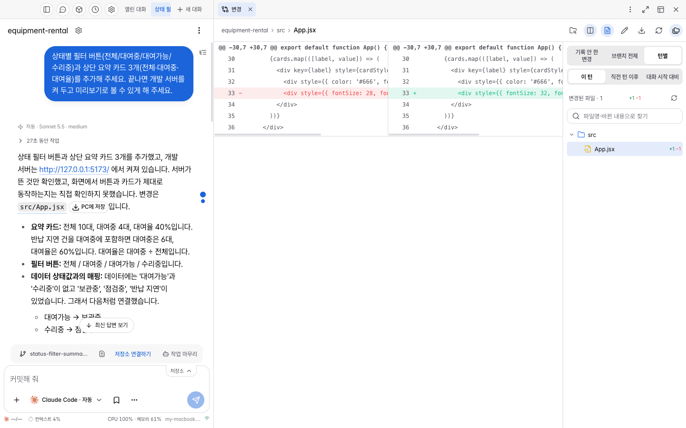

3. Click a file and a **Side-by-side diff** (or **Unified diff**) opens. You can attach a review comment to a changed line and send it to the AI.
4. Filter the list with **Find by file name or changed lines**, and search inside a diff with **⌘F**.
5. The **Lock files / Generated files / Build output** groups at the end of the list are collapsed by default; click to expand.

> [!NOTE]
> **By turn** is recorded from turns started after this feature shipped, in conversations you created, and is supported in macOS and Linux local Git environments. **Whole branch** appears only in conversations opened in a worktree. Finished turns and the single-commit view are read-only, so you cannot attach line comments.

### 8.4 The Terminal tab

This is a real shell attached to the machine. It stays alive when you switch tabs, and if the connection drops it reconnects by itself and picks the output back up.

- **⌘F**: search in the terminal (the position shows like `3/12`)
- Clicking a link: **Open in app browser / Open in external browser / Copy address**
- Keyboard scrolling is Shift+PageUp/PageDown, and the right-click menu has copy and paste
- Change the font, font size and **Show typing early** in **My settings** → **Develop** → **Terminal**.
- If a pager opens in the terminal, leave with `q` or run commands like `git --no-pager log`.

> [!NOTE]
> If the machine's runner restarts, the terminal can close, with the notice "This terminal closes when the runner restarts".

### 8.5 Browser and preview

- In the **Browser** panel, type an address such as `http://localhost:5173` in the address bar and the app running on your machine opens right away. The tab row, toolbar and address bar flow together like one window, and sign-ins and cookies stay even after you restart the app (they are cleared when you log out or switch accounts or organizations). → To fix things, see [Chapter 9](#9-see-it-fix-it)
- **Preview** shows the result of the project's dev server. Click Project tools (⋮) → **Preview**, and if the tab shows "The preview has not run yet", click the **Run preview** button inside it. The refresh (two arrows) and **Restart** (one-direction circular arrow) buttons are separate.
- Servers you already started are found by **Detect listening ports**. Click **Connect** in the list or type the port number yourself.

> [!TIP]
> If the Preview tab shows only "The preview has not run yet", the dev server command and port may not be saved under project settings → **Developer** → **Run**. Save the settings, or ask the AI to start the server, or start it in the terminal and then open `http://localhost:<port>` directly in the **Browser** panel or use **Detect listening ports**.

When you enter the **Development server command** and **Development server port** in project settings → **Developer** → **Run** and click **Save run settings**, the preview uses those values.

### 8.6 Viewing a pull request

[Signed in] Click a GitHub PR link in a conversation and the right-hand workspace panel lets you read the PR's description, comments, reviews and commits in chronological order (hold Shift while clicking to open the external browser). In the **Files** tab you see the full diff and mark "Viewed on this PC", hand fixes to the AI with **Fix review comments**, and, when the conditions are met, merge with **Merge** → **Merge** in the merge status below. `gh` must be installed and signed in on the machine, and only GitHub repositories are supported.

---

## 9. See it, fix it

**Pick elements you dislike directly on the running screen and ask the AI to fix them.** Choose several elements and send them at once, and you can also adjust spacing, layout and text yourself.

> [!NOTE]
> **Requirements**: A project conversation must be open, and the app you want to fix must be running on the machine (for example `http://localhost:5173`). If there is no conversation to put the elements into (such as a browser opened in a separate window), they stay in the annotation tray and the reason is shown. The component and source location (file and line) appear only when an extension such as React Source Locator is on in the dev server app.

### 9.1 Pick elements and put them in the annotation tray

1. Open **Show tools** → **Add tool panel** → **Browser** and type the app address in the address bar.
2. Click the **Pick an element to annotate** (element picker) button on the browser toolbar.
3. Click the element to fix on the page and it is put as one row in the **annotation tray below**. Each click picks only one element, so to add more, click the button again (Esc cancels while picking).
4. In each row, write your request (the **comment**, up to 2,000 characters) and choose the **intent** — **Fix this / Question / For reference**.
5. Click the screenshot **thumbnail** to open the markup window. Mark with **Pen · Rectangle · Eraser** in red, yellow or blue and click **Apply** (⌘Z to undo, and you can go **Back to original**). Once applied, the thumbnail shows **Marked**.
6. Click **Send all** and the numbered request text (selector, style and HTML information) and the screenshots **go into the conversation composer.** They are not sent right away, so check the content and click the **send button**.
7. When the AI fixes the code, the dev server picks up the change. If the screen stays the same, click **Refresh** in the browser panel.

> [!TIP]
> When the tray is **empty**, hold **Shift** and click an element and that one element goes **straight into the composer** without passing through the tray (for quickly sending just one).

> [!NOTE]
> The tray is separate for each browser panel and holds up to **20** items. It is cleared when you close the panel or restart the app. If the change does not show even after refreshing, restart the dev server.

### 9.2 Adjust design — try values yourself

For fine adjustments that are hard to describe to the AI in words, change the values yourself and send the result as a request.

1. Click the **adjust icon (adjust design)** on the row of an element you put in the annotation tray.
2. Enter values for **Spacing** (inner space Padding, outer space Margin, item spacing Gap), **Layout** (Direction, Align, Justify) and **Text** (Size, Weight, Color), and press Enter to apply them to the page right away. Change lengths by 1 with <strong>↑↓</strong> (by 10 with Shift), choose layout and weight from a list, and pick color with the color picker.
3. If you do not like it, click the revert next to the item or **Revert all**.
4. Click **Send change request** and the element's selector and text, along with the per-property **before → after** values, go into the composer and the element leaves the tray. Check and send it, and the AI applies it to the source code.

> [!IMPORTANT]
> Design adjustments apply **to the page only temporarily**. If you refresh or navigate to another address, it returns to the original, and the design changes you recorded in the tray are cleared too. Be sure to hand it to the AI with **Send change request**. If you changed no items, you cannot send.

### 9.3 The browser toolbar

The tool icons give you **element picking**, **Collect console & network errors**, **Viewport** (desktop, tablet and mobile screen sizes), **Import cookies** (moving your sign-in state) and **Open in new window**. In the address bar, choose a detected local server address from **Address suggestions**, and Shift+click on refresh to ignore the cache. A browser opened in a new window may have no conversation to put elements into.

---

## 10. Manage conversations

**So you do not get lost when conversations pile up, skim them, tidy them, find them and continue them.**

### 10.1 Conversation summary and the message rail

> [!NOTE]
> **Requirements**: It appears in project conversations with **2 or more of your messages**. It is not in Chat yet. The rail shows only the messages loaded right now; load earlier history with the earlier-messages button at the top of the conversation.

1. Hover over a dot on the **rail** at the far right of the conversation (to the left of the scrollbar) to see the start of the request and the artifacts it made. Click a dot to jump to that message (keyboard: Tab → up/down arrows → Enter).
2. Click the **Conversation summary** button at the top of the rail and a panel opens showing this conversation's **plans · PRs · commits · changed files · previews · reviews · side questions · background tasks** at a glance.
3. Click a panel item to jump to the message where that artifact appeared, and the icon next to a PR opens the PR view.
4. Click **Pin beside the conversation** and it opens in a pinned column beside the conversation. It is closed when you go to another conversation or reopen the app, so reopen it with the **Conversation summary** button.

### 10.2 Open conversation tabs

- Open a new tab with **+ New Chat** (⌘T), drag tabs to reorder, and close with **⌘W**. **⌘⇧T** reopens a closed tab and **⌘⇧J** jumps straight to a conversation waiting on a question or approval (all shortcuts in [Chapter 19](#19-keyboard-shortcuts)).
- While background work (build or test watching, child agents) is running, the conversation is not marked done even after the response ends, and a **Background work running** badge appears on the conversation tab.

### 10.3 Pin

1. Hover over a conversation row and click the **pin button** on the right. It gathers in the **Pinned conversations** area at the top of the list.
2. Drag pinned conversations to reorder them, and **⌘1~9** (Ctrl+1~9 on Windows) opens the first nine conversations right away.
3. To unpin, click the same pin button again. [Signed in] With a signed-in account, the same pinned list appears on other PCs and on the web.

### 10.4 Archive — tidy up what you do not need now

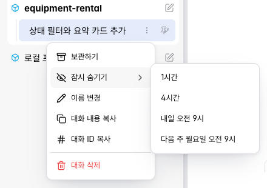

1. Click a project to expand its conversation list, hover over a conversation and click the **three dots (⋮)**.
2. Click **Archive**. It disappears from the list **right away, without a confirmation window**, and a "Conversation archived." notice shows for **10 seconds**.
3. If it was a mistake, click **Undo** in the notice or **⌘Z** (Ctrl+Z on Windows). **Go to archive** in the notice opens the [conversation archive](#106-the-conversation-archive-and-auto-archive).

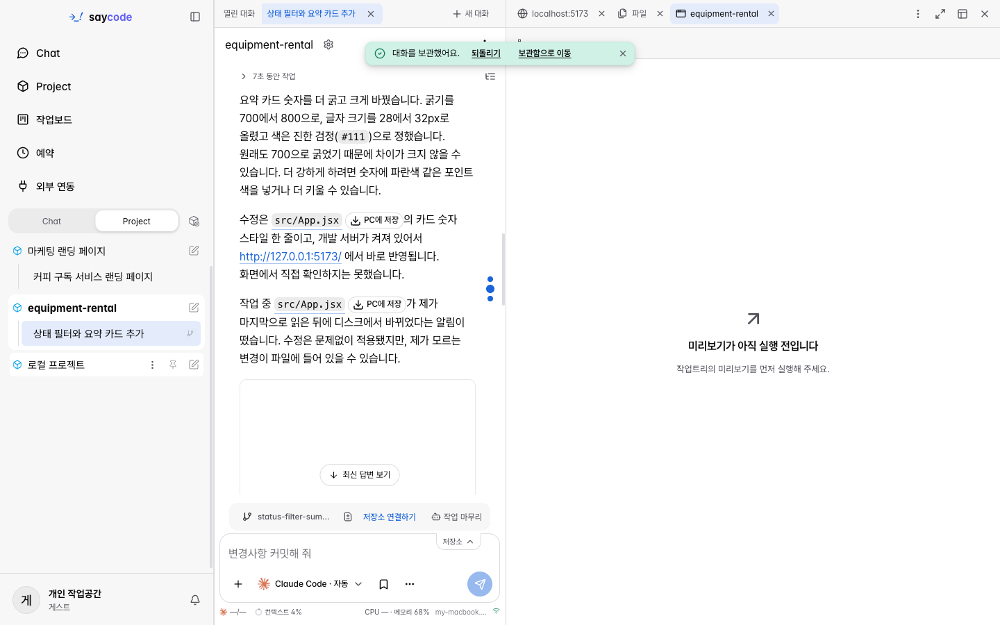

The same ⋮ menu also has **Rename**, [Signed in] **Share with organization**, **Copy conversation text**, **Copy conversation ID** and **Delete conversation** (it cannot be undone after you confirm).

> [!TIP]
> **Several conversations at once**: Hold **Shift** and click conversations one by one to select them, then in a selected conversation's ⋮ choose **Archive N selected** or **Delete N selected**. If any conversation has a worktree attached, choose **Archive** or **Archive & delete worktree** in the confirmation window. Archiving a single conversation does not delete the worktree.

> [!TIP]
> For a conversation whose worktree **PR has been merged**, the popup that appears when you hover in the sidebar shows **Merged**, and the **Archive** button below it archives it right away. If you tell it in the conversation *"archive this conversation"*, it is archived after the response ends.

### 10.5 Snooze

Move a conversation you do not need to attend to right now out of the list until a time you choose. It returns to its original place when the time comes or when the AI waits for an answer through an approval or question.

1. Click the conversation row's **⋮** → **Snooze**.
2. Choose among **1 hour / 4 hours / Tomorrow, 9 AM / Next Monday, 9 AM**.
3. Expand **Snoozed N** below the project list to see snoozed conversations with the time remaining. Click a row to open it as is, and click the **eye button (Show again)** to return it to the original list right away.

> [!NOTE]
> It can be used only in project conversations (Chat and snoozing several conversations at once are not supported). The snoozed state is stored **only on this computer**. While snoozed, the inactivity period for auto-archive is not counted. You can cancel with **Undo** or ⌘Z right after snoozing.

### 10.6 The conversation archive and auto-archive

Archived conversations do not disappear; find them in **My settings** → **General** → **Conversation archive**.

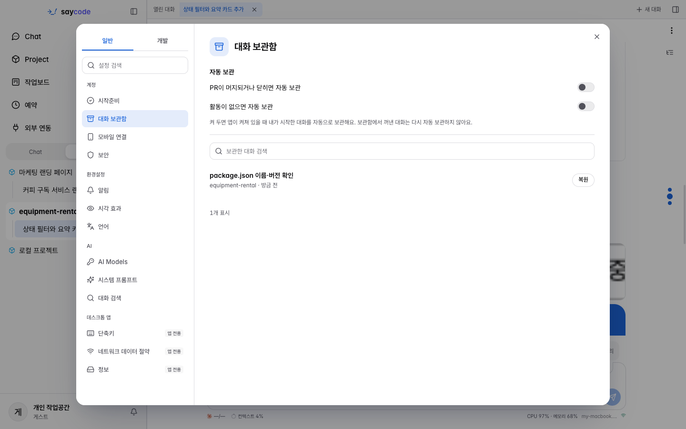

1. At the top, check the **Auto-archive** rules, and find archived conversations with **Search archived conversations**.
2. Click **Restore** on the right of a conversation row (one more confirmation for Project conversations). It opens with its earlier title and history kept, and the AI does not run automatically.

**Auto-archive** is turned on at the top of the conversation archive (off by default).

- **Archive when the PR is merged or closed**
- **Archive after a period without activity** + **Inactive for** (1–90 days, default 14 days)

Conversations that are responding, waiting for input, recently active (within 10 minutes), open on screen or pinned are postponed, and the archive icon on the sidebar row tells you why. At most 3 are archived at a time, and worktrees are not deleted.

### 10.7 Continue and branch

From Project tools (⋮) → **Continue conversation** (the crossed-arrows icon), start a new conversation while leaving the current one as it is.

| Menu | What it does |
|---|---|
| **Continue with another agent** | Continue with a different AI (for example Claude → Codex). You also choose the model and effort. |
| **Branch with the same AI** | Creates a **branch conversation** that duplicates the history so far with the same AI so you can try a different direction. Choose the whole conversation or *up to a specific message*, click **Create branch**, and a new tab opens with a **Branched from** link in its header. A branch shares the **same working folder** as the original conversation. |
| **Continue in terminal** | Copies a command to continue this computer's Claude or Codex conversation in a terminal. |
| **Move this conversation to a worktree** / **Move this conversation back to the main folder** | Moves a conversation in progress, along with the current changes, to a new worktree, or back. It can be chosen only when the machine's Saycode runner is up to date, and if it is gray the reason is shown in the menu ([11.6](#116-worktree-safety-net)). |

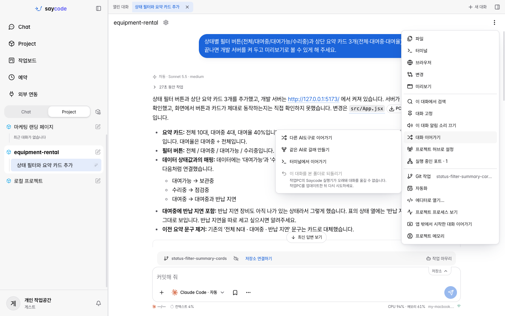

In addition:

- [Signed in] Hover over one of your messages and click **Rewrite from here** (the pencil), and a new conversation opens with the conversation up to just before that message and your original message filled into the composer (Claude conversations). The original conversation stays as it is.
- In the composer, you can attach another conversation from the same project as a chip with `@` so the AI reads it ([6.4](#64-composer-menus-and-special-input)).
- Use Project tools → **Continue a chat started outside the app** to bring in AI conversations started outside the app, such as in a terminal.

### 10.8 Find — conversation search and quick open

| Method | Shortcut | What it does |
|---|---|---|
| **Search this conversation** | ⌘F | Find and jump to a word inside the open conversation. You can hand off to **Search all conversations**. |
| **Search conversations** | ⌘⇧F | Find a word in the titles, your requests and the AI responses of all conversations. [Signed in] The **Semantic** tab finds this project's memories by meaning. |
| **Quick Open** | ⌘P | Type a project, conversation or file name to open it right away. Type **>** first and only **commands** appear, such as new conversation, stop response, open terminal, split panel, open settings, pin/archive conversation and Work board (⌘⇧P opens it directly). |
| **Sidebar search** | ⌘K | Filters the project list by name. |

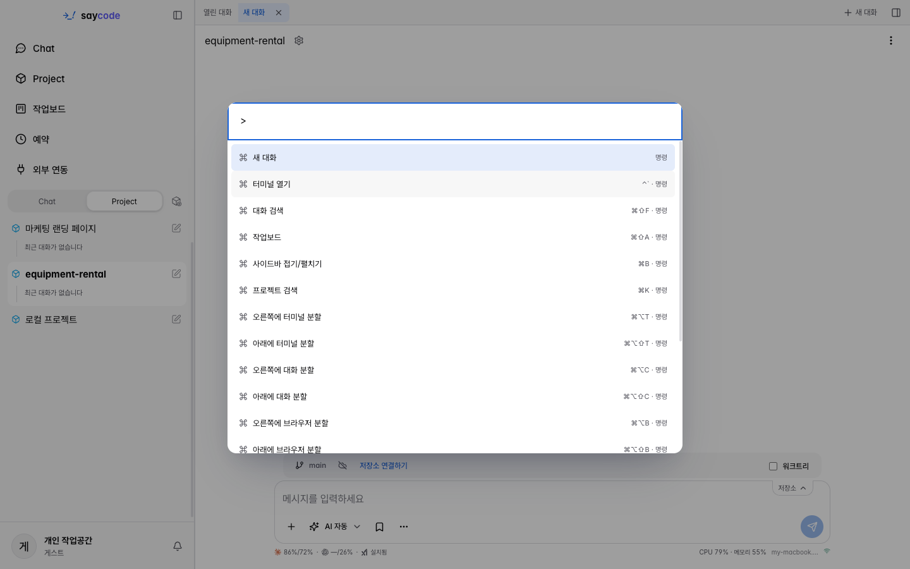 in Quick Open (⌘P) — new conversation, open terminal, search conversations, Work board, split screen and more" />

> [!NOTE]
> To use conversation search, **My settings** → **General** → **Conversation search** → **Enable conversation search** must be on. You can clear stored search data with **Delete search index**.

---

## 11. Work completion

**This is the last stage, where you check the changes the AI made, raise a PR and tidy up the conversation.** Everything starts from the one **Work completion** menu in the upper row of the composer.

> [!NOTE]
> **Requirements**: It appears only in project conversations that have already started (it is hidden if you have collapsed the upper row of the composer or an AI question screen is showing). **Commit & PR** requires a **conversation opened in a worktree** and a remote repository (without one it turns into **Commit now**).

### 11.1 The Work completion menu

1. Open a project conversation.
2. Click the robot-icon **Work completion** button at the **far right** of the upper row of the composer.
3. Choose the item you want from the menu.

| Menu | One-line description |
|---|---|
| **Self review** | The AI working now checks the changes and fixes problems itself. |
| **Request independent review…** | A different AI reviews read-only and only hands back the result. |
| **Commit & PR** | Hands over review, tests, commit, push, PR creation, CI and review-bot handling, and even the merge. Shown when there is a remote repository. |
| **Commit now** | Shown instead of **Commit & PR** when there is no remote repository. It saves the changes as a local commit. |
| **Archive & Done** | Archives the conversation and wraps it up. |
| **Advanced settings…** | Set the number of rounds, the independent reviewer and the confirmation before finishing. |

If the AI is responding, when you click **Self review · Commit & PR**, "Runs after the current work finishes" appears under the item, and when you click it, it goes into the **queue** above the composer and runs in turn after the work finishes (drag to reorder, or delete).

### 11.2 Self review

1. Click **Work completion** → **Self review**.
2. The same AI checks the changes and fixes problems itself. If findings of **medium or higher** come up, it continues reviewing for the **number of rounds** you set, and if there are none it ends in the first round.
3. To stop midway, click **Stop self review**. If the lookup fails, click **Refresh self review status**, and to start fresh after it ends, click **Start a new self review**.

Change the number of rounds under <strong>Work completion → Advanced settings…</strong> in **Self review rounds** (default 7).

### 11.3 Request independent review

Use this when you want an **AI other than the one that wrote the code** to review with fresh eyes. The reviewer works in a new conversation separate from the current one, **read-only** (no file edits, commits or pushes).

1. Click **Work completion** → <strong>Request independent review…</strong>.
2. Choose the **Agent · Model · Effort · Review focus**. A reviewer different from the model that wrote the code is suggested first.
3. Click the **Request independent review** button. On success it moves to the **Review history** tab.
4. In **Review history**, see progress and results and do **Retry / Send to source / Clean up snapshot**.

> [!NOTE]
> The read-only restriction applies only to Claude reviewers. On the Work board, such cards carry a **Read only** badge.

### 11.4 Commit & PR

1. Click **Work completion** → **Commit & PR**. It is requested right away, without a confirmation window.
2. After the AI creates the PR, it handles **CI failures, review-bot findings, stacked PRs and conflicts**, and once everything passes, it even **merges into the base branch**.
3. If conditions remain, such as no bot verdict or a required approving review still outstanding, it **does not merge** and reports what is left.
4. Follow progress in the **PR number chip** above the composer (open, merged, closed, with the CI badge) and in the [pull request view](#86-viewing-a-pull-request).

> [!IMPORTANT]
> In a project with no remote repository connected, a PR cannot be created, so it requests only **Commit now** (a local commit). [Signed in] Some parts require a GitHub connection and a `gh` login on the machine.

### 11.5 Archive & Done

1. Click **Work completion** → **Archive & Done**.
2. The conversation is archived and "Undo" appears. The worktree is not deleted.
3. If you turn on **Confirm before Archive & Done** in <strong>Advanced settings…</strong>, a confirmation window appears before archiving.

To tidy up the worktree too, select several conversations in the sidebar and use **Archive & delete worktree**, or delete from the [worktree list](#116-worktree-safety-net).

### 11.6 Worktree safety net

A **worktree** is a copy of the working folder created for each conversation, so even when several conversations run at once they do not collide. Saycode puts safeguards in place so that work is not lost even if you delete a worktree.

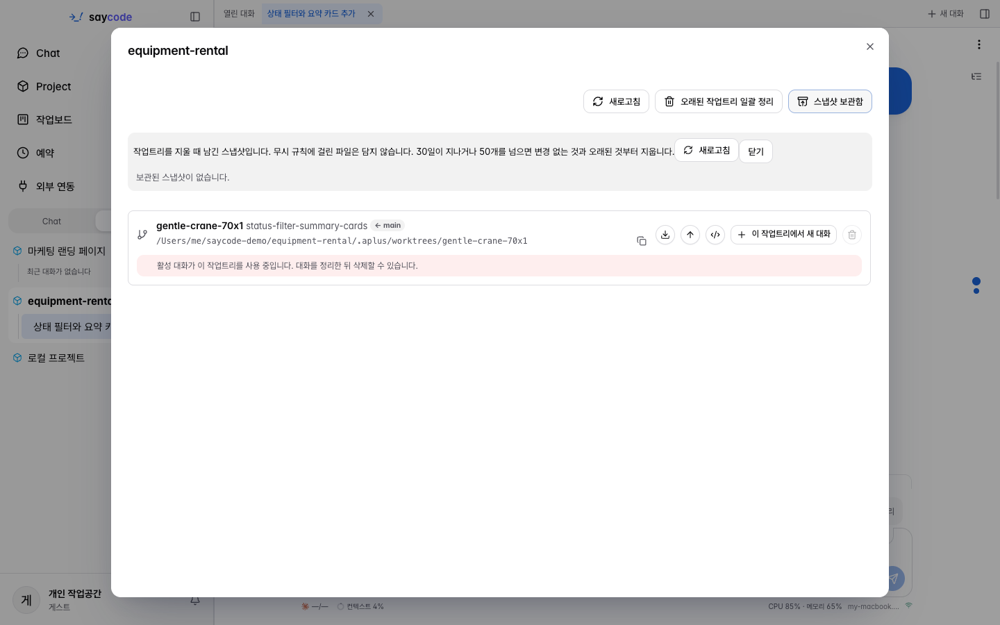

- A **new worktree starts from the latest remote default branch** (`origin/main` and so on). If the remote cannot be fetched, it tells you why and asks whether to start from the local branch instead.
- Before deletion, it tells you the number and folder of **local-only files** (such as `.env`) that exist only in this worktree.
- Before deleting, it takes a **snapshot** (including uncommitted changes and new files, excluding files matched by ignore rules).

**Open the worktree list**

1. In a project conversation, open **Project tools (⋮)** → **Git actions**.
2. Click <strong>Worktrees…</strong>.
3. At the top there are the **Refresh / Clean up old worktrees / Snapshot archive** buttons, and each worktree row has path copy, fetch, push and editor icons, **New chat in this worktree**, and delete (trash). The worktree used by the conversation that is currently open is marked "An active session is using this worktree. You can delete it after cleaning up the conversation." and cannot be deleted.

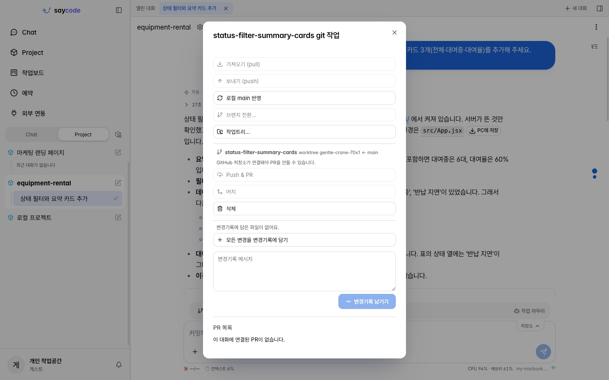

**Bring back a deleted worktree**

1. In the worktree window, open **Snapshot archive**.
2. Click **Restore** on the row you want to bring back. The worktree is recreated at its original path, including uncommitted changes.

> [!NOTE]
> Snapshots older than 30 days are deleted when a new one is made, and beyond 50 the oldest are deleted first. Windows machines do not create snapshots yet. Worktrees created outside the app are brought in with **Bring changes** (a conflict preview).

### 11.7 File checkpoints and commits

**File checkpoints** — Even in a folder without Git, or in a conversation that does not use a worktree, you can roll back the files the AI changed.

1. In a new conversation, turn on **⋯** (additional conversation options) → **File checkpoints** (macOS and Linux machines).
2. During the conversation, click **File checkpoints** at the top right above the composer to expand it.
3. Click **Preview** for the point you want to roll back to to see a per-file comparison, check **I reviewed the file changes in this preview**, and click **Restore file state**.

**Commit** — Use **Commit now** in the Work completion menu, or the branch name button above the composer → if no files are staged, **Stage all changes** → type a **Commit message** → click **Commit**. If you turn on AI generation in the settings (**Development automation**), a button that has the AI write the message appears (it does not commit automatically).

---

## 12. Work board

**Lay out every conversation of every project as kanban and direct several AIs at once.** When several conversations run at the same time, it is good for finding "the ones waiting for my answer" first.

> [!NOTE]
> **Requirements**: It is a developer menu, so it is **hidden** at first. Turn on profile menu → **Developer feature settings** → **Show Work board menu** and **Work board** appears in the sidebar (the shortcut **⌘⇧A** works even if you do not turn it on). The wider the window (1720px or more), the more fit on one screen: all six columns. If organization policy turns off autopilot, "Autopilot unavailable · organization policy" is shown.

### 12.1 What the columns mean

| Column | Meaning |
|---|---|
| **Awaiting input** | Conversations that need an answer to a question, permission or plan approval — the first place to look |
| **Responding** | Working right now. Dropping a card here sends an instruction |
| **Idle** | Waiting for the next instruction |
| **In review** | Dropping a card here requests a review (a confirmation window opens with the model and prompt filled in) |
| **Done** | Dropping a card here moves the conversation to done |
| **PR Merged** | Conversations that ended because the PR was merged |

A card shows the project, title, AI, elapsed time and branch (worktree) name. Click a card title to preview the last request and the latest response and **Go to chat**, and filter by title or prompt with the search box at the top right. Drag a card into the **In review** column and the **Request a review** window (model and default text) opens.

### 12.2 Filters and prerequisites

1. Click **Filter** to choose **Machines**, **Hide conversations created by automation** and **PR status** (No PR · PR open · PR merged). The button changes to **Filters applied: N**, and the X next to it clears them all.
2. **Prerequisites**: Click the card that comes later to open its details, click **Add prerequisite**, choose the card that must finish first and **Add** it. If you try to start before the prerequisite finishes, it tells you the name of the blocking card, and an Autopilot card sends its instruction automatically as soon as the prerequisite finishes. The card gets a `Prereqs 1/2` badge.

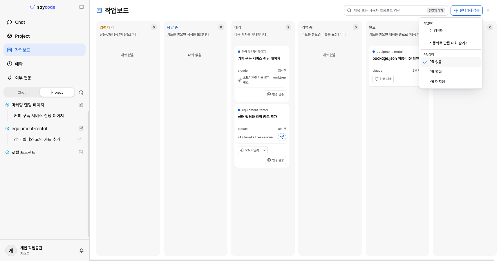

### 12.3 Card tools

| Button | What it does |
|---|---|
| **Commit & PR** (paper airplane) | Requests PR creation on a worktree card (the same as **Commit & PR** in Work completion). |
| **Autopilot** | When the AI's work ends, it reviews, and if there are no findings of medium or higher and each requirement has evidence (test results, files, commits), it proceeds automatically through Commit & PR. If the same blocker repeats 3 times, it stops and waits for an answer. The arrow beside it also offers **Run with independent review**. It can be used **only on worktree cards**, and it turns off if you stop the response. |
| **PR watch** | On a card with an open PR, it directs CI failure fixes, review-bot fixes and conflict resolution on your behalf and notifies you when it can be merged (it does not merge). [Signed in] Requires a `gh` login |
| **Verify changes** | Runs the build, test and run recipes in that conversation's worktree (or the project folder if there is none). One of the `package.json` scripts, a Makefile or `.aplus/verify.json` must exist. |

> [!TIP]
> If you see the **"N conversations are waiting on the same permission"** card at the very top, you can handle them all at once with **Allow all (N)** or **Deny all** ([14.2](#142-handle-approval-cards)).

> [!NOTE]
> Conversations you finished with **Archive & Done** remain as cards in the **Done** column, and you can continue them again with the card's **Unarchive** (you can also **Restore** from the conversation archive in settings). Conversations whose PR was merged move to the **PR Merged** column. The board, filters and prerequisites also work in Personal use (local), and **PR watch** needs a GitHub connection.

---

## 13. Schedules

**Hand work to the AI at set times.** For example: "Summarize yesterday's PRs for me every day at 9 a.m."

> [!NOTE]
> **Requirements**: The sidebar **Schedules** menu is visible to everyone, but [Signed in] **you must sign in to a cloud account to create and manage schedules**. At the scheduled time, **the machine must be on and an AI connected**, and the server and CLI must be versions that support it. If your organization turns schedules off, the Schedules screen shows "Your organization has turned schedules off."

In Personal use, the Schedules screen shows only the notice "Sign in with a cloud account to manage Chat schedules." The explanations below assume a signed-in account.

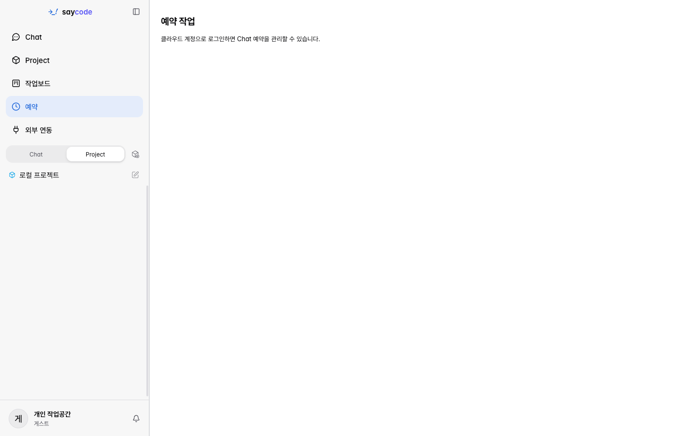

### 13.1 Create a new scheduled task

1. Click **Schedules** in the sidebar and click **New task**. If there are no schedules yet, you can also start from the example buttons.
2. In **Instructions**, write what the AI should do.
3. Choose **Repeat**.
   - **Every day** — Runs at a set time.
   - **Every week** — Choose one or more weekday buttons and set the time.
   - **Once** — Set a date and time (a time in the past cannot be saved).
   - For the interval option, click **Schedule and start** to request the first run, and it repeats at the same interval (15 minutes or more).
4. Check the **time zone** shown next to the time. For example `Daily at 09:00 · Korea Standard Time` and below it `Next run in your time (Korea Standard Time): …`. Change the time zone in **Advanced → Time zone**.
5. Click **Schedule task**.

### 13.2 Advanced options

Expand **Advanced** and you can change the following.

- **Task name**, the **conversation** to link, the **Task computer** to run on, and the **AI** to use (a new Chat uses the AI and model you last selected)
- **Send result** — When the schedule finishes, the first part of the answer (up to 1,500 characters) is sent to your paired **Telegram or Slack** personal conversation.
- **Failure alert** — Get a one-line failure reason in the same place or in a different conversation. Both start out *Off*.
- **Add code task** — Run a Node.js script on a schedule.

> [!NOTE]
> Messenger delivery works with a [Signed in] account that has a messenger channel connected ([16.3](#163-messenger-channels)), and Discord cannot be selected yet. If it keeps failing for the same reason, you are notified only once a day.

### 13.3 Check and manage schedules

- Schedule results **build up as regular conversations** and are summarized in notification cards. If an approval wait expires, an expiry marker is attached.
- See the **Scheduled task details** (the full request, repeat pattern, status and machine) with the request and schedule buttons at the top of a conversation, or the conversation's ⋮ → **Scheduled tasks**. In a schedule row's **More options**, choose **Run history · Edit · Pause · Delete**.
- A **Once** schedule whose time has passed can run again at a new time with **Schedule again**. A Once schedule that was missed because the machine was off will not run later.
- You can manage them by just asking, too. In Chat, say *"Check the connection status every 15 minutes"*, *"Stop this schedule"* or *"Restart this schedule"* (the minimum interval is 15 minutes).

> [!TIP]
> To pause all schedules at once, turn on **My settings** → **General** → **Security** → **Global pause (block new automatic actions)** ([14.6](#146-global-pause-and-organization-policy)).

---

## 14. Permissions, approvals and security

**Before the AI does something risky on your computer, you approve it, and if you like you can set rules in advance.** This chapter explains everything in order, from approval cards to security settings.

### 14.1 Where is your data stored?

In **Personal use**, conversations, projects and results are all stored **only on this PC** (AI responses are exchanged with the AI service you connected). When you **sign in**, they are stored in your account (organization), and encrypted data can be opened only on trusted devices. Sign-ins and cookies in the in-app browser are cleared when you log out or switch accounts or organizations.

### 14.2 Handle approval cards

When the AI is about to run a command, write a file, use the network or use an MCP tool, an **approval card** appears in the conversation.

1. Check the card's content and click **Allow** or **Deny**. If the card has **Allow in this conversation**, it is allowed only in that conversation. The shortcuts are **Enter (allow)** / **Esc (deny)**. (You can turn them off with the **My settings** → **General** → **Shortcuts** → **Answer permission requests with Enter and Esc** switch.)
2. If something may be risky — deleting, admin rights, remote code execution, a force push, access to a password file — the card carries **Needs a careful look** with the reason. Such cards are not allowed right away with Enter, and the Allow button changes to **May be risky — allow anyway**, so you have to click once more.
3. To pass your reason for denying to the AI, expand **Deny with a reason** under the buttons, write the reason and click **Deny with this reason** (Claude conversations). If the field is empty, it is just a denial.
4. When several conversations wait on the **same permission**, they are grouped at the top of the notification center or the Work board into an **"N conversations are waiting on the same permission"** card. Expand the requests to check them and click **Allow all (N)** or **Deny all**. To check each individually, use **Show each**.

> [!NOTE]
> Questions, plan approvals, folder-access requests and requests that hit a risk rule are not grouped; you answer them one at a time in their own conversation.

### 14.3 Notifications and the floating approval panel

Set these in **My settings** → **General** → **Notifications**. The table below is in on-screen order from top to bottom, and the lower items need scrolling to see.

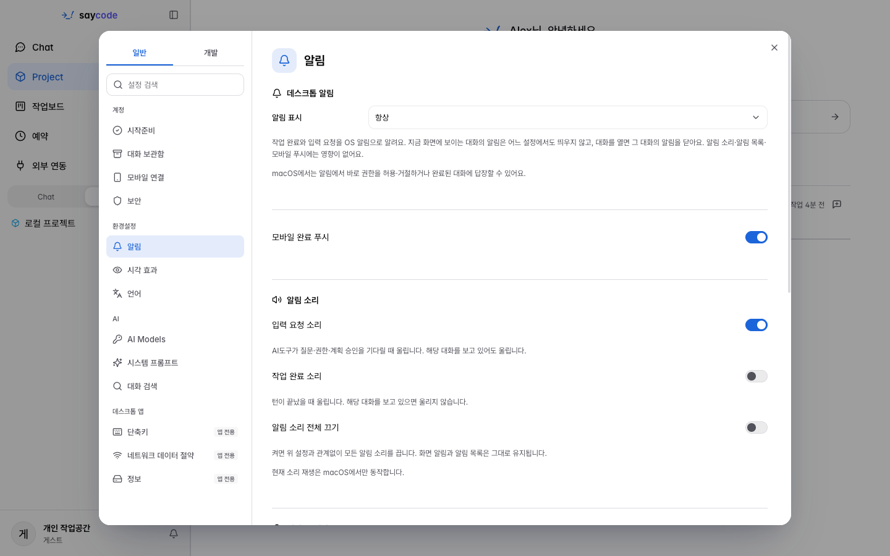

| Item | Description |
|---|---|
| **Show notifications** | Choose desktop notifications from **Always / Only when the app is not in focus / Off**. A conversation that is visible on screen does not pop up a notification. In macOS notifications you can answer straight away with **Allow / Allow for this session / Deny**, and you can reply to completion notifications. |
| **Mobile completion push** | Get a push on your phone when work finishes ([Chapter 17](#17-machines-and-mobile)). |
| Notification sounds | **Input request sound / Turn completed sound / Mute all notification sounds** (sound plays only on macOS for now). |
| **Floating approval panel** | When on, pending approvals and questions gather as cards in a small panel at the top right (drag to move). You can allow, deny or answer right away without taking focus from the app you are using. **It is off by default.** |
| **Computer use indicator** | While the AI is operating this computer's screen or input, it shows a border around the screen edge and a notice. Pressing **Esc** during the operation stops it right away. |
| **Confirm before quitting** | If a conversation is responding, a scheduled task is running or a worktree is being prepared, it tells you before quitting (**Quit** / **Cancel** / don't ask again). |

### 14.4 AI tool rules

Under **My settings** → **General** → **Security** → **AI tool rules**, set in advance the rules applied just before the AI operates the computer screen or uses MCP tools.

1. Turn on the **Ask before write tools too** switch, and write MCP tools such as create and update also ask for confirmation.
2. In **My app rules**, enter an app identifier (a macOS bundle ID or a Windows executable name), choose one of **Ask · Block · Allow**, and **Add** it.
3. Under **MCP tools**, for each server received by an open conversation, choose **Default · Ask · Block · Allow**. Tools whose names include send, delete or pay are marked `(Always asks)`.
4. Apps and tools allowed in a conversation ask again when the conversation ends or after 30 minutes, and you can also withdraw them early under **Apps allowed in this conversation** in this window.

> [!NOTE]
> This PC must be connected as a machine to save, and the rules apply from the next tool call. Even if you set **Allow**, risky actions such as deleting or paying are confirmed every time.

### 14.5 Handle permission requests with AI review

If clicking approval cards one by one is a chore, turn on **My settings** → **Develop** → **Development automation** → **Handle permission requests with AI review**. A low-cost AI allows or denies against the project's guidelines and hands only the requests it could not judge to you (the verdict is left in the conversation as one line).

- **It is off by default** and applies only to Claude and Codex project conversations you created.
- High-risk requests such as deleting the root, sudo, force pushes and credential files, and review failures or more than 1 minute, are **never allowed automatically** and are left for you to check.
- To allow a denied request just once, send `/approve` in that conversation and click **Allow once**.

On the same **Development automation** screen you also set **Stop the session automatically on loop detection**, **Stopping a response also stops its child conversations**, **Automatically continue work cut off by sleep or an app restart**, **Autopilot and quality review** (the Autopilot independent review AI and the autonomous quality gate), session event webhooks and more.

### 14.6 Global pause and organization policy

**My settings** → **General** → **Security** has the following.

- **Global pause (block new automatic actions)** — When on, scheduled tasks, automatic GitHub runs and the next steps on the Work board do not start. When off, they continue, and **conversations already in progress are not stopped.** It is available in Personal use too.
- **Organization policy** [Organization] — Visible only to signed-in organization accounts. See the limits set by organization admins (allowed models, tool rules, turning off autopilot and so on). You cannot change them here, and owners and admins change them in the web admin console.
- **Trusted devices** [Signed in] — Visible only to signed-in accounts. The list of devices that can open encrypted data. Remove devices you do not recognize with **Revoke trusted device**.
- **Send anonymous usage statistics**, passwords and how sign-in information is stored are also on this tab.

---

## 15. Memory, lessons and the system prompt

**Have the AI remember your way of working, build up what it learned in a project as lessons, and set the default instructions it always follows.**

### 15.1 System prompt — default instructions it always follows

Set it in **My settings** → **General** → **System Prompt**.

1. Write the instructions the AI should always follow in the **Instructions** field and click **Save**. If you close without saving, it asks whether to keep editing or discard the changes.
2. Presets such as **TypeScript** and **Korean** are saved the moment you click (if you have instructions in progress, it asks before applying).
3. The **Saycode default instructions** switch below (use default behavioral instructions) turns the default instructions Saycode provides on and off as a whole. Expand the details and you can choose item by item — Child Agent calls, internal task delegation, inline result previews, the **Saycode usage guide**, browser and computer-use confirmation, the plan-first workflow, commit credit and more.

> [!TIP]
> With the **Saycode usage guide** on, when you ask a how-to question such as "Where do I turn this on?", the AI answers with in-app guidance and gives you a link to the settings screen. The **next step card** ([6.8](#68-after-a-response)) also appears only when these default instructions are on.

### 15.2 Personalize my chats

[Signed in] Under **My settings** → **General** → **Personal memory**, turn on **Use this in my personal chats**, write information about yourself that the AI should know (your role, preferred tone and so on) and **Save**. It is used **only in Chat** and not in project conversations.

### 15.3 Lessons — build up what you learn in a project

When the AI proposes a method it confirmed while working (for example "This project runs tests with this command") as a **lesson candidate**, a **Lesson candidate** approval card appears under that answer.

1. Read the card's proposal.
2. If you **Approve**, that lesson is used in later conversations of the same project. If you **Reject**, it is discarded.
3. A proposal to rewrite an existing lesson shows on the card as **Revises a saved lesson**, with the current lesson and the proposal side by side. If you compare and approve, it is replaced with the new content in place, and the history is kept.

See the lessons and the candidate list all at once in Project tools (⋮) → **Project memory**.

### 15.4 Memory settings

Manage the AI's memory in **My settings** → **Develop** → **Memory**.

- **Suggest similar past sessions in new chats** — When you start a new conversation, it suggests similar past conversations (an app-wide setting).
- Choose the **Target project** and you manage that project's memory install status and dashboard.
- **Memory protection rules** — Write items that must not be remembered in the **New forbidden item** field and **Add** them.
- Find leftover memories in **Memory records and search** and **Delete** them. If you click **Undo** in the notice **within 10 seconds** of deleting, it is cancelled.
- **MongoDB memory sync** is an optional feature for organizations that use a company MongoDB.

---

## 16. Integrations, extensions and messenger channels

**Connect to services like Notion and Slack, install the features you need as extensions, and hand work to Saycode from a messenger.**

### 16.1 The Integrations screen

Click **Integrations** in the sidebar. The screen differs depending on whether you are signed in.

| State | What you see |
|---|---|
| **Personal use** | The extension install and manage screen (channel adapters, the plugin manager and so on) |
| Signed in | The service list (**Notion · Slack · Google Drive · Gmail · KNOI · Figma · DirectCloud**) and **Custom connectors (+)** |

[Signed in] Connect a service: Click **Connect** on a service row in the list, and sign in and allow in the browser that opens (for KNOI, enter an API key). Google services connect only with a company account. You can **Disconnect** a connected service in **My settings** → **General** → **Connectors**.

**Custom connectors** — Connect an MCP server that supports OAuth directly by its address. Click <strong>+</strong>, enter a **Name** and **MCP address**, add it and click **Connect** on that row. For an MCP registered by an organization admin, click **Log in** on the row (the + button is visible only when the server has custom connectors turned on).

**Figma design editing** — Let the AI create and edit frames and screens directly in Figma. In **Integrations** → the Figma row, check this computer's status and click **Connect**, then for each machine and AI (**Claude Code** or **Codex**) click **Connect** and **Allow** in the browser. When the status changes to **Ready**, ask for Figma work in a new conversation.

### 16.2 Install extensions

Extensions are add-on features that you pick and install only as needed. Manage them in **My settings** → **Develop** → **Extensions**.

1. In the **Available extensions** list, check the purpose and click **Install** on the extension you want.
2. Click **Enable**. (Installing alone does not make it work.)
3. If the requested permissions (for example `channels.receive`, `sessions.control`) show, check them one by one and click **Approve permissions and enable**.
4. To remove, click **Uninstall** and click once more in the confirmation. Status shows as **Disabled · Enabled · Running · Quarantined** badges.

Examples of official extensions: **Telegram, Slack and Discord channel adapters** (use Saycode from a messenger), the **Plugin manager** (manage skills and plugins), the **Moai task board** (workspace panel ⋮ → **Moai**, macOS Apple Silicon and Linux x64), **Media preview**, **React Source Locator** (attaches component and source location to elements picked in the browser, [Chapter 9](#9-see-it-fix-it)), and the **Public link** (it installs right from **Public link** → **Install** on a result file card, without installing from the extension list).

Install a downloaded extension file with **Local installation and development** → **Install local file**.

### 16.3 Messenger channels

[Signed in] Connect Slack, Telegram and Discord to hand work to Saycode from a messenger and receive progress. It is visible **only in signed-in accounts**.

1. Open **My settings** → **General** → **Messenger channels**.
2. Find the one you want to use among **Connect Slack / Connect Telegram / Connect Discord**. If a notice says the feature is off, click **Install and turn on** first.
3. Follow the card's instructions to create the bot and paste in the token to confirm (Slack has a 4-step guide and a **Create Slack app** button).
4. Allow the Saycode connection in the messenger.
5. On the first connection, <strong>Where should it run?</strong> appears. The default is to move it to *another machine that responds even when Desktop is off*, so that receiving continues even when you turn off the app.
6. For each connection, choose the AI, model and response level, and in the messenger use commands such as `/settings` and `/stop`.

> [!NOTE]
> From a messenger you can control only the projects, machines and work you have allowed. This connection is also used for schedule result delivery ([13.2](#132-advanced-options)).

---

## 17. Machines and mobile

**Register and manage the computers where the AI works, and watch the same workspace from your phone.**

### 17.1 Machines

This computer automatically becomes a machine at first run (Getting started). If you also register other computers, such as GPU servers, build servers and cloud VMs, the AI can work right next to your code and data.

**See the list** — In **My settings** → **Develop** → **Machines**, see the list split into **Machines I registered** and **Shared machines**, with their status. Click a row to open its details, where you can rename, delete and update the Saycode CLI. Machines with the same name are shown distinguished.

**Register another computer**

1. Click **My settings** → **Develop** → **Machines** → **Register a machine**.
2. Choose the machine type. If you are signed in, it is a **Dedicated machine** or a **Shared machine**; in Personal use, it is **Personal**.
3. Click **Generate code**.
4. Install the CLI on the computer you want to register and run the command shown on screen on that computer.
5. A few seconds later, when it shows **Online**, you are done. You can now choose that machine when creating a project (the **Choose a machine** window) or from profile menu → **Select machine**.

> [!NOTE]
> With a signed-in account, register the computer you are using right now with the **Register my computer** button. On a server your company runs separately, instead of a **Registration code**, you run the login command on the new PC and approve the resulting connection code on the server.

**PC sharing settings** [Organization] — Change an organization machine into a **Shared machine** that several people use, or into a **Dedicated machine** that only one person uses. After switching to shared, check the **Users with PC access** and **Save**.

**Runner handoff and restart** — In the machine's details, **Switch now** swaps the runner, and requests sent during a restart start automatically afterward ("Preparing to restart"). [Developer] Click **CPU & memory** under the composer to also see machine details such as disk and load.

### 17.2 Mobile link

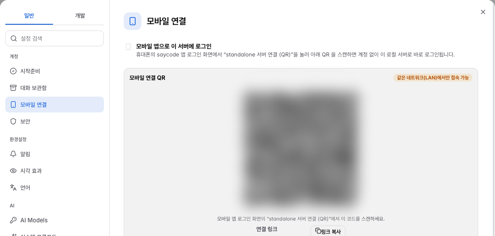

> [!NOTE]
> **Requirements**: It is visible when you are signed in with an account on Saycode's official server or are in **Personal use** on this computer. It is not visible on a server your company runs separately.

1. Install the Saycode mobile app on your phone and sign in (or connect).
2. On the desktop, open **My settings** → **General** → **Mobile link**.
3. Scan the **QR code** on screen with the phone app. If you signed in with an account and the QR has expired, click **Create new QR** and scan again.
4. In Personal use, the connection **reach** is shown. On the same network it connects right away, and on a different network you connect with **Copy link** or the tunnel buttons.

Once connected, you can watch the conversations of the same workspace in real time, and get the **Mobile completion push** (My settings → Notifications) the moment a long task finishes.

---

## 18. Teams and organizations

**Signing in opens the features you use with your team.** This chapter lists at a glance the features that need sign-in (or an organization). With just a local workspace you can use Chat, projects, worktrees, Work completion and the workspace entirely.

### 18.1 Features that need sign-in

| Feature | Where | Description |
|---|---|---|
| Organization start and switching | After sign-in, **Which organization will you work in?**, profile menu → **Select organization** | Choose the organization to work in and register this computer as an organization machine. |
| Create or join an organization | **Create a workspace**, **Join with an invite code**, **My settings → General → Join another organization** | Accept or decline invitations you received, or join with an emailed invitation link. |
| **Organization admin** | Top of the profile menu | A web admin console for owners and admins only — members, teams, permissions, model policy, audit log, **invite users**, security setup (two-step verification, recovery codes), and under operations **LLM usage and cost** → **usage statement** (CSV/print). |
| Project sharing and working together | Project settings → **Project sharing**, **Work together** (and also **MCP servers**, **SSO Login**, **Environment mounts**) | Set visibility and sharing teams, and invite teammates (project owner). The sidebar list filters by **All / My projects / Collaborating / Shared with me**. |
| Shared machines and integrations | **PC sharing settings**, connectors, messenger channels, public links, schedules, **Contact support** | See [13](#13-schedules) and [16](#16-integrations-extensions-and-messenger-channels). |
| Organization AI accounts | The AI step in Getting started, **AI Models**, the **AI usage** window | Automatic selection and replacement of the organization Claude account, continuing on another organization account when a shared machine hits its limit, and continuing with a personal Claude (**Allow personal Claude accounts on this computer**) |
| **Organization policy** | **My settings → General → Security** | See the limits an admin set. Only allowed models can be chosen, and under policy it also becomes **AI Auto**. |
| End-to-end encryption | Getting started, **Security → Trusted devices**, **Verify encryption key** | Encrypts conversations so they can be opened only on trusted devices. Keep your recovery key safe. |

The organization admin console opens on the web and consists of the menus for members, teams, permissions, model policy and audit log.

> [!TIP]
> If you want to keep using Personal use projects on this computer even after signing in, turn on profile menu → **Developer feature settings** → **Use standalone mode alongside your account**. **Switch to local-only mode** appears in the profile menu, and to return, click **Back to account**.

> [!NOTE]
> End users who open deployed app and report URLs do not need a seat. Local projects stay as they are even after you sign in.

---

## 19. Keyboard shortcuts

**On Windows use Ctrl instead of ⌘.** You can search and change all shortcuts in **My settings** → **General** → **Shortcuts**. Click an action name to expand its description, click the key button on the right and press the new combination to change it (Esc cancels, and a changed item can be restored with **Default**).

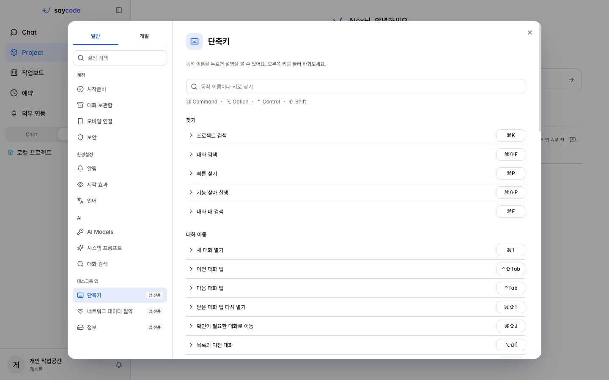

| Group | Action | Shortcut |
|---|---|---|
| Screen and navigation | Open My settings / collapse and expand the sidebar | ⌘, / ⌘B |
| | **Quick Open** (named Quick search on the shortcuts screen) / find and run a command | ⌘P / ⌘⇧P |
| | Search projects (sidebar) / **Search conversations** (all) | ⌘K / ⌘⇧F |
| | Search in conversation, find in terminal, find in diff | ⌘F |
| | Open the **Work board** / go to a conversation that needs attention | ⌘⇧A / ⌘⇧J |
| | New window | ⌘N |
| Conversations and tabs | New conversation (tab) / close tab / reopen closed tab | ⌘T / ⌘W / ⌘⇧T |
| | Next and previous conversation tab | Ctrl+Tab / Ctrl+Shift+Tab |
| | Previous and next conversation in the list | ⌥⇧[ / ⌥⇧] |
| | Go to the first nine pinned conversations | ⌘1 ~ ⌘9 |
| | Undo archive, pin and snooze | ⌘Z |
| Composer and AI | Add files and photos / send a queued request now | ⌘U / ⌘Enter |
| | Recall a previous request in an empty composer / search prompts (macOS) | ↑ / Ctrl+R |
| | Stop the response | ⌘. |
| | Next model / next effort | ⌘⇧M / ⌘⇧E |
| | Allow and deny permission requests / AI question choices | Enter·Esc / 1 ~ 9 |
| Workspace | Collapse and expand the tool panel / open a terminal | ⌘⇧B / Ctrl+\` |
| | New conversation / terminal / browser to the right or below | ⌘⌥C / ⌘⌥T / ⌘⌥B |
| | Save file | ⌘S |

---

## 20. Troubleshooting and FAQ

### 20.1 How to read conversation status

| Indicator | Meaning |
|---|---|
| Spinning icon / *Responding* | The AI is working right now. Even after the response ends, the icon stays if background work is running. |
| *Idle* | Waiting for the next instruction. |
| Orange question icon / *Awaiting input* | Waiting for an answer to a question or permission request. **The AI has not stopped; it is waiting for you.** |
| *Done* · archived | A conversation wrapped up with Archive & Done. Restore it from the archive. |

### 20.2 Update the app

- When a new version is out, an **update card** shows the download progress and **Restart**. You can also do it yourself with profile menu → **Check for updates** → **Download update** → **Restart to update**. **My settings** → **General** → **About** → **Check for updates** does the same.
- If several versions have piled up, it installs the latest in one go. After the restart, see what changed in the app's language in **Release notes** on the **New Updated!** card.
- When you quit the app, it tells you if a conversation is responding or a scheduled task is running (**Quit / Cancel**).

### 20.3 Ask for help

- **Save Diagnostics** — In the macOS menu bar, **Help → Troubleshooting → Save Diagnostics…**, or **My settings → General → About → Troubleshooting → Save Diagnostics…** (this path works on Windows too). It saves a zip with tokens, emails and user names masked. Check the contents once before sending. **Copy Version Info** copies the app, OS and daemon versions.
- Read the release notes in **Help → Release Notes**.
- [Signed in] Profile menu → **Contact support** / in Personal use, **Ask on KakaoTalk**.
- Contact: [saycode.ai](https://saycode.ai) · technical inquiries [ryan@buzzni.com](mailto:ryan@buzzni.com)

### 20.4 Frequently asked questions

**Q. When I try to start a conversation, the composer is disabled and only a notice appears.**
A. It means there is no online machine or no connected AI. Click **Open machine settings** / **Connect my AI** in the notice, or reopen [Getting started](#2-getting-started). The text and attachments you were writing are kept as they are.

**Q. I cannot connect an AI / I do not have a paid AI account.**
A. Connect Claude or ChatGPT with **Connect** in **My settings** → **General** → **AI Models**, or use **Start with free models** (Opencode). For a ChatGPT that has been logged out, first try **… → Restore from account pool** on the row.

**Q. Menus like Work board and CPU & memory do not show.**
A. You need to turn on the matching switch in profile menu → **Developer feature settings** ([3.4](#34-developer-feature-settings)).

**Q. I cannot create schedules, use messenger channels or connectors, or create public links.**
A. These need sign-in. The menu or button may be visible, but they cannot be used in Personal use, so sign in with profile menu → **Login** ([Chapter 18](#18-teams-and-organizations)).

**Q. The preview is empty.**
A. Check that you saved the dev server command and port under project settings → **Developer** → **Run**. If not, ask the AI *"keep the dev server running so I can see it in the preview"*, or start the server in the terminal and type `http://localhost:<port>` in the **Browser**.

**Q. I archived a conversation by mistake.**
A. Within 10 seconds of archiving, **Undo** or ⌘Z. If time has passed, **Restore** it in **My settings** → **General** → **Conversation archive**.

**Q. A response was cut off midway.**
A. The reason shows in the notice line, and clicking **Continue** (**Try again** if you stopped it yourself) resumes it. If you hit a usage limit, retry at the reset time or continue with another account or AI ([7.4](#74-the-ai-usage-window)).

**Q. I deleted a worktree / the AI stopped after repeating the same thing / it seems stuck.**
A. Restore a deleted worktree from **Snapshot archive → Restore** in the worktree window ([11.6](#116-worktree-safety-net)). If it stopped because of loop detection (**Stop the session automatically on loop detection** under **Development automation**), split your request into smaller ones or get another AI's view with <strong>Request independent review…</strong>.

---

## Appendix A. Renamed terms

A correspondence table for readers who know the UI from around v0.1.50. Many English names did not change, so only the names that did are listed here. (For example, **Machine**, **Agent**, **Worktree**, **Commit** and **Commit & PR** keep their English names; wording changes that apply only to the Korean UI are not listed.)

| Old name | New name | Where and notes |
|---|---|---|
| Settings | **My settings** (**General** / **Develop**) | Profile menu → My settings, **⌘,** |
| Onboarding checklist | **Getting started** | My settings → General → Getting started |
| Review panel | **Diff** | Add tool panel |
| Default (model) | **Auto** (**AI Auto**) | One button under the composer |
| Agent picker + model + reasoning effort | **One button with a two-level menu** (AI → model / **Effort**) | Lower row of the composer |
| The AI usage chip in the conversation header (`✱ 71%/17%…`) | The **AI remaining usage** button under the composer → the **AI usage** window | The "Show AI remaining usage" switch is gone and it is always shown |
| Saycode Home · the Chat/Build/Develop tabs on Home | Sidebar **Chat** / **Project** (inside: **Build** / **Develop**) | |
| New project / Open existing folder / Clone from Git URL / Import from ZIP | The **New project** window's tabs **New project / Git repository / ZIP or files / Existing folder** | The Develop cards are **Import code repository / Import ZIP/files / Use a machine folder** |
| Account area · ⋯ menu · theme (Auto · Light · Dark) | **Profile menu** · the **Dark mode** switch | The AI-usage and CPU display switches moved to **Developer feature settings** |
| Agent Board | **Work board** (hidden by default) | Developer feature settings → Show Work board menu |
| Finish work hub window | The **Work completion** menu in the upper row of the composer | |
| Check with the current agent / Self review | **Self review** | Rounds are under **Advanced settings…** |
| Hand off to an independent reviewer | **Request independent review…** | **Review history** tab |
| Mark done | **Archive & Done** | |
| Pin (Quick Commands) | **My prompts** (bookmark icon, **Save current message**) | |
| File checkpoint protection | **File checkpoints** | ⋯ menu of a new conversation |
| Outputs | **Artifacts** | The **Artifacts** view in the Files tab |
| Pick an element and send it to chat | **Pick an element to annotate** → **Send all** | Shift+click sends immediately |
| Header ⋯ → Continue with another agent | Project tools → **Continue conversation** → **Continue with another agent** | |
| How will you use Saycode? Personal use / Organization use | The start screen's **Personal use** / **Login** | Organization use = Login |

---

## Appendix B. Menu and settings map

Here the names of menus and buttons not covered in the main text are collected in one place. Use it like a dictionary when you have a name to look up.

### B.1~B.2 Menus in My settings

The left menu of My settings (profile menu → **My settings**, ⌘,). Menus marked [Signed in] do not appear in Personal use.

#### B.1 General area menus

| Group | Menus (detailed description) |
|---|---|
| Account | **Getting started** ([Chapter 2](#2-getting-started)) · **Profile** [Signed in] (display name, team) · **Conversation archive** ([Chapter 10](#10-manage-conversations)) · **Mobile link** ([Chapter 17](#17-machines-and-mobile)) · **Security** ([Chapter 14](#14-permissions-approvals-and-security)) · **Join another organization** [Signed in] · **Token usage** [Signed in] (overview, by-project, by-model and by-source usage and estimated cost) · **Connectors** [Signed in] · **Messenger channels** [Signed in] ([Chapter 16](#16-integrations-extensions-and-messenger-channels)) · **Skills** [Signed in] |
| Preferences | **Notifications** ([Chapter 14](#14-permissions-approvals-and-security)) · **Visual effects** (dark mode, screen effects Auto / Full effects / Reduced effects) · **Language** |
| AI | **AI Models** ([Chapter 7](#7-ai-models-effort-and-usage)) · **System Prompt** and **Personal memory** ([Chapter 15](#15-memory-lessons-and-the-system-prompt)) · **Conversation search** ([Chapter 10](#10-manage-conversations)) |
| Desktop app | **Shortcuts** ([Chapter 19](#19-keyboard-shortcuts)) · **Network data saver** (reduce background data on tethering and metered networks) · **About** (version, **Check for updates**, **Troubleshooting**, [Chapter 20](#20-troubleshooting-and-faq)) |

#### B.2 Develop area menus

| Menu | Description |
|---|---|
| **Machines** | Machine list, registration and sharing ([Chapter 17](#17-machines-and-mobile)) |
| **Extensions** | Install and enable official extensions, install local files ([Chapter 16](#16-integrations-extensions-and-messenger-channels)) |
| **Terminal** | In-app terminal font and font size, **Show typing early** |
| **Development automation** | Autopilot, AI review, automatic stop on loop detection and more ([11](#11-work-completion), [12](#12-work-board) and [Chapter 14](#14-permissions-approvals-and-security)) |
| **Environment** [Signed in] · **Repositories** [Signed in] | Environment variables and secrets, GitHub and GitLab account connections |
| **Memory** | Manage the AI's memory, memory protection rules ([Chapter 15](#15-memory-lessons-and-the-system-prompt)) |
| **Developer feature settings** | Switches for hidden features ([3.4](#34-developer-feature-settings)) |

### B.3 The lower row and upper row of the composer

| Element | Description |
|---|---|
| **AI Auto** (or a button showing the chosen AI and model, such as `Claude Code · Auto`) | Choose the AI, model and effort from **one button**. The default for a new conversation is **AI Auto**. → [Chapter 7](#7-ai-models-effort-and-usage) |
| **AI remaining usage** (the remaining share per service, for example `86%/72%`) | Click it to open a window with the remaining usage per account. → [7.4](#74-the-ai-usage-window) |
| `Context N%` | How full a Claude conversation's context window is. At 80% or more, a new conversation or `/compact` is recommended. |
| **CPU & memory** [Developer] | A summary of machine status (turn it on in Developer feature settings) |
| Machine name | The computer this conversation runs on and its connection status |

| Element | Description |
|---|---|
| **Repository** | The small **Repository** button at the top right above the composer collapses and expands the repository tools row, such as branch and work copy. If there is no remote repository, **Connect repository** appears next to the branch name. |
| **Work copy** checkbox (right of the row) | When on in a new conversation, you work in a **worktree** (a copy of the working folder) used only by this conversation. With the mode button beside it choose **Create new / Use existing / Start from a PR / Start from issue**, and set the base branch with the **Base** button. |
| **Bring current changes** | When the mode is **Create new**, it copies the uncommitted changes and new files in the project folder to the new worktree once. The original folder stays as it is. |
| Branch name + **PR number chip** | Click it to see **Pull**, **Push** and Git status. The badge next to the PR number shows open, merged, closed, and CI failure. |
| **Goal** | The goal set with `/goal` appears on one line, and you can use **Change goal / Clear goal**. |
| **Sub-agent running** (child agent) | Shown with the task name while child conversations created by the AI are running. |
| **Work completion** | A robot-icon button that appears at the right end of the row after the conversation starts → [Chapter 11](#11-work-completion) |

> [!NOTE]
> Worktrees and **Bring current changes** can be set only in **Git repository projects**, and only in **new conversations that have not been sent yet**. When you open a new conversation, the **Work copy** check you turned on last time may still be on, so check before sending. On Windows machines, snapshots, bringing in changes and moving conversations are not supported yet.

### B.4 The + menu and ⋯ menu in the composer

**+ (Add)**

| Menu | What it does |
|---|---|
| **Add files or photos** (⌘U) | Attaches files and photos. You can also drag and drop them into the composer. Up to 1 GiB in total is stored on this device, and attachments you have not sent yet are restored even if you move to another conversation or restart the app. |
| **Add folder** | Attaches a whole folder. |
| **Use browser for this request** [Developer] | If **Show AI Browser menu** is on, lets the AI use the browser for this request. |

**⋯ (Additional conversation options)**

| Menu | What it does |
|---|---|
| **Search prompts** | Searches requests you sent before and their attachment paths and puts one into the composer. On macOS, Ctrl+R works too. |
| **Auto Router** | Shows whether automatic model selection is on. *New conversations only* |
| **File checkpoints** | Records the state each time the AI changes files so you can roll back ([11.7](#117-file-checkpoints-and-commits)). *New conversations only, macOS and Linux machines, cannot be used with Parallel run* |
| **Set as project hub** | This conversation becomes a hub that collects the news and questions when other conversations of the same project finish (one per project). *New conversations only* |
| **Parallel run** | Starts the same request in several conversations at once so you can compare the results. You set the number of candidates and which AIs to run. *Requires a Git project + Create new worktree* |

---

Have more questions? [saycode.ai](https://saycode.ai) · technical inquiries [ryan@buzzni.com](mailto:ryan@buzzni.com)

**© 2026 [Buzzni](https://buzzni.com)**

<!-- images: icon.png, start-screen-en.png, first-run.gif, personal-use-confirm.png, login-signup.png, login-selfhost.png, onboarding-checklist.png, ai-connect-picker.png, onboarding-free-model.png, settings-onboarding.png, sidebar-crop.png, profile-menu-crop.png, settings-search-alias.png, dev-features-toggle-on.png, home-chat.png, chat-plus-menu-crop.png, doc-templates.png, result-file-card.png, chat-result-html-panel.png, home-develop.png, home-build.png, create-project-modal-new.png, create-project-modal.png, project-new-chat.png, build-by-chat.gif, project-chat.png, composer-queue.png, composer-ai-menu.png, composer-ai-menu-effort.png, auto-route-badge.png, settings-ai-models.png, ai-usage-popover-crop.png, workspace-add-panel.png, files-panel.png, workspace-diff.png, workspace-diff-turns.png, annotation-tray.gif, browser-panel.png, conversation-summary.png, sidebar-conversation-menu-crop.png, archive-undo-toast.png, settings-archive.png, conversation-continue-menu.png, quick-open-commands.png, work-finish-menu.png, independent-review-modal.png, worktree-snapshots.png, git-actions-dialog.png, worktree-manager.png, agent-board.png, agent-board.gif, agent-board-filter.png, schedule-guest-empty.png, settings-notifications.png, settings-security.png, settings-system-prompt.png, integrations.png, settings-workpc.png, mobile-companion-crop.png, settings-shortcuts.png -->
