

# Saycode Desktop User Guide

**From installation to project work to wrapping up — just follow along, in order.**
*Based on the v0.1.91 UI · November 2026*

**English** | [한국어](GUIDE.ko.md)

<!-- guidebook: version=v0.1.91 date=2026-11-17 -->

---
## How to read this guide

Saycode Desktop is a desktop app that lets AI create files, edit code and run commands for real, on your computer (or on another computer you connect). This guide is ordered so that **a first-time user can read from top to bottom and follow along**. If you already use the app, read only the chapters you need. If you know the older UI (around v0.1.50), start with the [Renamed terms](#appendix-a-renamed-terms) at the very end.

### What this guide is based on

- **Version**: Saycode Desktop **v0.1.91** (November 2026). Screen names and locations may differ slightly in later updates.
- **Operating system**: Explanations follow the macOS UI. On Windows, use **Ctrl** instead of **⌘** in shortcuts; features that are limited on Windows are noted where they appear.
- **UI language**: Labels are written exactly as they appear in the English UI. In other languages, the names may differ.

### Notation

| Notation | Meaning |
|---|---|
| **Bold text** | The exact name of a button, menu or tab as it appears on screen. |
| Profile menu → **My settings** → **General** | A path to click through, in order. |
| `Code-style text` | A value you type, or keys you press. |
| **[Signed in]** | A feature that is visible only when you are signed in with a Saycode account. It does not appear in **Personal use**, where you work without signing in. |
| **[Organization]** | A feature that requires belonging to an organization (team). Features that an organization admin must assign to you, such as the saycode plan and internal AI, are included here too. |
| **[Developer]** | A feature that appears only after you turn it on under **Developer feature settings** in the profile menu. It is separate from the **Developer mode** switch in the account menu, which decides whether you keep several conversation tabs open or just one. |

> [!NOTE]
> Each chapter follows the order "what you can do → requirements → steps → tips". The **requirements** (sign-in, organization, developer feature settings, server support, macOS/Windows) come before the steps, so if a menu is missing, check the requirements first. The screenshots were taken in v0.1.91 in **Personal use** (without signing in); parts that differ only for signed-in accounts are marked separately. The screenshots were taken with the [Developer] **Show Work board menu** and **Show CPU & memory** switches on (the start screen and the first-run screens were taken before turning them on). In a freshly installed app, the sidebar has no **Work board** and no CPU/memory readout appears under the composer ([3.4](#34-developer-feature-settings)).

---
## 0. Saycode at a glance

**Saycode is an app where "AI agents work on my machine while I watch on screen and steer."** Learn a few terms that will keep coming up and the later chapters get much easier.

### Key terms

| Term | In plain words |
|---|---|
| **Machine** | The computer where the AI actually creates files and runs commands. At first, the computer you are using automatically becomes your machine, and you can register servers or other PCs as well. Most screens call it **Machine**, and some, such as project settings, call it **Work PC** (the same thing). |
| **Agent** | The AI program that does the actual work: **Claude Code**, **Codex**, **Opencode**, **Grok** and so on. You either leave the choice to **AI Auto** or pick one yourself. In Chat they may appear as Claude and ChatGPT, and the step name in Getting started is written "AI tools" (the same thing). |
| **Runner (runtime)** | The Saycode program that actually runs the AI on your machine. When it gets old, some features turn gray and are disabled, with the reason shown. |
| **Organization policy** | Usage limits set by an organization admin (allowed models, tool rules and so on). Personal use has none. |
| **Model** | The kind of brain you pick inside an agent, from light, fast models to top-tier models for hard problems. |
| **Effort** | The level that decides how deeply the AI thinks before answering (for example Low to Max). The higher it is, the longer the AI thinks. |
| **Chat** | The place to ask questions right away, without a project, and to create documents, tables and presentations. |
| **Project** | A unit that connects one folder (usually a Git repository) and lets you build and edit code in many conversations inside it. |
| **Conversation** | One flow of back-and-forth work with the AI. Inside a project, each conversation runs and is stored separately. |
| **Worktree** | A **copy of the working folder** (a branch) just for one conversation. Even when several conversations run at once, their files never get mixed up. You turn it on with the checkbox on the row above the composer in a new conversation, which is labeled **Work copy**. |
| **Commit** | A Git commit. Use **Commit now** (or **Commit** in the Git actions window) to save your edits so far. |
| **Artifact** | A result file the AI creates during a conversation, such as a document, image or HTML page. The old name was "Outputs". |
| **My settings** | All the app's settings screens. The old name was "Settings"; the shortcut is still **⌘,**. |
| **Plan mode** | Turn it on from the composer's more (⋯) menu and the AI shows you **a plan first** instead of starting work right away. When you approve it, the work starts and the mode turns itself off ([6.9](#69-plan-mode--get-a-plan-first-then-start-work)). |
| **Connection** | The part of the model menu where you choose which account or plan the AI runs on. It is usually **AI account** (the account you connected), while **saycode plan** and **Internal AI** can be used only when your organization assigns them to you ([7.6](#76-organization-ai-connections--saycode-plan-and-internal-ai)). |
| **Bottom terminal** | A terminal that opens at the bottom right of the sidebar across the full width (⌘J) ([8.7](#87-bottom-terminal)). |
| **Developer mode** | A switch in the account menu. When it is on (the default), you can keep conversations open in several tabs and view them split on screen; when it is off, you see only one conversation ([10.9](#109-developer-mode-and-split-view)). |
| **Child conversation** | A lower-level conversation that an agent creates to hand off part of its work. You can go back to the parent conversation. |

### Chat vs. Project: what's the difference?

| | **Chat** | **Project** |
|---|---|---|
| Used for | Questions, writing, creating documents, tables and presentations | Building and editing apps and code |
| Where work happens | A working folder created automatically for each conversation | The project folder you connected |
| Files, Diff and Terminal panels | Mainly for viewing result files | All available |
| Worktree, PR, Work completion | Not available | Available (for Git projects) |
| Message rail, auto-archive | Not available | Available |

> [!TIP]
> If you are new, try **asking light questions in Chat** first, and move on to **Project** once you are comfortable.

### One round of work

1. **Prepare** — Install the app, choose **Personal use** on the start screen, and connect an AI in [Getting started](#2-getting-started).
2. **Start** — Ask a question in [Chat](#4-work-without-a-project-in-chat), or [create a project](#5-create-a-project) and open a conversation.
3. **Instruct** — Make a request in one sentence in the [composer](#6-project-conversations-and-the-composer). You can leave the AI and model to **AI Auto**.
4. **Check** — Look at the changed-files card and the result preview below the answer, check the files and changes in the [workspace](#8-the-workspace), and then ask again for anything to fix.
5. **Wrap up** — In the [Work completion](#11-work-completion) menu: review → Commit & PR → Archive & Done. For a cloud project, you can optionally go on to [deploying](#118-deploying).

---
## 1. Install and first run

**Install the app, then choose "how to start" on the first screen.** There are three ways: **Personal use**, which works right away without an account; **Login** with an account; and **Connect to a self-hosted server**, which connects to a server you run yourself.

### 1.1 Install

1. **[Download the latest installer.](https://github.com/buzzni/saycode-desktop-releases/releases/latest)** For macOS there are separate DMGs for Apple Silicon and for Intel Macs (x64). For Windows, download the installer.
2. On macOS, open the DMG and drag **Saycode** into the Applications folder. On Windows, follow the setup wizard and press **Finish** on the last screen to open the app (to avoid opening it right away, clear the launch checkbox).
3. When a new version is available, the app tells you (see [Update the app](#20-troubleshooting-and-faq)).

### 1.2 The start screen

When you open the app without being signed in, you see the screen below.

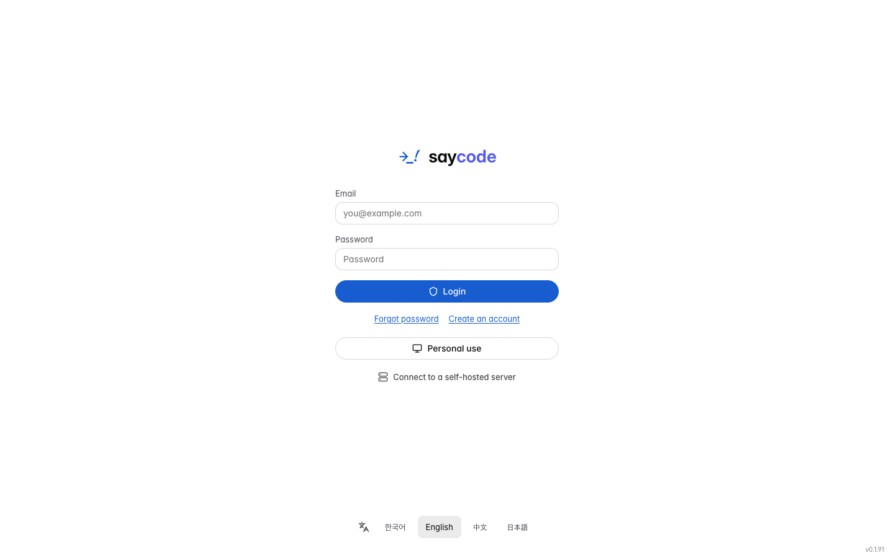

| Location | Name | Purpose |
|---|---|---|
| Top | **Email** · **Password** · **Login** | Sign in with a Saycode account. If you use an organization (team), this is the way in. |
| Below Login | **Forgot password** · **Create an account** | Sign up inside the app or reset your password. |
| Middle | **Personal use** | Start right away on your PC, with no account. |
| Bottom | **Connect to a self-hosted server** | Connect to a Saycode server you run yourself, using a connection code. |
| Bottom of the screen | **한국어 / English / 中文 / 日本語** | The app language. It changes immediately when you click. You can also change it later in **My settings** → **General** → **Language** or with the language row in the profile menu ([3.2](#32-the-profile-menu)). The app version (v0.1.91) is shown at the bottom right. |

### 1.3 Option ① Personal use — start without an account

**Requirements**: none. It appears only on the first screen when you are not signed in. In this mode, conversations and projects are stored **only on this PC**.

1. On the start screen, click **Personal use**.
2. When the **Personal use (connect my PC)** window appears, read the notice (start on your PC without an account; chats and projects are saved on your PC) and click **Confirm**. To cancel, click **Cancel**.
3. The **Preparing your workspace…** screen appears while Saycode prepares a workspace on this PC. It usually takes about 10 seconds, and the first time it can take longer.
4. When it is ready, the **"Let’s get your first task ready"** window opens automatically → this leads on to [Chapter 2, Getting started](#2-getting-started).

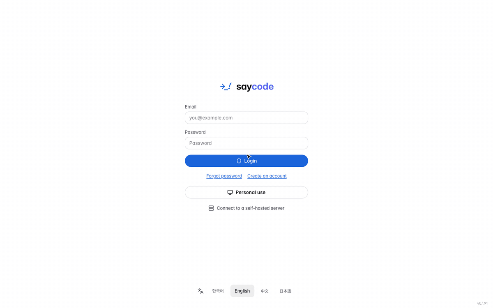

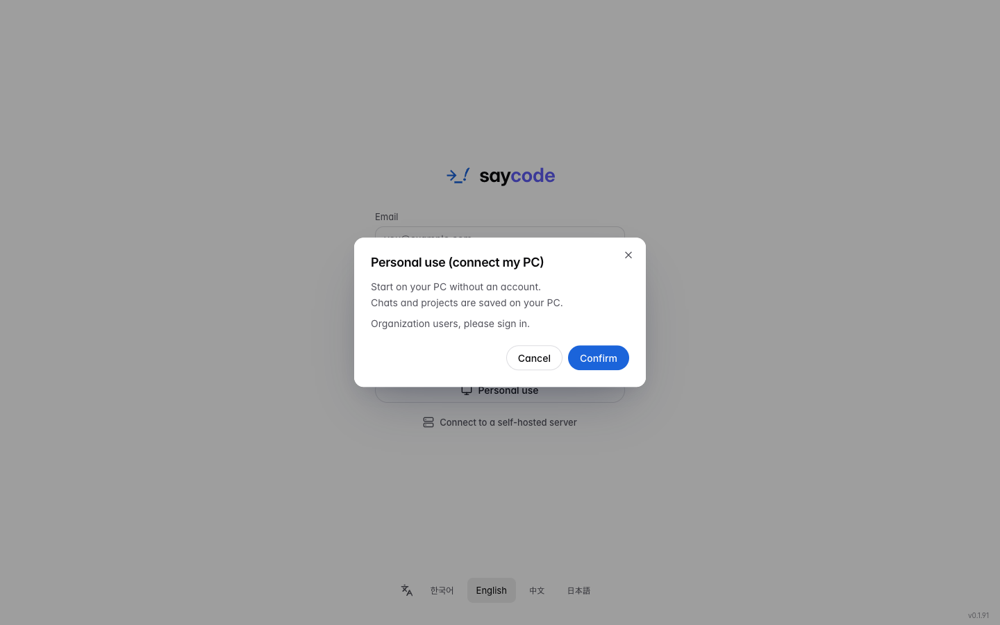

> [!NOTE]
> The line "Organization users, please sign in." at the bottom of the window means **if you belong to an organization, you need to come in with Login, not Personal use**.

> [!TIP]
> If you get an account later, you can switch to it from the profile button at the bottom of the sidebar → **Login** and use team features. Local projects you created in Personal use stay as they are after you sign in.

**Setting a name and ending Personal use**

- Even in Personal use, you can set a **Display name** (up to 20 characters) in **My settings** → **General** → **Profile** and click **Save**. Until you set one, the greeting reads "Hello, Guest" and the avatar shows **G**. The name is stored only on this computer.
- To end Personal use, click **End personal use** at the very bottom of the profile menu, then click **End personal use** once more in the **End personal use?** confirmation window. You return to the first start screen. Personal use has no **Log out**.

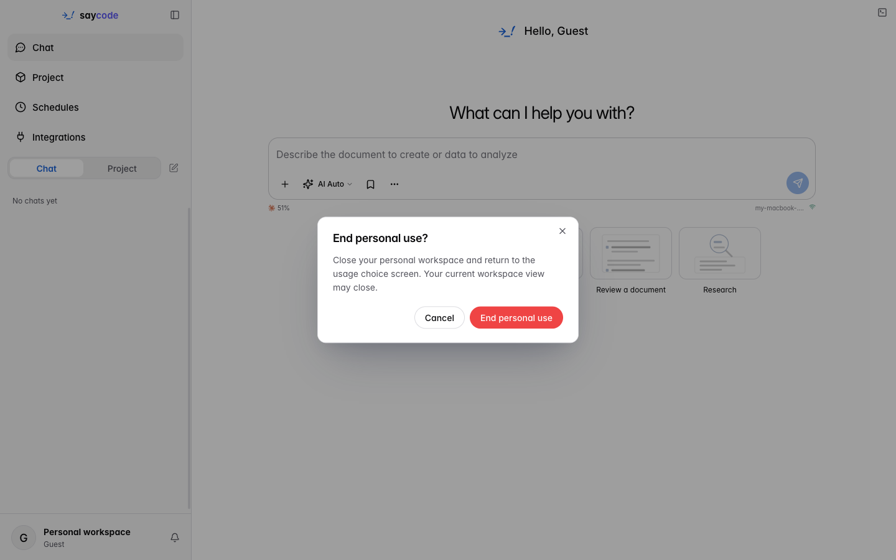

### 1.4 Option ② Login — start with an account

**Requirements**: You need a Saycode account. If you do not have one, create it inside the app as follows.

1. Click **Create an account**.
2. Enter your **Email** and click **Send verification code**. A **6-digit verification code** arrives in your inbox (check spam too); enter it. If the email fails to send, check the address and send it again.
3. Enter **Password** and **Confirm password** to finish signing up.
4. Enter the **Email** and **Password** of the account you created and click **Login**.

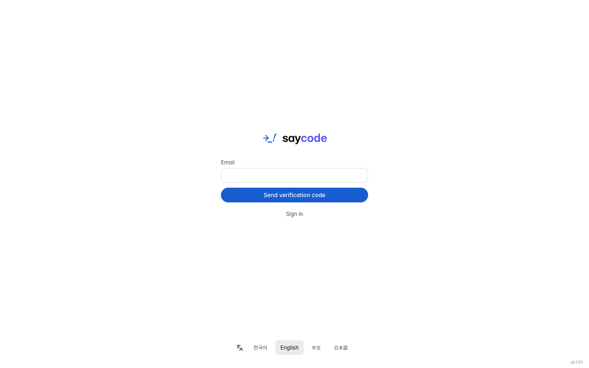

> [!NOTE]
> The **Continue with Google** button appears on the login and **Create an account** screens only when the server has turned it on. Clicking it opens Google verification and device-connection approval in your system browser, and you enter the code shown in the app into the browser. This button does not appear on the v0.1.91 screens used in this guide.

If you forgot your password, the order is **Forgot password** → enter your **Email** → **Send verification code** → enter the 6-digit code → **New password** and **Confirm password** → **Change password** → **Back to sign in**.

> [!NOTE]
> The reset code is valid for only 10 minutes, and you can press **Resend** after 60 seconds. You are not signed in automatically after the change, so sign in again.

#### Start with an organization [Organization]

If you sign in with an organization account, the **"Which organization will you work in?"** screen appears.

1. Choose the organization to work in from the list. If you do not belong to any organization, create one with **Create a workspace**, accept an invitation you received, or enter a code in **Join with an invite code** and click **Join organization**.
2. Click **Next**. Saycode prepares the tools it needs, registers this computer as the organization's machine, and checks the AI connection.
3. When it is ready, click **Complete**.

> [!TIP]
> If computer setup is stuck or you do not want to register right now, click **Start without this computer**. You enter the app immediately and can register later at **My settings** → **Develop** → **Machines** → **Register machine**. If the organization has another online machine, you can chat on that machine.

### 1.5 Option ③ Connect to a self-hosted server

**Requirements**: A Saycode server you run yourself (started with `saycode server`) and the **owner connection code** created on that server. Most users can skip this.

1. On the start screen, click **Connect to a self-hosted server**.
2. Paste the connection code issued with `saycode server connect` on the server into the **Connection code** field.
3. Click **Connect**.

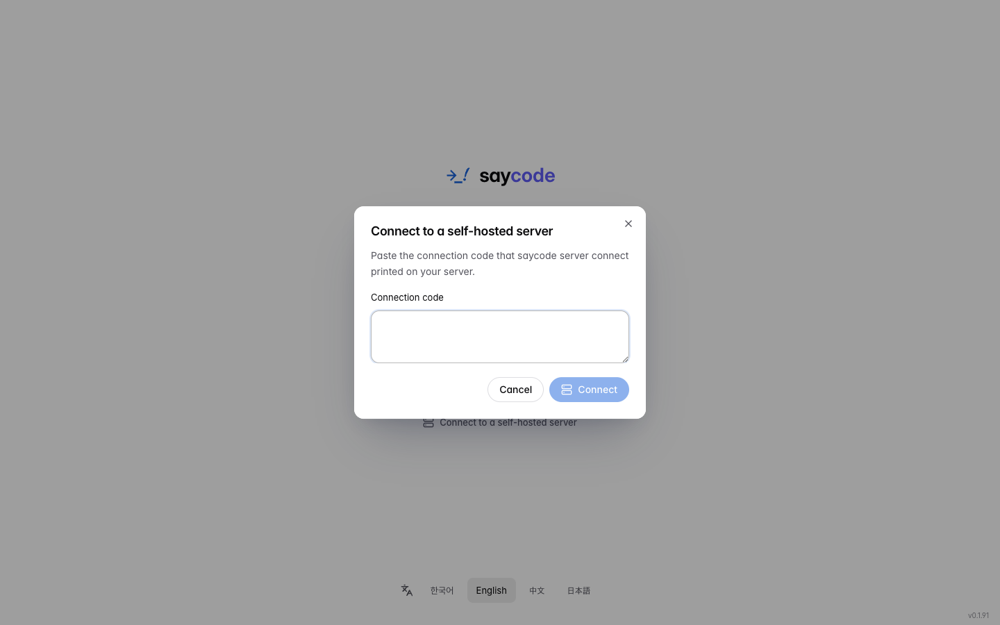

> [!NOTE]
> If you connect to a server that your company runs separately, some settings menus, such as **Getting started** and **Mobile link**, do not appear, and registering a machine works by "running the login command on the new machine and approving the resulting connection code on the server".

---
## 2. Getting started

**This is the first setup that prepares this computer so the AI can work and connects your AI accounts.** When you first enter with Personal use, the **"Let’s get your first task ready"** window opens automatically.

> [!NOTE]
> **Requirements**: A signed-in account sees the organization start screen first instead of this window. If you connected to a server that your company runs separately, the **Getting started** menu does not appear. You can close Getting started and reopen it any time.

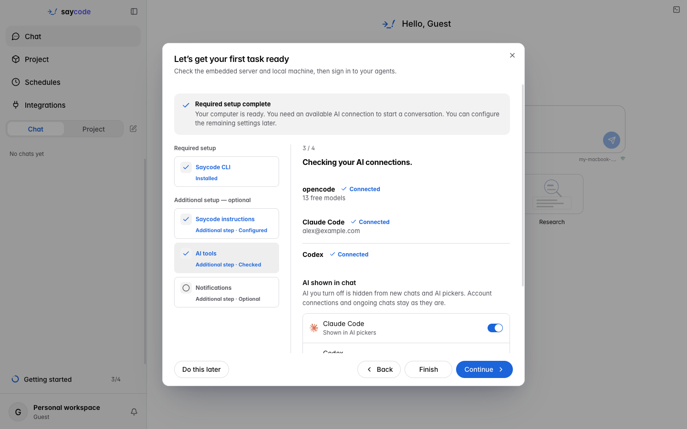

### 2.1 The steps

The list on the left is split into **Required setup** and **Additional setup — optional**. When the required setup is finished, "Required setup complete" is shown, and you can do the rest later. However, **you need at least one usable AI connection to start a conversation**. In Personal use the steps run in this order: **Saycode CLI → Saycode instructions → AI tools → Notifications**, four in all. With an [Organization] account, **Register this computer** comes right after the CLI, making five steps, and the AI tools step shows only the organization AI that your admin assigned to you.

| Group | Step | What it does |
|---|---|---|
| Required | **Saycode CLI** | Prepares the runtime where the AI actually works. It is bundled with the app, so it usually shows **Installed** right away. |
| Required [Organization] | **Register this computer** | Registers this computer as the organization's machine. |
| Additional | **Saycode instructions** | Choose between **Use instructions** and **Do not use**. At first, **Do not use** looks as if it is already checked (the default is off), but you have to click one yourself before the step shows **Configured**. You can change it later in **My settings** → **General** → **System Prompt** ([Chapter 15](#15-memory-lessons-and-the-system-prompt)). |
| Additional | **AI tools** | Checks the AI connected to this computer (Claude Code, Codex, Opencode and so on), and lets you connect an unconnected AI right here ([2.2](#22-connect-an-ai)). |
| Additional | **Notifications** | Decide on the **Input request sound** (on by default), the **Turn completed sound** (off by default) and **Mute all notification sounds**, and confirm with **Send test notification**. |

The step list on the left shows status icons instead of numbers (a check for a finished step, an empty circle for a remaining one). For an additional step, the caption changes from **Additional step · Optional** to **Configured** (for AI tools, **Checked**). After you choose on a step, click **Continue** to move on (it does not move on by itself).

At the bottom, **Do this later** is on the left, and **Back**, **Finish** (a white secondary button) and **Continue** (the blue primary button) are on the right. On the last step, Notifications, the primary button becomes **Add your first project**, which leads to the window for creating a project ([5.2](#52-the-new-project-window)). **Finish** closes the window. The **Run automatically from this step** button appears only when there are tools left to install, and it downloads and installs the tools you need.

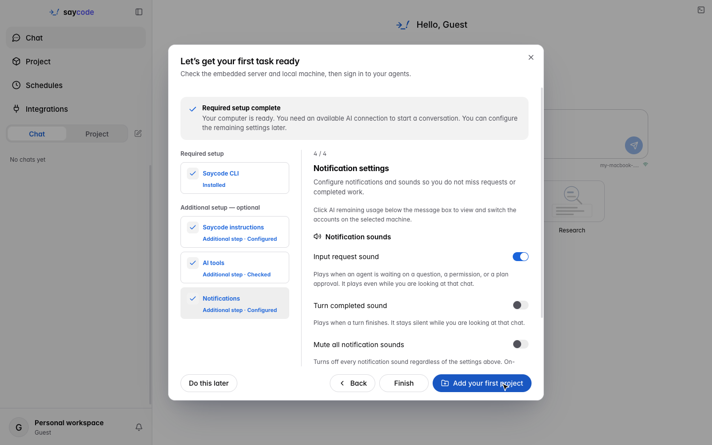

### 2.2 Connect an AI

The **AI tools** step checks the connection details once when you open it (**Checking your AI connections.**). Claude and ChatGPT that are already signed in on this computer show as **Connected** without any registration and are used as they are. AIs that are not connected do not disappear from the list; they show with their status.

| Status | Meaning | What to do |
|---|---|---|
| **Connected** | You can use it on this computer right away. | Nothing |
| **Not connected** | You have not signed in yet. | Click **Connect** on the row to open that AI’s sign-in steps. |
| **Needs a check** | The connection status could not be checked. | Check again in a moment, or click **Connect** to sign in. |

If no AI is connected, you see **Connect your AI account.** with the buttons below.

1. Click **Connect my AI account** and choose **ChatGPT** or **Claude** (ChatGPT and Claude sign in on their website, and **Free models (opencode)** starts without an account).
2. When the browser opens, sign in. Follow the instructions to click the link button and enter the **verification code**.
3. When you come back, the connection status is checked once more and changes to **Connected**.

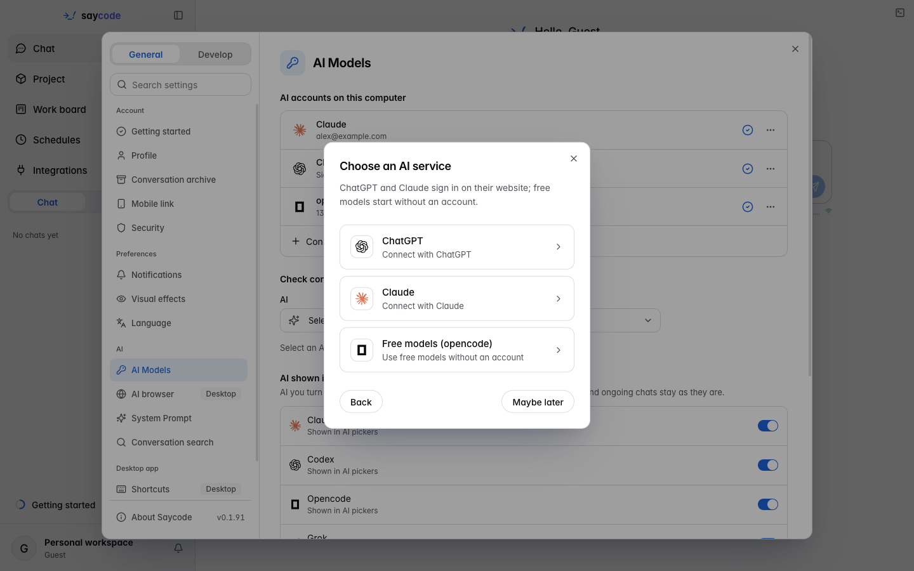

This picker window also opens from **My settings** → **General** → **AI Models** → **Connect**.

If you have no paid AI account, use **Start with free models** (more details are in [7.5](#75-start-with-free-models-opencode)).

1. In the picker window, choose **Free models (opencode)**.
2. On the **Start with free models** confirmation screen, read **Good to know** (the models are offered for a limited time and change often, usage limits and the policy on keeping or training on your input differ by model, performance may be lower than paid models, and so on).
3. Click **Install and start**. If opencode is already installed, "Check the installed opencode." appears and the button is **Check and start**.
4. When it is ready, choose **Opencode** as the agent in a new conversation. If you do not choose a model, a recommended free model is picked automatically for each message.

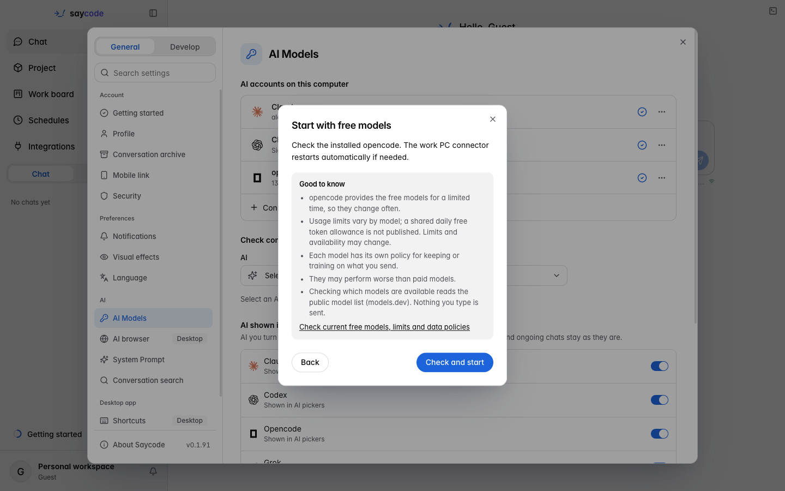

> [!IMPORTANT]
> **Free model conditions**: You can install it only when this computer is your own machine and it is online. If your organization limits the AI you can use, installation is blocked. When you hit a free-model limit, Saycode switches automatically to another free model up to 3 times, and it never moves on to a paid model.

> [!WARNING]
> **Be careful with company or customer code and confidential material.** The retention and training policy for your input (prompts and code) differs from one free model to another. Some models state that during the free period your input may be used to improve the model. For confidential material, use only free models whose provider states that they **do not retain input and do not train on it**, or connect a paid or organization AI ([7.5](#75-start-with-free-models-opencode)).

The **AI shown in chat** switches in the same step (Claude Code, Codex, Opencode, Grok) hide AIs you do not use from the selection list (at least one stays). With an [Organization] account, the AI step also shows the **Connect organization accounts**, **Verify encryption key** and **Test message** buttons; check them together with your admin.

### 2.3 Reopen it later

**Option ① The progress row in the sidebar**: If Getting started is not finished, a progress ring and a **Getting started** N/4 row (N/5 for an organization) appear at the very bottom of the sidebar, right above the profile button. Click it to open Getting started in My settings and continue with the remaining steps. When you hover over the row, a **×** (**Hide from sidebar**) appears on the right so you can hide it, and the row disappears by itself once you finish every step.

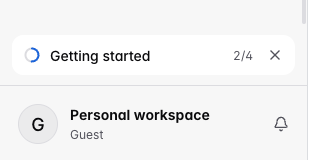

**Option ② Open it from settings**

1. Click the **profile button** at the bottom of the sidebar.
2. Open **My settings** → **General** → **Getting started**.
3. If there are tools left to install, click **Run automatically from this step**. If everything is installed (**Additional CLI tools** shows 7/7 **Installed**), just check the status (**Check again**) and close it with the last button, **Finish**. This screen has no **Add your first project**, and clicking **Finish** also removes the Getting started row from the sidebar.

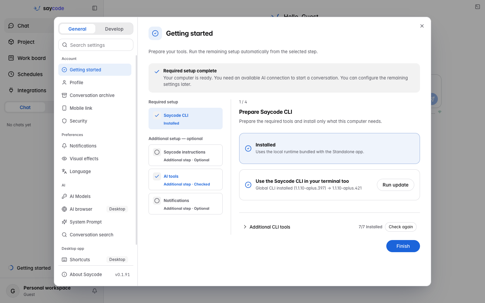

> [!TIP]
> On Windows, Node.js, uv and Git are installed for you automatically. If automatic installation is difficult, choose **I'll install them myself**. If an error appears, click **Error details** → **Next steps** → **Installation guide**, and if you need a diagnostic log, copy it with **Copy log** and send it to your support contact. On macOS, if the Git item shows **Xcode Command Line Tools needed**, click **Install Command Line Tools**, finish the Apple installer, and then click **Try again**.

> [!TIP]
> You can manage AI accounts later in **My settings** → **General** → **AI Models** with **Connect**, and with the **…** menu on a row → **Disconnect** / **Reconnect to Saycode** / **Add account** ([7.5](#75-start-with-free-models-opencode)).

---
## 3. A tour of the screen

**Saycode starts from the left sidebar, and you open settings from the profile button at the bottom left.** This chapter introduces the three big landmarks on screen.

### 3.1 The sidebar

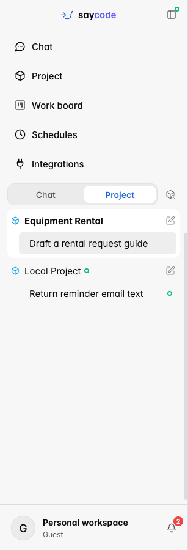

It is organized as follows, from top to bottom.

| Area | Contents |
|---|---|
| **Chat** | The start screen for conversations without a project (`What can I help you with?`) → [Chapter 4](#4-work-without-a-project-in-chat) |
| **Project** | The project home. It has two modes, **Build** (start planning by talking) and **Develop** (start from a repository or folder) → [Chapter 5](#5-create-a-project) |
| **Work board** | A kanban view of all conversations. [Developer] Hidden by default → [Chapter 12](#12-work-board) |
| **Schedules** | The screen for handing work to the AI at set times. In Personal use, you see only an example and a **Login** button → [Chapter 13](#13-schedules) |
| **Integrations** | Connect services and install extensions → [Chapter 16](#16-integrations-extensions-and-messenger-channels) |
| **Chat / Project tabs** | Switch the list below between chats and projects; the conversation you last viewed in that kind opens. The button to the right of the tabs is New project (a cube with +) in Project and New chat (a pencil) in Chat. |
| Search box and list | Click a project to expand its conversation list, and use **More** to load more when there are further conversations. |
| **Getting started** row | Appears above the profile button as **Getting started** N/4 only while setup is not finished ([2.3](#23-reopen-it-later)). |
| **Profile button** at the very bottom | Click it to open the [profile menu](#32-the-profile-menu). In Personal use it appears as "Personal workspace · Guest" (or the display name once you set one). |
| **Bell icon** | **Recent notifications**. Clicking a notification takes you to that conversation, and **View all** opens the notification center (**Unread / Read** tabs). |

**Conversation row marks**: A status dot, a worktree icon (green, blue, red or gray depending on the linked PR’s status) and the PR number are shown. An orange question icon means the conversation is waiting for your answer, and a red diamond dot means it ended in failure and you have not opened it yet.

**List search and view**: Open the search box with ⌘K as well (in a long list, you have to scroll to the top to see it). In the Project list, the three-dot button on the right of the search box (**Project view options**) lets you pick the scope **All / My projects / Collaborating / Shared with me**, **Sort conversations** (with **By status**, conversations waiting for your input move to the top), and a **Conversation status** filter. Click **Default view** to return to the original view.

**Collapse and width**: Collapse and expand with **⌘B** (or the collapse button at the top). When collapsed, only the **Expand sidebar**, Chat, Project, Work board (if you turned it on), Schedules and Integrations icons remain in a vertical column, with the notification bell and the profile avatar at the very bottom. To open My settings, click the avatar and use the profile menu. When expanded, drag the right edge to change the width.

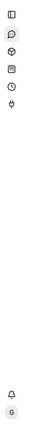

> [!TIP]
> Hover over a project row and use the three-dot (⋮) menu to choose **Pin**, **Project settings** and **All chats**. The conversation row menu is covered in [Chapter 10](#10-manage-conversations).

### 3.2 The profile menu

Click the **profile button** to open it. The order below is for Personal use.

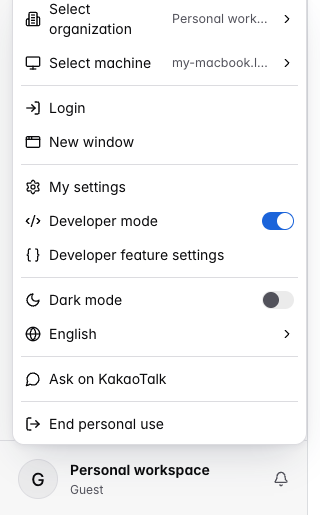

| Item | Description |
|---|---|
| **Select organization** | Switch the organization you work in. In Personal use it shows "Personal workspace", and if your account belongs to several organizations, choose from the list. |
| **Select machine** | Choose the default machine for running new work. The **Machines I registered** list opens, and machines that are offline do not appear. |
| **Login** | Sign in to an account. A signed-in account shows **Log out** instead. |
| **New window** | Opens one more app window (⌘N). |
| **My settings** | All settings (⌘,). Explained in [3.3](#33-general-and-develop-in-my-settings). |
| **Developer mode** | When on (the default), conversations open in several tabs and you can split the screen like an IDE; when off, only one conversation is shown. Tabs you already opened are not removed when you turn it off → [Chapter 10](#109-developer-mode-and-split-view). It is different from **Developer feature settings** below. |
| **Developer feature settings** | A set of switches for hidden features → [3.4](#34-developer-feature-settings) |
| **Dark mode** | A switch that turns the dark theme on and off. |
| Language row | It shows the name of the current language. Click it to choose from **한국어**, **English**, **日本語** and **简体中文**; the change applies immediately and is kept. |
| **Ask on KakaoTalk** | Opens an open chat room. When you are signed in, it becomes **Contact support** (you can attach up to 3 images). |
| **End personal use** | The very bottom item, shown only during Personal use ([1.3](#13-option-①-personal-use--start-without-an-account)). |
| **Organization admin** [Organization] | Visible only to organization owners and admins (at the very top of the menu when shown). You verify with your password once more, then the admin window opens → [Chapter 18](#18-teams-and-organizations) |
| **Check for updates** | Visible in official installs. |

### 3.3 General and Develop in My settings

When you open profile menu → **My settings** (⌘,), you switch between two areas at the top left: **General** and **Develop**. The left menu of General is divided into the groups **Account / Preferences / AI / Desktop app**, and Develop into the groups **Development environment / Development tools**. **About Saycode** (app version and update check) is pinned at the very bottom of the left menu.

Type what you are looking for into **Search settings** at the top left, such as `dark mode`, `sound`, `pause` or `automatic work`, and only the matching menus are shown (old names work too, for example `checklist` finds **Getting started**). If the menu you were viewing is not in the results, the first result opens automatically.

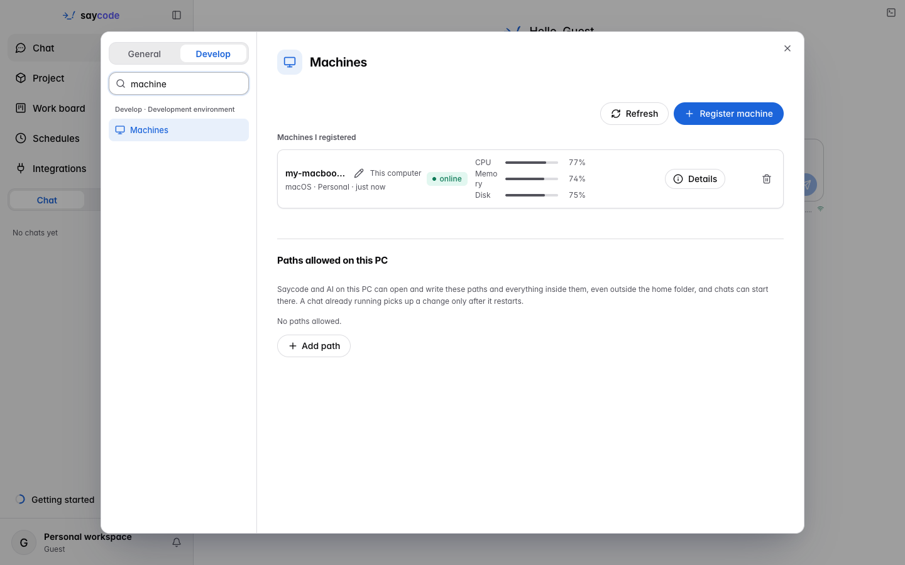

A full map of the menus is in [Appendix B.1 and B.2](#appendix-b-menu-and-settings-map).

> [!NOTE]
> Menus marked [Signed in] do not appear in Personal use (for example **Skills** and **Connectors**). Also, settings that an organization admin turns off are locked and carry the notice "Set by your organization policy, so you cannot change it."

### 3.4 Developer feature settings

Click profile menu → **Developer feature settings** (or **My settings** → **Develop** → **Developer feature settings**, desktop app only) and turn on the 10 switches below. All are off by default.

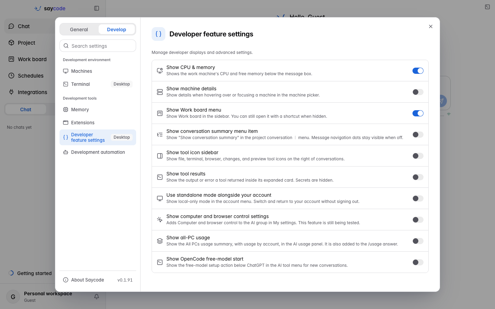

| Switch | When on |
|---|---|
| **Show CPU & memory** | Shows the machine's CPU and free memory under the composer |
| **Show machine details** | Shows details when you hover over an item in the machine picker |
| **Show Work board menu** | Adds the **Work board** menu to the sidebar. You can still open it with a shortcut when it is hidden ([Chapter 12](#12-work-board)) |
| **Show conversation summary menu item** | Adds **Show conversation summary** to the project conversation ⋮ menu ([10.1](#101-conversation-summary-and-the-message-rail)) |
| **Show tool icon sidebar** | Shows a column of file, terminal, browser, changes and preview icons on the right of the conversation |
| **Show tool results** | Shows the output or error a tool returned inside an expanded tool card (secrets are hidden) |
| **Use standalone mode alongside your account** | Use this computer's **Personal use** alongside your signed-in account. The profile menu gains **Switch to local-only mode**, and **Back to account** to return. |
| **Show computer and browser control settings** | Adds a **Computer & browser control** item to the AI group in My settings (still being tested, for checking macOS permissions) ([16.4](#164-control-the-computer-and-browser-and-connect-chrome)) |
| **Show all-PC usage** | Shows a summary of usage by account across all PCs in the AI usage window ([7.4](#74-the-ai-usage-window)) |
| **Show OpenCode free-model start** | Shows the free-model install and start item in the AI tool menu for new conversations ([7.5](#75-start-with-free-models-opencode)) |

> [!NOTE]
> **Show AI Browser menu**, **Show AI browser shortcut in conversation headers** and **Organization search settings** [Organization] are not in this list in Personal use. In Personal use, the browser and preview panels inside the app do not appear either ([Chapter 9](#9-see-it-fix-it)).

---
## 4. Work without a project in Chat

**This is where you ask questions right away, without creating a project, and create documents, tables and presentations.** Conversations are saved and can be continued even in Personal use.

> [!NOTE]
> **Requirements**: To start a conversation you need **one online machine** and **one connected AI**. If either is missing, "Open machine settings" or a blue **Connect my AI** notice appears under the composer ([Chapter 2](#2-getting-started)). Until you are ready the composer looks disabled, but what you have typed is kept.

### 4.1 Send your first question

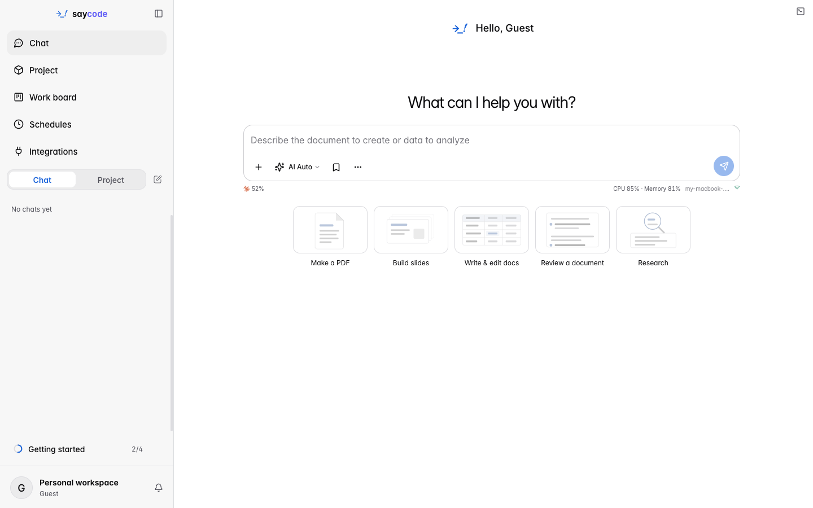

1. Click **Chat** in the sidebar.
2. Type your request in the center composer, under the heading **What can I help you with?**
3. Send it with the **send button** (paper airplane) on the right of the composer, or with Enter. To send with ⌘Enter instead of Enter, go to **My settings** → **Shortcuts** → **Send message with** and choose **⌘Enter sends** (Enter then adds a new line).
4. When the conversation opens, it is added to the list in the sidebar's **Chat tab**, and you can keep asking in the same screen.

Click the **machine name** at the bottom right under the composer to change the machine that runs this Chat (only online machines appear). You cannot change it after the new conversation starts. The **terminal icon** at the top right of the screen opens the [bottom terminal](#87-bottom-terminal) without leaving Chat.

> [!TIP]
> Click a **starter card** under the composer (**Make a PDF · Build slides · Write & edit docs · Review a document · Research**) and an example request is filled in.

### 4.2 Document formats and templates

When you create an Office document such as DOCX, XLSX, PPTX or PDF, choosing the format and template first makes the result much more reliable.

1. In a new Chat, click the **+** (**Add**) on the left of the composer.
2. In the menu, choose the document format to create — **Document (DOCX) / Spreadsheet (XLSX) / Presentation (PPTX) / PDF document (PDF)**. The same menu also has **Add files or photos** (⌘U), **Add folder** and **Start in existing directory** (use an existing folder on this computer as the working path).
3. A **Templates** gallery opens above the composer. Choose a default template (**Design Report**, **Minimal Letterhead**) or a personal template you saved. The format you chose shows as a chip above the composer (for example `Document`), and you clear it with the chip's ✕.
4. To save your own template, register an Office file and writing instructions with **Create my template**.
5. Type what you want created in the composer and send it. Example: *"Create a Q3 equipment rental status report."*

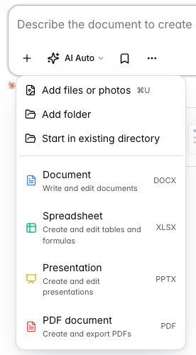

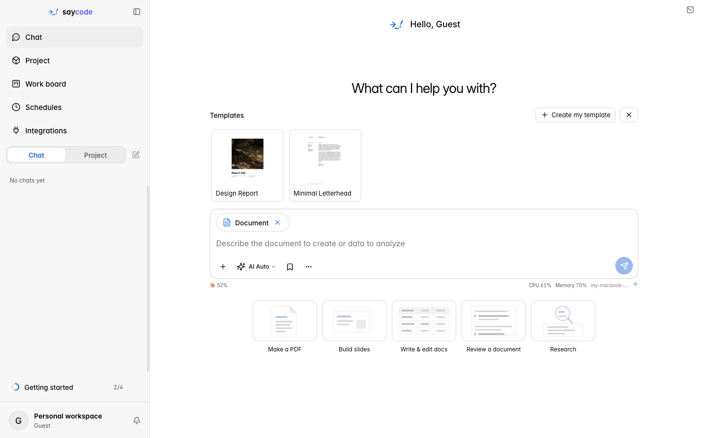

> [!NOTE]
> The default templates work without installing an extension. The source files of personal templates can be used only on an allowed **personal machine**.

### 4.3 View, save and share result files

Files the AI creates appear as **file cards** inside the answer. One row on each card has the **file name**, **Save** and **Public link**.

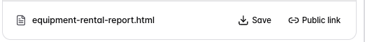

1. Click the **file name** and the document opens in the right-hand workspace tools panel (DOCX, PDF, HTML, Markdown and images are supported). HTML results show an inline preview in the chat first, and right after the first HTML result is created, a file tab sometimes opens in the right panel on its own.

   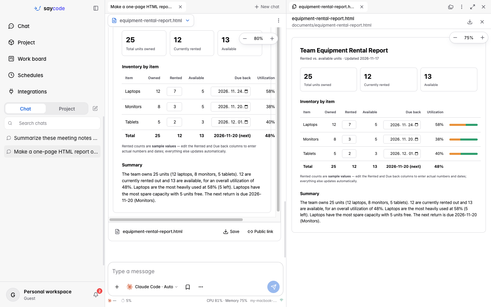

2. Click **Save** to save it to a location of your choice on your computer.
3. **Public link** is shown on the card even if you have not signed in, but creating and publishing a link requires a [Signed in] account. In Personal use, clicking it opens the Public link extension install notice, and the extension is installed only after you click **Install**. For a signed-in account, this extension is installed automatically at the first sign-in. To publish:
   1. Choose **Who can open**. The default is **Anyone with the link**; if you choose **Organization only**, organization members must sign in to open it.
   2. Choose **Expires** from 1 day, 3 days, 7 days or 30 days.
   3. Click **Publish** and an address is created. Copy it with **Copy link**.
   4. After you publish, the button turns into a check icon. Click it again to see the current address, access setting and expiry, along with **Copy link** and **Stop publishing**. If you edited the file, click **Publish revised file**.
4. [Signed in] On the card of a signed-in account, **More (…)** → **Add to My Documents** is also available. Cards in Personal use do not have this button.

**Zoom an HTML result**: Hover over the inline preview and **− 100% +** appears at the top right. Adjust it from 25% to 300%, and click the zoom number to return to 100%. The size of the whole app does not change.

> [!IMPORTANT]
> **Creating a public link works with a signed-in account.** In Personal use, use **Save** and viewing inside the app. You cannot click Public link while the AI is answering.

### 4.4 Input features available in Chat

Most of the same features as in project conversations are available in the Chat composer. See [Chapter 6](#6-project-conversations-and-the-composer) for details.

- **+**: **Add files or photos** (⌘U), **Add folder**, **Start in existing directory**
- The **bookmark** under the composer (**My prompts**) and **⋯** (**Additional conversation options**). Before your first message, ⋯ has only **Search prompts**; once the conversation has started, **Plan mode** is added.
- While the AI answers, you can put your next request in the **queue**, and you answer the AI's questions with the **question form**.
- **Plan mode**: After the conversation has started, turn on **⋯** → **Plan mode** and send, and the AI shows you a plan before it creates files ([Chapter 6](#69-plan-mode--get-a-plan-first-then-start-work)).
- `/btw` (side question), `/recap` (summary), `/usage` (AI usage), rendering of code blocks, tables and `[!NOTE]` callouts, and pasted-text cards for long pastes
- [Signed in] You can create a **schedule** by just saying so, for example "Summarize this every day at 9 a.m." ([Chapter 13](#13-schedules)).

> [!TIP]
> When you wonder how to use something, ask in Chat, for example *"Where do I turn on dark mode?"* The Saycode AI answers with in-app guidance and opens the matching settings screen right away. You can turn this off with the **Saycode usage guide** switch under **My settings** → **General** → **System Prompt**.

### 4.5 Move a Chat conversation into a project

Use this when you want to carry on in a project the work you started in Chat. **In Personal use, the Chat conversation's more menu (⋮) does not have this item** (it has only Pin conversation, Mute sounds for this chat, Session lifetime and Scheduled tasks). With a [Signed in] account, do the following.

1. Click **Conversation options** in the Chat conversation header and choose **Convert to project**.
2. Choose the project name and the files to bring along, and tick any publication confirmation that is required. If the file list is empty, click **Check file list again**.
3. Click **Convert and open project** and a new project conversation opens, and you can keep writing in its composer right away.

---
## 5. Create a project

**Connect your folder or repository as a project, and you can build and edit code in many conversations inside it.** You choose among four methods in one window.

> [!NOTE]
> **Requirements**: You need an **online machine** to create the project on. The **Git repository** tab requires a [Signed in] GitHub or GitLab connection (**My settings** → **Develop** → **Repositories**); the other methods work without an account.

### 5.1 The Project menu: Build and Develop

Click **Project** in the sidebar and you see two start modes.

| Mode | When to use it |
|---|---|
| **Build** | Describe what you want to build **in words** and start from planning. Under the heading **Start your project with a plan**, type into the composer (`What would you like to build?`) and send. A plan appears, and when you approve it, the work moves on to building ([6.9](#69-plan-mode--get-a-plan-first-then-start-work)). **Recent projects** cards appear below. |
| **Develop** | For developers who start from a code repository or folder. It has the **Create a project** · **Import code repository** · **Import ZIP/files** · **Use a machine folder** cards and the project list. Recent projects are listed with the most recently worked-on first. |

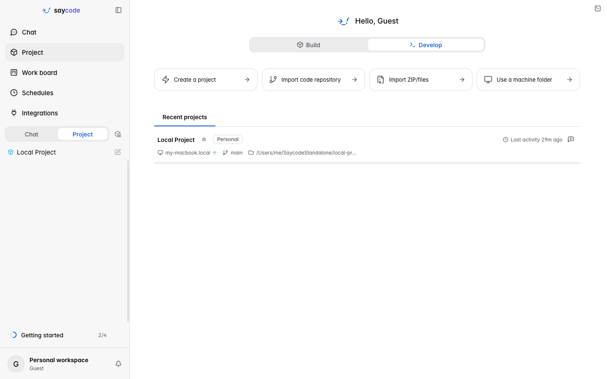

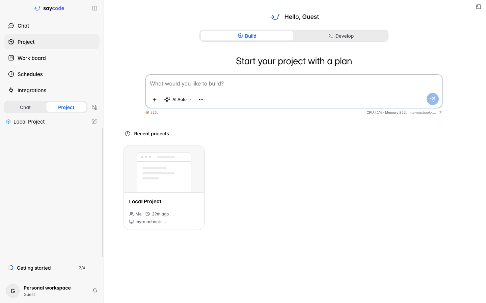

In both modes, click the **machine name** at the bottom right under the composer to choose which machine to start on.

### 5.2 The New project window

1. Click sidebar **Project** → **Develop** → **Create a project** and a window titled **New project** opens (this guide calls it "the New project window"). You can also open a specific method directly with the other cards in Develop.
2. Choose a method with the tabs at the top of the window. The values you entered are kept when you switch tabs.

   | Tab | Description |
   |---|---|
   | **New project** | Just choose a **Project name** and start from an empty folder. **Location** below the name shows where the folder will be created. |
   | **Git repository** | Clone from a remote repository address onto the machine. |
   | **ZIP or files** | Create a project from a compressed file or from files. |
   | **Existing folder** | Connect an existing codebase as it is. |

3. In **Existing folder**, folders are browsed starting from the home folder of the selected machine. Use the up arrow to go to the parent folder, or type a path into **Path** and press Enter (or click **Refresh**) to check it. Hidden folders are collapsed, and you can expand them with **Show N hidden folders** at the end of the list. On your own computer, **Start from a new path** opens the operating system's folder picker.
4. Click **Machine: name** at the bottom left of the window to change the machine the project is created on.
5. Check the name and click **Create project** (**Import project** for the import methods). As soon as the project is created, the new conversation screen of that project opens.

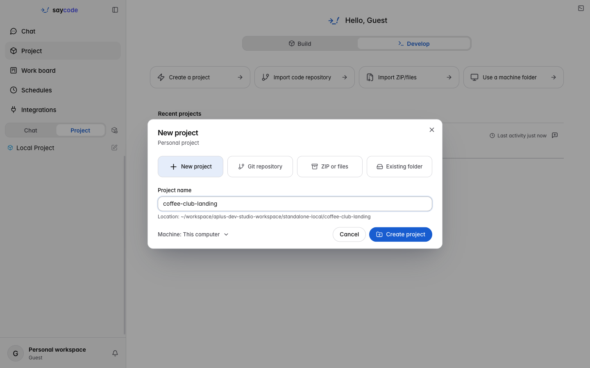

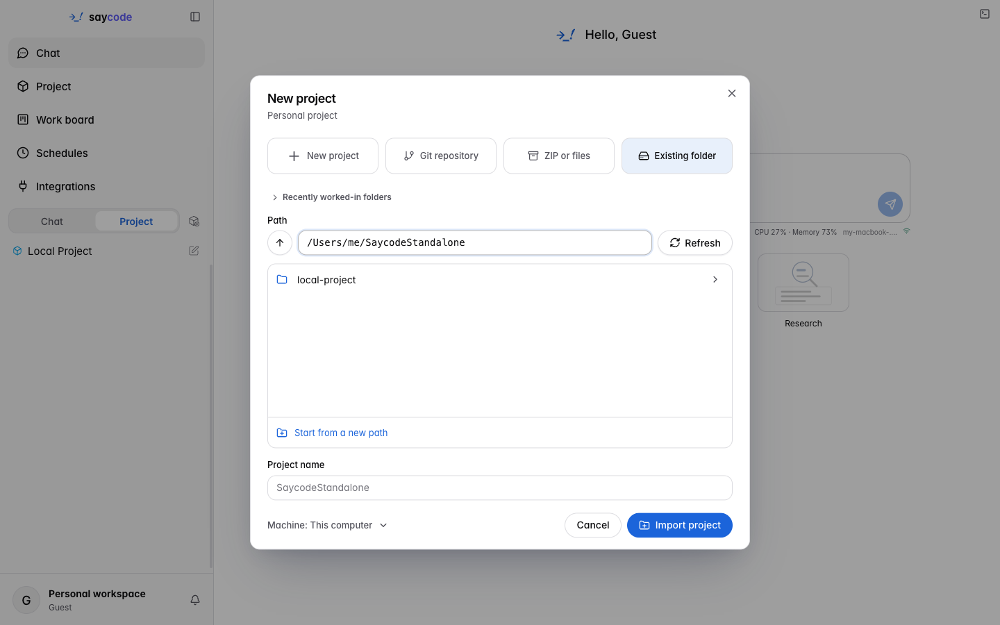

#### Create projects at once from recently worked-in folders

You can pick folders you worked on with Claude Code or Codex on this computer in the last 30 days and create projects from them all at once.

1. Click **Add your first project** on the last step of Getting started, or open the collapsed **Recently worked-in folders** on the **Existing folder** tab of the **New project** window.
2. Check the folders you want. Each row shows `N sessions` and how long ago you worked there.
3. Click **Create projects from N selected folders**.

> [!NOTE]
> Folders that are already projects are left out, and the session contents are not read. This list appears **only when the machine is this computer**.

#### Open a folder outside your home folder

If you type a path outside your home folder, you see **This folder can't be opened**. If you are using the app on this PC, you can open only folders you have confirmed with **Allow this folder** → **Allow** next to the notice.

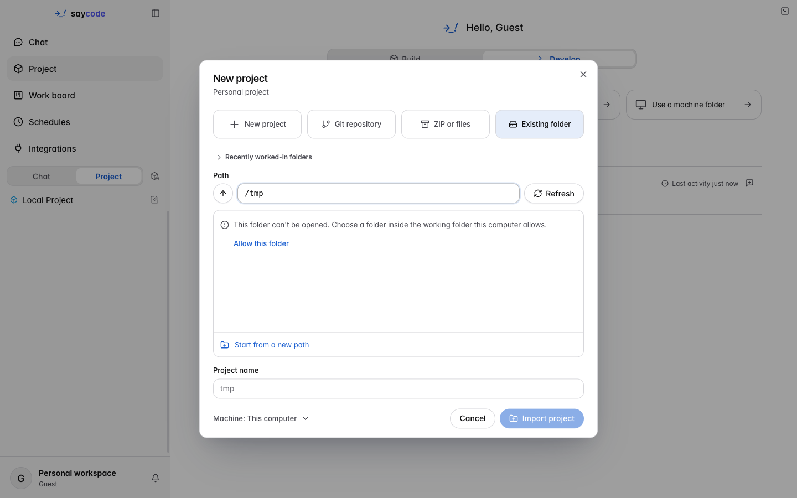

To add or cancel paths yourself, go to **My settings** → **Develop** → **Machines** → **Paths allowed on this PC**. Click **Add path**, choose **Choose folder…** or a drive and click **Allow**; to cancel, click **Revoke**.

> [!WARNING]
> If you allow a drive, your other devices signed in to the same account can reach that drive too, so allow only what you need. A folder on another PC can be allowed only in the app on that PC.

> [!TIP]
> If you are new, open a code folder you already use with **Existing folder**, or start from an empty folder with **New project**. Worktrees, branches and Commit & PR all work only for **Git repository projects**.

### 5.3 Project settings

With a project open, click the gear (**Project settings**) button next to the project name above the conversation (or the sidebar project's ⋮ → **Project settings**). It is divided into two groups, **General** and **Develop**.

| Group | Items |
|---|---|
| **General** | **Project info** (name, description, **Starting AI mode**, **Starting panel**, tags, color), **Desktop settings** (notification sound), **Delete project**. [Signed in] **Code repository** is in this group too. |
| **Develop** | **Work PC**, **Run** (dev server command and port → **Save run settings**), **Environment variables**, **Developer information** |

Signed-in organization projects have more items, such as **Work together**, **Share project** and **MCP Servers** ([Chapter 18](#18-teams-and-organizations)).

> [!NOTE]
> Many items can be changed only by the **project owner**. You can attach up to 10 **tags** and filter by tag in the sidebar.

---
## 6. Project conversations and the composer

**When you open a project and start a conversation, the center is the conversation and the right side is the workspace.** This chapter explains how to start a conversation and use the composer.

> [!NOTE]
> **Requirements**: You need an online machine and a connected AI (or a [free model](#22-connect-an-ai)).

### 6.1 Your first conversation — build an app with one sentence

1. In the sidebar, click the **pencil icon (new conversation)** next to the project name, or open the project and click **+ New chat** at the top right of the screen. The new conversation screen shows *"What can I help you with?"* and the composer (`Type a message`).
2. Type your request in the composer.

   > *"Build a landing page for a coffee subscription service. Use only HTML/CSS and include a hero, 3 pricing plans, and a testimonials section."*

3. Send it with the send button (the round one) or with Enter.
4. The AI creates the files. While it responds, the work rows are expanded and you see `Working... · 23s`; when it finishes, they collapse into one row, `Worked for 51s ›`.
5. The answer comes with a file name chip (`index.html` **Save** **Public link**), an HTML preview inside the conversation, and a [changed files card](#68-after-a-response).
6. To see the whole file, click **Show tools** (⌘⇧B) at the top right of the screen to open the workspace, then click **Files** → `index.html`. An HTML file opens as a rendered page, and if you switch to **View source** you can edit the code ([8.2](#82-the-files-tab)).

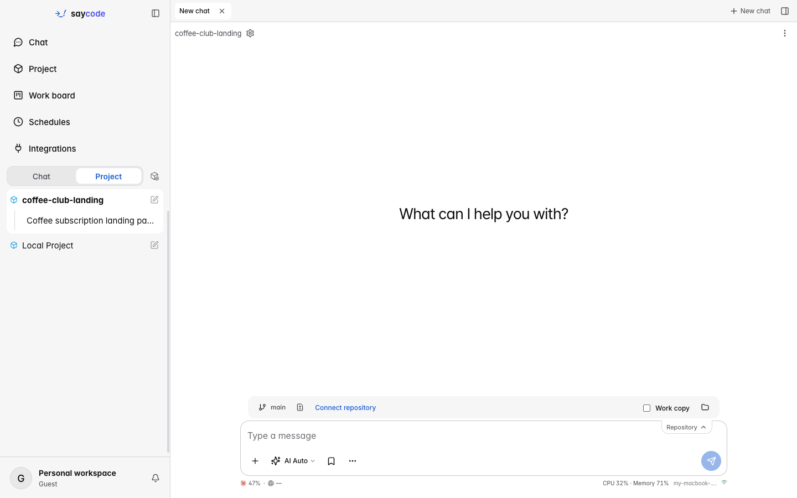

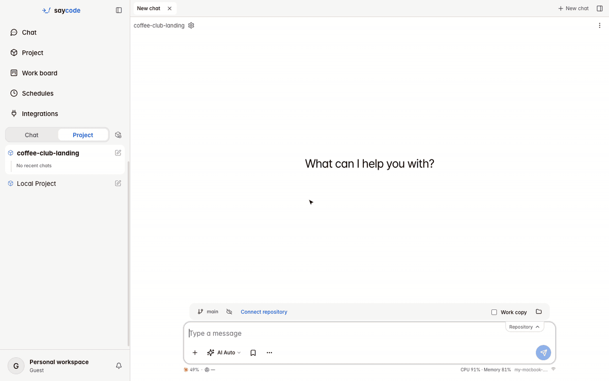

> [!NOTE]
> The **Preview** tab, the in-app **Browser** panel, element annotation and the AI browser are still being polished in v0.1.91, so they do not appear in Personal use or on most accounts (they are shown only to some organizations). The workspace does not open by itself either. → [8.5](#85-browser-and-preview)

> [!TIP]
> If you need a dev server, include *"start the dev server"* in your request. Otherwise the AI may finish with a single HTML file.

### 6.2 Screen layout

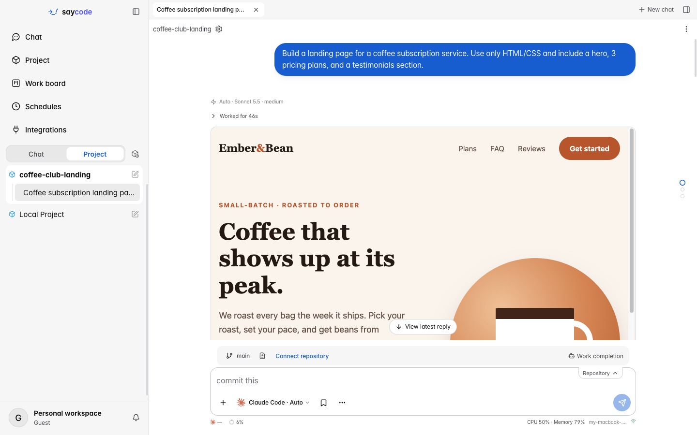

- **Conversation tab row**: Conversations open as tabs. **+ New chat** (⌘T) opens a new conversation, and **Show tools** / **Hide tools** at the far end opens and closes the workspace.
- **Header**: the project name and **Project settings** (⚙) on the left, and **⋮** on the right. In Personal use there are no **Deploy** or **Preview** buttons.
- **Right edge**: the message rail (dots). To open the conversation summary, turn on [Developer] **Show conversation summary menu item**, then click **⋮** → **Show conversation summary** ([Chapter 10](#101-conversation-summary-and-the-message-rail)).
- **Composer**: it has an upper row (branch, repository status, **Work completion**) and a lower row (AI, usage, context, CPU, memory). The **Repository** tab at the top right of the composer collapses and expands the upper row. If there is no repository, you see **Connect repository** (or **No repository connected** if you are not the owner).

**⋮** (Project tools) gathers the features of this conversation (**Search this conversation** (⌘F), **Pin conversation**, **Continue conversation** and more) and the project features (**Git actions**, **Automation**, **Open in editor…**, **Project memory** and more). Files, terminal and changes are not in the ⋮ menu; open them with **Add tool panel** in the workspace on the right ([Chapter 8](#8-the-workspace)).

### 6.3 What to know about the composer first

At first you only need to know these five things.

- **AI Auto** (the button at the left of the lower row): Choose the AI, model and effort from one button. The default for a new conversation is **AI Auto**. After you send, it changes to `Claude Code · Auto`, and the actual choice appears in the badge above the answer, such as `Auto · Sonnet 5.5 · medium`. If you pick a model yourself, it shows like `Opus 5.5 High`. → [Chapter 7](#7-ai-models-effort-and-usage)
- **AI remaining usage** (left of the lower row): The usage shows as one value such as `55%` (in a new project conversation, one per AI, such as `53% · —`). Click it to open the usage window → [7.4](#74-the-ai-usage-window). Next to it, the circular gauge and `N%` is the context usage of a Claude conversation (see below).
- The **Work copy** checkbox (right of the upper row): When on, you work in a **worktree** (a copy of the working folder) used only by this conversation. With the slider icon next to it, you choose **Mode**, **Base** and **Bring current changes**. It can be changed only in a **new conversation that has not been sent yet**, and the choice from your previous conversation may still be set, so check it before sending.
- **Project root** (the folder button next to Work copy): Use it in a monorepo when you want to work from a subfolder. Click **Select this folder** in the **Choose folder** window and the AI reads that folder's `CLAUDE.md` and `.claude` settings from the start. Use the **X** next to the button to go back to the root.
- **Work completion** (far right of the upper row, after the conversation starts): Review, PR and archive → [Chapter 11](#11-work-completion)

#### Context N% — see the breakdown and compact the conversation

In a Claude conversation, after the first answer, a circular gauge and `N%` appear in the lower row of the composer (there is no text label). Click it and the window below opens.

1. The **Context window N%** window lists the tokens used and the **Breakdown · estimated at the last response**, largest item first (a warning appears at 80% or more).
2. To reduce it, click **Compact conversation**. If there is something you want kept in the summary, type it in **Compact instructions** and click **Compact**. **Include preservation guidance** is on by default and asks the AI to keep the constraints you gave.
3. What you were typing in the composer stays as it is, and **Cancel** or Esc sends nothing.

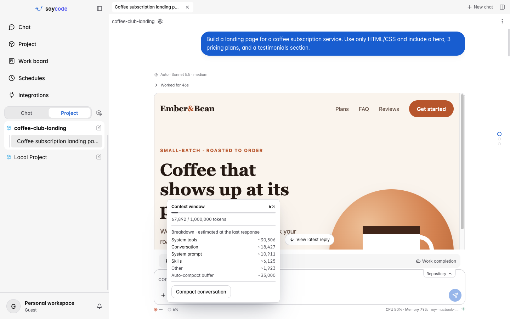

> [!NOTE]
> It appears only in Claude conversations, and you cannot compact while the AI is responding or waiting for your answer to a question.

### 6.4 Composer menus and special input

The **+** (**Add files or photos** (⌘U), **Add folder**) and **⋯** menus and the items in the upper row of the composer are in [Appendix B.3 and B.4](#appendix-b-menu-and-settings-map). In a new conversation, **⋯** has **File checkpoints**, **Parallel run** and more; in a Claude conversation after the first message, you see **Plan mode** and **Search prompts**. In the composer you can also use these inputs.

- `@` + file name → find a file among all the project files and put it into your request.
- `@` → **Git changes**: attaches `@diff` (uncommitted changes), `@staged` (staged changes) or `@git:N` (the last N commits) as a diff. This works only in a Git repository.
- `@` + conversation title → attach another conversation from the same project so the AI reads it.
- `/` → the command list (up and down + Enter/Tab). If you click a blue command in an answer, such as `/review`, it is only added to the composer and not sent automatically.
- `/btw question` (side question): a short answer appears as a card without stopping the work in progress. It works only in a **Claude conversation** that has already started.
- `/recap`: shows a card summarizing "so far" and "next step" (a **Claude conversation** with 3 or more of your messages).
- When you paste long text it becomes a `Pasted text · N lines` card, and you can right-click text in an answer to **Quote** it. Other ways to attach files are in [8.8](#88-attach-files-to-the-conversation).

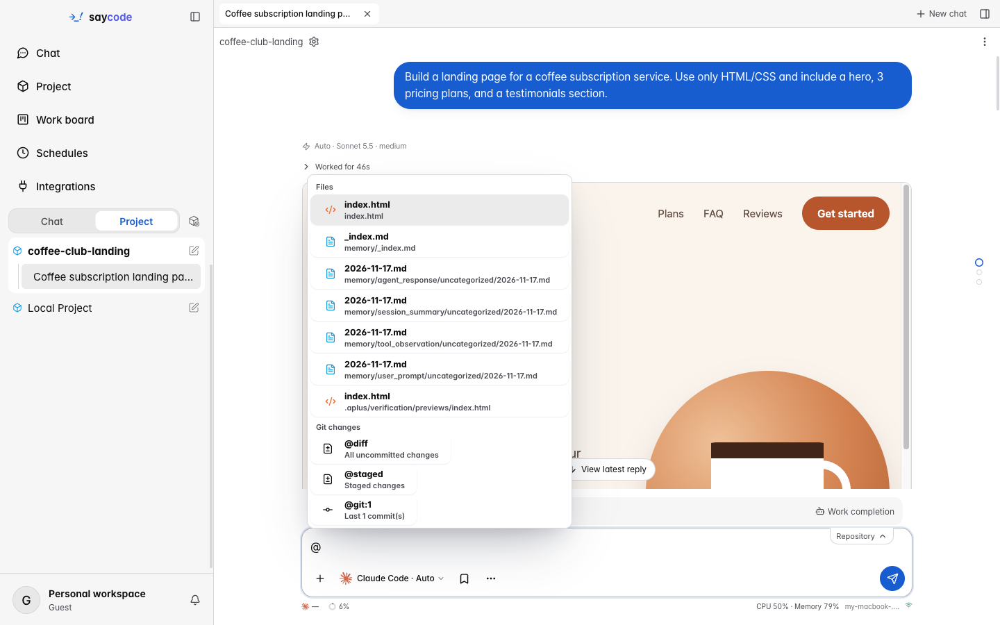

### 6.5 My prompts — save frequent requests

1. Type a sentence you use often in the composer.
2. Click the **bookmark icon** (**My prompts**) in the composer.
3. Click **Save current message** to save it.
4. From then on, click the sentence in the same bookmark menu to put it straight into the composer. Edit it with the pencil icon and delete it with the trash icon.

> [!NOTE]
> [Signed in] They are encrypted and saved to your signed-in account and synced, so the same list appears on other PCs. In Personal use they are saved only on this device, and they stay even after you end Personal use. Saved sentences appear in every project. When the composer is empty, the **↑** key recalls only the requests sent in the *current conversation*, one after another.

### 6.6 The queue — stack your next requests while the AI answers

You can type your next request in the composer even while the AI is answering.

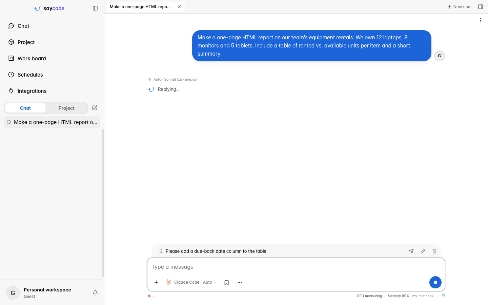

1. While the AI answers, type a request in the composer and press Enter, and it is added to the queue. The queue holds **up to 3** requests and sends them one by one, oldest first, once the answer finishes.
2. To hand something to the current answer right away without stopping the response, click **Steer now** on the card (the send icon). With the default settings, ⌘Enter (Ctrl+Enter on Windows) does the same.
3. Edit a request in place with **Edit** (the pencil icon), and remove it with **Delete** (the trash icon).
4. When you **stop** a response, the queue is kept but **it is not sent automatically.** Click **Resume sending** (the play icon) on the **Stopped · queued requests won't be sent automatically** row to carry on.

**New message during a response**: At the top of **My settings** → **Shortcuts**, choose what happens to a message you send while the AI is answering: **Add to queue** (the default), **Steer now** or **Stop and send**.

### 6.7 Answer the AI's questions

When the AI asks a question with choices, **the composer turns into a question form.** In the sidebar, an **orange question icon** is attached to that conversation row.

1. Click a choice or pick one with the **number keys (1–9)**. If you want to write your own, type it in the field.
2. If there are several questions, move on with **Previous question / Next question**, and click **Send** at the end. To move on without answering, click **Skip**.
3. To answer with a file or photo, click **+** to the left of the box where you write your own answer → **Add files or photos**.

> [!NOTE]
> If you leave a question unanswered, the AI is **waiting for your answer**, and the queue is not sent either.

### 6.8 After a response

- **Next steps card**: At the end of an answer, a summary of "what is done and what is left" and suggested buttons appear, and the hint text in the composer changes to the suggested sentence too. In a Git repository project, buttons such as **Request commit / Create PR / Merge PR / Fix CI with AI / Self review / Archive as done** appear only when they can be done now (they do the same thing as [Work completion](#11-work-completion)).
- **When a response is cut off**: **Continue** appears with the cause (**Try again** if you stopped it yourself). For a temporary error, an automatic retry countdown appears.
- **Changed files card**: Below an answer that edited files, a card like `2 changed files +86 −0` appears, together with the line counts for each file. Click **View turn changes** and the Diff tab opens at **By turn** · **This turn** ([8.3](#83-the-diff-tab)). If you reload the screen the card may disappear; in that case, open **By turn** in the Diff tab.
- **Child conversations** (sub-agents): **N child conversations** appears in **⋮**, where you can **Steer** or **Stop** them, and in a child conversation you go back with **Go to parent conversation**.
- **Hover over one of your messages** to see **Copy message**, **Rewrite from here** (creates a new conversation from the conversation up to just before that message; possible only in a conversation linked to the AI's history), and **Delete message**. In a conversation with file checkpoints on, Saycode also asks whether to roll the files back ([11.7](#117-file-checkpoints-and-commits)).
- **Hover over an AI answer** (a Claude project conversation, the last answer of a turn) and you can create a new branch up to that answer with **Branch from here** ([10.7](#107-continue-and-branch)).

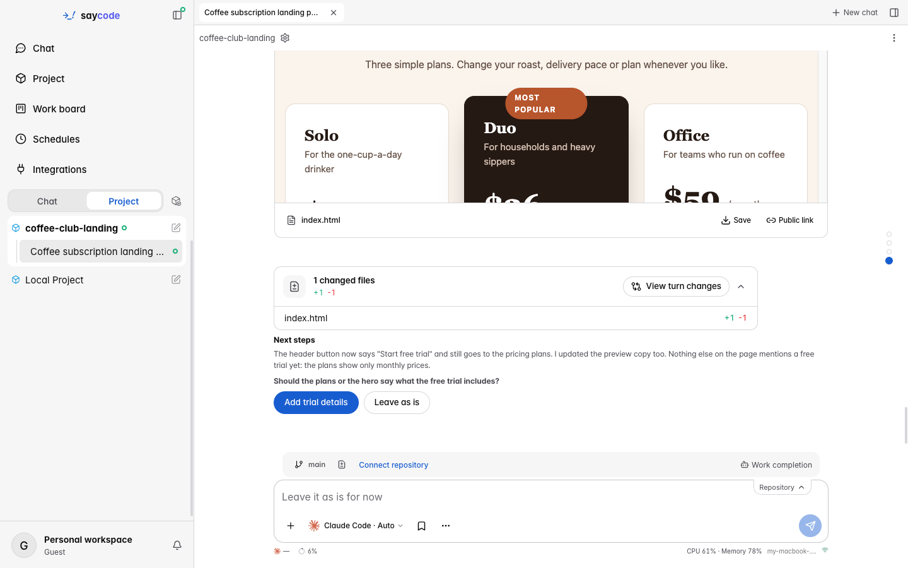

### 6.9 Plan mode — get a plan first, then start work

**This mode makes the AI show you a plan before it changes any files.** You can use it in Claude conversations (project conversations and personal Chat).

1. After you send the first message, click **Plan mode** in the composer's **⋯** menu and a check mark appears. This item is not shown before the first request of a new conversation.
2. Type a request and send it. Before changing any file, the AI shows a **plan card**. While it waits for your approval, the tab shows an **Awaiting input** badge.
3. On the card, choose **After approval** (**Allow everything** (default) / **Auto-approve edits only**) and click **Start work**. The AI starts working, and Plan mode turns itself off.
4. If you do not like the plan, click **Request changes** or **Deny with a reason**. Meanwhile Plan mode stays on, so your next message also gets a plan first.

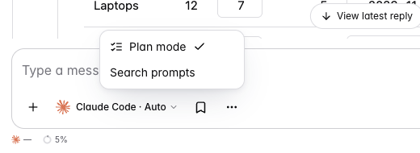

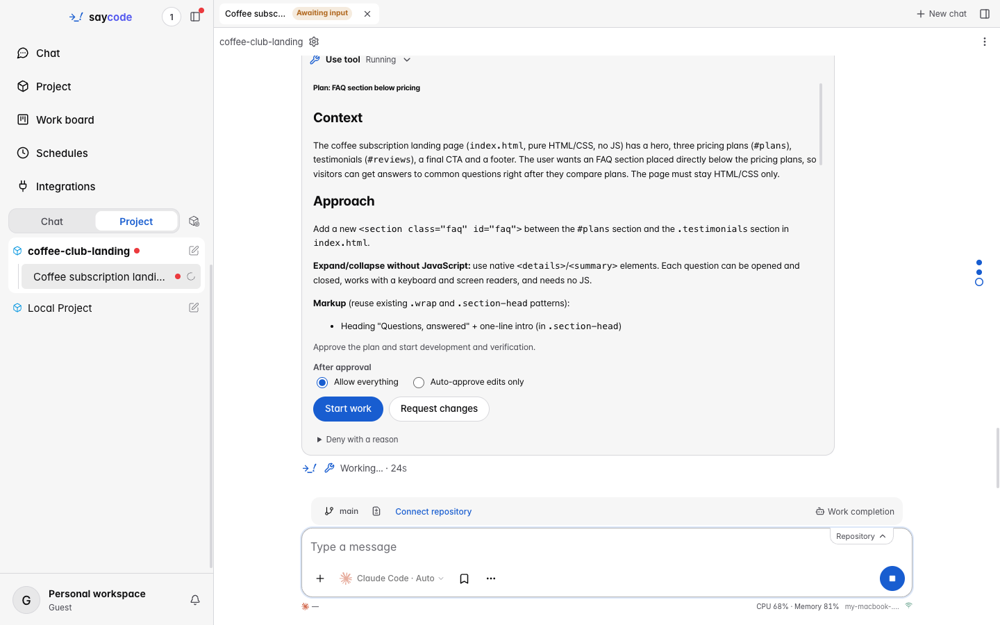

> [!NOTE]
> When you reopen the app, Plan mode starts out off.

#### Start work from a plan

In a conversation where a plan was made first, such as a project started from a plan (Project → **Build**), you start the implementation with **Start work** below the answer.

- **Start work** right below the most recent answer that reflects the plan starts the implementation without a confirmation window, and if it cannot start, Saycode shows the reason and a button to try again.
- When the implementation is done, Saycode runs the preview server. On an account that shows the **Preview** panel, it opens by itself the first time, and if it fails you see the error and **Approve one AI recovery**. On an account that does not show it, check the result in the file tools as in [6.1](#61-your-first-conversation--build-an-app-with-one-sentence). You stop the work with the stop button in the composer.

---
## 7. AI, models, effort and usage

**Decide which AI works and how deeply it thinks, and check the remaining usage of your AI accounts.** In most cases, leaving it to **AI Auto** is fine.

> [!NOTE]
> **Requirements**: Only the AIs and models you can use appear in the list. In a new conversation you can change everything, and in a conversation in progress you can change **only the model and effort** (not while the AI is answering). The model list changes with updates, so rely on the list you see in the app.

### 7.1 Choose the AI, model and effort

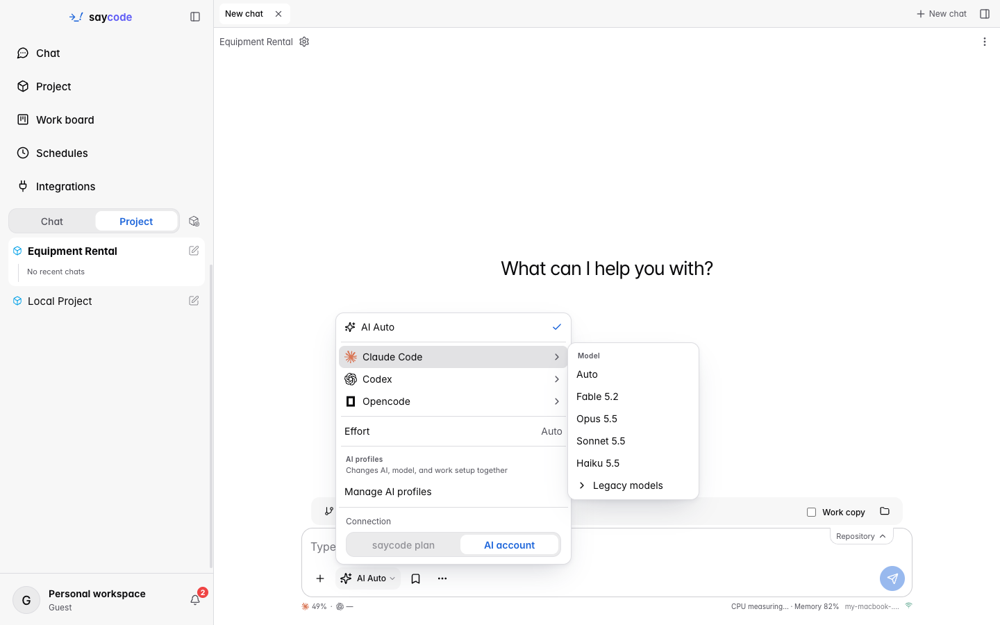

1. In a new conversation, click **AI Auto** (or the button that shows the current model name and effort) in the lower row of the composer.
2. If you choose **AI Auto**, Saycode looks at how hard the request is and picks the AI, model and effort. To choose yourself, hover over an AI name and pick a **model** in the submenu (choosing **Auto** makes only the model automatic). Older models are in the **Legacy models** group.
   - In **Chat** the AI names are **Claude / ChatGPT / Opencode**, and in a **project** they are **Claude Code / Codex / Opencode** (Grok too, if it is installed). Chat and projects simply show the same AI under different names.
   - To work without a paid AI, pick a free model under **Opencode** ([7.5](#75-start-with-free-models-opencode)).
3. Choose the **Effort** after you pick a model yourself. While in AI Auto, this row is grayed out and shows `Auto`. Depending on the model there are steps such as Low · Medium · High · Xhigh · Max.
4. After you send, the button changes to something like `Claude Code · Auto`, and in that conversation you can change only the model and effort.

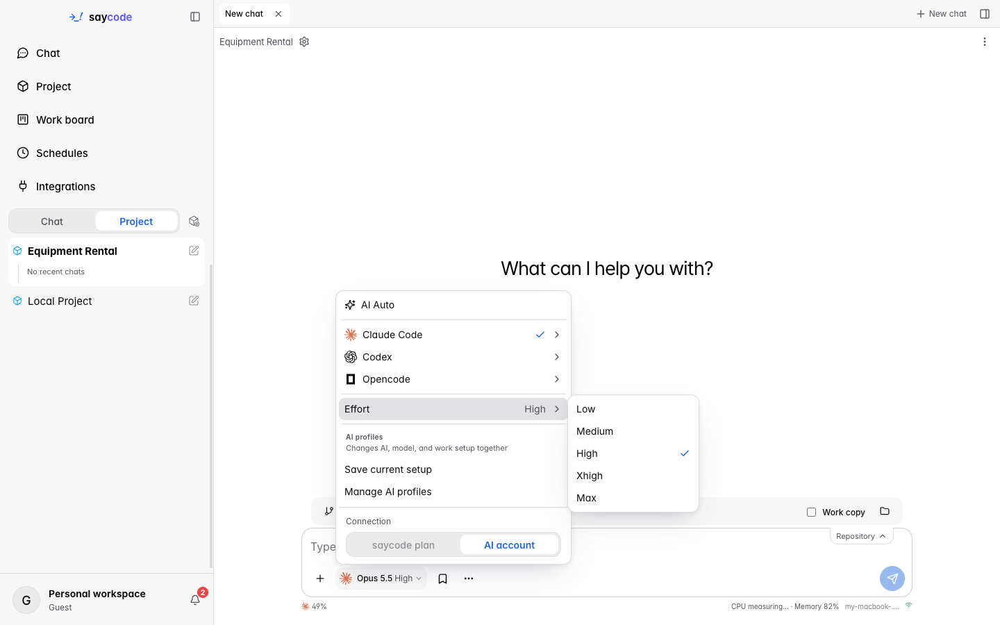

> [!TIP]
> **If you leave the model on Auto**, Saycode picks the model each turn according to difficulty. It handles a typo fix lightly and sends only truly hard problems to a top-tier model. A one-line badge (for example `Auto · Sonnet 5.5 · medium`) stays above the response so you can see how it chose.

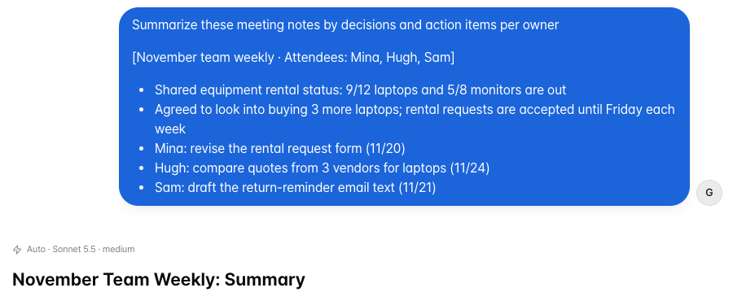

When you choose yourself, the composer button shows the AI logo, the model name and, in gray, the effort (for example `Opus 5.5 High`). If the composer is narrow, the effort is left out.

**Shortcuts**: With focus in the composer, **⌘⇧M** switches to the next model and **⌘⇧L** (Ctrl+Shift+L on Windows) to the next effort (they do nothing while a response is in progress or when there is only one choice).

### 7.2 AI profiles — save favorite combinations

1. In a new conversation, choose a specific AI and set the model and effort.
2. In the AI button menu, click **Save current setup** to save it as a profile (it appears in the menu after you choose a model).
3. From then on, pick it from the **AI profiles** list in the same menu to apply the AI, model and work setup all at once. To edit or delete, click **Manage AI profiles**.

### 7.3 Set the AI list and defaults

Set the following in **My settings** → **General** → **AI Models**.

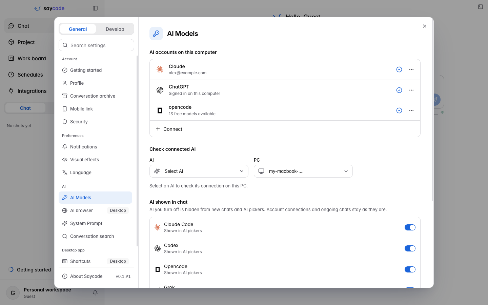

- **AI accounts on this computer** — Shows the connection status of the Claude, ChatGPT and opencode accounts allowed on this PC. Use **Connect** to connect your own account through the browser. In a row's **…** menu, choose **Disconnect**, **Reconnect to Saycode** or **Add account**.
- **Check connected AI** — Choose an AI and a PC to check the connection status.
- **AI shown in chat** — Hide AIs you do not use from the AI selection list of new conversations (conversations in progress stay as they are).
- **New conversation defaults** — Set the default AI, Model and Effort for new conversations separately with **Chat defaults** and **Project defaults**.
- **Opencode row … → Install** — Install the free models ([7.5](#75-start-with-free-models-opencode)).

To hand a project conversation in progress over to another AI, use Project tools (⋮) → **Continue conversation** → **Continue with another agent** ([10.7](#107-continue-and-branch)).

### 7.4 The AI usage window

Click the **AI usage chip** at the lower left under the composer (the AI logo and a usage percentage, for example `55%`) to see the AI accounts connected to this machine and their remaining usage. A new Chat shows the value for one AI, and a new project conversation lists a value per AI, such as `53% · —`. Once a Chat starts, the chip changes to `—`, and when you open the window it says "This conversation's account is not confirmed." You can still see the account list.

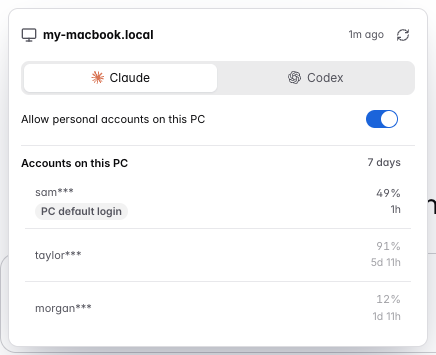

1. Choose the AI to view with the tabs at the top (**Claude / Codex**, plus Grok if it is installed).
2. Under **Accounts on this PC**, see each account's **7 days** usage and the time left until reset. Emails are partly hidden, like `abcd***yz`. Accounts not used in the current conversation appear in gray.
3. The `1m ago` style text at the top is the time of the last check, and the **Refresh** icon next to it rereads the latest values. Sending just `/usage` in the composer also attaches the same summary to the conversation.
4. If the **Allow personal accounts on this PC** switch is off, the list of personal accounts and its notice are hidden.
5. If you have connected several accounts, turn on **Auto account rotation** and, even if one account hits its limit, Saycode switches to another account automatically. You can also see usage per account. The **All PCs** row appears only when [Developer] **Show all-PC usage** in **Developer feature settings** is on (off by default).

> [!NOTE]
> The machine must be online to see real values. An account whose usage could not be checked is left out of the total.

[Signed in] **Choosing an organization account**: If your organization has several Claude accounts, choosing a different one applies not only to new conversations but also to the conversation you are viewing (for a conversation that is answering, **from the next answer**). For a conversation running on an earlier tool or on a personal account, or a conversation on a shared PC, it applies only to new conversations. Compare your usage history over 7, 30 and 90 days under **My settings** → **General** → **Token usage**.

### 7.5 Start with free models (Opencode)

**Even without a paid Claude or ChatGPT account**, you can install opencode on this computer and chat right away with free models. If you do have a paid AI, you can install it alongside and pick per conversation.

> [!NOTE]
> **Requirements**: You can install it only when this computer is your own machine and it is online. If your organization limits AI models, you cannot install it, and it does not appear in Windows trial builds.

1. Start from whichever of these is handiest.
   - **Start with free models** in the AI step of [Getting started](#22-connect-an-ai)
   - **Free models (opencode)** in the **Connect my AI account** window (or **My settings** → **General** → **AI Models** → **Connect**)
   - **My settings** → **General** → **AI Models**, **…** menu on the Opencode row → **Install**
2. Before installing, Saycode shows the **install location** and the **conditions of free models** (offered for a limited time, a retention and training policy that differs by model, and performance that may be lower than paid models). It installs only after you read and confirm.
3. When "Ready to start with free models." appears, you are done. In a new conversation, choose **Opencode** on the AI button.
4. In the model list, free models are marked `· Free` and the suggested ones `· Recommended free`. **If you do not choose a model**, a recommended free model is used for each message automatically.

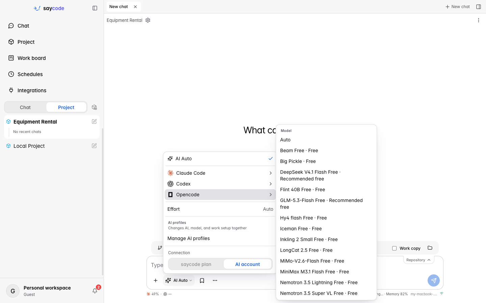

If no free model is available, Saycode does not send the message and asks you to **Check again**. Check again a little later, or connect another AI.

> [!WARNING]
> **Check what you send to a free model.** Free models are offered by OpenCode for a limited time, and **each model has its own data policy**. As of November 1, 2026, the OpenCode Zen documentation says GLM-5.3-Flash Free and DeepSeek V4.1 Flash Free do not retain input and do not train on it, that some models such as Big Pickle may use input to improve the model during the free period, and that the NVIDIA Nemotron models are for trial use only, so you should not submit personal or confidential data. The list and policies can change, so check them yourself in the [OpenCode Zen docs](https://opencode.ai/docs/zen/).
> For company or customer code and confidential material, use only free models whose provider states that they do not retain or train on input, or connect a paid or organization AI.

> [!NOTE]
> The **OpenCode · Start with free models** item appears in the AI menu of a new conversation only when [Developer] **Show OpenCode free-model start** in **Developer feature settings** is on (off by default).

For how much you can use per day, see [20.5](#205-how-much-can-i-use-free-models).

### 7.6 Organization AI connections — saycode plan and Internal AI

Under **Connection** at the bottom of the AI menu, you choose how this conversation runs. It is also shown in Personal use.

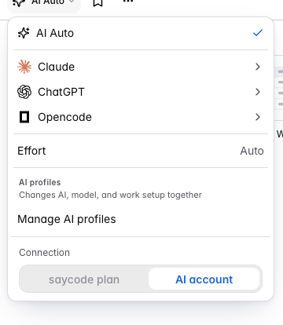

| Tab | What it is | Requirements |
|---|---|---|
| **AI account** | Runs with an AI account you connected, such as Claude or ChatGPT (the default). | Anyone |
| **saycode plan** | Runs on your organization's flat-rate plan. | [Signed in] [Organization] You have a plan tier. Otherwise it is grayed out, and hovering shows "You cannot use the agent plan right now. Ask your organization admin to check your plan tier." |
| **Internal AI** | Runs on an in-house LLM that your organization operates. | [Organization] Only when an administrator has registered it and assigned it to you. If nothing is assigned, the tab does not appear. |

- **How to choose**: If you are in Personal use, or you work with your organization's AI accounts, choose **AI account**. If your organization has prepared a flat-rate plan, choose **saycode plan**. If you must use an LLM inside the company, choose **Internal AI**. The connection you chose last becomes the default for your next new conversation.
- **You cannot change the connection of a conversation that has started.** To change it, start a new conversation.
- For Internal AI, on your own dedicated machine in the organization, choose **Claude** as the AI, choose a connection under **Connection** → **Internal AI**, and then send. If it cannot start, Saycode shows the reason instead of quietly switching to another connection. Members cannot register or assign an Internal AI themselves.
- **saycode plan usage**: In a conversation that ran on saycode plan, the **saycode plan** button under the composer shows your plan tier, your **This month · This week · 5 hours** usage and the reset time. When you reach a limit, the model button shows `saycode plan · Limit reached` and a notice tells you to start a new conversation with **AI account** (it does not switch automatically).

---
## 8. The workspace

**On the right side of the project screen, you check the AI's work by looking at files, changes and the terminal.** It sits next to the center conversation, so you can see the conversation and the work results together.

> [!NOTE]
> **Requirements**: The project must have an **online machine** connected. The **Diff** tab is available only in Git projects. The **Preview** tab and the **Browser** panel are offered only to some organizations, so they do not appear in Personal use or in ordinary accounts ([8.5](#85-browser-and-preview)).

### 8.1 Open it and add panels

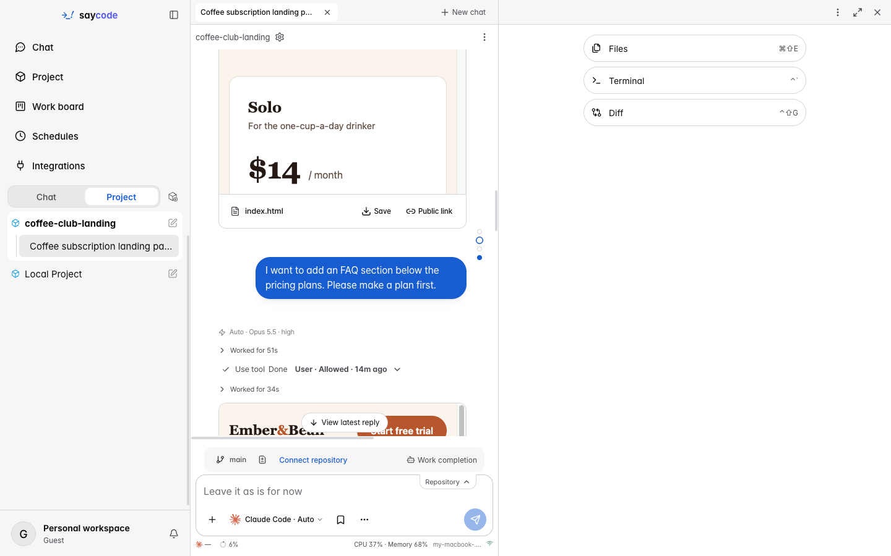

1. Click **Show tools** at the top right of the project conversation (when collapsing, **Hide tools**; shortcut **⌘⇧B**), and the list **Files** (⌘⇧E) · **Terminal** (⌃`) · **Diff** (⌃⇧G) appears.
2. If a panel is already open, open more tools with the **Add tool panel** icon on the right of the tab row. The same list also has **Open New Terminal to the right** and **Open New Terminal to the below**.
3. Drag tabs to reorder them and close them with **⌘W**. When you close the last tab, the panel collapses. The tools you had open are remembered per conversation.
4. Drag the divider to adjust the width (you can also use the ←→ arrow keys on the file tree divider). The expand icon at the top right of the workspace widens it.

> [!TIP]
> The panel does not open by itself when an answer finishes. Open it yourself. In the panel header's ⋮ menu (or by right-clicking an empty spot), **Panel layout** lets you move the work panel to the left of the conversation.

### 8.2 The Files tab

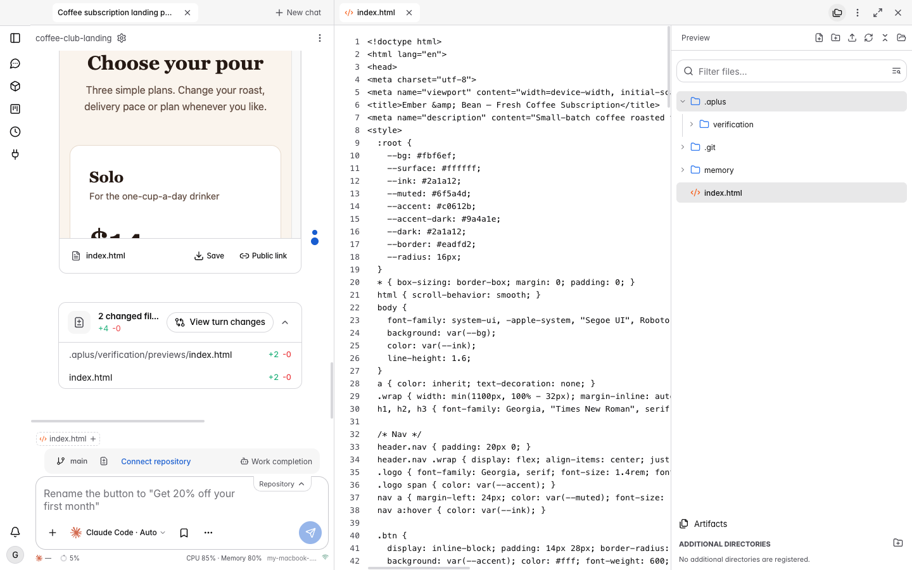

1. Open **Show tools** → **Files**. The file tree is in the right column, and clicking a file opens it as a **tab** in the center. Changes you have not saved are shown as a **dot** on the tab.
2. Type a name into the **Filter files…** box and the list is filtered right away; press **Enter** to search *file names across the whole project*.
3. To search by what is **inside** files, turn on the **Search file contents** switch on the right of the filter box and press **Enter**. Results are grouped by file, as in `8 results in 2 files`, with line numbers and highlighted search terms; click a line to open that file. Turn the switch off and you go back to name search, and your search term stays. (This works only when the machine supports it.)

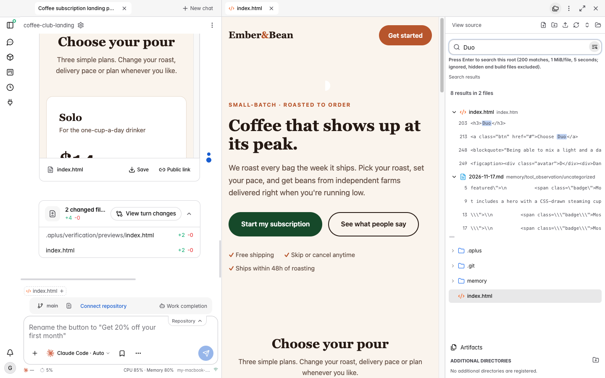

4. The icons above the tree do **New file · New folder · Upload files · Refresh files · collapse/expand folders · Reveal in Finder**. If a file does not show, click refresh. A file row's ⋮ menu (or right-click) has **Add to chat · Reveal in Finder · Rename · Duplicate · Delete**, and the download button on a folder row saves it as `FolderName.zip`.
5. Documents, images and HTML the AI created are gathered in one place in **Artifacts** at the bottom of the list (just above **Additional directories**). In the window, choose **This conversation / This project** and search.
6. HTML files open as a rendered screen, and the **View source** / **Preview** button in the tree header switches between code and screen. `.csv`/`.tsv` files open with **View as table**.

#### Edit a file directly

Edit an open file right there and save with **⌘S** (**Ctrl+S** on Windows). Edit HTML and Markdown in **View source**. If you close a tab without saving, the app asks whether to discard. Files the AI changed show up in the open tab right away, and if you have unsaved edits, the app does not overwrite them and shows a notice that the AI changed the file instead.

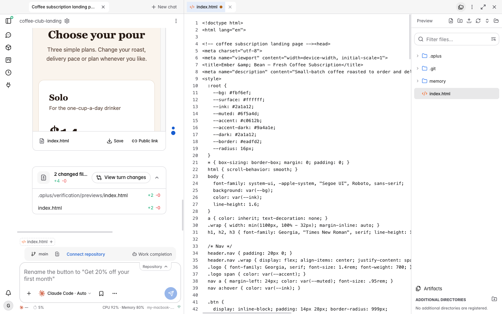

Right-click a file tab for Close, **Copy Path** (the absolute path), **Reveal in File Tree**, **Split right**, **Reload from Disk** and more.

### 8.3 The Diff tab

See at a glance the files the AI changed and the lines that changed.

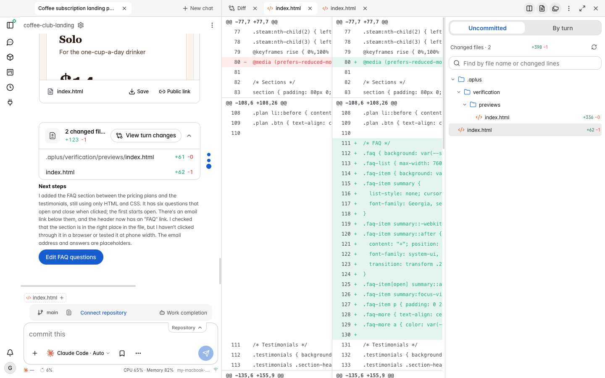

1. Open **Add tool panel** → **Diff** (⌃⇧G). You can also open it with **View turn changes** on the changes card under an answer ([6.8](#68-after-a-response)).
2. Choose the scope with the tabs at the top right — **Uncommitted / By turn**. Conversations in a worktree also have **Whole branch**.
   - **By turn** — View by the unit of one AI answer (a turn). Choose among **This turn / Since last turn / Since chat start**.

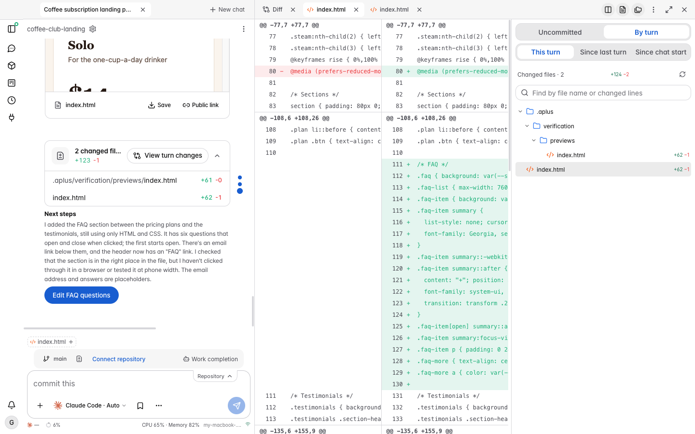

3. Click a file and the diff opens in a tab named after that file (**Side-by-side diff** or **View the whole file**). You can attach a review comment to a changed line and send it to the AI.
4. Filter the list with **Find by file name or changed lines**, and search inside a diff with **⌘F**.

> [!NOTE]
> **By turn** is recorded in conversations you created and is supported in macOS and Linux local Git environments. Finished turns are read-only, so you cannot attach line comments.

### 8.4 The Terminal tab

This is a real shell attached to the machine. It stays alive when you switch tabs, and if the connection drops it reconnects by itself. Its background is always dark. The bottom terminal you can use on any screen is in [8.7](#87-bottom-terminal).

- **⌘F** searches in the terminal, and the right-click menu has copy and paste.
- Split the terminal with **Open New Terminal to the right / Open New Terminal to the below** in **Add tool panel** (⌘⌥T / ⌘⌥⇧T).
- Change the font, font size, **Show typing early** and **AI response status** in **My settings** → **Develop** → **Terminal**.

**Send terminal output to the conversation** — Drag to select the output, then press **⌘L** (**Ctrl+L** on Windows), and you see the notice "Added to the chat composer." and a `Terminal · N lines` card is attached to the composer. Secrets are masked, and nothing is sent automatically. If nothing is selected, the shortcut goes to the shell as usual.

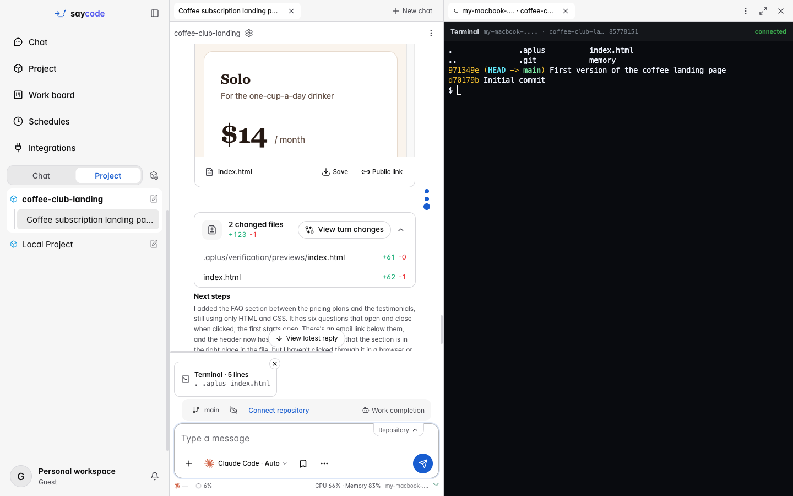

> [!NOTE]
> In the **bottom terminal** ([8.7](#87-bottom-terminal)), ⌘L does not work. To attach output, use the terminal in the work panel.

### 8.5 Browser and preview

In Personal use and ordinary accounts, you see results like this.

- **Inside the answer**: Results the AI made, such as HTML, show up right inside the answer, and you download or share them with **Save** and **Public link** on the file card below.
- **In the Files tab**: Open an HTML file from **Show tools** → **Files** and the rendered screen appears; switch between code and screen with **View source ↔ Preview** ([8.2](#82-the-files-tab)).
- **An app you started yourself**: Start the dev server in the terminal, then open an address such as `http://localhost:5173` in this computer's browser.

> [!NOTE]
> The **Preview** tab (shows the dev server screen inside the app) and the **Browser** panel (opens the machine's `localhost` app inside the app) are still being refined in v0.1.91, so they are offered first to only some organizations. In Personal use and ordinary accounts they do not appear in the Add tool panel list, and you cannot turn them on with Developer feature settings either. **Open browser** in My settings → Shortcuts may remain in the list but does not work. The feature for seeing a screen and fixing it is in [Chapter 9](#9-see-it-fix-it).

### 8.6 Viewing a pull request

[Signed in] Click a GitHub PR link in a conversation and the right-hand workspace panel lets you read the PR's description, comments, reviews and commits in chronological order (hold Shift while clicking to open the external browser). In the **Files** tab you see the full diff and add line comments, hand fixes to the AI with **Fix review comments**, and, when the conditions are met, merge with **Merge** → **Merge** in the merge status below. `gh` must be installed and signed in on the machine, and only GitHub repositories are supported. This could not be checked on a Personal use screen, so it is written from the release notes.

### 8.7 Bottom terminal

**You can open a terminal at the bottom of any screen.** It opens as a bottom panel across the full width to the right of the sidebar, so it opens even when you have no project.

1. Press **⌘J** (**Ctrl+J** on Windows), or click the **Open current work PC terminal** icon at the top right of the start screen (Chat · Project). You can change the key in **My settings** → **Shortcuts** under **Show or hide bottom terminal**.
2. If the open project is on the same machine, it starts in that folder; if not, it starts in your home folder (`~`).
3. To hide it, press the same key again, or click **Hide terminal** (⌄) on the right of the tab row. When you open it again, you continue in the same terminal.

- **Tabs**: Click **+** (**New terminal tab**) to open a new terminal, drag tabs to reorder them, and close them with **X**. Each tab has its own shell, so work that is running keeps going even when you hide the panel. When you close the last tab, the panel hides, and unlike the right-hand panel, you cannot split it.
- **Height**: Drag the top edge to adjust it (up to 70%). You cannot move it to the top, left or right.

### 8.8 Attach files to the conversation

**To tell the AI about a file or a piece of code, attach it to the conversation.** The AI receives the path (for code, the line numbers and the code you selected), not the file contents, and reads it itself.

| Way | Result |
|---|---|
| **The dashed chip above the composer** | The file you last looked at in the right panel is offered as a chip such as `index.html +`. If you send as is, that file's path goes along. Remove it with X and it is not sent this time. |
| **Right-click in the file tree → Add to chat** | Click **Add to chat** at the top of a file or folder menu and `@path` is put in the composer. You can also type `@` in the composer to find and insert project files (**Git changes** items such as `@diff`, `@staged` and `@git:1` show up there too). |
| **Select code → ⌘L** | Drag to select code in the editor, then press **⌘L** (**Ctrl+L** on Windows). A chip such as `A  index.html 24–26` appears in the composer (A, B… in order), and the AI receives the path, line numbers and the selected code. |

> [!TIP]
> You can change **⌘L** in **My settings** → **Shortcuts**. How to attach terminal output is in [8.4](#84-the-terminal-tab).

---
## 9. See it, fix it

> [!IMPORTANT]
> In v0.1.91, the features in this chapter are offered first to some organizations. They do not appear in Personal use or in ordinary accounts, and you cannot turn them on with Developer feature settings either.

**This feature lets you pick an element you dislike directly on the running screen and ask the AI to fix it.** Use it when a project conversation is open and the app you want to fix is running on the machine.

### 9.1 Pick elements and put them in the annotation tray

In the **Browser** panel, click the element picker button and click the element to fix, and it is put as one row in the tray below (up to 20). In each row, write a comment and choose the intent (**Fix this / Question / For reference**), and you can mark the screenshot with a pen or rectangle. Click **Send all** and the request text and screenshots go into the conversation composer; check the content and send it yourself.

### 9.2 Adjust design — try values yourself

In an element's row in the tray, change the **Spacing**, **Layout** and **Text** values and they apply to the page right away, so you can see the result with your own eyes. The change is only temporary and disappears when you refresh, so use **Send change request** to put the before → after values in the composer and have the AI apply them to the source code.

### 9.3 The browser toolbar

Besides picking elements, there are collecting console and network errors, the viewport (desktop, tablet, mobile), importing cookies and opening in a new window. For the Browser panel, see [8.5](#85-browser-and-preview).

### 9.4 Hand web tasks to the AI browser

This feature lets the AI open web pages and operate them itself in a dedicated Chrome window that is separate from your own Chrome. Ask for it with composer **+** → **Use browser for this request**. It needs Google Chrome and a signed-in account, and this item is shown only to the same organizations as above. Even in Personal use you can see the setup status and how to use it in **My settings** → **AI** → **AI browser**, but you cannot use it from the composer. In organizations where it is offered, you can click **Take control** in the **AI Browser** console to operate the page yourself, then give it back to the AI with **Release control**.

> [!TIP]
> What anyone can do right now: describe in words exactly what you want to change, or paste a screenshot or files into the composer to show it. You can point to code with **⌘L** or `@` ([8.8](#88-attach-files-to-the-conversation)).

---
## 10. Manage conversations

**So you do not get lost when conversations pile up, skim them, tidy them, find them and continue them.**

### 10.1 Conversation summary and the message rail

> [!NOTE]
> **Requirements**: It appears in project conversations with **2 or more of your messages**, and not in Chat. To open the conversation summary panel, [Developer] **Show conversation summary menu item** under **Developer feature settings** in the profile menu must be on.

1. The **rail** at the right edge of the conversation has one dot for each of your requests. Hover over a dot to see `Request N: …`, and click it to jump to that message.
2. [Developer] Click **⋮** in the conversation header → **Show conversation summary** (right below **Search this conversation**) and a panel opens showing this conversation's **plans · outputs (changed files and so on) · PRs · commits · background tasks** at a glance. To close it, click the ✕ on the panel.
3. Click a panel item to jump to the message where that work product appeared.
4. Click the **pin** icon at the top of the panel and it stays pinned beside the conversation. It closes when you go to another conversation or reopen the app.

### 10.2 Open conversation tabs

- Open a new tab with **+ New chat** (⌘T), drag tabs to reorder, and close with **⌘W**. **⌘⇧T** reopens a closed tab and **⌘⇧J** jumps straight to a conversation waiting on a question or approval (all shortcuts in [Chapter 19](#19-keyboard-shortcuts)). The tab row is what you see when **Developer mode** is on ([10.9](#109-developer-mode-and-split-view)).
- The tab row shows **only conversations of the kind you are viewing**. If you choose **Chat** in the sidebar, only Chat conversation tabs appear; if you choose **Project**, the conversation tabs of **all the projects** you have open appear.
- Tabs carry status badges such as `Awaiting input` and `In review`. While background work (build or test watching, child conversations) is running, a **N background tasks running** badge appears and the conversation is not marked done.
- **Right-click** a tab to see items such as **Close**, **Close other tabs**, **Close All** and the split commands.

### 10.3 Pin

1. Hover over a conversation row and click the **pin button** that appears. It gathers in the **Pinned conversations** area at the top of the list.
2. Drag pinned conversations to reorder them, and **⌘1~9** (Ctrl+1~9 on Windows) opens the first nine conversations right away.
3. To unpin, click the pin button again. [Signed in] With a signed-in account, the same pinned list appears on other PCs and on the web.

### 10.4 Archive — tidy up what you do not need now

1. Hover over a conversation row and click **⋮**.
2. Click **Archive**. It disappears from the list **right away, without a confirmation window**, and an "Archived the conversation." notice shows for about **10 seconds**.
3. If it was a mistake, click **Undo** in the notice or **⌘Z** (Ctrl+Z on Windows). **Go to archive** opens the [conversation archive](#106-the-conversation-archive-and-auto-archive).

The same ⋮ menu also has **Rename** (type in the small window, then click **Save**), **Copy conversation text**, **Copy conversation ID** and **Delete conversation** (it cannot be undone after you confirm), and project conversations also have **Snooze**. [Signed in] **Share with organization** does not appear in Personal use.

> [!TIP]
> **Several conversations at once**: Hold **Shift** and click conversations to select them, then choose ⋮ → **Archive N selected** or **Delete N selected**. If any conversation has a worktree attached, choose **Archive** or **Archive & delete worktree** in the confirmation window (archiving a single conversation does not delete the worktree). For a conversation whose PR has been merged, you can also archive it with **Archive** in the popup that appears when you hover over it in the sidebar.

> [!NOTE]
> A conversation whose response ended in failure gets a **red diamond dot** (`Failed, not yet opened`) in the sidebar. The dot goes away only when you read that conversation yourself (open it, click the composer or send a message).

### 10.5 Snooze

Move a conversation out of the list until a time you choose. It returns to its original place when the time comes or when the AI waits for an answer through an approval or question.

1. Click the conversation row's **⋮** → **Snooze**.
2. Choose among **1 hour / 4 hours / Tomorrow, 9 AM / Next Monday, 9 AM**.
3. Expand **Snoozed N** below the project list to see snoozed conversations with the time remaining. Click the **eye button (Show again)** to return a conversation to the original list right away.

> [!NOTE]
> It can be used **only in project conversations** (the Chat conversation menu does not have it). The snoozed state is stored **only on this computer**, and you can cancel it with **Undo** or ⌘Z right after snoozing.

### 10.6 The conversation archive and auto-archive

Find archived conversations in **My settings** → **General** → **Conversation archive**.

1. At the top, check the **Auto-archive** rules, and find archived conversations with **Search archived conversations**.
2. Click **Unarchive** on the right of a conversation row, then click **Unarchive** once more in the "Unarchive this conversation?" confirmation window. It appears again in the left-hand list with its earlier title and history kept, and the AI does not run automatically.

> [!NOTE]
> In Personal use, only **project conversations** appear in this list. An archived Chat conversation does not appear in the archive, so if you archived one by mistake, use **Undo** in the notice right away, and **pin** a Chat conversation you want to see later instead of archiving it.

**Auto-archive** is the two switches at the top of the archive (off by default). When they are on, conversations you started are archived automatically while the app is open, and conversations you took out of the archive are not archived again.

- **Archive when the PR is merged or closed**
- **Archive after a period without activity** + **Inactive for** (1–90 days, default 14 days)

A conversation is not archived if a branch PR or a **linked PR** is still open. Conversations that are responding, waiting for input, recently active, open on screen or pinned are postponed, and worktrees are not deleted.

### 10.7 Continue and branch

From Project tools (⋮) → **Continue conversation**, start a new conversation while leaving the current one as it is.

| Menu | What it does |
|---|---|
| **Continue with another agent** | Continue with a different AI (for example Claude → Codex). You also choose the model and effort. |
| **Branch with the same AI** | Creates a **branch conversation** that duplicates the history so far with the same AI so you can try a different direction. Choose what to copy (**Whole conversation** or **Up to a message**), click **Create branch**, and a new tab opens with a **Branched from** link in its header. A branch shares the **same working folder** as the original conversation. |
| **Continue in terminal** | Copies a command to continue the conversation in a terminal (for Claude and Codex conversations; not available for saycode plan conversations). |
| **Move this conversation to a worktree** / **Move this conversation back to the main folder** | Moves a conversation in progress, along with its changes, to a new worktree, or back. A conversation in a worktree shows **Move this conversation back to the main folder** ([11.6](#116-worktree-safety-net)). |

In a new conversation with no AI history yet, only **Continue with another agent** is available and the others are grayed out with the reason shown. Open the menu again after you have exchanged one message.

**Shortcut**: In a Claude conversation in a project, hover over the last AI answer of a turn and click the **Branch from here** icon that appears, and the same window opens with that answer already chosen as the last message to keep.

In addition:

- In a project conversation, hover over one of your messages and click **Rewrite from here**, and a new conversation opens with the conversation up to just before that message and your original message filled into the composer (Claude conversations). The original conversation stays as it is, and the button is disabled if the AI history is not linked. In a conversation with file checkpoints on, it first asks whether to roll the files back too ([11.7](#117-file-checkpoints-and-commits)).
- Use Project tools → **Continue a chat started outside the app** to bring in a Claude or Codex conversation started outside the app (such as in a terminal) in this project's folder. If the CLI on the machine is too old to continue it, you can only **View read-only**.
- In Project tools (⋮), or in the more menu (⋮) of a Chat conversation, **Session lifetime** lets you choose, for that conversation only, the default, 1, 4, 8 or 24 hours, or **No idle shutdown**.

### 10.8 Find — conversation search and quick open

| Method | Shortcut | What it does |
|---|---|---|
| **Search this conversation** | ⌘F | In a **project conversation**, find and jump to a word inside the open conversation (⋮ → **Search this conversation** does the same). It does not open in a personal Chat. |
| **Search conversations** | ⌘⇧F | Find a word in the titles, your requests and the AI responses of project conversations. Personal Chat conversations are not searched. |
| **Quick Open** | ⌘P | Type a project, conversation or file name to open it right away. Type **>** first (⌘⇧P opens it directly) and only **commands** appear. |
| **Project search** | ⌘K | Filters projects, conversations and machines in the sidebar by name. |

**Search this conversation** puts a highlighted border on the matching message and shows the result count, for example "Match found. 1 of 1". **Enter** goes to the next result and **Shift+Enter** to the previous one. You can open the conversation search window with **Search all conversations**.

**Search conversations** has **Local search** and **Semantic** tabs, and you narrow the scope with the **All projects** filter. Click a result to jump to the matching message (a draft you were writing stays as it is), and Cmd-click to open it in a new tab. **Semantic** finds by meaning, but only among the memories stored on the machine of the active project.

 in Quick Open — Conversation search, Work board, Toggle sidebar, Project search, Open settings and more" width="620" />

> [!NOTE]
> To use conversation search, **My settings** → **General** → **Conversation search** → **Enable conversation search** must be on (on by default). You can clear stored search data with **Delete search index**.

### 10.9 Developer mode and split view

Choose whether to keep several conversation tabs open or to see just one conversation in large view, and split the screen into panes to watch several conversations at once.

> [!NOTE]
> **Requirements**: It can be used in Personal use too. **Developer mode** is the `Developer mode` switch in the profile menu, and it is separate from the [Developer] features you turn on under **Developer feature settings** ([3.4](#34-developer-feature-settings)).

**Turn Developer mode on and off**

1. Click the **profile** at the bottom of the sidebar to open the account menu.
2. Click the **Developer mode** switch right below **My settings**. It applies right away, and the menu stays open.

It is **on** by default, so you work with several tabs. When you turn it off, **only one conversation** shows in the center, and instead of the tab row, only the conversation title in one line and the right-panel icon appear at the top. The project name and **⋮** stay on the line below. Turning it off does not remove your open tabs, and they come back as they were when you turn it on again.

**Split the view into panes** (while Developer mode is on)

You can split the screen into up to **4 panes** (4×4) in each direction, horizontally and vertically, to watch several conversations at once.

1. Choose **Split Chat right** (⌘⌥C) or **Split Chat down** (⌘⌥⇧C). You can also **right-click** a tab and choose a split, or **drag a tab to the edge of a pane**.
2. After the split, each pane gets its own tab row, and you can drag tabs to other panes. **+ New chat** opens in the pane you are in now.
3. When you close the last tab of a pane, that pane disappears.
4. **Close split** does not close the tabs; it only **moves** them to another pane.

- File and terminal tabs are split the same way. Drag the tab in the right-hand workspace panel, or use **Split right** and **Split down** in the tab's right-click menu ([8.2](#82-the-files-tab), [8.4](#84-the-terminal-tab)).

---
## 11. Work completion

**This is the last stage, where you check the changes the AI made, leave a commit or a PR, and tidy up the conversation.** Everything starts from the one **Work completion** menu in the upper row of the composer.

> [!NOTE]
> **Requirements**: It appears only in project conversations that have already started (it is hidden if you have collapsed the upper row of the composer or an AI question screen is showing). **Commit now** is on only in a **conversation opened in a worktree**. In a conversation that is not in a worktree it is grayed out and says "Available in worktree sessions." In a worktree conversation with a remote repository connected, **Commit & PR** appears in its place.

### 11.1 The Work completion menu

1. Open a project conversation.
2. Click the **Work completion** button at the **far right** of the upper row of the composer.
3. Choose the item you want from the menu.

| Menu | One-line description |
|---|---|
| **Self review** | The AI working now checks the changes and fixes problems itself. |
| **Request independent review…** | A different AI reviews read-only and only hands back the result. |
| **Commit & PR** | Hands over review, tests, commit, push, PR creation, CI and review-bot handling, and even the merge. Shown in a worktree conversation that has a remote repository. |
| **Commit now** | Saves the changes as a local commit. It is on only in a worktree conversation, and when a remote is connected it turns into **Commit & PR**. |
| **Archive & Done** | Archives the conversation and wraps it up. |
| **Advanced settings…** | Set the number of rounds, the independent reviewer and the confirmation before finishing. |

If the AI is responding when you click **Self review** or **Commit & PR**, the request goes into the **queue** and runs after the response ends.

### 11.2 Self review

1. Click **Work completion** → **Self review**.
2. A request labeled `Sent by self-review` and a **Self-review · round 1/7** marker appear in the conversation, and the same AI checks the changes and fixes problems itself. If findings of **medium or higher** come up, it continues for the **number of rounds** you set, and if there are none it ends in the first round.
3. To stop midway, click **Stop self review**. After it ends, the first item in the menu changes to **Start a new self review**.

When the review ends, the check results (JSON) and a bold **Done · N findings** summary (**Done · 1 finding** when there is one) are added at the end of the AI's answer, and below it a notice such as "Repeat review ended after 1 round(s) — only low/nit findings in this round" appears. During the review, an **In review** badge is shown on the conversation tab.

Change the number of rounds under **Work completion → Advanced settings…** in **Self review rounds** (default 7).

### 11.3 Request independent review

Use this when you want an **AI other than the one that wrote the code** to review with fresh eyes. The reviewer works in a new conversation separate from the current one, **read-only** (no file edits, commits or pushes).

1. Click **Work completion** → **Request independent review…**.
2. Choose the **Agent · Model · Effort · Review focus** (General / Bugs & regressions / Security). A combination different from the AI that wrote the code is selected first (for example Codex in a conversation worked on with Claude).
3. Click the **Request independent review** button. On success it moves to the **Review history** tab, where you can see progress and results.

> [!NOTE]
> The read-only restriction applies only to Claude reviewers. On the Work board, such cards carry a **Read only** badge.

### 11.4 Commit & PR

1. Click **Work completion** → **Commit & PR**. It is requested right away, without a confirmation window.
2. After the AI creates the PR, it handles **CI failures, review-bot findings, stacked PRs and conflicts**, and once everything passes, it even **merges into the base branch**.
3. If conditions remain, such as no bot verdict or a required approving review still outstanding, it **does not merge** and reports what is left.
4. Follow progress in the **PR number chip** above the composer (open, merged, closed, with the CI badge) and in the [pull request view](#86-viewing-a-pull-request). If several PRs are linked, the chip carries `+N`, and clicking it opens the list.

> [!IMPORTANT]
> Without a remote repository, a PR cannot be created, and you can go only as far as **Commit now** (a local commit). Creating a PR needs a GitHub repository connection and a `gh` login on the machine ([Signed in]).

### 11.5 Archive & Done

1. Click **Work completion** → **Archive & Done**.
2. The conversation is archived, and the "Archived the conversation." notice shows **Undo** and **Go to archive**. The worktree is not deleted.
3. If you turn on **Confirm before Archive & Done** in **Advanced settings…**, a confirmation window ("Archive "…" and move it to Done?") appears before archiving (off by default).

To tidy up the worktree too, select several conversations in the sidebar and use **Archive & delete worktree**, or delete from the [worktree list](#116-worktree-safety-net).

### 11.6 Worktree safety net

A **worktree** is a copy of the working folder created for each conversation, so even when several conversations run at once they do not collide. Turn it on with the **Work copy** checkbox in the upper row of the composer on the new conversation screen. Saycode puts safeguards in place so that work is not lost even if you delete a worktree.

- A **new worktree starts from the latest remote default branch** (`origin/main` and so on). If the remote cannot be fetched, it tells you why and asks whether to start from the local branch instead.
- Before deletion, it tells you about the **local-only files** (such as `.env`) that exist only in this worktree.
- Before deleting, it takes a **snapshot** (including uncommitted changes and new files, excluding files matched by ignore rules).
- If the project has `.aplus/worktree-setup.sh` or `.aplus/verify.json`, then before the first run it shows the path and the full content and asks you to **Run** or **Skip**. Content you have not allowed is not run by automatic verification, so when the notice appears, run **Verify changes** once yourself to allow it.

**Open the worktree list**

1. In a project conversation, open **Project tools (⋮)** → **Git actions** (in a worktree conversation, the item shows the branch name and `·WT` on its right).
2. Click **Worktrees…**.

3. At the top of the worktree window there are the **Refresh / Clean up old worktrees / Snapshot archive** buttons, and each row has path-copy, pull, push and editor icons, **New chat in this worktree**, and delete (trash). The worktree used by a conversation that is open is marked "An active session is using this worktree. You can delete it after cleaning up the session." and cannot be deleted.

**Bring back a deleted worktree**

1. In the worktree window, open **Snapshot archive**.
2. Click **Restore** on the row you want to bring back. The worktree is recreated at its original path, including uncommitted changes.

> [!NOTE]
> Snapshots are deleted, oldest first, once they are older than 30 days or there are more than 50. Windows machines do not create snapshots yet.

### 11.7 File checkpoints and commits

**File checkpoints** — This feature records the files the AI changed at each point in time so you can roll them back. It also works in a folder without Git, or in a conversation that does not use a worktree (macOS and Linux machines).

1. In a new conversation, open **⋯** (**Additional conversation options**) → **File checkpoints** and turn on the switch. Once it is on, a shield icon appears at the far right of the upper row of the composer.
2. During the conversation, click that icon to expand the checkpoint list, click **Preview** for the point you want to roll back to to see a per-file comparison, check **I reviewed the file changes in this preview**, and click **Restore file state**.
3. You can also roll back to just before you sent a message: hover over your message and click the **clock icon** that appears (or right-click → **Restore files to this point**). After rolling back, **Reapply** brings things back as they were.

> [!WARNING]
> In v0.1.91 Personal use (without signing in), a conversation started with the switch on does not start, and "Could not start this conversation." appears. The restore screens in steps 2 and 3 could not be checked in this environment, so the description above is based on the release notes. Try it first while signed in.

**Commit** — In the branch name button above the composer (or **Project tools (⋮)** → **Git actions**), click **Stage all changes** → type a **Commit message** → click **Commit**. A "Committed" notice appears. In a worktree conversation you can also use **Commit now** in the **Work completion** menu. If you turn on AI generation in the settings (**Development automation**), a button that has the AI write the message appears.

### 11.8 Deploying

> [!NOTE]
> **Requirements**: [Signed in] It is available only in a conversation of a cloud project you own. In Personal use, no **Deploy** item appears in the project conversation header, in **Project tools (⋮)** or in the **Work completion** menu. **Production deployment** needs your organization's permission, the server settings, and a test deployment that has passed first.

Put a project you have checked in the preview online as a **test** or **production** deployment.

1. In the project conversation header, click the **Deploy** button to the left of the more (⋮) button on the right.
2. Choose **Test deployment** or **Production deployment**.
3. If a deployment already exists, open **Deployment options** and choose **Update existing deployment** (refreshes the same address) or **Create new deployment** (puts it on a separate address). If a warning appears that existing data will be overwritten, read it to the end and confirm.
4. While it runs you see the build log, and when it finishes the service address and a copy button appear.

Problems left over from the code check before deployment can be handed to the AI with **Ask AI to fix**, and for errors you cannot solve yourself, ask for support with **Request review**. Deployment keeps going even if you close the window, and if the result is late, reopen the window and click **Check status again**.

---
## 12. Work board

**Lay out every conversation of every project as kanban and direct several AIs at once.** When several conversations run at the same time, it is a good way to find "the ones waiting for my answer" first.

> [!NOTE]
> **Requirements**: [Developer] It is a developer menu, so it is **hidden** at first. Turn on profile menu → **Developer feature settings** → **Show Work board menu** and **Work board** appears in the sidebar (the shortcut **⌘⇧A** works even if you do not turn it on). With a window about 1440px wide and the sidebar open, all six columns up to **PR Merged** fit on one screen, and if it is narrower you scroll sideways. The board, filters and prerequisites also work in Personal use.

### 12.1 What the columns mean

| Column | Meaning |
|---|---|
| **Awaiting input** | Conversations that need an answer to a question or permission — the first place to look |
| **Responding** | Working right now. Dropping a card here sends an instruction |
| **Idle** | Waiting for the next instruction |
| **In review** | Dropping a card here requests a review |
| **Done** | Dropping a card here moves the conversation to done |
| **PR Merged** | Conversations that ended because the PR was merged |

A card shows the project, title, AI and elapsed time, and for a worktree conversation also the branch name. A card waiting for a question carries a preview of the question. Click a card title to open **Recent conversation** (the latest user request and the latest agent response) on the right, where you can click **Go to chat**. The search box at the top right filters by title or prompt.

Drag a card into another column and, depending on the column, the following opens.

- **In review** — the **Request a review** window. The model (**Auto** by default) and default text are filled in; edit them and click **Request review**.
- **Done** — an "Archive this session?" confirmation window. Click **Archive** and the conversation is archived.

### 12.2 Filters and prerequisites

1. Click **Filter** to choose **Machines**, **Hide conversations created by automation** and **PR status** (No PR · PR open · PR merged). The button changes to **Filters applied: N**, and the X next to it (**Clear filters**) clears them all.
2. **Prerequisites**: Click the title of the card that comes later to open **Recent conversation**, pick the card that must finish first in **Choose a card** under **Prerequisites**, and click **Add**. The prerequisite card shows as a row with a **Not done** chip, and you remove it with the X. The later card gets a `Prereqs 0/1` badge, and it does not start until every prerequisite is done or its PR is merged. An Autopilot card sends its instruction automatically as soon as the prerequisites finish.

### 12.3 Card tools

| Button | What it does |
|---|---|
| **Commit & PR** (paper airplane) | Requests PR creation on a worktree card (the same action as **Commit & PR** in Work completion). |
| **Autopilot** | When the AI's work ends, it reviews, and if there are no findings of medium or higher and each requirement has evidence (test results, files, commits), it proceeds automatically through Commit & PR. If the same blocker repeats 3 times, it stops and waits for an answer. The arrow beside it also offers **Run with independent review**. It can be used **only on worktree cards**, and on a card that is not a worktree it shows "Autopilot unavailable · worktree required". |
| **PR watch** | On a card with an open PR, it directs CI failure fixes, review-bot fixes and conflict resolution on your behalf and notifies you when it can be merged (it does not merge). It needs a GitHub connection and a `gh` login, so it could not be checked on the Personal use screen. |
| **Verify changes** | Runs the build, test and run recipes in that conversation's worktree (or the project folder if there is none). One of the `package.json` scripts, a Makefile or `.aplus/verify.json` must exist; if none does, the card shows "Verification failed — No recipe to run." If the content is new to you, a confirmation window appears before it runs ([11.6](#116-worktree-safety-net)). |

> [!TIP]
> If you see the **"N conversations are waiting on the same permission"** card at the very top, you can handle them all at once with **Allow all (N)** or **Deny all** ([14.2](#142-handle-approval-cards)).

> [!TIP]
> **PR watch** can also be turned on for one conversation. Click the PR button above the composer (`+N`) to open the list of linked PRs, then click **⋮** at the end of the PR row → **Start watching** or **Stop watching**. While it is on, one running Saycode Desktop takes charge of that PR and, when a CI failure, conflict or review-bot finding appears, sends a follow-up instruction when the conversation is idle. The GitHub CLI on the machine must be able to read that repository.

> [!NOTE]
> Conversations you finished with **Archive & Done** remain as cards in the **Done** column, and the card's **Unarchive** brings it back to the **Idle** column without a confirmation so you can continue it (the "Session reopened." notice appears). You can also **Unarchive** from the conversation archive in settings. Conversations whose PR was merged move to the **PR Merged** column.

---
## 13. Schedules

**Hand work to the AI at set times.** For example: "Summarize yesterday's PRs for me every day at 9 a.m."

> [!NOTE]
> **Requirements**: The sidebar **Schedules** menu is visible to everyone, but [Signed in] **you must sign in to a cloud account to create and manage schedules**. At the scheduled time, **the machine must be on and connected to an AI**. If your organization turns schedules off, the Schedules screen shows "Your organization has turned schedules off."

In Personal use, the **Scheduled tasks** screen shows only the notice "Sign in with a cloud account to manage Chat schedules.", two examples (**Daily work summary** and **Email review**) and a **Login** button. The explanations below assume a signed-in account.

### 13.1 Create a new scheduled task

1. Click **Schedules** in the sidebar and click **New task**. If there are no schedules yet, you can also start from the example buttons.
2. In **Instructions**, write what the AI should do.
3. Choose **Repeat**.
   - **Every day** — Runs at a set time.
   - **Every week** — Choose one or more weekday buttons and set the time.
   - **Once** — Set a date and time (a time in the past cannot be saved).
   - For the interval option (**At intervals**), click **Schedule and start** to request the first run, and it repeats at the same interval (15 minutes or more).
4. Check the **time zone** shown next to the time. For example `Daily at 09:00 · Korea Standard Time` and below it `Next run in your time (Korea Standard Time): …`. Change the time zone in **Advanced → Time zone**.
5. Click **Schedule task**.

### 13.2 Advanced options

Expand **Advanced** and you can change the following.

- The **Task name**, the conversation to link, the **Task computer** to run on, and the **AI** to use (a new Chat uses the AI and model you last selected)
- **Send result** — When the schedule finishes, the first part of the answer (up to 1,500 characters) is sent to your paired **Telegram or Slack** personal conversation.
- **Failure alert** — Get a one-line failure reason in the same place or in a different conversation. Both start out as *Off*.
- **Add code task** — Run a Node.js script on a schedule.
- **Missed runs** — What happens when the machine was off, asleep or disconnected and missed the scheduled time.
  - **Default** — It does not run, and the run history records it as missed.
  - **Run once when back** — After the machine reconnects, only the most recent of the missed runs is run late (within 8 days).
  - **Skip** — It does not run, even if the default behavior changes later.

> [!NOTE]
> Messenger delivery works with a [Signed in] account that has a messenger channel connected ([16.3](#163-messenger-channels)), and Discord cannot be selected yet. On a machine that does not support **Missed runs**, the choice is locked and an update notice appears.

### 13.3 Check and manage schedules

- Schedule results **build up as regular conversations** and are summarized in notification cards.
- In a conversation's ⋮ → **Scheduled tasks**, see the **Scheduled task details** (the full request, repeat pattern, status and machine). In a schedule row's **More options**, choose **Run history · Edit · Pause · Delete**.
- A **Once** schedule whose time has passed can run again at a new time with **Schedule again**. A missed Once schedule does not run by default, but if you choose **Run once when back** under **Missed runs**, it runs once after the machine is back.
- In the run history, missed runs are shown like `Missed ×3 · The work PC did not run it at the scheduled time`, and a run that started more than 5 minutes late is shown as **Ran late**. For failed or cancelled runs, the **cause** appears instead of "Run failed", for example "Not run — a connector needs you to sign in".
- You can manage them by just asking, too. In Chat, say *"Check the connection status every 15 minutes"*, *"Stop this schedule"* or *"Restart this schedule"* (the minimum interval is 15 minutes).

> [!NOTE]
> A schedule made on the web with a **fresh AI context each run** also shows in the app, with `Isolated` next to its status. In the app you can change the instructions, name, repeat, missed runs, send result, pause, delete and **Run now**; the AI context mode, reference material, AI and model can be changed only on the web.

> [!TIP]
> To pause all schedules at once, turn on **My settings** → **General** → **Security** → **Global pause (block new automatic actions)** ([14.6](#146-global-pause-and-organization-policy)).

---
## 14. Permissions, approvals and security

**Before the AI does something risky on your computer, you approve it, and if you like you can set rules in advance.** This chapter explains everything in order, from approval cards to security settings.

### 14.1 Where is your data stored?

In **Personal use**, conversations, projects and results are all stored **only on this PC** (AI responses are exchanged with the AI service you connected). When you **sign in**, they are stored in your account (organization), and encrypted data can be opened only on trusted devices. Sign-ins and cookies in the in-app browser are cleared when you log out or switch accounts or organizations.

### 14.2 Handle approval cards

When the AI is about to run a command, write a file, use the network or use an MCP tool, an **approval card** appears in the conversation.

1. Check the card's content and click **Allow** or **Deny**. If the card has **Allow in this conversation**, it is allowed only in that conversation. With the keyboard, **Enter (allow once)** / **Esc (deny)**. Press them after clicking outside the input box; they do not work while you are typing a message. This is one of the **Basic shortcuts** under **My settings** → **Shortcuts** (**Answer permission requests with Enter and Esc**) and cannot be changed.
2. If something may be risky — deleting, admin rights, remote code execution, a force push, access to a password file — the card carries **Needs a careful look** with the reason. Such cards are not allowed right away with Enter, and the Allow button changes to **May be risky — allow anyway**, so you have to click once more.
3. To deny and tell the AI to do something else, expand **No, do this instead**, write what to do and click **Deny and send** (or press Enter) (Claude conversations). The request is denied, and the AI changes direction as you instructed within the same response. If the field is empty, it is just a denial.
4. When several conversations wait on the **same permission**, they are grouped at the top of the notification center or the Work board into an **"N conversations are waiting on the same permission"** card. Expand the requests to check them and click **Allow all (N)** or **Deny all**. To check each individually, use **Show each**. Questions, plan approvals, folder-access requests and requests that hit a risk rule are not grouped; you answer them one at a time in their own conversation.

**Check long commands to the end.** A card shows a command up to 600 characters and 12 lines, and if it is longer, it shortens the middle to `⟨…+N⟩`. Open the whole thing with **Show all (N characters)** under the card. Values such as passwords and `TOKEN` are hidden as `[redacted]`. In places that cannot show the whole command, such as the floating approval panel or OS notifications, only **Deny** appears without **Allow**, so open the card in the app to check it.

**A record of who allowed it is kept.** On a tool row whose approval is finished, the one who decided (**User**, **AI review** or **Runtime**), the decision and the time are shown, for example `… · User · Allowed · just now`. Calls handled automatically by [AI review](#145-handle-permission-requests-with-ai-review) or by an **Allow in this conversation** rule are marked **Auto-allowed** / **Auto-denied**, and hovering over the badge shows the reason.

### 14.3 Notifications and the floating approval panel

Set these in **My settings** → **General** → **Notifications**. The table below is in on-screen order from top to bottom, and the lower items need scrolling to see.

| Item | Description |
|---|---|
| **Show notifications** | Choose how finished work and input requests are announced as OS notifications from **Always / Only when the app is not in focus / Off** (default **Always**). A conversation that is visible on screen does not pop up a notification. On macOS you can allow or deny permissions straight from the notification, or reply to a finished conversation. |
| **Mobile completion push** | Get a push on your phone when work finishes ([Chapter 17](#17-machines-and-mobile), on by default). |
| Notification sounds | **Input request sound** (on by default — when a question, permission or plan approval is waiting, and it plays even if you are looking at that conversation), **Turn completed sound** (off by default), **Mute all notification sounds**. Sound plays only on macOS. |
| **Show suggestions while typing** | Based on what you type in the Chat input, shows suggestions for creating a schedule, using a skill or connecting a connector above the input (on by default). |
| **Show AI provider outage notices** | On by default. When an outage is posted on the official Claude or Codex status page, a notice appears in the sidebar. It checks only the public status pages every 5 minutes and sends no account information. |
| **Confirm before quitting** | On by default. If a conversation is responding, a scheduled task is running or a worktree is being prepared, it asks before you quit. |
| **Show icon in the menu bar** (macOS) | Off by default. When on, even with every window closed, you can see the runner status and the number of conversations that need checking in the menu bar, and open the app, restart the runner or quit. |
| **Computer use indicator** | On by default. While the AI is operating this computer's screen or input, it shows a border around every screen edge and which conversation is using it. Even if you turn the indicator off, pressing **Esc** stops the operation. |
| **Floating approval panel** | Off by default. When on, pending approvals and questions from every conversation gather as cards in a small panel above other windows. You can allow, deny or answer right away without bringing the main window forward, and the panel hides when there are no requests. Plan approval is opened in the app. |

**Notice pop-ups** appear at the top of the screen as a pill shape, and the color differs by type. Click **More** and the cause, wait limit, how to stop, sent time, conversation ID and app version appear, and you can **Copy** them.

### 14.4 AI tool rules

Under **My settings** → **General** → **Security** → **AI tool rules**, set in advance the rules applied just before the AI operates the computer screen or uses MCP tools. The Saycode runtime on this PC applies the rules.

1. Turn on the **Ask before write tools too** switch, and write MCP tools such as create and update also ask for confirmation (tools that send, delete or pay always ask).
2. In **My app rules**, enter an app identifier (a macOS bundle ID, for example `com.apple.Terminal`, or a Windows executable name, for example `cmd.exe`), choose one of **Ask · Block · Allow**, and click **Add**. The default is **Ask**. Expand **What the AI may do in each kind of app** to see the range for each kind.
3. Under **MCP tools**, when you open a conversation, that conversation's MCP servers appear here, and for each server you choose **Default · Ask · Block · Allow**.
4. Apps and tools you chose **Allow in this conversation** for are gathered under **Apps and tools allowed in this conversation**, and they ask again when the conversation ends or after 30 minutes. You can withdraw them early with **Take back**.

> [!NOTE]
> Rules apply from the next tool call. Even if you set **Allow**, actions beyond what the app kind allows and risky actions such as deleting or paying are confirmed every time.

**Tool policy check card** — When a protected session tries to use Chrome, an external MCP or an installed CLI, a card with the target and arguments appears. Choose **Allow once** or **Allow same scope in this conversation** (which applies only to the same target and arguments).

### 14.5 Handle permission requests with AI review

If clicking approval cards one by one is a chore, turn on **My settings** → **Develop** → **Development automation** → **Handle permission requests with AI review**. A low-cost AI allows or denies against the project's guidelines (AGENTS.md, CLAUDE.md) and your own guidelines, and hands only the requests it could not judge to you (the verdict is left in the conversation as one line).

- **It is off by default** and applies only to Claude and Codex project conversations you created.
- High-risk requests such as deleting the root, sudo, force pushes and credential files, and review failures or reviews that take more than 1 minute, are **never allowed automatically** and are left for you to check.
- To allow a denied request just once, send `/approve` in that conversation and click **Allow once**.

On the same screen you also set **Stopping a response also stops its child conversations** (on by default), **Automatically continue work cut off by sleep or an app restart**, session event webhooks and more.

### 14.6 Global pause and organization policy

**My settings** → **General** → **Security** has the following.

- **Global pause (block new automatic actions)** — When on, scheduled tasks, automatic GitHub runs and the next steps on the Work board do not start. When off, they continue, and **conversations already in progress are not stopped.** Only this app's automatic actions stop; tasks you run separately on the machine continue. It is available in Personal use too (off by default).
- **Send anonymous usage statistics** — Sends only minimal information such as whether features are used and the app version, and does not collect chat or code content (on by default).
- **Organization policy** [Organization] — See the limits set by organization admins (allowed models, tool rules and so on). You cannot change them here, and owners and admins change them in the web admin console.
- **Trusted devices** [Signed in] — The list of devices that can open encrypted data. Remove devices you do not recognize with **Revoke trusted device**.

In Personal use, those last two items do not appear.

---
## 15. Memory, lessons and the system prompt

**Have the AI remember your way of working, build up what it learned in a project as lessons, and set the default instructions it always follows.**

### 15.1 System prompt — default instructions it always follows

Set it in **My settings** → **General** → **System Prompt**.

1. Write the instructions the AI should always follow in the **Instructions** field under **My instructions** and click **Save**. (**Reset** clears the field.) If you close without saving, it asks whether to keep editing or discard the changes.
2. Presets such as **TypeScript**, **Tailwind**, **Korean**, **Minimal** and **Full stack** are saved the moment you click them (if you have instructions in progress, it asks before applying).
3. The **Saycode default instructions** switch below (**Use default behavioral instructions provided by Saycode**) turns the default instructions Saycode provides on and off as a whole. In Personal use it is **off** at first. Your own instructions, the project instructions and the skills you installed stay in effect whether this switch is on or off.
4. Expand **Default instruction details** and you can choose item by item — Child Agent calls, internal task delegation, inline result previews, the **Saycode usage guide**, browser and computer-use confirmation (if a browser action fails 4 times in the same step, the AI stops and tells you), the plan-first workflow, commit credit, plain explanations and request scope, consistent work procedures, **Conversation language** and more.

> [!NOTE]
> With the **Conversation language** instruction on, the AI replies in the language you selected for the app (unless you ask for another language). If you write a language directly in the system prompt, that wins, and if you turn this instruction off, the AI does not match your language.

> [!TIP]
> With the **Saycode usage guide** on, when you ask a how-to question such as "Where do I turn this on?", the AI answers with in-app guidance and gives you a link to the settings screen.

### 15.2 Personalize my chats

[Signed in] Under **My settings** → **General** → **Personal memory**, turn on **Use this in my personal chats**, write information about yourself that the AI should know (your role, preferred tone and so on) and **Save**. It is used **only in Chat** and not in project conversations. This menu does not appear in Personal use.

### 15.3 Lessons — build up what you learn in a project

When the AI proposes a method it confirmed while working (for example "This project runs tests with this command") as a **lesson candidate**, a **Lesson candidate** approval card appears under that answer.

1. Read the card's proposal.
2. If you **Approve**, that lesson is used in later conversations of the same project. If you **Reject**, it is discarded.
3. A proposal to rewrite an existing lesson shows as **Revises a saved lesson**, with the current lesson and the proposal side by side. If you approve, it is replaced with the new content, and the history is kept.

See the lessons and the candidate list in Project tools (⋮) → **Project memory**.

### 15.4 Memory settings

Manage the AI's memory in **My settings** → **Develop** → **Memory**.

- Choose a project under **Target project** and you can manage the memory on that machine.
- **Suggest similar past sessions in new chats** — When you start a new conversation, it suggests similar past conversations (an app-wide setting, on by default).
- **Memory protection rules** (collapsed) — Write items that must not be remembered in the **New forbidden item** field and click **Add**.
- Once you choose a project, you can find leftover memories and **Delete** them. If you click **Undo** in the notice right after deleting, **within 10 seconds**, it is cancelled.
- **MongoDB memory sync** is an optional feature for organizations that use a company MongoDB. What it syncs is based on the code repository (git origin), and the address you enter is saved only on this computer (**Forget saved address**).

### 15.5 Skill locks

[Signed in] Lock important skill files so the AI cannot edit or delete them. In **My settings** → **General** → **Skills**, turn on the switch next to the name of the skill you want to lock in the **Skill locks** list. The **Skills** menu does not appear in Personal use.

In Claude conversations, the AI cannot edit or delete a locked skill with file-edit tools or terminal commands, even in auto-approve mode. Reading and running it are not blocked, and the lock does not apply to Codex conversations.

---
## 16. Integrations, extensions and messenger channels

**Connect to services like Notion and Slack, install the features you need as extensions, and hand work to Saycode from a messenger.**

### 16.1 The Integrations screen

Click **Integrations** in the sidebar. The screen differs depending on whether you are signed in.

| State | What you see |
|---|---|
| **Personal use** | **Installed extensions** (empty at first) and the **Available extensions** list. A note says "Sign in to also connect online accounts like Notion and Slack." |
| [Signed in] Signed in | The service list (**Notion · Slack · Google Drive · Gmail · KNOI · Figma · DirectCloud**) and **Custom connectors (+)** |

[Signed in] **Connect a service**: Click **Connect** on a service row, and sign in and allow in the browser that opens (for KNOI, enter an API key). Google services connect only with a company account. After you connect, the service row shows a description and the account you connected. To disconnect, choose **Disconnect** in the row's manage (⋮) menu. If the browser cannot open, try again with the same **Connect** button. If you opened it from a conversation, **Return to conversation** lets you pick up what you were writing.

[Signed in] **Custom connectors** — Connect an MCP server that supports OAuth by its address. Click **+**, enter a **Name** and **MCP address**, add it and click **Connect** on that row. For an MCP registered by an organization admin, click **Log in** on the row.

[Signed in] **Figma design editing** — On the Figma row, click **Connect**, then for each machine and AI (**Claude Code** or **Codex**) click **Connect** and **Allow** in the browser. When the status changes to **Ready**, ask the AI for Figma work in a new conversation.

### 16.2 Install extensions

Extensions are add-on features that you pick and install only as needed. Manage them in **My settings** → **Develop** → **Extensions** (in Personal use, the **Integrations** screen shows the same list).

1. In the **Available extensions** list, check the purpose and click the install button on the right of the extension you want (for example **Install Telegram channel adapter**).
2. Click **Enable**. (Installing alone does not make it work.)
3. If the requested permissions (for example `channels.receive`, `sessions.control`) show, check them one by one and click **Approve permissions and enable**.
4. Update and uninstall from the manage (⋮) menu on an installed extension's card. To uninstall, click once more in the confirmation. The card first shows the name, purpose and status (**Disabled · Enabled · Active · Quarantined**), and the ID, version and permissions are gathered under **Details**.

Official extensions in the list: the **Project templates extension**, the **Plugin manager extension**, the **Public link extension**, the **Telegram, Slack and Discord channel adapters** (use Saycode from a messenger), the **Computer control extension**, the **Moai task board extension** (workspace panel ⋮ → **Moai**), **buzzni.media-preview** and **buzzni.react-source-locator** (attaches the component and source location to an element picked in the browser, [Chapter 9](#9-see-it-fix-it)).

You can also install the **Public link** from the window that opens the first time you click **Public link** on a result file card, with **Install**. [Signed in] A signed-in account gets it installed and enabled automatically, once.

Install a downloaded extension file with **Local installation and development** at the bottom of the list → **Install local file**.

### 16.3 Messenger channels

[Signed in] Connect Slack, Telegram and Discord to hand work to Saycode from a messenger and receive progress. It is visible **only in signed-in accounts**, and My settings in Personal use does not have this menu.

1. Open **My settings** → **General** → **Messenger channels**.
2. Find the one you want to use among **Connect Slack / Connect Telegram / Connect Discord**. If a notice says the feature is off, click **Install and turn on** first.
3. Follow the card's instructions in order to create the bot and paste in the token to confirm, then allow the Saycode connection in the messenger.
4. On the first connection, **Where should it run?** appears. The default is to move it to *another machine that responds even when Desktop is off*, so that receiving continues even when you turn off the app.
5. For each connection, choose the AI, model and response level, and in the messenger use commands such as `/settings` and `/stop`.

Slack reads follow-up replies in a thread and earlier posts (for an existing Slack app, add the `channels:history`, `groups:history` and `mpim:history` permissions and reinstall it). On Telegram and Discord, files the AI made are attached to the reply (up to 5). For a connection problem, use **Copy diagnostic information** and check what it copies.

> [!NOTE]
> From a messenger you can control only the projects, machines and work you have allowed. This connection is also used for schedule result delivery ([13.2](#132-advanced-options)).

### 16.4 Control the computer and browser, and connect Chrome

[Developer] To let the AI operate other apps on this computer or Chrome, first give it permission. This is for macOS and is an optional feature still being tested.

1. In the profile menu → **Developer feature settings**, turn on **Show computer and browser control settings**.
2. Open **My settings** → **AI** → **Computer & browser control**.
3. On the **Accessibility** and **Screen Recording** rows, click **Open System Settings** to open that privacy screen.
4. If the status is **Needs allowing**, click **Request access**, and allow it in the macOS prompt or turn on Cua Driver in the System Settings list.

**Chrome connection** — Click **Open Chrome Web Store** to add the **Saycode Browser Extension**, then click **Connect** on the extension page, and Saycode shows it as **Connected**. To end it, click **Disconnect**.

> [!NOTE]
> If an update changes the Cua Driver, you need to click the install button on that screen and **Check OS permissions** once. While the AI operates your screen, the [Computer use indicator](#143-notifications-and-the-floating-approval-panel) appears and you can stop it right away with **Esc**.

---
## 17. Machines and mobile

**Register and manage the computers where the AI works, and watch the same workspace from your phone.**

### 17.1 Machines

This computer automatically becomes a machine at first run (Getting started). If you also register other computers, such as GPU servers and build servers, the AI can work right next to your code and data.

**See the list** — In **My settings** → **Develop** → **Machines**, see the **Machines I registered** list (when you are [Signed in], **Shared machines** are listed separately). Each row shows the name, connection status, operating system, last activity and CPU, memory and disk usage.

- The pencil next to the name renames it, and the trash can at the far right deletes it (click once more in the confirmation window).
- See the machine ID, owner, CLI version and daemon (background program) status in the card that appears when you hover over the name, or in the **Details** window.
- [Signed in] The row's ⋮ menu has **PC sharing settings** and **Take work from other PCs** ([17.3](#173-hand-work-to-another-machine)). In Personal use there is no ⋮ menu.

**Paths allowed on this PC** — At the bottom of the same screen, you directly allow paths outside your home folder or a whole drive (C and D drives and so on). Click **Add path** and **Choose folder…** and a list of drives (`/` on macOS) appears; once you pick one, it is allowed. In an allowed path you can start new conversations and add folders to a conversation, and if you cancel the permission in the same list, it is blocked again. A conversation already in progress picks it up only **after it restarts**.

> [!WARNING]
> If you allow a drive, other devices connected with the same account can also reach that drive. Allow only the drives you need.

**Register another computer**

1. Click **My settings** → **Develop** → **Machines** → **Register machine**.
2. Choose the machine type. If you are signed in, it is a **Dedicated machine** or a **Shared machine**; in Personal use, it is **Personal**.
3. Click **Generate code**, install the CLI on the computer you want to register, and run the command shown on screen on that computer.
4. A few seconds later, when it shows **Online**, you are done. You can now choose that machine when creating a project (the **Choose a machine** window) or from profile menu → **Select machine**.

> [!NOTE]
> With a signed-in account, register the computer you are using right now with the **Register my computer** button. On a server your company runs separately, you run the login command on the new PC and approve the connection code it shows on the server.

**PC sharing settings** [Organization] — Change an organization machine into a **Shared machine** that several people use, or into a **Dedicated machine** that only one person uses. After switching to shared, check the **Users with PC access** and **Save**.

### 17.2 Mobile link

> [!NOTE]
> **Requirements**: It is visible when you are signed in with an account on Saycode's official server or are in **Personal use** on this computer. It is not visible on a server your company runs separately.

1. Install the Saycode mobile app on your phone. To connect without an account, tap **Connect with Desktop QR** on the app's sign-in screen.
2. On the desktop, open **My settings** → **General** → **Mobile link**.
3. Scan the **Mobile connection QR** with the phone app. If you signed in with an account and the QR has expired, click **Create new QR** and scan again.
4. On the same network, the QR alone connects right away (the **Reachable only on the same network (LAN)** badge). You can also send the connection link with **Copy link**.
5. To connect from a different network, expand the collapsed **Advanced: connect from other networks** and click **Turn on server sharing** → **Turn on app connection sharing**.

Once connected, you can watch the conversations of the same workspace in real time, and get the **Mobile completion push** (**My settings** → **Notifications**, on by default) the moment a long task finishes.

### 17.3 Hand work to another machine

When you have two or more machines, the AI in a conversation on one PC can create a new conversation on another connected PC, hand it work and check the result. In Personal use with only one machine, this setting does not appear.

1. In **My settings** → **Develop** → **Machines**, on the row of the PC that will receive the work, click ⋮ → **Take work from other PCs**.
2. Turn on the switch for the PC that will send the work. Both PCs must be on and running the latest Saycode.
3. In a conversation on the sending PC, ask for it, for example "Run the full test suite on the shared build PC."

- The handed-over conversation runs under the **receiving PC's policy** (sandbox and AI account), and permission requests are answered in that conversation on the receiving PC.
- It shows in the sending conversation's **child conversation** list together with the machine name.

---
## 18. Teams and organizations

**Signing in opens the features you use with your team.** This chapter lists at a glance the features that need sign-in (or an organization). With just a local workspace you can use Chat, projects, worktrees, Work completion and the workspace entirely.

### 18.1 Features that need sign-in

| Feature | Where | Description |
|---|---|---|
| Organization start and switching | After sign-in, **Which organization will you work in?**, profile menu → **Select organization** | Choose the organization to work in and register this computer as an organization machine. In Personal use only **Personal workspace** is shown. |
| Create or join an organization | **Create a workspace**, **Join with an invite code**, **My settings → General → Join another organization** | Accept or decline invitations you received, or join with an emailed invitation link. |
| **Organization admin** | Top of the profile menu | A web admin console for owners and admins only — members, teams, permissions, model policy, audit log, **invite users**, security setup (two-step verification, recovery codes), and under operations **LLM usage and cost** → **usage statement** (CSV/print). |
| Project sharing and working together | Project settings → **Project sharing**, **Work together** | Set visibility and sharing teams, and invite teammates (project owner). The sidebar list filters by **All / My projects / Collaborating / Shared with me**. |
| Shared machines and integrations | **PC sharing settings**, connectors, messenger channels, public links, schedules, **Contact support** | See [13](#13-schedules) and [16](#16-integrations-extensions-and-messenger-channels). |
| Organization AI accounts | The AI step in Getting started, **AI Models**, the **AI usage** window | Automatically chooses and replaces the organization Claude account. When a limit is reached, it moves to another assigned organization account and runs right away, and waits only when all of them are at their limit. You can also continue with a personal Claude (**Allow personal Claude accounts on this computer**) ([7.4](#74-the-ai-usage-window)). |
| **Connection** | Bottom of the model menu in a new conversation | Choose the connection this conversation uses among **AI account / saycode plan / Internal AI**. In Personal use the menu is visible, but **saycode plan** is disabled and **Internal AI** is not shown → [Chapter 7](#76-organization-ai-connections--saycode-plan-and-internal-ai) |
| **Deploy** | Project header | Deploy a cloud project you own to test or live service → [Chapter 11](#118-deploying) |
| **Organization policy** | **My settings → General → Security** | See the limits an admin set. Only allowed models can be chosen, and under policy it also becomes **AI Auto**. |
| End-to-end encryption | Getting started, **Security → Trusted devices**, **Verify encryption key** | Encrypts conversations so they can be opened only on trusted devices. Keep your recovery key safe. |
| Other | **Continue with Google** (login screen, only when the server supports it), **Add to My Documents** (more menu on a result file card), **Report** (error popup) | [Chapter 1](#1-install-and-first-run), [4.3](#43-view-save-and-share-result-files), [20.3](#203-ask-for-help) |

> [!TIP]
> If you want to keep using Personal use projects on this computer even after signing in, turn on profile menu → **Developer feature settings** → **Use standalone mode alongside your account**. **Switch to local-only mode** appears in the profile menu, and to return, click **Back to account**.

> [!NOTE]
> End users who open deployed app and report URLs do not need a seat. Local projects stay as they are even after you sign in.

---
## 19. Keyboard shortcuts

**The keys below are for macOS. On Windows, use Ctrl instead of ⌘ and Alt instead of ⌥** (⌃ and ⇧ are Ctrl and Shift). You can search and change all shortcuts in **My settings** → **General** → **Shortcuts**. Click an action name to expand its description, click the key button on the right and press the new combination to change it (Esc cancels, and a changed item can be restored with **Default**).

| Group | Action | Shortcut |
|---|---|---|
| Find | Project search / **Conversation search** | ⌘K / ⌘⇧F |
| | **Quick Open** (named Quick search on the shortcuts screen) / find and run a command (named Find and run an action) | ⌘P / ⌘⇧P |
| | Search this conversation (project conversations) | ⌘F |
| Conversations | New conversation (tab) / close tab / reopen closed tab | ⌘T / ⌘W / ⌘⇧T |
| | Next and previous conversation tab | ⌃Tab / ⌃⇧Tab |
| | Previous and next conversation in the list | ⌥⇧[ / ⌥⇧] |
| | Go to the first through ninth pinned conversation | ⌘1 ~ ⌘9 |
| | Go to a conversation that needs attention | ⌘⇧J |
| Composer and AI | Add files or photos | ⌘U |
| | Stop the response (outside terminals) | ⌘. |
| | Next model / next effort | ⌘⇧M / ⌘⇧L |
| | Send the other way during a response (with the default setting, **Steer now**) | ⌘Enter |
| | Recall a previous request in an empty composer / search prompts | ↑ / Ctrl+R (macOS) |
| | Allow and deny permission requests / AI question choices | Enter·Esc / 1 ~ 9 |
| | Undo archive, pin and snooze | ⌘Z |
| Files and work panels | Collapse and expand the work panel / show and hide the **file tree** | ⌘⇧B / ⌘⇧E |
| | Open a terminal in the work panel / show and hide the **bottom terminal** | ⌃\` / ⌘J |
| | Open the **Diff** tool / open the **Browser** | ⌃⇧G / ⌃⇧O |
| | Save file (in the file editor) | ⌘S |
| | **Add to chat**: the selected code or terminal output | ⌘L |
| Split the view | Split conversation / terminal / browser to the right | ⌘⌥C / ⌘⌥T / ⌘⌥B |
| | Split conversation / terminal / browser downward | ⌘⌥⇧C / ⌘⌥⇧T / ⌘⌥⇧B |
| App | Open the **Work board** / new window | ⌘⇧A / ⌘N |
| | Collapse and expand the sidebar / open My settings | ⌘B / ⌘, |

> [!NOTE]
> Opening and splitting the **Browser** are in the list, but Personal use has no Browser panel ([8.5](#85-browser-and-preview)). Splitting a **conversation** is used with **Developer mode** in the profile menu ([10.9](#109-developer-mode-and-split-view)). ⌘L works when you select output in the work panel terminal. ⌘W, ⌘Z, ⌘Enter and Enter/Esc are **Basic shortcuts**, so you cannot change them.

**Send settings** — At the top of this screen, **Send message with** (**Enter sends** / **⌘Enter sends**) and **Messages sent during a response** (**Add to queue** / **Steer now** / **Stop and send**) set the send keys. If you choose **⌘Enter sends**, Enter adds a new line, and the key for sending the other way during a response becomes ⌘⇧Enter. For how each option works, see [6.6](#66-the-queue--stack-your-next-requests-while-the-ai-answers).

---
## 20. Troubleshooting and FAQ

### 20.1 How to read conversation status

| Indicator | Meaning |
|---|---|
| Spinning icon / *Responding* | The AI is working right now. Even after the response ends, the icon stays if background work is running. |
| *Idle* | Waiting for the next instruction. |
| Orange question icon / *Awaiting input* | Waiting for an answer to a question or permission request. **The AI has not stopped; it is waiting for you.** |
| Red diamond / *Failed, not yet opened* | A conversation whose response ended in failure. The dot goes away only after you open and read the conversation yourself, and you can bring it back with **Mark as unread** in the conversation menu. |
| *Background work running* | The response has ended, but something the AI started, such as a shell or a monitor, is still running. In **N background tasks running** above the composer, you can **Stop** them one by one. |
| *Done* · archived | A conversation wrapped up with Archive & Done. Bring it back with **Unarchive**. |

### 20.2 Update the app

- When a new version is out, an **update card** shows the download progress and **Restart to update**. You can also check yourself with profile menu → **Check for updates** (installed official build) or **My settings** → **About Saycode** → **Check for updates**. **About Saycode** is pinned at the bottom of the left menu in both General and Develop, and the app version appears on its right.
- If the update server does not respond, the card tells you to try again in a moment or to check your connection.
- If several versions have piled up, it installs the latest in one go. After the restart, see what changed, in the app's language, under **Release notes** on the update card.
- On Windows, only the changed parts are downloaded and the new version is prepared in advance (the card shows **Preparing Update**). If **Update Failed** keeps appearing, install it yourself with the full installer (.exe) from the official download page.
- When you quit the app, it tells you if a conversation is responding or a scheduled task is running. The choices are **Cancel / Stop Chats and Quit / Keep Running** ([14.3](#143-notifications-and-the-floating-approval-panel)).

### 20.3 Ask for help

- **Save Diagnostics** — **My settings** → **About Saycode** → **Troubleshooting** → **Save Diagnostics…** (on macOS it is also in the menu bar under **Help → Troubleshooting**). It saves a zip with tokens, keys and emails masked, and the file stays on this computer, so check it once before sending it to support. **Copy Version Info** also copies the app and OS versions.
- **Report an error** [Signed in][Organization] — Expand **More** in an error popup to see the diagnostic information (cause, wait limit, time it occurred, app version). Click **Copy**, or if you are signed in with an organization account, click **Report** to send it straight to the Saycode team (conversation content is not sent). In Personal use there is no **Report** button, only **Copy**.
- Read the release notes in **Help → Release Notes**.
- Profile menu → **Ask on KakaoTalk** (Personal use), [Signed in] **Contact support**.
- Contact: [saycode.ai](https://saycode.ai) · technical inquiries [ryan@buzzni.com](mailto:ryan@buzzni.com)

### 20.4 Frequently asked questions

**Q. When I try to start a conversation, the composer is disabled and only a notice appears.**
A. It means there is no online machine or no connected AI. Click **Open machine settings** / **Connect my AI** in the notice, or reopen [Getting started](#2-getting-started). The text and attachments you were writing are kept as they are.

**Q. I cannot connect an AI / I do not have a paid AI account.**
A. Connect Claude or ChatGPT with **Connect** in **My settings** → **General** → **AI Models**, or use **Start with free models** (Opencode) ([7.5](#75-start-with-free-models-opencode)). For how much the free models allow, see [20.5](#205-how-much-can-i-use-free-models).

**Q. Menus like Work board and CPU & memory do not show.**
A. You need to turn on the matching switch in profile menu → **Developer feature settings** ([3.4](#34-developer-feature-settings)).

**Q. I cannot create schedules, use messenger channels or connectors, or create public links.**
A. These need sign-in. The menu or button may be visible, but they cannot be used in Personal use, so sign in with profile menu → **Login** ([Chapter 18](#18-teams-and-organizations)).

**Q. The Preview or Browser tab is missing or empty.**
A. In Personal use the Preview and Browser tabs are not shown; they appear only on some organization accounts ([8.5](#85-browser-and-preview)). In Personal use, save the dev server command and port under project settings → **Develop** → **Run**, ask the AI *"keep the dev server running and tell me the address to open"*, and then open `http://localhost:<port>` in the web browser you normally use.

**Q. I archived a conversation by mistake.**
A. Within 10 seconds of archiving, click **Undo** or press ⌘Z. If time has passed, use **Unarchive** in **My settings** → **General** → **Conversation archive**.

**Q. A response was cut off midway.**
A. The reason shows in the notice line, and clicking **Continue** (**Try again** if you stopped it yourself) resumes it. If it says "The AI response stopped because it was longer than one reply allows", ask for large files to be written in several parts. If an AI provider outage notice is shown above the account area of the sidebar, check the **Status page**. If you hit a usage limit, retry at the reset time or continue with another account or AI ([7.4](#74-the-ai-usage-window)).

**Q. A Claude conversation went over 80% of the context.**
A. Click the context chip (the circular gauge with `N%`) under the composer to see the breakdown, then use **Compact conversation** or move to a new conversation ([6.3](#63-what-to-know-about-the-composer-first)).

**Q. The Getting started row keeps showing in the sidebar.**
A. It disappears on its own once you finish all the steps. Even before that, hover over the row and click **Hide from sidebar** to hide it ([2.3](#23-reopen-it-later)).

**Q. The terminal closed.**
A. For a terminal that is not kept, the time left before it closes and the reason are shown above the terminal. Just open a new terminal ([8.7](#87-bottom-terminal)).

**Q. Computer control stops with "The Cua Driver is not installed yet."**
A. After an update you need to do **Install Cua Driver** and **Check OS permissions** once ([16.4](#164-control-the-computer-and-browser-and-connect-chrome)).

**Q. I deleted a worktree / the AI stopped after repeating the same thing.**
A. Restore a deleted worktree from **Snapshot archive → Restore** in the worktree window ([11.6](#116-worktree-safety-net)). If it stopped because of loop detection (**Stop the session automatically on loop detection** under **Development automation**), split your request into smaller ones or get another AI's view with **Request independent review…**.

### 20.5 How much can I use free models?

**What is officially confirmed**: The OpenCode Zen documentation (checked November 1, 2026) describes most free models as "free for a limited time" and **does not publish limits such as a daily token count or number of requests.**

**Rough figures (unofficial)**: Users have reported the following in GitHub issues such as [anomalyco/opencode#15585](https://github.com/anomalyco/opencode/issues/15585).

- The limit looks **daily** and **resets at local midnight**.
- Many estimate daily usage at **about $0.30 worth (roughly 300K–500K tokens)**.
- If you send many requests in a short time, people report a brief throttle at **around 15–20 requests per minute**.

> [!NOTE]
> These numbers are **only user observations and estimates.** OpenCode has not published or confirmed official limits, and they **can change at any time** by model and over time. Do not base your plans on them.

**When you go over**: The response may show a notice such as `Free usage exceeded`. When a free model hits its limit, Saycode switches automatically to another free model **up to 3 times** and never moves on to a paid model. If you are still blocked, pick one of these.

1. **Wait for the reset.** Try again after the next local midnight.
2. **Switch to another free model.** In the AI menu below the composer, pick a different `Free` model under Opencode ([7.5](#75-start-with-free-models-opencode)).
3. **Connect a paid AI.** In **My settings** → **General** → **AI Models** → **Connect**, connect Claude or ChatGPT to carry on without worrying about the limit ([2.2](#22-connect-an-ai)).

> [!WARNING]
> For company or customer code and confidential material, use only free models whose provider states that they **do not retain input and do not train on it**, or connect a paid or organization AI. Check each model's policy in the [OpenCode Zen docs](https://opencode.ai/docs/zen/).

---
## Appendix A. Renamed terms

A correspondence table for readers who know the UI from around v0.1.50 or from before v0.1.81. Many English names did not change, so only the names that did are listed here. (For example, **Machine**, **Agent**, **Worktree**, **Commit**, **Commit & PR** and **Quick Open** keep their English names; wording changes that apply only to the Korean UI are not listed.) The names that changed in v0.1.82–v0.1.91 are collected in the lower part of the table.

| Old name | New name | Where and notes |
|---|---|---|
| Settings | **My settings** (**General** / **Develop**) | Profile menu → My settings, **⌘,**. **Preferences** stays as the name of a group inside General |
| Review panel | **Diff** | Add tool panel |
| Onboarding checklist | **Getting started** | My settings → General → Getting started |
| Default (model) · AI picker + model + reasoning effort | **Auto** (**AI Auto**) · **one button with a two-level menu** (AI → **Model** / **Effort**) | Lower row of the composer |
| The AI usage chip in the conversation header (`✱ 71%/17%…`) | The **AI usage** chip in the lower row of the composer → the **AI usage** window | The two values for 5 hours and 7 days became one value per AI (`53%`), and the window has only a **7 days** column (the saycode plan has a separate **5 hours** row). **Show all-PC usage** is a separate developer switch |
| The `Context N%` text button | A circular gauge and an `N%` chip | Lower row of the composer ([6.3](#63-what-to-know-about-the-composer-first)) |
| Saycode Home · the Chat/Build/Develop tabs on Home | Sidebar **Chat** / **Project** (inside: **Build** / **Develop**) | |
| New project / Open existing folder / Clone from Git URL / Import from ZIP | The **New project** window's tabs **New project / Git repository / ZIP or files / Existing folder** | The Develop cards are **Create a project / Import code repository / Import ZIP/files / Use a machine folder** |
| Agent Board | **Work board** (hidden by default) | Developer feature settings → Show Work board menu |
| Check with the current agent / Self review | **Self review** | Rounds are under **Advanced settings…** |
| Hand off to an independent reviewer | **Request independent review…** | **Review history** tab |
| Mark done | **Archive & Done** | |
| Pin (Quick Commands) | **My prompts** (bookmark icon, **Save current message**) | |
| File checkpoint protection | **File checkpoints** | ⋯ menu of a new conversation |
| Outputs | **Artifacts** | The **Artifacts** view |
| **Send now** (queued row button) · send a queued request now | **Steer now** | Passes the request to the AI right away without stopping the response. Default shortcut ⌘Enter ([6.6](#66-the-queue--stack-your-next-requests-while-the-ai-answers)) |
| **Restore** (Conversation archive) | **Unarchive** | Also used on Work board cards and in the personal chat menu. **Restore** for file checkpoints and worktree snapshots is unchanged |
| **Log out** (while in Personal use) · **About** (My settings) | **End personal use** · **About Saycode** | **Log out** of a signed-in account is unchanged. **About Saycode** is pinned at the bottom of settings |
| **N child agents** | **N child conversations** | The link back is **Go to parent conversation**. The setting name **Child Agent calls** and the term **Agent** are unchanged |
| **Deny with a reason** · **Deny with this reason** | **No, do this instead** · **Deny and send** | Permission card ([14.2](#142-handle-approval-cards)) |
| The **Conversation summary** button (top of the rail) | ⋮ → **Show conversation summary** | When [Developer] **Show conversation summary menu item** is on |
| ⌘⇧E (next effort) | **⌘⇧L** | ⇧⌘E now shows and hides the **file tree** ([Chapter 19](#19-keyboard-shortcuts)) |

---
## Appendix B. Menu and settings map

Here the names of menus and buttons not covered in the main text are collected in one place. Use it like a dictionary when you have a name to look up.

### B.1~B.2 Menus in My settings

My settings (profile menu → **My settings**, ⌘,) has the **General | Develop** switch at the top, the **Search settings** box and the left menu. Below are the menus you actually see in Personal use, from top to bottom. Menus with a **Desktop** badge open only in the desktop app. Settings search also understands related words; for example, typing `device` opens **Machines**.

#### B.1 General area menus

| Group | Menus (detailed description) |
|---|---|
| Account | **Getting started** ([Chapter 2](#2-getting-started)) · **Profile** (display name; `Guest` if not set) · **Conversation archive** ([Chapter 10](#10-manage-conversations), two **Auto-archive** switches) · **Mobile link** ([Chapter 17](#17-machines-and-mobile)) · **Security** ([Chapter 14](#14-permissions-approvals-and-security)) |
| Preferences | **Notifications** ([Chapter 14](#14-permissions-approvals-and-security), including **Show AI provider outage notices** and **Show icon in the menu bar**) · **Visual effects** (**Dark mode**, screen effects **Auto / Full effects / Reduced effects**) · **Language** (you can also change it from the profile menu) |
| AI | **AI Models** ([Chapter 7](#7-ai-models-effort-and-usage); free models in [7.5](#75-start-with-free-models-opencode)) · **AI browser** Desktop ([9.4](#94-hand-web-tasks-to-the-ai-browser)) · **System Prompt** ([Chapter 15](#15-memory-lessons-and-the-system-prompt)) · **Conversation search** (use and delete the search index, [Chapter 10](#10-manage-conversations)) |
| Desktop app | **Shortcuts** Desktop ([Chapter 19](#19-keyboard-shortcuts)) · **Network data saver** Desktop (reduce background data on tethering and metered networks) |
| Pinned at the bottom | **About Saycode** — It stays at the bottom in both General and Develop, and the app version appears on its right. It has the app version, **Check for updates**, **Troubleshooting** (**Save Diagnostics…**, **Copy Version Info**) and **Open design guide** ([Chapter 20](#20-troubleshooting-and-faq)). |

When you are signed in, these also appear: **Join another organization**, **Token usage** (usage and estimated cost by project and by model), **Connectors** (connecting and disconnecting moved to **Integrations** in the sidebar), **Messenger channels** ([Chapter 16](#16-integrations-extensions-and-messenger-channels)), **Skills** (**Skill locks**, [15.5](#155-skill-locks)) and **Personal memory** ([15.2](#152-personalize-my-chats)). [Developer] If you turn on **Show computer and browser control settings** in **Developer feature settings**, **Computer & browser control** is added to the AI group ([16.4](#164-control-the-computer-and-browser-and-connect-chrome)).

#### B.2 Develop area menus

| Group | Menu | Description |
|---|---|---|
| Development environment | **Machines** | Machine list, **Paths allowed on this PC** and **Add path**, **Register machine** ([Chapter 17](#17-machines-and-mobile)) |
| | **Terminal** Desktop | For the in-app terminal: **Terminal font** (font size and font family), **Show typing early**, **AI response status** |
| Development tools | **Memory** | **Memory target** (the target project), **Similar session suggestions**, **Memory protection rules** ([Chapter 15](#15-memory-lessons-and-the-system-prompt)) |
| | **Extensions** | The same extension list as the Integrations screen, with install and management ([Chapter 16](#16-integrations-extensions-and-messenger-channels)) |
| | **Developer feature settings** Desktop | Ten switches for hidden features (the full list is in [3.4](#34-developer-feature-settings)). It is different from **Developer mode** in the profile menu (conversation tabs and split view). |
| | **Development automation** | Session event webhook, **Child conversations**, **Permission requests** (AI review), automatically continuing interrupted work, **Git actions** (generating commit messages and PR descriptions with AI), Autopilot and quality review ([11](#11-work-completion), [12](#12-work-board) and [Chapter 14](#14-permissions-approvals-and-security)) |

[Signed in] When you are signed in, the **Environment** and **Repositories** (GitHub and GitLab account connections) menus appear too.

### B.3 The lower row and upper row of the composer

| Element | Description |
|---|---|
| **AI Auto** (once you choose, the AI logo with the model and effort such as `Opus 5.5 High`; after sending, `Claude Code · Auto`) | Choose the AI, model and effort from **one button**. The default for a new conversation is **AI Auto**. → [Chapter 7](#7-ai-models-effort-and-usage) |
| **saycode plan** / **Internal AI · connection name** button | The button of a conversation where you chose a connection from your organization or plan. Clicking the saycode plan opens the usage window. → [7.6](#76-organization-ai-connections--saycode-plan-and-internal-ai) |
| The conversation run option (Codex) | Under the options of a new Codex conversation, choose between the saycode plan and the Codex login on this PC. → [7.6](#76-organization-ai-connections--saycode-plan-and-internal-ai) |
| **AI usage** chip (left of the lower row, the AI logo and `53%`) | One remaining-share value per AI (in a project it continues per AI, like `53% · —`, and shows `—` when it cannot be determined). Click it to open the usage window per account. → [7.4](#74-the-ai-usage-window) |
| Context chip (circular gauge and `N%`) | Appears after a Claude conversation finishes its first answer. Click it to open the breakdown (an estimate) and **Compact conversation** ([6.3](#63-what-to-know-about-the-composer-first)). |
| **CPU & memory** [Developer] | A summary of machine status (turn it on in Developer feature settings) |
| Machine name + connection icon | The computer this conversation runs on and its connection status |
| **N background tasks running** | Shown above the composer while a shell or monitor started by the AI is running. Click it to **Stop** them task by task. |
| **Running without a sandbox** | Shown with the reason on project conversations that run without a sandbox (for example, on Windows) |

| Element | Description |
|---|---|
| **Repository** toggle (top right corner of the composer) | Collapses and expands the repository tools row, such as branch and worktree. At the left of the row you see the branch (`main`), the repository status icon, and, if there is no remote repository, **Connect repository** for the owner or **No repository connected** for anyone else. |
| Folder icon (new conversation, right of the row) | **Start folder: Project root** — starts a new conversation in a subfolder → [6.3](#63-what-to-know-about-the-composer-first) |
| Chips above the composer (`</> index.html +`, a selected-code chip, a `Terminal · 5 lines` card) | Chips that put a file, code or terminal output into your next request → [8.8](#88-attach-files-to-the-conversation) |
| **Work copy** checkbox (new conversation, right of the row) | When on, you work in a **worktree** (a copy of the working folder) used only by this conversation. With the mode button beside it choose **Create new / Use existing / Start from a PR / Start from issue**, and set the base branch with the **Base** button. |
| **Bring current changes** | When the mode is **Create new**, it copies the uncommitted changes and new files in the project folder to the new worktree once. The original folder stays as it is. |
| Branch name + **PR number chip** | Click it to see **Pull**, **Push** and Git status. The badge shows open, merged, closed, and CI failure, and when `+N` is attached it opens the **Linked pull requests** list. |
| **Goal** | The goal set with `/goal` appears on one line, and you can use **Change goal / Clear goal**. If you stop the response, the goal is paused too, and **Resume goal** carries on. |
| **Sub-agent running** (child conversation) | Shown with the task name while child conversations created by the AI are running (for a conversation handed to another machine, the machine name is shown too). |
| **Extensions · env N · MCP M** | The number of environment variables and MCP servers an extension adds (in the new conversation options row, when you use an extension) |
| **Work completion** | A robot-icon button that appears at the right end of the row after the conversation starts → [Chapter 11](#11-work-completion) |

> [!NOTE]
> Worktrees and **Bring current changes** can be set only in **Git repository projects**, and only in **new conversations that have not been sent yet**. When you open a new conversation, the **Work copy** check you turned on last time may still be on, so check before sending. On Windows machines, snapshots, bringing in changes and moving conversations are not supported yet.

### B.4 The + menu and ⋯ menu in the composer

**+ (Add)**

| Menu | What it does |
|---|---|
| **Add files or photos** (⌘U) | Attaches files and photos. You can also drag and drop them into the composer. Up to 1 GiB in total is stored on this device, and attachments you have not sent yet are restored even if you move to another conversation or restart the app. |
| **Add folder** | Attaches a whole folder. |
| **Start in existing directory**, **Document · Spreadsheet · Presentation · PDF document** | Only in the **+** menu on the Chat start screen → [4.2](#42-document-formats-and-templates) |
| **Use browser for this request** | Shown only on organization accounts that use the browser features. It is not there in Personal use ([9.4](#94-hand-web-tasks-to-the-ai-browser)). |

**⋯ (Additional conversation options)**

| Menu | What it does |
|---|---|
| **Search prompts** | Searches requests you sent before and their attachment paths and puts one into the composer. On macOS, Ctrl+R works too. Clear the history with **Clear history** → **Clear all**. In a new Chat this is the only item shown. |
| **Plan mode** | When on (a check mark), the AI makes a plan first and works after you approve it. It is only in the ⋯ menu of an **already started Claude conversation**, and it is disabled while a response is running ([6.9](#69-plan-mode--get-a-plan-first-then-start-work)). |
| **Auto Router** | Shows whether automatic model selection is on. *Only in new conversations of a project* |
| **File checkpoints** | Records the state each time the AI changes files so you can roll back ([11.7](#117-file-checkpoints-and-commits)). *New conversations only, macOS and Linux machines, cannot be used with Parallel run* |
| **Set as project hub** | This conversation becomes a hub that collects the news and questions when other conversations of the same project finish (one per project). *New conversations only* |
| **Parallel run** | Starts the same request in several conversations at once so you can compare the results. You set the number of candidates and which AIs to run. *Requires a Git project + Create new worktree* |

---

Have more questions? [saycode.ai](https://saycode.ai) · technical inquiries [ryan@buzzni.com](mailto:ryan@buzzni.com)

**© 2026 [Buzzni](https://buzzni.com)**

